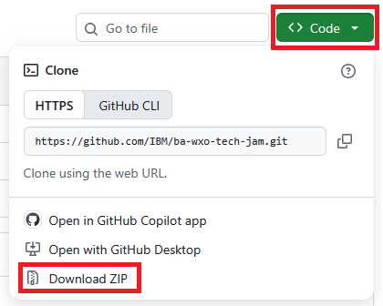

# IBM watsonx Orchestrate Labs

## 1. Overview

On this page you can find all required information to start with the wxO Labs. To run the labs, you will need access to our system of record (SOR). Therefore, you will first grab your user ID and password for that one.

Once you have that, you will be ready to access wxO. You have access to **two wxO tenants**:
1) Tenant 1 - wxO-Playground: To run the Trinity End-to-End Scenario
2) Tenant 2 - TechJamXXX: To build your own Agents as part of the other labs

Next, you have to get a copy of this GitHub onto your local machine.

And before you can start one of the Labs, please complete the mandatory lab first: Introduction to watsonx Orchestrate. Without that, you will not be able to run the other labs.

Finally, you will be ready to pick your lab and start it. The table below lists all **watsonx Orchestrate labs** that we currently have. It is recommended that during the Jam, you prioritize the labs in which you are interested most. **You do not have to perform the labs in a specific order**.

In case you have **questions or issues related to a specific lab**, use the **Slack Channel** linked in the table below. For any **broad questions, comments and feedback** please go to the **[#wxo-tech-jam-main-lobby](https://ibm.enterprise.slack.com/archives/C0C4FTRRF1Q)** Slack channel.

## 2. Grab your system of record credentials

To get your SOR user ID, SOR password and the SOR base URL, complete the following steps:

1. Open the following link in a new browser tab:
   
   **[Jam Usermanagement App](https://jam-usermanagement-jam-usermanagement.swat-dev-roks-vpc-02-464887bc828751e1b00625ca9211fbca-0000.eu-de.containers.appdomain.cloud/UserManagement)**
   
2. Enter the **Email Address** with which you registered for this Tech Jam.
   
3. Click **Retrieve My Credential**.
   
4. Your **SOR user ID** and **SOR password** are shown. **Please take a note of them**, you will require those multiple times while performing the labs.
   
   Hint: In case you have trouble retrieving your SOR credentials, please contact us in the **[#wxo-tech-jam-main-lobby](https://ibm.enterprise.slack.com/archives/C0C4FTRRF1Q)** Slack channel.
   
5. The **SOR base URL** you will need is:
   
   **https://cpd-ibm-cp4ba.swat-dev-roks-vpc-02-464887bc828751e1b00625ca9211fbca-0000.eu-de.containers.appdomain.cloud/bas**
   
   **Please take a note of this URL**, you will require it multiple times while performing the labs.

## 3. Access IBM watsonx Orchestrate

To access wxO, complete the following steps:

1. Open the following link in a new browser tab:
   
   **[IBM watsonx Orchestrate](https://dl.watson-orchestrate.ibm.com/)**
   
3. Enter the **Email Address** with which you registered for this TechJam.
   
   Hint: In case you have trouble accessing wxO, please contact us in the **[#wxo-tech-jam-main-lobby](https://ibm.enterprise.slack.com/archives/C0C4FTRRF1Q)** Slack channel.
   
4. On the next screen, you'll see **two tenants/accounts** that you can access:
   
   - **wxO-Playground** - This is Tenant 1 to run the Trinity End-to-End Scenario (Lab 0)
   - **TechJamXXX** - This is Tenant 2 to build your own Agents (all other Labs)
   
5. Dependant on the lab you pick in the next step, click on the tentant to access it.
   
   Hint: You can switch between the two tenants by clicking in the top right corner on your **user icon** and then **Account**.

## 4. Clone this GitHub

While working on the labs, you will require some solution artifacts that can be found in this GitHub. To copy them onto your local machine, there are several options:

**Option 1:** Clone the github using git CLI.

If you have git CLI installed on your local machine, please run this command to clone it:

```
git clone https://github.com/IBM/ba-wxo-tech-jam.git
```

**Option 2:** Download as ZIP file.

If you don't have the git CLI installed, you can download the content of this GitHub as ZIP file:

1. Open **https://github.com/IBM/ba-wxo-tech-jam**.
   
2. Click the green button **Code**.
   
3. Select **Download ZIP**.
   
   
   
4. Once the download completed, please extract the ZIP onto your local machine.

## 5. wxO Lab List

You are now ready to start with the Labs! But, before you can start one of the Labs, please complete the mandatory lab first: **[Introduction to watsonx Orchestrate](lab-guides/Introduction%20to%20watsonx%20Orchestrate.md)**. Without that, you will not be able to run the other labs. Once you completed the introduction lab, pick your Lab from the following list:

| Lab Title and Link to Lab Instructions                        | Environment   | Approximate Duration | Slack Channel |
| ------------------------------------------------------------- | :-----------: | :------------------: | ------------- |
| [Mandatory: Introduction to watsonx Orchestrate](lab-guides/Introduction%20to%20watsonx%20Orchestrate.md) | n/a (read-only) | ~0.5 hours | [#wxo-tech-jam-main-lobby](https://ibm.enterprise.slack.com/archives/C0C4FTRRF1Q) |
| [Lab 0 — The Trinity Scenario: End-to-End Experience](lab-guides/Lab%20Guide%20-%20Lab%200%20-%20e2e.md) | Tenant 1 - wxO-Playground | ~0.5-1 hours | [#wxo-tech-jam-e2e](https://ibm.enterprise.slack.com/archives/C0C6ELXTGP9) |
| [Lab 1.0 — Worker Agent: Building Your First Agent](lab-guides/Lab%20Guide%20-%20Lab%201.0%20-%20first-agent.md) | Tenant 2 - TechJamXXX | ~1-1.5 hours | [#wxo-tech-jam-first-agent](https://ibm.enterprise.slack.com/archives/C0C6U472RU6) |
| [Lab 1.1 — Worker Agent: Building Tools and Choosing Tool Types](lab-guides/Lab%20Guide%20-%20Lab%201.1%20-%20agents-tools.md) | Tenant 2 - TechJamXXX | ~2–3 hours | [#wxo-tech-jam-agents-tools](https://ibm.enterprise.slack.com/archives/C0C6VU0K474) |
| [Lab 1.2 — Worker Agent: RAG / Knowledge Base](lab-guides/Lab%20Guide%20-%20Lab%201.2%20-%20agents-knowledge-base.md) | Tenant 2 - TechJamXXX | ~2.5–3 hours | [#wxo-tech-jam-agents-knowledge-base](https://ibm.enterprise.slack.com/archives/C0C6U4JE8AJ) |
| [Lab 1.3 — Multi-Agent Systems: Supervisor + Collaborator Patterns](lab-guides/Lab%20Guide%20-%20Lab%201.3%20-%20multi-agent.md) | Tenant 2 - TechJamXXX | ~2-3 hours | [#wxo-tech-jam-multi-agent](https://ibm.enterprise.slack.com/archives/C0C6ZPJUFFE) |
| [Lab 2 — Agentic Workflow: Billing Dispute](lab-guides/Lab%20Guide%20-%20Lab%202%20-%20workflow-billing.md) | Tenant 2 - TechJamXXX | ~4.5-5.5 hours | [#wxo-tech-jam-workflow-billing](https://ibm.enterprise.slack.com/archives/C0C85ME3JDV) |
| [Lab 3 — Agentic Workflow: External Warranty Claim](lab-guides/Lab%20Guide%20-%20Lab%203%20-%20workflow-warranty.md) | Tenant 2 - TechJamXXX | ~ 4-5 hours | [#wxo-tech-jam-workflow-warranty](https://ibm.enterprise.slack.com/archives/C0C8ERZ5YP5) |

**Enjoy our October 2026 watsonx Orchestrate Tech Jam!**

Powered by the IBM Business Automation & watsonx Orchestrate Tiger Team (formerly SWAT), IBM Software Support
