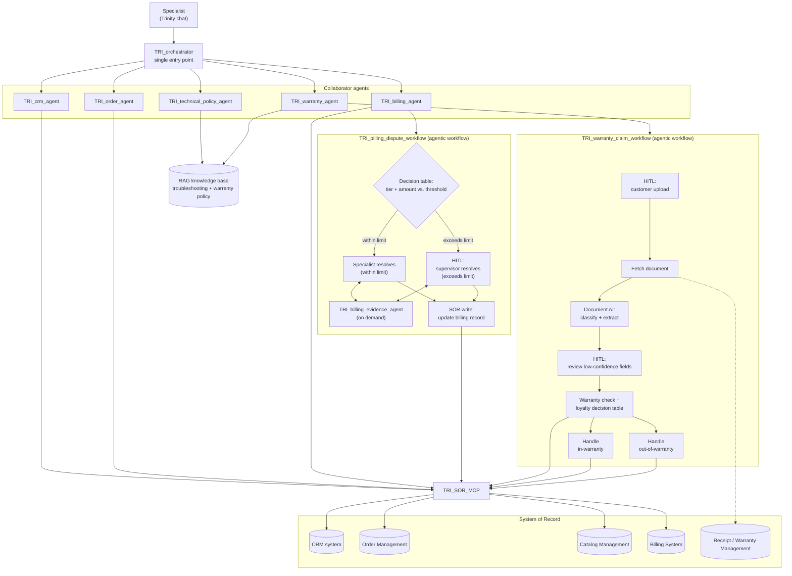

# Lab 0 — The Trinity Scenario: End-to-End Experience

Version 1.0.0 / Author: Olaf Hahnl / Duration: ~45–60 minutes

---

## Notices

This information was developed for products and services offered in the USA. IBM may not offer the products, services, or features discussed in this document in other countries. Consult your local IBM representative for information on the products and services currently available in your area.

INTERNATIONAL BUSINESS MACHINES CORPORATION PROVIDES THIS PUBLICATION "AS IS" WITHOUT WARRANTY OF ANY KIND, EITHER EXPRESS OR IMPLIED, INCLUDING, BUT NOT LIMITED TO, THE IMPLIED WARRANTIES OF NON-INFRINGEMENT, MERCHANTABILITY OR FITNESS FOR A PARTICULAR PURPOSE.

This information could include technical inaccuracies or typographical errors. Changes are periodically made to the information herein; these changes will be incorporated in new editions of the publication.

This information contains examples of data and reports used in daily business operations. To illustrate them as completely as possible, the examples include the names of individuals, companies, brands, and products. All of these names are fictitious and any similarity to the names and addresses used by an actual business enterprise is entirely coincidental.

Trademarks: IBM, the IBM logo, and ibm.com are trademarks or registered trademarks of International Business Machines Corp., registered in many jurisdictions worldwide. Other product and service names might be trademarks of IBM or other companies. A current list of IBM trademarks is available at [www.ibm.com/legal/copytrade.shtml](https://www.ibm.com/legal/copytrade.shtml).

© Copyright International Business Machines Corporation 2026. This document may not be reproduced in whole or in part without the prior written permission of IBM. US Government Users Restricted Rights — Use, duplication or disclosure restricted by GSA ADP Schedule Contract with IBM Corp.

---

## Table of Contents

1. [Lab Introduction](#1-lab-introduction)
   - 1.1 [Lab Scenario](#11-lab-scenario)
   - 1.2 [Lab Setup Instructions](#12-lab-setup-instructions)
2. [Lab Instructions](#2-lab-instructions)
   - [Exercise 1: Identify the Customer](#exercise-1-identify-the-customer)
   - [Exercise 2: Technical Issue — USB-C Charging Fault](#exercise-2-technical-issue--usb-c-charging-fault)
   - [Exercise 3: Warranty Claim — Laptop from Focus Corp Online Shop](#exercise-3-warranty-claim--laptop-from-focus-corp-online-shop)
   - [Exercise 4: Billing Dispute — Duplicate Charge](#exercise-4-billing-dispute--duplicate-charge)
   - [Exercise 5: Warranty Claim — Headset from a Reseller](#exercise-5-warranty-claim--headset-from-a-reseller)
3. [Lab Complete](#3-lab-complete)

---

## 1. Lab Introduction

Trinity is the Agentic AI Partner for the Customer Support Specialist: an agentic AI solution that assists a contact-centre specialist in real time during a customer call. Unlike a chatbot — which responds to a single prompt and stops — Trinity can plan, call backend systems, observe results, and continue until a task is done. In this lab you will experience that difference first-hand by running a full customer support call from end to end.

You are the specialist. A customer calls about two separate issues: a laptop with a hardware fault and a headset purchased from a reseller. Along the way you will encounter billing, warranty, document processing, and human-in-the-loop approval — all handled by Trinity responding to natural-language prompts you type into the chat.

### 1.1 Lab Scenario

**Focus Corp** is a fictional IT hardware manufacturer that sells products through its own online shop and through authorised resellers. It operates a contact centre where customer support specialists handle warranty claims, technical faults, and billing disputes in real time with the help of Trinity.

Trinity assists the specialist — it is not a customer-facing chatbot, and the customer never interacts with it directly. This is a deliberate choice. Agentic systems like Trinity are extremely helpful and work correctly most of the time, but they remain probabilistic: the same prompt can produce a different response on different runs, and an agent can act on an incorrect assumption. Courts have already held companies responsible for what their customer-facing chatbots told a customer, so putting a trained specialist between Trinity and the customer is a risk-management decision, not a limitation of the technology — the specialist always reviews what Trinity returns before relaying it, and remains in control of the call throughout.

In this lab you will follow one call from start to finish, covering five use cases in sequence:

1. **Identify the customer** — look up the customer profile and find the relevant laptop order
2. **Technical support** — retrieve USB-C charging troubleshooting steps from the knowledge base
3. **Warranty claim (online shop)** — check warranty status, browse replacement models, and update the order
4. **Billing dispute** — look up billing records, initiate a dispute, and route it through a supervisor approval workflow
5. **Warranty claim (reseller)** — handle a second product the customer bought outside the Focus Corp shop via a document upload and AI extraction flow

These five use cases are combined into one relatively long conversation so a single lab session can show the breadth of wxO capabilities Trinity relies on — multi-agent orchestration, RAG, tool calls that read and write to the System of Record, and two distinct agentic workflows. Only use case 1, identifying the customer, is a true prerequisite: it establishes the customer, order, and product context that the other four exercises reuse. Use cases 2 through 5 are independent of each other. In a real call they could occur in any order, in any combination, or on their own — they are sequenced here for narrative flow, not because one depends on the previous one.

Trinity is a multi-agent system: the orchestrator never calls a tool itself — it delegates every request to the specialist domain agent best suited to it (customer, order, technical, warranty, or billing). For processes that must run the same way every time rather than vary with the conversation — a document extraction, a supervisor approval, a billing or warranty decision — the relevant agent calls an agentic workflow instead, which executes a pre-defined sequence of steps, decision tables, and human-in-the-loop checkpoints deterministically. The diagram below shows this full picture: five domain agents handling the conversational parts of the call, and two agentic workflows — one for the billing dispute, one for the reseller warranty claim — handling the parts that must be deterministic and auditable.



`Figure 1. Trinity solution architecture — orchestrator, collaborator agents, knowledge base, agentic workflows, and System of Record integrations`

In this lab, Trinity is already built — you experience it as the specialist, end to end. The labs that follow this one show you how each piece of this diagram is actually built: the domain agents, their tools, the knowledge base, and the agentic workflows. We will not go into that here; for now, focus on what Trinity can do for the specialist, not on how it is built.

### 1.2 Lab Setup Instructions

#### 1.2.1 Prerequisites

Lab 0 uses a pre-deployed Trinity solution on the **TechJam(EMEA|APAC|Americas)** tenant.

Before starting this lab, confirm the following:

- You have received an invitation to the **TechJam(EMEA|APAC|Americas)** tenant, which you log in to with your IBMid.
- You have retrieved your **username** (format `usrXXX`) and **password** for the SOR from [Setup & Event Credentials — Step 1: Trinity System of Record (SOR) credentials](Setup%20%26%20Event%20Credentials.md#step-1-trinity-system-of-record-sor-credentials) (if you completed the event preparation, you will find these values in `labs/event.env`) — you will enter these once, after your first prompt in Exercise 1, to configure your member-scoped credential.

> **Note:** You are not building anything in this lab — all agents, tools, workflows, and knowledge bases are already in place. On this tenant you have the **Builder** role: you have full access to build and test, but for this lab you will only use the chat interface.

#### 1.2.2 Access the Trinity chat

1. Navigate to the watsonx Orchestrate base URL (for a TechJam event: [https://ap-southeast-1.dl.watson-orchestrate.ibm.com](https://ap-southeast-1.dl.watson-orchestrate.ibm.com)).
2. Log in with your **IBMid** (not your SOR credentials).
3. If you have access to multiple wxO tenants, you will see an account selection page — select **TechJam(EMEA|APAC|Americas)**. If you have access to only one tenant, you will land directly in TechJam(EMEA|APAC|Americas) without a selection page.


`Figure 2. Account selection page — select TechJam(EMEA|APAC|Americas) if prompted`

4. As a Builder you have access to the full wxO interface — to reach the chat, use one of these methods: click the **hamburger menu** (☰) in the top-left corner and select **Chat**, or click the second icon (**Chat**) in the left-hand toolbar.


`Figure 3. Navigating to the chat interface`

5. In the middle of the chat window, click the agent selector (the drop-down below the message box, next to the paperclip icon) and select **Trinity Orchestrator Agent**.

> ⚠️ **Important:** Pay close attention to select exactly **Trinity Orchestrator Agent** from the agent list. Other agents with similar names (such as individual specialist agents: CRM Agent, Order Agent, Billing Agent, etc.) may be available in the selector. The Orchestrator Agent is the single entry point for all prompts in this lab — it automatically routes your messages to the appropriate specialist agent. Selecting a different agent directly will bypass the orchestration and lead to unexpected results.


`Figure 4. Selecting the Trinity Orchestrator Agent`

> **Note:** You will type every prompt in this lab into this chat panel. Trinity routes your messages to the appropriate specialist agent automatically — you do not need to select a different agent per topic.

[↑ Back to Table of Contents](#table-of-contents)

---

## 2. Lab Instructions

The exercises that follow are built around three principles:

1. **Two depths of engagement.** Choose how deep you want to go:
   - **Just do it** — perform the steps, mostly entering prompts and filling in data, and see the Trinity use cases play out elegantly in support of the specialist.
   - **Do it, and look under the hood** — in addition to the steps, read the explanation of how things work and confirm it by expanding the reasoning trace and looking back at earlier chat responses (**Under the hood**), and branch into a new chat to try the alternate prompts suggested (**Going further**), to see how elegantly and flexibly the agentic solution is implemented, exploiting many of the core capabilities of an agentic platform like watsonx Orchestrate.
2. **Dialog as narrative.** Each exercise opens with a short Customer/Specialist exchange — a storytelling device that motivates the prompt that follows, grounding it in a realistic support conversation rather than a bare instruction.
3. **A scripted path.** The System of Record data is crafted to support this specific sequence of prompts, not arbitrary alternatives. Stay on the scripted path — this is a sample solution built for education, not a production-ready one. Dates in the System of Record are relative to when the scenario is run, so time-window prompts (e.g., "within the last four weeks") keep matching regardless of when you do the lab. Dates on uploaded documents are fixed, but chosen so the outcome (in-warranty or not) stays stable. Either way, exact dates, day-counts, and screenshots you see may differ slightly from what's shown in this guide.

---

### Exercise 1: Identify the Customer

In this exercise you will establish the customer profile that all subsequent exercises depend on, along with the order and product context that Exercises 2–4 build on. Exercise 5 introduces a different, externally-purchased product with no order record, so it carries over only the customer context.

**Dialog:**

*Customer: "Hi, I need help with two things today. Let's start with the laptop I ordered about four weeks ago — it's not charging properly."*

*Specialist: "I'm happy to help with both. Could I get your customer ID, or the order number, so I can pull up your account?"*

*Customer: "Sure, my customer ID is C-3DBZFE."*

The specialist folds the customer ID, the approximate order age, and the laptop detail into a single prompt for Trinity.

**Step 1.** Copy and paste the following prompt into the Trinity chat and press **Enter** or click **Send**:

```
List customer details and orders for customer id C-3DBZFE within last four weeks, show details for those containing a laptop
```


`Figure 5. Trinity asks you to connect your System of Record credential before it can run the request`

**Step 2.** Trinity's connection to the System of Record is member-scoped, so before it can call the CRM, Order, and other backend tools on your behalf, it asks you to connect your own credential. This is a one-time step. In the **Connect to app** card, enter the **Username** (`usrXXX`) and **Password** you retrieved in the prerequisites, then click **Connect**. Trinity then continues with your request automatically.


`Figure 6. Trinity returns the customer profile and the matching laptop order`

> **Note:** Once connected, Trinity reuses this credential for every System of Record call for the rest of the lab — you will not be asked again. If you mistyped your username or password, you can correct it later under **Settings → Member credentials** (user icon, top right).

> **Note:** It is the nature of LLM-based systems that response wording and formatting vary between runs — for example, a table may come back horizontal (one row, many columns) in one run and vertical (two columns, many rows) in another. The information — customer profile and the correct order — should be present regardless of exact phrasing or layout.

**Step 3.** Verify that the response contains:

- Customer name: **Marie Smith**, status: **Platinum**
- Order **O-DF340K** with item **Focus Gamer Z2** (laptop, gaming, $2,500) — you may need to scroll the table to the right to see all of this

*Specialist: "I can see an order for a Focus Gamer Z2 — is that the laptop you're having trouble with?"*

*Marie (Customer): "Yes, that's the one."*

> **Under the hood:**
>
> Click **Show reasoning** next to the Trinity Orchestrator Agent's response to see how it got here.
>
> From that one sentence, the LLM extracted four separate pieces of information — the customer ID, the "list orders" intent, a four-week time window, and the laptop product filter — converted "four weeks" into the 28-day input the Order agent's tool actually expects, and called the CRM agent too, since Trinity always resolves customer identity before answering: two agents, one response, in a single turn. None of this is hardcoded: ask for "the last 10 days" instead, and the same reasoning adapts the call to whatever the worker agents can actually accept.

> **Note:** Trinity has now established the customer identity, order, and product in its working context. All subsequent exercises in this session use this context without you needing to re-state it.

> **Going further — widen the time window:** Click **New chat**, then type:
>
> ```
> List customer details and orders for customer id C-3DBZFE within last three months, show details for those containing a laptop
> ```
>
> With a wider window, a second laptop order (**O-Q19F12**, Focus P1) falls into range alongside **O-DF340K** — Trinity now returns two matching orders instead of one.
>
> Change the product filter instead and the same pattern applies in reverse. Type:
>
> ```
> List customer details and orders for customer id C-3DBZFE within last 20 days, show details for those containing a power supply
> ```
>
> Only **O-34LOK3** (Focus Power supply 150W) falls within the last 20 days — Trinity returns a single matching order. Return to your original chat before continuing to Exercise 2.

*Some customers don't have their customer ID on hand: "Actually, I don't have my customer ID with me — but I do have the order number, it's O-DF340K."*

> **Going further — identify by order ID instead:** The customer could just as easily have led with the order number instead of a customer ID. Either reuse the chat from the previous "Going further" examples or click **New chat** in the left-hand panel — reusing the main conversation would mean Marie Smith's information is already in context, which hides the point of this example — then type:
>
> ```
> Show me order O-DF340K and the customer who placed it
> ```
>
> Click **Show reasoning** on the response: with no customer ID in the prompt, Trinity cannot call the CRM agent directly. It calls the Order agent first, which resolves the order directly from the order ID, then extracts the `customer_id` from that result to make a second, chained call to the CRM agent. Two different entry points, two different reasoning paths, the same destination — no hard-coding, all based on agentic reasoning. Return to your original chat before continuing to Exercise 2.

✅ Exercise 1 complete. You have identified the customer and their relevant order. In Exercise 2, you will ask Trinity for troubleshooting guidance for the laptop's USB-C charging fault.

[↑ Back to Table of Contents](#table-of-contents)

---

### Exercise 2: Technical Issue — USB-C Charging Fault

In this exercise you will retrieve troubleshooting steps from Trinity's technical knowledge base. No system-of-record tools are called — the Technical Agent retrieves its answer entirely from a set of structured documents in the knowledge base.

**Dialog:**

*Specialist: "How can I help you with this laptop?"*

*Marie (Customer): "The first laptop I received for my order had display issue. This replacement won't charge via USB-C, I tried everything."*

The specialist paraphrases the USB-C charging fault and folds in the catalog item ID (**CI-D412F3**) already identified from the order into a single prompt for Trinity.

**Step 1.** Type the following prompt and press **Enter**:

```
Provide troubleshooting tips when laptop cannot be loaded via USB C for item with item id CI-D412F3
```


`Figure 7. Trinity returns the troubleshooting procedure from the knowledge base`

**Step 2.** Verify that the response includes at minimum, matching the `TRI_technical_troubleshooting_laptop.txt` knowledge document shown alongside the response:

- Verifying the power adapter wattage and compatibility (the correct adapter is the Focus Power supply 150W)
- Inspecting the USB-C cable and port for damage
- Checking the power source

> **Note:** Trinity retrieves these steps verbatim from its knowledge base — it does not invent them from training data. The five steps should match the Focus Corp troubleshooting guide exactly.

*Specialist: "Let's see which points on our troubleshoot list you did not try yet and if they help to resolve the problem."*

*Marie (Customer): "Unfortunately, I have already tried these out as I found a similar support document on your homepage. What can we do now?"*

> **Going further — a different item, a different document:** Click **New chat**, then type:
>
> ```
> Provide troubleshooting tips for headphones (CI-WHP001) that no longer turn on
> ```
>
> The Technical Policy Agent retrieves from `TRI_technical_troubleshooting_headphones.txt` instead — the same reasoning, grounded in a different document, because the knowledge base holds separate troubleshooting guides per product category. Return to your original chat before continuing to Exercise 3.

The specialist paraphrases the stalled troubleshooting into a new prompt for Trinity.

**Step 3.** Type the following prompt and press **Enter**:

```
The technical issue could not be resolved. What are the options to replace the laptop having issues?
```


`Figure 8. Trinity confirms in-warranty status and presents the four resolution options`

**Step 4.** Verify that the response:

- Is headed **Warranty Resolution Options** — Trinity determined internally that the laptop is still **in warranty**, from the item ID already established, without the specialist stating it
- Lists four options: **replace with the same model**, **gift certificate**, **refund**, **replace with a different model** — matching the `TRI_warranty_in_warranty_options.txt` knowledge document shown alongside the response

> **Under the hood:**
>
> Click **Show reasoning** on the last response, and look at Step 1 within that reasoning trace — the request the Orchestrator phrased to the Warranty Agent:
>
> "message": "KB options lookup: **under_warranty true** for **order item OI-TDDU12** (laptop). Customer tier Platinum."
>
> The Warranty Agent requires the order item ID in addition to the warranty status. The order item ID (`OI-TDDU12`) was implicitly selected by specifying the catalog item ID (`CI-D412F3`) in Step 1 of this exercise — within the order identified in Exercise 1, that catalog item matches exactly one order item, `OI-TDDU12`. `under_warranty: true` was determined automatically from the order record for that order item ID — go back to the Exercise 1, Step 2 response in your own chat and scroll its table to the far right to see the `in_warranty` column (not visible in Figure 6's cropped screenshot). Neither resolution is explicitly hard-coded: both are inferred from the Warranty Agent's own description of what it can do and what inputs it needs, and from what is in the Orchestrator's context due to prior interactions.
>
> Now look at Step 2 within the reasoning trace of either of the last two prompts: for the troubleshooting steps, the Orchestrator routed to the Technical Policy Agent, which searched the knowledge base and identified `TRI_technical_troubleshooting_laptop.txt` as the best-matching source for this item — not a document picked by item ID lookup, but by the agent reasoning over the item's category and the fault description. For the resolution options, the same agent instead grounds its answer in `TRI_warranty_in_warranty_options.txt` — a different question, routed to a different document, within the same knowledge base.

✅ Exercise 2 complete. You have retrieved USB-C troubleshooting guidance from the knowledge base, and confirmed warranty resolution options for the laptop. In Exercise 3, you will proceed with the warranty claim.

[↑ Back to Table of Contents](#table-of-contents)

---

### Exercise 3: Warranty Claim — Laptop from Focus Corp Online Shop

In this exercise you will browse replacement models within the customer's price range and update the order — a two-prompt sequence completing the warranty resolution flow for an online-shop purchase.

**Dialog:**

*Specialist: "Given the in-warranty status, you have four options: replace with the same model, a gift certificate, a full refund, or replace with a different model. How would you like to proceed?"*

*Marie (Customer): "I've lost confidence in the Focus Gamer Z2. I'd like to switch to another model."*

The specialist paraphrases Marie's choice using the $200 price range guidance from the warranty options into a single prompt for Trinity.

**Step 1.** Type the following prompt and press **Enter**:

```
Customer wants a different model within a $200 price range of the original item.
```


`Figure 9. Trinity returns matching catalog items within the price range`

**Step 2.** Verify that the response includes:

- **Focus Gamer Z2** (CI-D412F3, $2,500) — the original model
- **Focus Gamer Z2+** (CI-D412F4, $2,700) — larger screen

*Specialist: "I see we have the Z2+ model with a larger screen — it's normally $200 more, but in this warranty replacement at no extra cost."*

*Marie (Customer): "That sounds great. Let's go with the Z2+. I'm hoping this one will work fine."*

The specialist paraphrases Marie's choice to select the Z2+ model into a single prompt for Trinity.

**Step 3.** Type the following prompt and press **Enter**:

```
Customer wants to replace the laptop in her current order with the Focus Gamer Z2+
```


`Figure 10. Trinity confirms the order update — Focus Gamer Z2+ will be shipped on return of the original`

**Step 4.** Verify that the response confirms the order has been updated with the Focus Gamer Z2+ replacement.

> **Note:** This is a live write to the Focus Corp System of Record. The order for `O-DF340K` has been updated in the backend — you can verify this by asking Trinity to look up the order again after the exercise.

*Specialist: "Good, we have updated your order. You mentioned there was something else. How can I help you?"*

> **Under the hood:**
>
> Click **Show reasoning** on the Step 1 response and on the Step 3 response to see how Trinity got there.
>
> In the Step 1 response's reasoning trace, expand the reasoning steps 1 & 2. Trinity understood the intent and extracted key facts: "different model" → search the catalog; "original item" → category **laptop**, sub-category **gaming** (from the order item identified in Exercise 1); "$200 price range" → minimum price of $2,300 ($2,500 − $200) and maximum price of $2,700 ($2,500 + $200). It composed a message to the Order Agent:
>
> ```
> "message": "Catalog search: category laptop, sub_category gaming, minimum_price 2300, maximum_price 2700"
> ```
>
> The Order Agent received this information and understood how to search the catalog: filter by the category and sub-category provided, find all items within the price range specified, and return matching results. In a production environment, the Order Agent would have the flexibility to search with or without a price range, or filter by category alone — all combinations the Orchestrator infers from the conversation intent and from the agent's own description of what it can do.
>
> In the Step 3 response's reasoning trace, expand the reasoning steps 1 & 2. Trinity understood the intent and extracted: "replace" → order update; "the laptop" → **order item ID** OI-TDDU12 (the laptop in Marie's order); "current order" → **order ID** O-DF340K (established at the start); "Focus Gamer Z2+" → **catalog item ID** CI-D412F4. It composed a message to the Order Agent:
>
> ```
> "message": "Order update: order_id O-DF340K, order_item_id OI-TDDU12, catalog_item_id CI-D412F4"
> ```
>
> None of this is hardcoded: all fact extraction and reasoning is inferred from the Order Agent's description of what it can do and what inputs it needs.

> **Going further — wider price range:** Click **New chat** or reuse the chat from earlier "Going further" examples, then type:
>
> ```
> Customer wants a different model within a $500 price range of the original item.
> ```
>
> Trinity recalculates the price range: minimum $2,000 ($2,500 − $500) and maximum $3,000 ($2,500 + $500). With this wider range, four alternatives now match instead of two — the broader filter surfaces more options for Marie to choose from. Return to your original chat before continuing to Exercise 4.

✅ Exercise 3 complete. You have processed a full warranty replacement: checked eligibility, browsed replacements, and updated the order. In Exercise 4, you will handle the billing dispute Marie raises for the same order.

[↑ Back to Table of Contents](#table-of-contents)

---

### Exercise 4: Billing Dispute — Duplicate Charge

In this exercise you will look up billing records, identify a duplicate charge, and initiate a structured billing dispute workflow. The workflow routes automatically through a decision table and — because the amount exceeds the specialist's approval threshold — escalates to a supervisor review.

> 💡 **If you get stuck:** Create a new chat and establish the customer context by copy pasting:
> ```
> List customer details and orders for customer id C-3DBZFE within last four weeks, show details for those containing a laptop
> ```
> Then restart this exercise from Step 1. This ensures the customer context is available for the billing dispute workflow.

**Dialog:**

*Marie (Customer): "Yes, I got billed twice for the laptop in this order. That is wrong, can you please correct that."*

*Specialist: "Let me look into that for you."*

The specialist documents the billing issue and paraphrases it into the prompt for Trinity.

**Step 1.** Type the following prompt and press **Enter**:

```
Customer is disputing second charge for the order. The reason is "Duplicate charge for single order"
```

> **Note:** The Billing Agent has handed off to the billing dispute workflow. The chat is now driven by structured forms rather than by free-text agent responses for the remainder of this exercise.


`Figure 11. Trinity returns both billing records for order O-DF340K`

**Step 2.** Verify that the response shows two billing records:

| Billing ID | Amount | Description | Status |
|------------|--------|-------------|--------|
| B-QP23SD | $2,530 | Initial charge | active |
| B-TDDU12 | $2,500 | Shipping before laptop return | active |

> **Under the hood — Enforcement of deterministic rules and explicit path modeling:**
>
> Agentic workflows exist because LLM agents are non-deterministic. An agent cannot reliably enforce business rules — you could instruct it to check conditions, but agent reasoning will approximate those rules rather than enforce them. Workflows solve this by forcing two foundational architectural choices:
>
> **1. Deterministic rule enforcement:**
> - Minimum active records guardrail — The workflow first checks that at least two active billing records exist for this order. If only one active billing record remains (perhaps because another was already resolved in a previous dispute or other action), the workflow exits gracefully and informs the specialist rather than prompting for input that can never succeed.
> - Explicit record selection — The specialist must explicitly identify which record to dispute with a deliberate click, not a conversational guess that Trinity infers and acts on unilaterally.
> 
> Both are exactly the kinds of deterministic, auditable gates that workflows are designed for — gates that guarantee a condition rather than approximate it.
>
> **2. Explicit path modeling:**
> Workflows force you to model every possible path through the business process, not just the happy path. In this exercise, the customer confirms they want to dispute, and the process continues. But workflows must account for all possibilities: after the specialist reviews the billing records with the customer and explains the charges, the customer might realize they understand why the second charge occurred and decide they don't want to dispute after all. The workflow includes a prescribed exit path to handle that scenario gracefully — should a specialist click "Cancel" at the record-selection step, the workflow exits cleanly without creating a dispute. This explicitness is not a limitation; it is a feature. It ensures that every possible outcome is handled intentionally, not left to chance or an agent's probabilistic guess.

*Specialist: "I see two billing records for your order. The original one is $2,530 and then a second one for $2,500. The comment says this is due to the fact that we sent the second device before you had returned the defective one. Did you return the original laptop?"*

*Marie (Customer): "Yes I returned it on the same day. That is why the second billing is wrong."*

Based on Marie's confirmation, the specialist identifies and selects the second billing record to dispute.

**Step 3.** In the billing records table, select the second record (B-TDDU12, $2,500, "Shipping before laptop return") by clicking its radio button, then click the **Continue** button to initiate the dispute processing.

> **Going further — test the entry guardrail:** After completing this exercise, open a new chat session to see the guardrail in action. First, re-establish the customer context by copy pasting:
> ```
> List customer details and orders for customer id C-3DBZFE within last four weeks, show details for those containing a laptop
> ```
> Then copy paste the dispute prompt:
> ```
> Customer is disputing second charge for the order. The reason is "Duplicate charge for single order"
> ```
> Since you already resolved the second billing record (B-TDDU12) as cancelled in this exercise, only one active billing record now remains for this order. The workflow's entry guardrail will fire: instead of showing the record-selection form, Trinity will inform you that at least two active billing records are required to open a billing dispute. This demonstrates how the workflow enforces the minimum-records rule deterministically — a new dispute cannot even start without meeting that condition.


`Figure 12. The billing dispute workflow informs the specialist that supervisor review is required`

**Step 4.** Verify that the workflow presents a message stating that the disputed amount ($2,500) exceeds the direct approval limit for a Platinum customer and that supervisor review is required within approximately 5 business days.

> **Under the hood — Business rules are applied, not expressed:**
>
> Notice what just happened: the workflow automatically evaluated the disputed amount against the approval threshold for a Platinum customer and made a routing decision. This decision was not left to an agent's interpretation or a prompt. The rule — "$2,500 exceeds the Platinum tier limit, therefore escalate to supervisor" — is hard-coded into a decision table and applied deterministically every single time.
>
> This matters because we're dealing with money. You could instruct an agent: "If the amount exceeds the approval threshold, escalate to a supervisor." But on a bad run, the agent might misread the amount, miscategorize the customer tier, apply a different rule, or simply forget to escalate. Each failure costs the company. Agentic workflows exist precisely because agent reasoning cannot be trusted with decisions that must be consistent, auditable, and guaranteed — especially financial ones. The workflow doesn't hope the agent will follow the rule; it enforces it.

*Specialist: "I have created a billing dispute for the duplicate billing record. The system informed me that supervisor review is required to resolve it and it may take up to 3–5 business days before you receive a response. Thanks for your patience."*

*Marie (Customer): "Thanks for that. I appreciate your help."*

*Specialist: "Is there anything else that I can help you with today?"*

The workflow now switches to the supervisor role.

> **Important:** In a production environment, the specialist would be done at this point — a new task would appear in the supervisor's chat history on the left-hand side, alerting them that a billing dispute requires their approval. Since this lab uses a single user per participant, you continue in the supervisor role to complete the approval process. The highly visible **"You are now acting in the supervisor role."** banner makes the role switch explicit, so you understand the context shift.


`Figure 13. The supervisor view opens, showing customer and dispute details`

**Step 5.** Verify that the supervisor view shows:
- Header banner: **"You are now acting in the supervisor role."**
- Customer: **Marie Smith — Platinum**
- Order: **O-DF340K**
- A read-only table of the billing records for this order
- A **Request information** field where you can enter a free-text prompt to gather additional details

> **Under the hood — Multi-user agentic workflows:**
>
> In a production environment, what you experienced in this lab is a unique feature of wxO's agentic workflows: native multi-user involvement without a separate task management system. When the specialist completed the dispute entry in Step 3, the workflow automatically created a new chat conversation in the supervisor's chat list on the left-hand side with a notification that a billing dispute requires their approval. The supervisor can then open that conversation to review the details and make their decision — all within the same chat interface where they interact with customers and other agentic systems.
>
> This is fundamentally different from traditional workflow management systems, which rely on task lists — centralized queues where employees see assigned tasks, update their status, and complete them from a dedicated task interface. Agentic workflows, by contrast, deliver work through the messaging interface itself: incoming work appears as new conversations in your chat history, you're notified when work arrives, and you complete it by interacting with the workflow within that conversation. There is no separate task list to navigate.
>
> This makes agentic workflows powerful for conversational, multi-user scenarios where work flows naturally through chat. However, they are not a replacement for traditional workflow systems. Tasks that require complex queuing, prioritization, load-balancing across many employees, detailed status tracking, or separation between assignment and execution still benefit from a dedicated workflow management platform. Agentic workflows add unique capabilities to the agent space — they do not deprecate the workflow management category. Both have their place, and the choice depends on whether the work is conversational (agents) or task-managed (workflows).

*Supervisor: "Looking at these records, Marie claims she returned the first laptop on the same day, but the $2,500 charge is still active. This is a high-value item and I need to verify the return before approving the dispute. I should also check for any fraud indicators given the amount involved."*

The supervisor enters a request for both the shipping records and a fraud risk assessment.

**Step 6.** In the **Request information** field, enter the following prompt and press **Enter**:

```
Provide fraud risk info and show shipping records
```


`Figure 14. The sub-agent returns fraud risk assessment and shipping records`

**Step 7.** Verify that the response includes:

- **Fraud risk assessment:** Marie Smith is in good standing with a **Low risk level**
- **Three shipping records:**

| Shipment ID | Status | Description |
|-------------|--------|-------------|
| S-WOD3KD | delivered | Original outbound delivery |
| S-KWL21S | delivered | Replacement laptop delivery |
| S-H6A0OS | returned | Laptop return |

The supervisor could ask additional questions using the same **Request information** field, but in this case `S-H6A0OS` (status: **returned**) confirms the customer did return the first laptop, and combined with the low fraud risk assessment, they have sufficient information to proceed with the approval decision.

> **Under the hood — The hybrid workflow pattern:**
>
> wxO agentic workflows support a continuum of implementation patterns, ranging from fully pre-modelled deterministic flows to largely non-deterministic implementations where the workflow is essentially a call to an agent. The billing dispute workflow you are experiencing sits in the middle of this spectrum.
>
> The **deterministic backbone** consists of:
> - Entry guardrails that enforce business rules (at least two active records must exist)
> - Explicit record selection by the specialist (no agent guessing)
> - A decision table that routes based on customer tier and amount (guaranteed, repeatable routing)
> - Structured HITL forms for specialist and supervisor decisions
>
> But the **non-deterministic loop** is intentional: the supervisor's **Request information** field is a free-form prompt that gets passed to an agent. Why? Because billing disputes are knowledge-intensive. The exact information a supervisor needs to make a decision varies from case to case — it might be shipping records, fraud history, customer communications, inventory status, or something not yet anticipated. Rather than hard-code every possible information requirement, the workflow delegates this to an agent that can reason about what information is needed, call the right tools, synthesize results, and return them to the supervisor.
>
> This hybrid approach achieves the best of both worlds: deterministic enforcement of non-negotiable rules (entry conditions, routing thresholds, approval authority) combined with flexible agent reasoning for information gathering that cannot be pre-modelled.

> **Going further — additional agent capabilities:**
>
> The embedded agent in the **Request information** field supports multiple tool capabilities for demonstration purposes. In addition to shipping records and fraud risk assessment, you could ask:
> ```
> Show me the customer details
> ```
> This would retrieve and display Marie Smith's full customer profile and contact information — a third tool available to the agent for gathering context.

*Supervisor: "The shipping records confirm that the laptop was received a few days later, and Marie's fraud risk is low. This is a straightforward case — the second charge should never have been active after the return. I can move forward and approve the cancellation."*

**Step 8.** Click **Make Decision** to advance to the decision form.


`Figure 15. The decision form — select the billing record to action and enter a reason`

**Step 9.** In the **Billing Dispute Decision** form:
- Select the billing record with **$2,500** and description **"Shipping before laptop return"** from the table.
- In the **Dispute verdict** dropdown field, select **Approve Cancellation**.
- In the **Reason** field, enter: `Item was returned but charge not cancelled`


`Figure 16. The supervisor completes the decision form`

> **Under the hood — Forms enforce deterministic user interaction:**
>
> The **Billing Dispute Decision** form you are about to complete is not a free-text interface — it is a structured form. This distinction is critical for governance:
>
> - **Information presentation:** The form displays exactly what the solution designer wants the supervisor to see, in exactly the order and format intended. There is no ambiguity about what data the supervisor is reviewing or how it is presented.
> - **Input constraints:** The **Dispute verdict** dropdown field only offers valid choices (`Approve Cancellation`, `Reject Cancellation`). The supervisor cannot type an invalid verdict; they can only select from the predefined options. This guarantees that every decision is one the workflow knows how to handle.
> - **Required fields:** The asterisks (*) mark mandatory input fields — the **Reason** field, for example. The form prevents submission until all required fields are populated. This ensures that every decision is documented and auditable.
>
> Combined, forms enforce deterministic user interaction: the supervisor cannot deviate from the expected inputs, cannot omit required information, and cannot submit incomplete or malformed data. For financial decisions and compliance-critical workflows, this determinism is not a limitation — it is essential governance.

> **Going further — test the form validation:**
>
> Before clicking **Complete**, test the form's validation logic by deliberately clearing a required field. Try one of these:
> - Click the **x** next to the **Dispute verdict** dropdown to clear the selected option, or
> - Delete all the text in the **Reason** field
>
> Then click the **Complete** button. The form will refuse to submit and display an error message indicating which required fields are missing. This demonstrates form validation in action — the workflow will not allow submission of an incomplete or invalid decision, ensuring data integrity and compliance. Reset the field and re-enter the information, then proceed to Step 10.

**Step 10.** Click the **Complete** button.


`Figure 17. The billing dispute is resolved — B-TDDU12 has been cancelled`

**Step 11.** Verify that the confirmation shows:
- Header: **"Billing dispute for order O-DF340K completed"**
- Decision: **Approve Cancellation**
- New status: **resolved-cancelled**
- Reason: **"Item was returned but charge not cancelled"**

An audit log entry has also been created automatically, capturing the entire workflow history including the prompts that were executed (e.g., "Provide fraud risk info and show shipping records"), the information gathered, and the supervisor's decision. This log is generated dynamically using an LLM prompt, so the exact wording may vary, but it will contain the essential workflow details for compliance and record-keeping purposes.

> **Under the hood — Generative prompts for flexible text synthesis:**
>
> The audit log entry demonstrates another hybrid capability: combining deterministic workflow with generative AI. The billing dispute workflow branches across multiple paths — supervisor review vs. specialist direct resolution, Approve vs. Reject, different evidence queries or none. A static template would require complex, brittle nested conditionals to generate a coherent narrative for every possible combination.
>
> Instead, this workflow uses a Generative prompt node — a single-shot LLM call that receives all populated workflow variables and synthesizes a coherent audit narrative. The LLM generates text flexibly without tool use, iterative reasoning, or loops. One call, one output, zero branching logic required. This is where generative AI excels: transforming structured data into natural language that captures the essentials for auditing and compliance, regardless of which path the workflow took.

**You are now acting again in the specialist role.**

You return to continue the conversation from where it paused:

*Specialist: "Is there anything else that I can help you with today?"*

> **Important:** In a production environment, the supervisor's dispute resolution would happen asynchronously in the background — the specialist would not pause the call waiting for approval. The conversation with the customer would continue naturally; the specialist would later be notified that the dispute was resolved and could relay the outcome on a follow-up call or in writing. Here, we interrupt the conversation to walk through the supervisor's steps, then resume as the specialist to maintain narrative flow. The **"You are now acting again in the specialist role."** banner marks this role switch.


`Figure 18. The specialist role return banner`

> **Note:** The billing record has been updated in the Focus Corp System of Record. Running this exercise a second time on the same session will trigger a guardrail — Trinity will detect that B-TDDU12 is already cancelled and decline to start a new dispute.

✅ Exercise 4 complete. You have handled a billing dispute through a full supervisor-approval workflow. In Exercise 5, you will handle a warranty claim for a product the customer bought outside the Focus Corp shop.

[↑ Back to Table of Contents](#table-of-contents)

---

### Exercise 5: Warranty Claim — Headset from a Reseller

In this exercise you will handle a warranty claim for a product that was not purchased through Focus Corp. Because there is no order record, Trinity cannot look up the purchase date — instead it triggers a document processing workflow where the customer uploads their proof of purchase and the AI extracts the relevant details.

> 💡 **If you get stuck:** Create a new chat and establish the customer context by copy pasting:
> ```
> List customer details and orders for customer id C-3DBZFE within last four weeks, show details for those containing a laptop
> ```
> Then restart this exercise from Step 1. This ensures the customer context is available for the warranty claim workflow.

**Dialog:**

*Marie (Customer): "As you are asking, there is one more thing. I bought a headset made by your company from a local store. It is no longer working but the store closed meanwhile. I would like to claim warranty."*

*Specialist: "Sure, that is no problem. Let's go through that together."*

The specialist paraphrases the warranty request and enters the prompt in Step 1.

**Step 1.** Type the following prompt and press **Enter**:

```
Customer has a headset they bought from a reseller — it stopped working and they want warranty.
```

Trinity routes to the Warranty Agent, which starts the warranty claim workflow.


`Figure 19. The workflow displays the customer's masked credit card information and email address on file for confirmation`

**Step 2.** Verify that the form displays:
- **Credit card on file:** Masked card ending in 9012 (confirmed with customer)
- **Email address:** marie.smith@example.com
- **Fraud risk status:** Low
- **Customer tier/status:** Platinum

These details give the specialist a general understanding of Marie's background with Focus Corp — her payment method, contact information, fraud profile, and loyalty tier — before deciding how to proceed with the warranty claim.

> **Under the Hood — Data Protection via Platform Masking**
>
> Notice the credit card number is **masked** (showing only the last four digits: `****-****-****-9012`). This masking is enforced by a **platform-level data protection feature**, not by the workflow or agent:
> - The solution declares the `card_number` field as sensitive
> - The platform applies a regex masking pattern we have specified that reveals only the last four digits, allowing the specialist and customer to verify it is the correct card on file without exposing the full number
> - **Both users and administrators** see only the masked value — the raw card data never surfaces in the UI, logs, or reasoning traces
> - This prevents accidental exposure of PII and meets regulatory requirements without adding application-level masking logic
>
> Even if a specialist tries to copy the field or inspect the underlying form data, only the masked representation is visible.

*Specialist: "To process your warranty claim, I'll need a receipt or warranty card for the headset. Would you prefer to upload it now or handle it later?"*

*Marie (Customer): "I can upload it right now — I have it handy."*

*Specialist: "Perfect. I'll send you an email with upload instructions. Once you've uploaded the document, just let me know and we can move forward."*

**Step 3.** Click **Upload Now**.


`Figure 20. Trinity confirms upload instructions have been sent and waits for the customer to confirm`

*Specialist: "The email with the upload instructions has been sent. Please check your inbox."*

*Marie (Customer): "Yes, I have it. I'm uploading the photo now."*

*[Customer uploads the document...]*

*Marie (Customer): "I've uploaded a photo of the receipt taken with my mobile."*

*Specialist: "Thank you. Let me check if it's arrived—one moment."*

**Step 4.** Click **Document Uploaded**.

Trinity fetches the document, classifies it as a receipt, and extracts the purchase details. The purchase date field falls below the confidence threshold (the photo was taken with a partially obscured lens). The HITL extraction review form opens automatically.

> **Note:** In this scenario, no actual document upload takes place. Trinity retrieves a pre-loaded PDF from the CRM for this customer. The upload steps are narrative framing — the document returned is always the same sample receipt for `C-3DBZFE`.

*Specialist: "Your receipt has arrived and was automatically analyzed. I can see there's some dust on your smartphone lens, which affected the photo quality. Let me quickly validate the extracted data to make sure everything is correct."*

*Marie (Customer): "Of course."*


`Figure 21. The extraction review form — one field is flagged for low confidence`

**Step 5.** Click on the **View** link to open the Review document extraction form.

**Step 6.** Observe that no value was extracted for the **purchase_date** field. Enlarge the document on the left-hand side by clicking the magnifying glass with the **+** a couple of times. Observe that the last digit in the purchase date is somewhat obscured, potentially by dust on the mobile's lens. That is the reason the data extraction failed here. Notice that most of the other fields were extracted successfully, and fields like **Reseller** that were not found are not marked because they are not required.

**Step 7.** Enter **2024-05-15** into the **purchase_date** field. This date can be read by a human when the document is enlarged enough to see through the dust obscuration.

> **Under the Hood — Document Processing Pipeline**
>
> This workflow demonstrates a **deterministic backbone with intelligent extraction** using three native document processing capabilities:
> - **Document classification** (receipt, warranty card, or other) is handled by the LLM, but a fixed decision table routes based on the result. If classified as "receipt" or "warranty card", processing continues deterministically. If classified as "other", HITL is triggered to allow a human specialist to make the final determination.
> - **Document extraction** uses LLMs to extract specific structured fields (purchase_date, product_name, price, etc.) with confidence scores. Confidence thresholds trigger **Human-in-the-Loop (HITL) review** when confidence falls below a threshold. The specialist's corrections become **definitive data** — once Step 8 is confirmed, downstream business logic (warranty check, discount calculation) relies on the human-validated values.
> - **Text extraction** extracts the raw text content of the document without analyzing specific fields. This serves multiple purposes: it provides the basis for audit log generation (as introduced in Exercise 4) and preserves the original document context for compliance.
>
> Once the extracted customer's data is validated by the specialist (human checkpoint), everything that follows is **deterministic**. No AI ambiguity, no fallback prompts — just business rules applied in sequence.

**Step 8.** Click **Submit** to confirm the data extracted from the document uploaded and proceed to Warranty Check.

**Step 9.** Observe as Trinity executes the warranty evaluation workflow. You will see progress messages indicating each step:
- "Looking up catalog item in progress..."
- "Determining warranty status in progress..."
- "Generating discount code in progress..."

These messages show the deterministic workflow executing in sequence — each step completes before the next begins, with no AI ambiguity or retries.


`Figure 22. The warranty check result — Out of Warranty, Platinum loyalty discount code generated`

**Step 10.** Verify that the response shows:

- Warranty status: **Out of Warranty**
- The warranty expiry date
- A **Platinum tier loyalty discount code** (format: `OOW30-XXXXXX`) valid for 90 days
- A reference to the Audit Log having been created

> **Under the Hood — Business Rules as Workflow Logic**
>
> The downstream warranty evaluation (Steps 9–10) is purely **deterministic**:
> - **Catalog lookup:** Uses fuzzy search based on the extracted product name. If a 100% match is found, the product is used directly to determine the warranty duration. If no exact match exists, the specialist is provided with a list of likely product matches to select from. The principle is that the final decision rests with the specialist, supported by the agentic system.
> - **Warranty evaluation:** Given catalog item ID + purchase date, compute days expired and determine warranty status (In Warranty or Out of Warranty) — a hard rule, not an LLM decision
> - **Loyalty discount decision table:** A multi-condition lookup table that maps (warranty status, customer tier, days expired) → (discount %, discount note) — no AI involved
> - **Discount code generation:** A service call that encodes the discount percentage into a code and logs the issuance
> - **Audit log generation:** Similar to Exercise 4, an LLM is used to generate the Audit Log based on the extracted text and extracted fields from the document, combined with all the events that occurred throughout the workflow, creating a comprehensive record of the warranty claim process.

*Specialist: "I'm sorry to let you know that your headset is no longer covered under our 1-year warranty. However, as a valued Platinum customer, we'd like to offer you a 30% discount code for your next purchase, which has been sent to your email. Is there anything else I can help you with today?"*

*Marie (Customer): "Thanks for your help and the discount code. That covers everything for now."*

*Specialist: "Thank you for choosing Focus Corp. We appreciate your business. Have a great day!"*

*Marie (Customer): "You too, thank you!"*

✅ Exercise 5 complete. You have processed a reseller warranty claim end-to-end — from document upload through AI extraction, HITL review, warranty evaluation, and loyalty discount generation.

[↑ Back to Table of Contents](#table-of-contents)

---

## 3. Lab Complete

This concludes the **Lab 0 — The Trinity Scenario: End-to-End Experience** lab.

In this lab you:

- Identified a customer and their relevant laptop order using a natural-language lookup across the CRM and Order Management systems
- Retrieved structured troubleshooting steps from a RAG knowledge base without any backend tool call
- Processed a full in-warranty replacement: checked eligibility, browsed catalog alternatives within a price range, and updated the live order record
- Initiated and resolved a billing dispute through an agentic workflow with a decision table, a supervisor HITL approval gate, and a live SOR write
- Handled an externally purchased product warranty claim via document upload, AI classification and extraction, conditional HITL review, and loyalty discount generation

Congratulations on completing the lab!

You have experienced the Trinity solution from an end-user perspective and gained "Under the Hood" insights into how agents collaborate within a multi-agent system, how they invoke tools and make decisions, how agentic workflows enforce business rules and handle document processing, and how the orchestrator routes requests to the right specialist. The remaining labs dive deeper into these concepts by showing you how to build the components of Trinity yourself.

When you are ready, you can choose which labs to complete next based on your interests. The remaining labs are independent and can be completed in any order:
- **Lab 1.0–1.3**: Agent fundamentals and architecture — build specialist agents, connect tools, and implement multi-agent collaboration patterns
- **Lab 2**: Agentic workflows with HITL approval — implement workflow logic with decision tables and approval gates
- **Lab 3**: External system integration with warranty claims — build tools, workflows, and document processing pipelines


*Figure. Lab progression map: Lab 0 exercises align with the six follow-on labs*

[↑ Back to Table of Contents](#table-of-contents)
