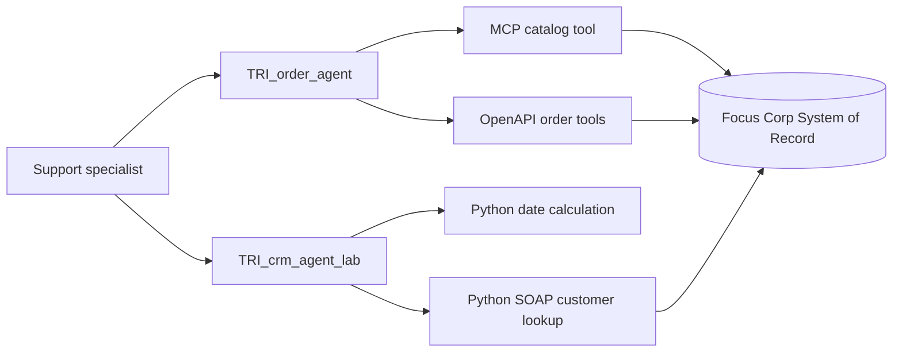

# Lab 1.1 — Worker Agent: Building Tools and Choosing Tool Types (MCP, OpenAPI, Python, Agentic Workflow, Langflow)

Version 1.0.0 / Authors: Ramy Shosha, Olaf Hahnl, Juergen Lukas / Duration: ~2 hours (2.5–3 hours including optional)

---

## Notices

This information was developed for products and services offered in the USA. IBM may not offer the products, services, or features discussed in this document in other countries. Consult your local IBM representative for information on the products and services currently available in your area.

INTERNATIONAL BUSINESS MACHINES CORPORATION PROVIDES THIS PUBLICATION "AS IS" WITHOUT WARRANTY OF ANY KIND, EITHER EXPRESS OR IMPLIED, INCLUDING, BUT NOT LIMITED TO, THE IMPLIED WARRANTIES OF NON-INFRINGEMENT, MERCHANTABILITY OR FITNESS FOR A PARTICULAR PURPOSE.

This information could include technical inaccuracies or typographical errors. Changes are periodically made to the information herein; these changes will be incorporated in new editions of the publication.

This information contains examples of data and reports used in daily business operations. To illustrate them as completely as possible, the examples include the names of individuals, companies, brands, and products. All of these names are fictitious and any similarity to the names and addresses used by an actual business enterprise is entirely coincidental.

Trademarks: IBM, the IBM logo, and ibm.com are trademarks or registered trademarks of International Business Machines Corp., registered in many jurisdictions worldwide. Other product and service names might be trademarks of IBM or other companies. A current list of IBM trademarks is available at [www.ibm.com/legal/copytrade.shtml](https://www.ibm.com/legal/copytrade.shtml).

© Copyright International Business Machines Corporation 2026. This document may not be reproduced in whole or in part without the prior written permission of IBM. US Government Users Restricted Rights — Use, duplication or disclosure restricted by GSA ADP Schedule Contract with IBM Corp.

---

## Table of Contents

1. [Lab Introduction](#1-lab-introduction)
   - 1.1 [Lab Scenario](#11-lab-scenario)
   - 1.2 [Lab Setup Instructions](#12-lab-setup-instructions)
2. [Lab Instructions](#2-lab-instructions)
   - [Exercise 1: What the Agent Actually Reads](#exercise-1-what-the-agent-actually-reads-15-min) *(~15 min)*
   - [Exercise 2: Connect to an MCP Server — Product Catalog](#exercise-2-connect-to-an-mcp-server--product-catalog-30-min) *(~30 min)*
   - [Exercise 3: Connect OpenAPI Tools — Orders](#exercise-3-connect-openapi-tools--orders-30-min) *(~30 min)*
   - [Exercise 4: Define and Register Python Tools](#exercise-4-define-and-register-python-tools-3045-min) *(~30–45 min)*
   - [Exercise 5: Explore Agentic Workflows as a Tool](#exercise-5-explore-agentic-workflows-as-a-tool-10-min) *(~10 min)*
   - [Exercise 6 *(Optional)*: Explore Langflow as a Tool](#exercise-6-optional-explore-langflow-as-a-tool-10-min) *(~10 min)*
   - [Exercise 7 *(Optional)*: Choose the Right Integration Type](#exercise-7-optional-choose-the-right-integration-type-2030-min) *(~20–30 min)*
3. [Lab Complete](#lab-complete)

---

## 1. Lab Introduction

In Lab 1.0, your Order agent returned plausible order and catalog data without reading any Focus Corp system. A language model can reason over text, but it cannot query a database or perform a transaction until it is connected to a tool. *Grounding* means anchoring the agent's response to verified data instead of allowing it to fill gaps from training knowledge.

Tools connect flexible, non-deterministic agent reasoning to deterministic software. The agent decides which action is needed; the tool performs that action against a real system and returns evidence. In this lab, you will use three backend integration types—MCP, OpenAPI, and Python—and compare them with the two process-oriented types, Agentic Workflow and Langflow.

The five wxO tool types serve two different purposes:

| Tool type | Purpose | How it works | Hands-on coverage |
|---|---|---|---|
| **MCP** | Integration | Discover and register related backend operations as a toolkit. | Exercise 2: Connect to an MCP Server |
| **OpenAPI** | Integration | Import REST operations from a versioned API specification. | Exercise 3: Connect OpenAPI Tools |
| **Python** | Integration | Implement deterministic logic or bridge a custom or legacy protocol. | Exercise 4: Define and Register Python Tools |
| **Agentic Workflow** | Orchestration | Encapsulate a governed, multi-step, asynchronous process. | Exercise 5: Explore (intro)<br>Lab 2: Multi-user workflows<br>Lab 3: Document processing workflows |
| **Langflow** | Orchestration | Package a visually authored AI pipeline as a callable tool. | Exercise 6 (Optional): Explore |

The central design rule is: **tool quality is description quality**. The model never sees a tool's implementation—only its `name`, `description`, and `inputSchema` are visible at inference time, and it relies on those three fields alone to decide whether to call the tool and how to fill in its arguments. So a tool can be technically valid (correctly implemented and wired up) and still fail in practice if those fields don't tell the model when to call it, what arguments to supply, and what it will get back.

### 1.1 Lab Scenario

Focus Corp support specialists need current catalog, order, and customer information while assisting customers. The data lives behind three common enterprise integration surfaces: an MCP server, a REST API described by OpenAPI, and a legacy SOAP Web Service.

You will complete `(NAMESPACE)_TRI_order_agent` by attaching one catalog tool through MCP and three order tools through OpenAPI. You will then import two Python tools and build a lab-only CRM worker agent. The finished Order agent matches the end-to-end Trinity design; the CRM lab agent is an educational variant used to demonstrate Python and SOAP integration. In this lab, you will work hands-on with the three integration types (MCP, OpenAPI, Python) and explore the two process-oriented patterns (Agentic Workflow and Langflow). Beyond implementation, you will compare each tool type's strengths, trade-offs, and decision criteria — understanding when to choose each one based on your backend capability and use case requirements.



*Figure 1. Lab 1.1 solution architecture and the three hands-on integration paths.*

### 1.2 Lab Setup Instructions

#### 1.2.1 Prerequisites

Before starting, ensure you have:

1. The ADK CLI (version 2.15 or later) installed, connected to the event tenant, and authenticated.
2. **Builder** role on the shared wxO SaaS tenant (permissions to create and edit agents, tools, and connections). If you completed any previous lab in this event, you already have this role.

> 💡 **Not sure?** Log in, expand the hamburger menu in the top left, and confirm the **BUILD & RUN** section is displayed. If not, contact your facilitator.
3. Completed **Lab 1.0 — Building Your First Agent**, or can import its pre-built bare agent.
4. Your SOR user ID, SOR password, and SOR base URL. Your SOR user ID is your assigned namespace. To get these values, see the labs page of the event GitHub repository, section **2. Grab your system of record credentials**.
5. The Trinity-Event repository (the event GitHub repository) cloned or downloaded to your machine. To get it, see the labs page of the event GitHub repository, section **4. Clone this GitHub**.

> 💡 **Tip:** To install, update, or connect the ADK CLI, see **Introduction to watsonx Orchestrate**, section **1.2.1 Before the Event — Prepare Your Local Environment**, and **Appendix: ADK CLI Setup Guide**. If a command fails with an authentication or token error, see **A.5 Connecting to the AWS wxO Environment**, Step 3.

**Placeholder convention:** Parentheses mark a value you must supply — the uppercase word or phrase inside names what's needed. Replace the entire `(...)` token with your actual value everywhere it appears, in both UI fields and commands, for example `(NAMESPACE)`, `(YOUR-SOR-BASE-URL)`, `(YOUR-SOR-USER-ID)`, and `(YOUR-SOR-PASSWORD)`.

**Namespace prefix convention:** All participants work on a shared wxO tenant. Every artifact you create must be prefixed with your assigned user ID (for example: `usr001`, `usr002`) followed by `_TRI_` to avoid naming conflicts (for example: `usr001_TRI_order_agent`). You will see `(NAMESPACE)_TRI_` as a placeholder throughout this lab — in instructions, tables, and commands — replace `(NAMESPACE)` with your assigned user ID (e.g. `usr001`) wherever it appears.

> **Note:** Because this is a shared wxO tenant specific to this enablement event, do not enter production credentials or customer data. All lab exercises use fictitious lab records.

[↑ Back to Table of Contents](#table-of-contents)

---

## 2. Lab Instructions

### Exercise 1: What the Agent Actually Reads (~15 min)

In this exercise, you will inspect the model-facing tool contract so you can diagnose routing and argument failures before integrating a backend. You will also verify that your starting Order agent is ready for the exercises ahead.

#### If You Are Starting Here

If you skipped Lab 1.0, the Order agent is absent, or it needs to be reset, prepare and import the pre-built bare agent:

1. Prepare namespace-safe versions of all Lab 1.1 artifacts (agents, connections, tools, and toolkits):

   ```bash
   python3 labs/lab-1x/solution/scripts/prepare_lab_1_1.py --sor-user-id (YOUR-SOR-USER-ID) --sor-base-url (YOUR-SOR-BASE-URL) --output labs/lab-1x/solution/lab-1-prepared
   ```

   > **Note:** On Windows, use `python` if `python3` is not available.

2. Import the prepared agent:

   ```bash
   orchestrate agents import --file labs/lab-1x/solution/lab-1-prepared/agents/lab_1_1_TRI_order_agent_start.yaml
   ```

3. In the wxO UI, expand the hamburger menu (☰) in the top left, click **Active inventory** under the **BUILD & RUN** category, then click **Agents**. Search for `(NAMESPACE)_TRI_order_agent`.

4. Open the agent and navigate to the **Tools** tab. Verify that no tools are attached.

#### Steps

1. Review which tool fields reach the model at inference time.

   | Field | Reaches the model? | Purpose |
   |---|---:|---|
   | Tool `name` | Yes | Provides the first routing signal. |
   | Tool `description` | Yes | Explains when to call, when not to call, and what is **returned**. |
   | Parameter names, types, and descriptions in `inputSchema` | Yes | Guides argument construction. |
   | HTTP method and URL | No | Used by the wxO runtime binding. |
   | Authentication credentials | No | Resolved by the connection security boundary. |
   | Response schema | No | Used for runtime validation and documentation, not pre-call routing. |

   > **Note:** The description is the *only* place the model learns what a tool returns — prose written by the tool author, not the formal response schema. The Response schema row below is not a typo: it never reaches the model, so the description's account of "what is returned" is what the model relies on when deciding whether a result answers the user's question.

2. Inspect this model-facing input schema for an order search.

   ```json
   {
     "type": "object",
     "properties": {
       "customer_id": {
         "type": "string",
         "description": "[Required] Customer ID in format C-*, e.g. C-3DBZFE."
       },
       "item_category": {
         "type": "string",
         "description": "[Required] Product category, e.g. laptop, headset, mouse."
       },
       "number_of_days": {
         "type": "integer",
         "format": "int32",
         "description": "[Required] Days back from today, e.g. 28 for last 4 weeks."
       }
     },
     "required": ["customer_id", "item_category", "number_of_days"]
   }
   ```

3. Identify the role of each schema element.

   | Element | What it tells the model |
   |---|---|
   | `properties` | The exact argument names; specific names such as `customer_id` avoid ambiguous `id` values. |
   | `type` and `format` | How to serialize a value, such as integer `28` instead of string `"28"`. |
   | `required` | Which arguments cannot be omitted — they must be included in the call. |
   | `enum` | The allowed vocabulary when the backend exposes a finite set. |
   | Property `description` | The meaning, format, and example for one argument. |

   > **Note:** The SOR's generated OpenAPI schema does not provide a property-level `required` array or regex patterns for these operations. Trinity therefore begins mandatory parameter descriptions with `[Required]` and supplies format-by-example values such as `C-3DBZFE`. Prefer formal schema constraints when the source platform can emit them; use description-based mitigation only for gaps in the generated contract.

   > **Note:** `type` and `format` also guide the model's own data-type conversion, not just serialization style. If the conversation only has a date as a plain string (e.g. from prior tool output or user text) and the tool requires a `string` with `format: date`, the model performs that conversion itself, using the `type`/`format` field as the target shape — there is no separate validation or casting layer between the model and the call.

4. Compare the descriptions for the same operation.

   | Contract | Description |
   |---|---|
   | Developer-grade | `Returns order details for the given order ID.` |
   | Agent-quality | `Retrieve the full details of a specific order by its order ID. Use when an order ID (format O-*) is available. Do NOT call if only a customer ID is available. Returns: order_id, customer_id, order_date, total, items[].` |

5. Apply the two-level contract checklist. Every tool exposes two separate contracts to the model: a **routing contract** — `name` plus the top-level `description` — that decides whether the model calls the tool at all, and an **argument contract** — the `inputSchema` properties — that decides how it fills in the call. Steps 1–4 built each half in isolation; this checklist is the single pass you apply to any tool going forward.

   | Level | Fields | Required content |
   |---|---|---|
   | **Routing** | `name` + top-level `description` | Business action, positive trigger, negative guard, explicit `Returns:` list. |
   | **Arguments** | `inputSchema` properties | Specific name, correct type, required status, valid values, format, and example. |

This discipline is the **Agent-Computer Interface**: design the interface for a model with the same care used for a human-facing interface. Long or ambiguous tool lists cause **#7 Tool Soup** (ADK Docs: [`agents/agent_design/tooling_scalability#tool-soup`](https://developer.watson-orchestrate.ibm.com/agents/agent_design/tooling_scalability#tool-soup)); raw, oversized results cause **#8 Tool Data Overload**, the "Firehose Effect" (ADK Docs: [`agents/agent_design/tooling_scalability#tool-data-overload`](https://developer.watson-orchestrate.ibm.com/agents/agent_design/tooling_scalability#tool-data-overload)). Precise scoping and contracts address both.

#### Verify the Starting Agent

Before moving to Exercise 2, verify that your Order agent is ready:

1. In the wxO UI, expand the hamburger menu (☰) in the top left, click **Active inventory** under the **BUILD & RUN** category, then click **Agents**. Search for `(NAMESPACE)_TRI_order_agent`.

2. Open the agent and navigate to the **Tools** tab. Verify that no tools are attached.

3. In **Draft Preview**, enter: `Find replacement gaming laptops in the price range $1000–$2000.`

4. Observe that the agent invents, hedges, or reports that it cannot retrieve live catalog data.

   

   *Figure 2: Bare Order agent in Draft Preview without grounded catalog data.*

   > **Note:** Model responses vary. The important result is that no reasoning trace appears and no response is grounded in the Focus Corp SOR.

✅ Exercise 1 complete. You can distinguish the routing contract from the argument contract and identify the three fields the model reads. You have also verified that your Order agent is ready in its ungrounded state. In Exercise 2, you will apply this checklist to a live MCP tool and ground it for real.

[↑ Back to Table of Contents](#table-of-contents)

---

### Exercise 2: Connect to an MCP Server — Product Catalog (~30 min)

In this exercise, you will register an MCP server, test its catalog tool in isolation, and attach only that tool to the Order agent.

> **Tip:** Code values shown in the tables throughout this exercise are selectable — highlight and copy them directly into the UI fields.

##### Create a Key-Value Team Connection

A wxO connection stores credentials separately from tools, code, and model context. Local MCP servers receive key-value credentials as environment variables when the local MCP server starts. Key-Value connections are Team-scoped; anyone permitted to invoke the bound tool uses the stored backend identity — a service account, shared across every caller rather than tied to the individual.

1. Expand the hamburger menu (☰) in the top left and click **Connections** under the **GOVERN & OPERATE** category.

2. Click **Add connection +**.


*Figure 3: Add connection page showing the available authentication types.*

3. Enter the following connection details.

   | Field | Value |
   |---|---|
   | **Connection ID** | `(NAMESPACE)_TRI_cp4ba_keyvalue_team` |
   | **Display name** | `(NAMESPACE) Trinity SOR — Key-Value Team` |
   | **Description** | `Provides the Focus Corp SOR endpoint and credentials to the local MCP server and Python SOAP tool.` |

4. Click **Save and continue**.

5. Confirm the pop-up by clicking **Continue**.

6. Configure the Draft environment.

   | Field | Value |
   |---|---|
   | **SSO** | `Off` |
   | **Authentication type** | `Key Value Pair` |
   | **Credential type** | `Team` |

7. Add the following key-value pairs.

   | Key | Value |
   |---|---|
   | `ENDPOINT` | `(YOUR-SOR-BASE-URL)` |
   | `USERID` | `(YOUR-SOR-USER-ID)` |
   | `PASSWORD` | `(YOUR-SOR-PASSWORD)` |
   | `VERIFY_SSL` | `false` |
   | `HTTP_TIMEOUT` | `300` |

8. Click **Next**.

9. Click **Paste draft configuration** on the Live configuration page.

10. Save the connection by clicking **Finish**.


*Figure 4: Saved namespaced Key-Value Team connection.*

> **Note:** In a production deployment, prefer delegated OAuth or enterprise SSO when the backend supports it. The lab uses static credentials because the event SOR does not expose an OAuth flow.
>
> Draft and Live can be configured independently, since they can target different backend systems and their member credentials might differ. In this lab, Draft and Live share the same SOR, so the credentials are identical in both.

##### Register and Test the MCP Server

11. Expand the hamburger menu (☰) in the top left, click **Active inventory** under the **BUILD & RUN** category, then click **Tools**.

12. Click **Create tool +**.

13. Under **Add from**, select **MCP server**.

14. Click **Add MCP server +**.

15. Select **Local MCP server**.

16. Click **Next**.

17. Enter the following values.

   | Field | Value |
   |---|---|
   | **Name** | `(NAMESPACE)_TRI_SOR_MCP` |
   | **Description** | `MCP server exposing the Focus Corp System of Record.` |
   | **Install command** | `uvx --from https://github.com/ibmbpm/ibm-baw-mcp-server/archive/refs/heads/main.zip ibm-baw-mcp-server` |
   | **Connection** | `(NAMESPACE)_TRI_cp4ba_keyvalue_team` |

18. Click **Import**.


*Figure 5: Imported MCP server with discovered tools.*

> **Note:** The connection field is marked optional as some MCP servers need no credentials or other configuration information. It is mandatory here. If the import reports `Missing required environment variable: ENDPOINT`, remove the failed server and import it again with the connection selected.

The UI calls this artifact an **MCP server**; the ADK calls it a **toolkit of kind `mcp`**. The toolkit registers every operation returned by `tools/list`. You still choose which individual operations each agent can use.

19. The **Add tools and manage MCP servers** page lists all tools for the MCP server you just created. Click **Done** to close it.

> **Note:** Tools imported via MCP are marked with a stylized **M** icon (tilted to the right) in the tool list.

20. Search the imported server for `(NAMESPACE)_TRI_SOR_MCP:TSOR_Catalog_get_catalog_items_by_category_sub_category_and_price_ran`.

> **Note:** The final word will be displayed as `ran` because MCP tool names are limited to 64 characters. This is the registered tool name, not a broken import.

21. Click the three stacked dots (⋮) on the right-hand side of the tool's line and select **Edit details**.

22. Confirm that its description contains a trigger, a negative guard, and a `Returns:` list.

##### Attach and Verify the Catalog Tool

23. Click **All agents** on the left-hand side (search for `(NAMESPACE)_TRI_order_agent` in the search field to filter the list) and open the agent.

24. Select the **Tools** tab.

25. Click **Add Tool +**.

26. Under **Add from**, select **MCP server**.

27. Click the filter icon and select `(NAMESPACE)_TRI_SOR_MCP` in the MCP server filter.

28. Enter `TSOR_Catalog_get_catalog_items_by_category_sub_category_and_price_ran` in the search bar to filter the tool list down to just this tool, then select it.

29. Click **Add to agent** to add the selected tool.

30. Enter this prompt in **Draft Preview**:

    `Find gaming laptops between $2300 and $2700.`

31. Click **Show reasoning** next to the agent's response, then expand step 1 to see which tool, agent, or knowledge base it invoked, the input it generated, and the raw result returned. This is a quick way to see a condensed form of the agent's reasoning compared to the **Debug** view used in Lab 1.0.

> **Note:** The reasoning trace is the per-turn record of everything the agent did to produce its answer — not only tool calls, but also any collaborator agent it routed to and any knowledge base it queried.

32. Verify that the reasoning trace shows the catalog tool and the answer contains `CI-D412F3` and `CI-D412F4`.


*Figure 6: Grounded Order agent response with the MCP catalog reasoning trace.*

33. Click the debug icon (the small bug symbol below the response) to open the agent debugger. Explore the **Diagram** tab to see how the tool flows through the agent execution path.

   > **Note:** For an introduction to the debugger's major components and capabilities, see **Lab 1.0 — Building Your First Agent**, Exercise 1, "Explore the Agent Debugger Window" (steps 12–13).

34. On the **Execution timeline** (right side), locate and expand the first `WatsonxChatModel.chat` step to see how the model determines which tool to call based on the request.

35. Below that, locate the step starting with "Preparing tool call: TSOR_Catalog_get_catalog_items_by_category_sub_category_and_price_ran" and its sub steps to see the actual tool invocation and the raw result returned by the MCP server.

36. Locate and expand the second `WatsonxChatModel.chat` step to see how the model converts the raw tool output into the user-facing answer presented in the chat.

37. Close the debugger by clicking the topmost **X** button in the top-right corner of the debug window.

✨ The same request that previously invited invented product data now returns verified catalog records. Attaching only one catalog tool also avoids **#7 Tool Soup** (ADK Docs: [`agents/agent_design/tooling_scalability#tool-soup`](https://developer.watson-orchestrate.ibm.com/agents/agent_design/tooling_scalability#tool-soup)): registration can be broad, but agent scope should remain narrow.

> **Going further — MCP lifecycle:** An MCP toolkit cannot be updated in place. Apply server changes by removing and reimporting the toolkit, then redeploy agents that reference it. Keep description improvements in the server source or an adapter repository because UI-only edits are lost on reimport.

✅ Exercise 2 complete. You registered a local MCP server, tested one operation independently, and grounded catalog searches with a precisely scoped tool. In Exercise 3, you will add user-scoped Order operations from OpenAPI.

[↑ Back to Table of Contents](#table-of-contents)

---

### Exercise 3: Connect OpenAPI Tools — Orders (~30 min)

In this exercise, you will import three REST operations with Member-scoped (per-user) credentials and inspect the write-safety contract for a state-changing tool. A write-safety contract is guidance stated in a tool's description — such as requiring explicit customer confirmation before a call is made — that the model attempts to follow. Since the description alone is not enforced at runtime, truly critical write operations should use an Agentic Workflow for deterministic enforcement.

> **Tip:** Code values shown in the tables throughout this exercise are selectable — highlight and copy them directly into the UI fields.

Local MCP and OpenAPI tools use different connection models in wxO:

| Capability | Local MCP | OpenAPI |
|---|---|---|
| Discovery | Automatic through `tools/list` | Operations selected from an uploaded spec |
| Artifact model | Grouped toolkit | Standalone tools |
| Authentication | Key-Value only | Basic (used here), Bearer, API Key, or OAuth |
| Credential scope | Team only | Member (used here) or Team |

Orders are user-scoped in the event environment. Member credentials preserve the caller's data partition and audit identity; Team credentials would collapse participants behind one service account. Authentication type and identity scope are separate design choices, and least privilege still applies to the permissions assigned to each identity.

This exercise uses the Catalog-enabled Order agent from Exercise 2.

#### If You Are Starting Here

If you skipped Exercise 2, need to reset your work, or want to see how to import its artifacts via the ADK CLI, catch up with the steps below before continuing with this exercise. They are also safe to re-run if you completed Exercise 2 through the UI: re-importing the same namespaced artifacts simply confirms your Draft configuration.

1. Create namespace-safe temporary copies of the Lab 1.1 artifacts.

   ```bash
   python3 labs/lab-1x/solution/scripts/prepare_lab_1_1.py --sor-user-id (YOUR-SOR-USER-ID) --sor-base-url (YOUR-SOR-BASE-URL) --output labs/lab-1x/solution/lab-1-prepared
   ```

   > **Note:** On Windows, use `python` if `python3` is not available. Run this preparation command once; the steps below reuse the same output directory.

2. Import the namespaced Key-Value connection definition.

   ```bash
   orchestrate connections import --file labs/lab-1x/solution/lab-1-prepared/connections/TRI_cp4ba_keyvalue_team.yaml
   ```

3. Set the Draft credentials for the connection.

   ```bash
   orchestrate connections set-credentials --app-id (NAMESPACE)_TRI_cp4ba_keyvalue_team --env draft -e ENDPOINT=(YOUR-SOR-BASE-URL) -e USERID=(YOUR-SOR-USER-ID) -e PASSWORD=(YOUR-SOR-PASSWORD) -e VERIFY_SSL=false -e HTTP_TIMEOUT=300
   ```

4. Import the namespaced MCP toolkit.

   ```bash
   orchestrate toolkits import --file labs/lab-1x/solution/lab-1-prepared/toolkits/TRI_SOR_MCP.yaml
   ```

5. Import the Exercise 2 Order agent checkpoint, which references only the Catalog MCP tool.

   ```bash
   orchestrate agents import --file labs/lab-1x/solution/lab-1-prepared/agents/lab_1_1_TRI_order_agent_mcp_complete.yaml
   ```

   > Optional: open `(NAMESPACE)_TRI_order_agent` in the UI and repeat Exercise 2 Steps 30–32 to verify the grounded catalog response before continuing.

##### Create a Basic Auth Member Connection

1. Expand the hamburger menu (☰) in the top left and click **Connections** under the **GOVERN & OPERATE** category.

2. Click **Add connection +**.

3. Enter the following details.

   | Field | Value |
   |---|---|
   | **Connection ID** | `(NAMESPACE)_TRI_cp4ba_basic_member` |
   | **Display name** | `(NAMESPACE) Trinity SOR — Basic Member` |
   | **Description** | `Member-scoped connection for Focus Corp Orders OpenAPI tools.` |

4. Click **Save and continue**.

5. Confirm the pop-up by clicking **Continue**.

6. Configure the Draft environment.

   | Field | Value |
   |---|---|
   | **SSO** | `Off` |
   | **Authentication type** | `Basic Auth` |
   | **Server URL** | `(YOUR-SOR-BASE-URL)` |
   | **Credential type** | `Member` |

   > **Note:** Member credentials are not entered while creating the connection. Each user configures their own username and password afterward — see Steps 10–13 below.

7. Click **Next**.

8. Click **Paste draft configuration** on the Live configuration page.

9. Save the connection by clicking **Finish**.


*Figure 7: Saved namespaced Basic Auth Member connection.*

10. Expand the hamburger menu (☰) in the top left and click **Settings** under the **ADMINISTRATION** category.

11. Click the **Member credentials** tab. The list will initially be empty since no credentials have been configured for the Draft environment yet.

12. Click **Add member credential +**.

13. Enter `(NAMESPACE)` in the search field, select `(NAMESPACE)_TRI_cp4ba_basic_member`, and click **Next**. The next page allows you to enter your username and password to preset the member credentials for the Draft environment.

14. Alternatively, wxO will ask for them the first time a tool bound to this connection is used, via the **Connect Apps** dialog shown directly in the chat — this is what we will do in this lab, for demonstration purposes. Click the closing **X** in the top-right corner of the dialog to close it without entering credentials now.


*Figure 8: Member credential entry dialog with username and password fields.*

   > **Note:** Draft and Live can be configured independently, since they can target different backend systems and their member credentials might differ. In this lab, Draft and Live share the same SOR, so the credentials are identical in both.

##### Import and Inspect the OpenAPI Tools

The event connection supplies the target SOR server URL; the OpenAPI file supplies the operation contracts.

15. Expand the hamburger menu (☰) in the top left, click **Active inventory** under the **BUILD & RUN** category, then click **Tools**.

16. Click **Create tool +**.

17. Under **Add from**, select **OpenAPI**.

18. If `labs/lab-1x/solution/lab-1-prepared` does not already exist from earlier in this lab, create it now by running the following command. wxO's OpenAPI import has no in-UI field to add a namespace prefix, so on this shared multi-user tenant the prefix must be baked into the file beforehand.

   ```bash
   python3 labs/lab-1x/solution/scripts/prepare_lab_1_1.py --sor-user-id (YOUR-SOR-USER-ID) --sor-base-url (YOUR-SOR-BASE-URL) --output labs/lab-1x/solution/lab-1-prepared
   ```

   > **Note:** On Windows, use `python` if `python3` is not available.

   > **Note:** Skip this command if you already ran it earlier in Lab 1.1 — reuse the same `labs/lab-1x/solution/lab-1-prepared` directory.

19. Select or drag and drop `labs/lab-1x/solution/lab-1-prepared/tools/lab_1_1_TRI_SOR_Orders_openapi.json`, then click **Next**.

20. Select these three operations, then click **Next**.

   - `(NAMESPACE)_TRI_TSOR_Orders_get_order_by_id`
   - `(NAMESPACE)_TRI_TSOR_Orders_get_orders_by_customer_id_and_item_category_last_xdays`
   - `(NAMESPACE)_TRI_TSOR_Orders_update_order`

21. Select the connection `(NAMESPACE)_TRI_cp4ba_basic_member`. The table lists connections by display name, with the connection ID shown in smaller font below it — look for `(NAMESPACE) Trinity SOR — Basic Member`.

22. Import the operations by clicking **Done**.


*Figure 9: Three imported namespaced Orders OpenAPI tools.*

> **Note:** Tools imported via OpenAPI are marked with an **API** icon in the tool list.

23. Click the three stacked dots (⋮) on the right-hand side of `(NAMESPACE)_TRI_TSOR_Orders_get_order_by_id` and select **Edit details**.

24. Verify that the description contains the positive trigger `when an order ID ... is available`, the guard `Do NOT call if only a customer ID is available`, and an explicit `Returns:` list.

25. Click the three stacked dots (⋮) on the right-hand side of `(NAMESPACE)_TRI_TSOR_Orders_update_order` and select **Edit details**.

26. Verify that its description says not to call until the customer has explicitly confirmed the replacement.

   This is the write-safety contract in practice. A broad `manage_orders` tool would be a **#28 God-Mode Tool** (ADK Docs: [`agents/agent_design/mcp_integration#the-god-mode-tool`](https://developer.watson-orchestrate.ibm.com/agents/agent_design/mcp_integration#the-god-mode-tool)); distinct lookup and update operations make side effects visible and easier to govern. Production designs should also provide a reversal or correction path for material writes.


*Figure 10: Update Order tool description showing the write-safety contract.*

##### Attach and Verify the Order Tools

27. Click **All agents** on the left, enter `(NAMESPACE)_TRI_order_agent` in the search field, then open it.

28. Select the **Tools** tab.

29. Click **Add Tool +**.

30. Under **Add from**, select **Local instance**.

31. Enter `(NAMESPACE)_TRI_TSOR_Orders` in the search field to filter the tool list down to the three tools imported in Step 22.

32. Select all three tools, then click **Add to agent**.

33. Enter this prompt in **Draft Preview**:

   `For customer C-3DBZFE, find the most recent laptop order from the last four weeks.`

34. Enter your SOR username and password into the **Connect Apps** dialog fields and click **Connect Apps**.

35. Click **Show reasoning** and expand the reasoning trace to inspect the tool calls and arguments.

36. Verify that the reasoning trace calls the customer/category/time-window operation with these arguments.

   | Argument | Expected value |
   |---|---|
   | `customer_id` | `C-3DBZFE` |
   | `item_category` | `laptop` |
   | `number_of_days` | `28` |

37. Verify that the grounded answer includes order `O-DF340K`, catalog item `CI-D412F3`, order item `OI-TDDU12`, and price `2500`.

✨ The Order agent now grounds order searches with real data from the REST API. Member-scoped credentials ensure data isolation across participants.


> **Note:** Order dates are generated as a fixed number of days before the moment the tool is called, not as fixed calendar dates. This keeps them stable relative to the event date regardless of when the lab runs. Match the stable IDs and amounts; the displayed calendar date will vary depending on when you call the tool.

38. To start a fresh test conversation, click the **Reset Chat** icon in the top-right corner of the **Draft Preview** window. This ensures the next test isn't influenced by previous exchanges.

39. Enter this prompt in **Draft Preview**:

   `For customer C-3DBZFE, find the most recent laptop order from the last 2 months.`

40. Verify that the list now contains two orders. Check the reasoning trace showing that the LLM powering the agent has translated "2 months" into `number_of_days: 60`, similarly to how it previously translated "four weeks" into `28`. It can do this not only because the `number_of_days` parameter of `(NAMESPACE)_TRI_TSOR_Orders_get_orders_by_customer_id_and_item_category_last_xdays` is typed as an integer, but also because its name and description clearly explain what value is expected — check this yourself by clicking **Edit details** for the tool on the agent's **Tools** tab, then selecting **Parameters**.

41. Now try this prompt in **Draft Preview**:

   `For customer C-3DBZFE, find the most recent orders from the last 2 months.`

42. Observe that the agent cannot respond as it states. This demonstrates the required contract for input parameters in action: with the tools we have added, `item_category` is a required input parameter. Since you did not specify a category (laptop, headset, etc.) in your request, there is no tool available for the agent to call. The agent grounding is working correctly—it refuses to invent data rather than making up a category that was not specified.

✅ Exercise 3 complete. You connected the Order agent to a REST API with Member credentials and inspected the write-safety contract on a state-changing operation. In Exercise 4, you will implement deterministic logic and a legacy Web Service bridge with Python.

[↑ Back to Table of Contents](#table-of-contents)

---

### Exercise 4: Define and Register Python Tools (~30–45 min)

In this exercise, you will import three Python tools and use their typed signatures and docstrings as the model-facing contract. Two tools will be added to a new CRM agent that is used only in this exercise to demonstrate Python and legacy system integration. A third tool will demonstrate the impact of incomplete parameter documentation on agent performance.

In Python, a function's documentation—the descriptive text placed immediately after the function definition that explains what it does, what inputs it requires, and what it returns—is called a **docstring**.

Decorated Python source is imported with the ADK CLI; the SaaS UI can inspect, attach, and test the resulting tools but does not replace the Python import command. Once the tools are imported, you will create the CRM lab agent in the UI.

> **Tip:** Code values shown in the tables throughout this exercise are selectable — highlight and copy them directly into the UI fields.

Use cases when to use Python tools are:

- A small deterministic calculation that produces the same result every time.
- Custom library logic that requires specific code libraries or frameworks.
- One or two operations against a custom or legacy protocol that needs adaptation.

If a backend has many reusable operations, an MCP adapter may provide a better shared lifecycle. For a detailed comparison of all five tool types and how to choose between them, see Exercise 7.

| Tool | Use case |
|---|---|
| `TRI_calculate_days_since_purchase` | Pure date arithmetic with no external system; the same input must produce the same result on a given date. |
| `TRI_get_customer_by_id` | One SOAP operation; a standalone wrapper is smaller than a new server and converts XML to model-friendly structured data. |

The date tool has no credential declaration. The SOAP tool declares an expected Key-Value connection; wxO injects its keys as `WXO_CONNECTION_<APP_ID>_<KEY>` environment variables when the tool runs. In this exercise, the focus is on understanding what transforms a Python function into a tool — the decorators, type annotations, and documentation — rather than the implementation logic itself.

#### If You Are Starting Here

If you skipped Exercise 3 and have not previously imported pre-built artifacts in Lab 1.1, prepare the namespace-safe Python tool files by running this command. If the `lab-1-prepared` directory already exists from a previous exercise, you can skip this step.

```bash
python3 labs/lab-1x/solution/scripts/prepare_lab_1_1.py --sor-user-id (YOUR-SOR-USER-ID) --sor-base-url (YOUR-SOR-BASE-URL) --output labs/lab-1x/solution/lab-1-prepared
```

> **Note:** On Windows, use `python` if `python3` is not available.

#### Import the Python Tools — Command Required

1. Open `labs/lab-1x/solution/lab-1-prepared/tools/lab_1_1_TRI_calculate_days_since_purchase.py` in a text editor.

2. Locate the `@tool` decorator, annotated `purchase_date` parameter, return type, and docstring.

3. Confirm that the parameter description requires ISO `YYYY-MM-DD` and gives an example.

4. Import the date tool.

   ```bash
   orchestrate tools import -k python -f labs/lab-1x/solution/lab-1-prepared/tools/lab_1_1_TRI_calculate_days_since_purchase.py
   ```

5. Open `labs/lab-1x/solution/lab-1-prepared/tools/lab_1_1_TRI_get_customer_by_id.py`.

Before we import it, examine how this tool is designed to use credentials and configuration from a platform connection rather than storing them in code. This decoupling keeps the tool implementation independent of any specific environment (Draft or Live), so the same tool code can run against different backends by swapping the connection.

6. Locate the `CONNECTION_ID` variable at the top of the file and confirm it is set to `(NAMESPACE)_TRI_cp4ba_keyvalue_team`.

7. Locate the `expected_credentials` in the `@tool` decorator and confirm it references this connection ID, which means the tool will receive ENDPOINT, USERID, and PASSWORD as injected environment variables.

8. Locate the `_soap_endpoint()` function and confirm that it accepts an ENDPOINT value with or without `/bas` and produces `/bas/teamworks/webservices/TSOR/CRM.tws` exactly once. The credentials are read from the connection using the `_connection_value()` helper function (lines 92–94), not hardcoded.

9. Import the SOAP tool with its dependency and connection binding.

   ```bash
   orchestrate tools import -k python -f labs/lab-1x/solution/lab-1-prepared/tools/lab_1_1_TRI_get_customer_by_id.py --requirements-file labs/lab-1x/solution/lab-1-prepared/tools/lab_1_1_requirements.txt --app-id (NAMESPACE)_TRI_cp4ba_keyvalue_team
   ```

   > **Note:** The `requirements.txt` file specifies external Python packages that the tool depends on. In this case, it includes the `requests` library, which the SOAP tool uses to make HTTP calls. When you import the tool with `--requirements-file`, wxO ensures these packages are installed in the runtime environment.

10. Expand the hamburger menu (☰) in the top left, click **Active inventory** under the **BUILD & RUN** category, then click **Tools**.

11. Enter `(NAMESPACE)` in the search field to filter the tool list. Verify that both namespaced tools that you just imported appear: `(NAMESPACE)_TRI_calculate_days_since_purchase` and `(NAMESPACE)_TRI_get_customer_by_id`.

> **Note:** Tools imported via Python are marked with a `</>` icon in the tool list.


*Figure 12: Imported date and customer Python tools.*

#### Create the CRM Lab Agent

12. Click **All agents** on the left sidebar.

13. Click **Create agent +**.

14. Select **Create from scratch** under **Other ways to start**.

15. Enter the following values.

    | Field | Value |
    |---|---|
    | **Agent name** | `(NAMESPACE)_TRI_crm_agent_lab` |
    | **Model** | `Default` |
    | **Description** | `Looks up customer profiles by C-* customer ID and demonstrates deterministic date arithmetic.` |
    | **Instructions** | `Use available tools for customer profile lookups and deterministic elapsed-day calculations. Return tool responses in full. Do not invent missing customer or date values. If a tool fails, explain what failed and use its correction hint.` |
    | **Style** | `ReAct Core` |

16. Open the **Tools** tab.

17. Click **Add Tool +**.

18. Under **Add from**, select **Local instance**.

19. Enter `(NAMESPACE)` in the search field to filter the tool list.

20. Select both `(NAMESPACE)_TRI_calculate_days_since_purchase` and `(NAMESPACE)_TRI_get_customer_by_id`, then click **Add to agent**.

21. Verify that the agent's **Tools** tab contains both Python tools.

22. Enter this prompt in **Draft Preview**:

    `Look up customer C-3DBZFE.`

23. Verify that the customer tool returns these fields.

   | Field | Expected value |
   |---|---|
   | `customer_id` | `C-3DBZFE` |
   | `firstname` | `Marie` |
   | `lastname` | `Smith` |
   | `email` | `Marie.Smith@example.com` |
   | `phone` | `123-456-7890` |
   | `status` | `Platinum` |

   > **Note:** The LLM may represent the data differently in its response. For example, `firstname` and `lastname` may be combined into a single `name` field, but the underlying tool data remains structured as returned by the SOAP service. To verify the actual tool response, click **Show reasoning** and inspect the reasoning trace to see the raw structured data returned by the SOAP tool.

✨ The CRM agent grounds customer lookups with real data from the SOAP service. Structured error handling and deterministic date arithmetic provide the agent with reliable tools for customer service scenarios.


*Figure 13: CRM lab agent returning Marie Smith through the Python SOAP tool.*

24. Enter `Calculate the days since purchase on 2026-01-01.` in **Draft Preview**.

25. Verify that the date tool returns `status`, `purchase_date`, `as_of_date`, and `days_since_purchase` without estimating in the language model.


*Figure 14: CRM lab agent calling the deterministic date tool.*

26. Enter `Look up customer 12345.` in **Draft Preview**.

27. Verify that the agent provides a helpful explanation that the customer ID must be in C-* format (derived from the tool's correction_hint), rather than returning a stack trace or cryptic error.

This structured error avoids **#32 Useless Error** (ADK Docs: [`agents/agent_design/tooling_scalability#useless-error`](https://developer.watson-orchestrate.ibm.com/agents/agent_design/tooling_scalability#useless-error)) and **#11 Happy Path Engineering** (ADK Docs: [`agents/agent_design/tooling_scalability#happy-path-engineering`](https://developer.watson-orchestrate.ibm.com/agents/agent_design/tooling_scalability#happy-path-engineering)). The tool gives the agent enough information to correct the request or ask for a valid ID.

The function name describes a business action, the docstring carries the routing contract, and the annotated parameter carries the argument contract. HTTP and XML mechanics remain hidden inside the implementation, avoiding **#24 Glorified API Wrapper** (ADK Docs: [`agents/agent_design/mcp_integration#glorified-api-wrapper`](https://developer.watson-orchestrate.ibm.com/agents/agent_design/mcp_integration#glorified-api-wrapper)) and **#25 Raw Schema Leakage** (ADK Docs: [`agents/agent_design/mcp_integration#raw-schema-leakage`](https://developer.watson-orchestrate.ibm.com/agents/agent_design/mcp_integration#raw-schema-leakage)).

#### Demonstrate the Importance of Input Parameter Documentation

We have prepared a special tool `TRI_calculate_warranty_expiry_days` to demonstrate why documenting the expected input format is critical. This tool deliberately has incomplete parameter documentation (it does NOT specify the expected DD-MM-YYYY format) to highlight a common problem. When you call this tool with dates in other formats, the agent may encounter an error that reveals the expected format, or it may even eventually give up and fail — demonstrating how poor documentation forces the agent to work through trial and error or abandon the task rather than getting it right on the first attempt.

28. Open `labs/lab-1x/solution/lab-1-prepared/tools/lab_1_1_TRI_calculate_warranty_expiry_days.py` in a text editor.

29. Locate lines 36–44 where the tool validates the expiry date format and returns an error with a correction hint if the format is invalid.

30. Compare the parameter description on lines 21–24 with the actual expected format. Notice that the parameter description says `"[Required] An expiry date."` — it does NOT specify the expected DD-MM-YYYY format or provide an example, even though the tool requires that specific format (line 36).

31. Import the demonstration tool.

    ```bash
    orchestrate tools import -k python -f labs/lab-1x/solution/lab-1-prepared/tools/lab_1_1_TRI_calculate_warranty_expiry_days.py
    ```

32. Open `(NAMESPACE)_TRI_crm_agent_lab` in the UI if it is not already open. Navigate to the **Tools** tab to add the demonstration tool.

33. Click **Add Tool +**.

34. Under **Add from**, select **Local instance**.

35. Enter `(NAMESPACE)_TRI_calculate_warranty_expiry_days` in the search field to find the tool, then select it.

36. Click **Add to agent** to attach the tool to the agent.

37. To start a fresh test conversation, click the **Reset Chat** icon in the top-right corner of the **Draft Preview** window. This ensures the next test isn't influenced by previous exchanges.

38. Enter this prompt in **Draft Preview**:

    `Calculate the days since the warranty expiry on 01.01.2026.`

39. Observe that the agent responds with a successful result (the exact number of days may vary depending on today's date).

40. Click **Show reasoning** and expand the reasoning trace. You will see two tool calls:

    **Step 1 (First tool call):** The agent reformatted the date you provided (01.01.2026) to the ISO standard YYYY-MM-DD format (2026-01-01) and called the tool. The tool returned an error: `INVALID_DATE_FORMAT`. The error response included a correction hint: `"Provide an expiry date in DD-MM-YYYY format, e.g. 21-08-2026."` Notice that this is the first time the agent learned the correct format — from the error response, not from the parameter description.

    **Step 2 (Second tool call):** The agent, now informed by the error response, reformatted the date to DD-MM-YYYY (01-01-2026) and called the tool again. This time it succeeded and returned the calculated days.

41. Reflect on the learning: The parameter description `"[Required] An expiry date."` provided no guidance about format. The agent had to learn the correct format from the error response. In a production tool, it is far better to specify the format and provide an example directly in the parameter description — for example: `"[Required] Expiry date in DD-MM-YYYY format, e.g. 21-08-2026."` — so the agent gets it right on the first attempt.

> **Key insight:** Remember that tool descriptions are written for **the LLM to read at inference time**, not for human developers reading the code. The LLM never sees the implementation — only the function name, docstring, and parameter descriptions are visible. This principle of clear, complete documentation applies equally to the main function docstring (the routing contract), parameter descriptions (the argument contract), and return value descriptions. Each level of documentation must guide the model's decision-making, so vague or incomplete descriptions at any level force the agent into trial-and-error mode. While we demonstrated this with Python tools because they are easy to manipulate, this principle applies universally to all tool types — MCP, OpenAPI, Agentic Workflow, and Langflow — wherever you define descriptions visible to the LLM.

> **Going further — Python packaging:** Use `--auto-discover` to generate initial wrappers for plain functions, then improve the generated descriptions before production. Use `--package-root` when a tool needs local modules or static files; keep the package within the current platform size limit.

✅ Exercise 4 complete. You imported deterministic and SOAP-backed Python tools, bound credentials without hardcoding them, tested structured failures, demonstrated the impact of incomplete parameter documentation, and observed how the agent learns from error responses. In Exercise 5, you will identify when an atomic tool is not sufficient.

[↑ Back to Table of Contents](#table-of-contents)

---

### Exercise 5: Explore Agentic Workflows as a Tool (~10 min)

In this reading exercise, you will explore agentic workflows as the fourth wxO tool type — understanding how they orchestrate business processes by blending deterministic steps with embedded reasoning, multi-user collaboration, and governance.

**What is an Agentic Workflow?**

You have now seen three tool types: MCP servers (Exercise 2), OpenAPI tools (Exercise 3), and Python tools (Exercise 4). Agentic Workflows are the fourth — but unlike the previous, they are not single operations. An agentic workflow defines a set of linked activities and controls that are designed to achieve a specific business purpose or goal. When exposed as a tool, an agentic workflow becomes a composite capability that an agent can invoke as if it were a single operation.

Agentic workflows are unique because they support a continuum of orchestration strategies, from fully predetermined to fully dynamic. A workflow can be:
- **Fully predictable:** A fixed sequence of deterministic steps (decision tables, transformations, API calls) with no reasoning involved
- **Partially agentic:** A predetermined path with embedded agent nodes at specific decision points where reasoning is needed
- **Hybrid:** Structured sequences that branch conditionally, with human-in-the-loop review and approval loops
- **Fully agentic:** Calling agents as steps, allowing dynamic reasoning within a governed outer workflow structure

This flexibility lets you choose the right level of structure for each part of the business process. You enforce governance where needed, enable reasoning where it adds value, and maintain the auditability and resilience that pure agents cannot guarantee. 

Agentic workflows also enable multi-user collaboration: human-in-the-loop activities can be assigned to different users based on workflow logic — a supervisor for approval, a subject matter expert for review, a compliance officer for validation. The workflow routes work items to the right person at the right time, maintains continuity as control passes between users, and records every decision and contributor for audit trails.

Agentic workflows support the full complexity of real-world business processes: enforced sequences, conditional branching, human approval loops with role-based routing, document classification and extraction with HITL review by different users, long-running asynchronous execution, and durable state maintenance across interactions and participants. They are the orchestration layer that turns sequences into resilient, auditable processes that involve teams, not just individuals.

IBM watsonx Orchestrate docs: [`Agentic workflows`](https://www.ibm.com/docs/en/watsonx/watson-orchestrate/base?topic=tools-agentic-workflows)

**When to use Agentic Workflows**

Use agentic workflows when the work requires:
- **Governed orchestration** — a blend of deterministic steps, conditional branching, and embedded reasoning (agents at decision points) — rather than pure reasoning
- **Multi-user collaboration** — routing human-in-the-loop activities to different users based on role, expertise, or workflow logic (approvers, reviewers, validators, specialists)
- **Document classification and extraction** with human review loops for validation and correction by designated reviewers
- **Unbypassable approval gates** that are audited and cannot be circumvented
- **Long-running processes** that survive system interruptions and maintain state across hours or days
- **Durable state** that persists across multiple interactions and multiple participants
- **Audit trails** that record every step, every decision, and every contributor for compliance and transparency

**How Agentic Workflows Differ from Other Tool Types**

| Construct | When to use |
|---|---|
| **Atomic tool** (REST, MCP, OpenAPI, Python) | One operation: a lookup, write, transformation, calculation, or classification. Self-contained; no external sequencing needed. |
| **Agent** | Many operations with dynamic tool choice. The agent decides which tools to call based on reasoning over the conversation and available data. |
| **Agentic Workflow** | A spectrum from fully deterministic to partially agentic to fully agentic. The workflow orchestrates sequences that can be pure automation, embed agent nodes for dynamic reasoning at decision points, branch conditionally, route human reviews to different users, process documents with HITL validation, and maintain durable state. Acts as a composite tool that agents can invoke. Ideal when you need governance, multi-user collaboration, and audit trails. |

In Labs 2 and 3, within the Trinity domain, you will build two agentic workflows that showcase different capabilities and patterns.

#### Steps

1. Review the capabilities that an Agentic Workflow can orchestrate.

   | Capability | Example nodes |
   |---|---|
   | AI reasoning | **Prompt Node**, **Agent Node** (embed agents for dynamic reasoning within the workflow) |
   | Document processing | **Document Classifier**, **Document Extractor** (with HITL review by designated users) |
   | Deterministic logic | **Decisions Node**, **Branch**, **Parallel execution**, **Loop** |
   | External integration | **Tool Node** (call REST APIs, Python tools, agents) |
   | Human-in-the-loop (HITL) | **User Activity Node** (route approval, review, validation tasks to the same user or other users—enabling multi-user collaboration—based on role or expertise) |

2. Apply the decision test: **Does this process belong in a workflow or an agent?**

   Ask yourself:
   - Is tool selection dynamic (the agent decides what to do next), or is the path predetermined?
   - Are there steps that must happen in a guaranteed sequence?
   - Is human review required at specific decision points?
   - Do multiple users need to be involved (e.g., specialist review, approval by different roles)?
   - Does the process need to be auditable and maintain a durable record of all decisions and participants?
   - Will the process take hours or days to complete and must survive interruptions?

   **If the path is at least partially predetermined, review or approval is needed, or multiple users must collaborate → Agentic Workflow**
   
   **If tool selection is conversational and dynamic, and a single reasoning agent can handle it → Agent**

3. Compare the two Trinity lab workflows and how they blend structure with reasoning.

   - **Billing Dispute (Lab 2):** Partially agentic workflow. Fixed outer path—check eligibility → **route to supervisor with embedded agent node** → apply decision → write result. The supervisor can enter a free-text prompt, and the embedded agent dynamically gathers the information needed to resolve the dispute without hard-coding specific information requirements. The workflow structure ensures governance and audit trails while the embedded agent provides reasoning flexibility.
   - **Warranty Claim (Lab 3):** Hybrid workflow with document processing. Extract/classify documents → human review if confidence is low → calculate dates → check eligibility → decide outcome. Combines deterministic logic (date calculations, eligibility checks, decision tables) with document intelligence and multi-user HITL review.

✅ Exercise 5 complete. You now understand how agentic workflows complement agents and atomic tools. They are the orchestration pattern for business processes that must be governed, audited, and reliable. In Lab 2, you will build your first workflow. In Lab 3, you will build a second one that adds document intelligence and human-in-the-loop review. Exercise 6 provides an optional look at Langflow, which specializes in AI-centric pipeline composition (prompt chaining, transformations, RAG), as a different orchestration approach focused on AI workflows rather than general business process governance.

[↑ Back to Table of Contents](#table-of-contents)

---

### Exercise 6 *(Optional)*: Explore Langflow as a Tool (~10 min)

In this reading exercise, you will explore Langflow as the fifth wxO tool type — understanding how it builds visual AI capabilities and how those capabilities are imported and used within wxO.

**What is Langflow?**

Langflow is a visual, node-based environment for constructing AI reasoning chains, RAG systems, and prompt pipelines. Like MCP, OpenAPI, Python, and Agentic Workflow tools, a Langflow tool — once built and imported — can be used anywhere tools are needed: as a step in an Agentic Workflow, as a tool an agent can call, or invoked directly.

**How Langflow Tools are Built and Imported into wxO**

Langflow tools are built in an external Langflow editor (not embedded in wxO SaaS), then exported as JSON and imported into wxO using the ADK CLI:

```bash
orchestrate tools import -k langflow -f (FLOW-JSON-PATH)
```

Once imported, the Langflow tool appears in the wxO tool catalog and can be used like any other tool type.

**When is Langflow a Good Choice?**

Choose Langflow when you are building an AI capability and your team prefers visual, node-based composition. Specifically:

- **Complex RAG & advanced search systems** — wire up vector databases, text splitters, custom embedding strategies, and multi-stage retrieval pipelines visually. (For simple RAG use cases, see Knowledge Bases in Lab 1.2.)
- **Complex LLM chaining** — pass output from one model into another or create prompt-and-tool sequences quickly
- **Prototyping AI-first micro-agents** — quickly build a specialist AI capability (e.g., a document analyzer) before exposing it as a tool
- **Model agnostic testing** — Build your pipeline once with your chosen logic and connections, then swap different LLMs (Claude, GPT-4, Llama, etc.) and re-run the same tests to compare which model performs best for your use case

Choose a different tool when:
- You need a simple lookup or integration → **MCP, OpenAPI, or Python**
- You need a long-running business process with human approval gates → **Agentic Workflow**
- You need basic document retrieval and Q&A → **Knowledge Bases** (covered in Lab 1.2)

✅ Exercise 6 complete. You now understand all five wxO tool types. In Exercise 7, you will apply a comprehensive decision framework to choose the right tool across different business and technical scenarios.

[↑ Back to Table of Contents](#table-of-contents)

---

### Exercise 7 *(Optional)*: Choose the Right Integration Type (~20–30 min)

In this optional reading exercise, you will apply a comprehensive decision framework to choose the right wxO tool type for any scenario by comparing the five tools across their primary fit, governance capabilities, and production characteristics.

#### Steps

1. Classify the work as either a single backend action/calculation or a multi-step process.

2. Understand the key decision dimensions.

   When choosing among the five tool types, these dimensions drive the choice:
   - **Artifact type**: What do you deploy and maintain? (code, config, toolkit, flow JSON)
   - **Governance**: Does the work require human approval or multi-step coordination?
   - **Description source**: Where do agent-ready descriptions live and get versioned?
   - **Non-REST support**: Can the tool type handle non-REST protocols and legacy systems?
   - **Team skills**: What integration and authoring patterns does your team own?

3. Review the comparison table to see how each tool differs.

   | Dimension | MCP | OpenAPI | Python | Agentic Workflow | Langflow |
   |---|---|---|---|---|---|
   | Primary fit | Discoverable backend operations | REST operations from a spec | Custom logic or protocol | Governed multi-step process | Visual AI pipeline |
   | Artifact | Toolkit | Standalone tools | Tool | Flow exposed as a tool | Imported flow JSON |
   | Human approval | No | No | No | Yes | No |
   | Non-REST support | Adapter-dependent | No | Yes | Through called tools | Langflow components available |
   | Description source | Server or adapter code | Versioned spec | Docstring | Flow definition | Versioned flow JSON |
   | Identity model | Transport and platform dependent | Connection dependent | Connection dependent | Inherited from components | Determined by Langflow components used |

4. Apply decision criteria: filter by constraints and fit.

   1. For multi-step processes with governance or human approval, use **Agentic Workflow**.
   2. For atomic tools, prefer **MCP** as the de facto standard if it supports the backend system and meets description requirements.
   3. If MCP is unavailable or lacks required characteristics (e.g., non-REST support), consider **OpenAPI** (REST only) or **Python** (maximum flexibility).
   4. For visual AI pipeline composition (complex RAG, prompt chaining, document analysis), use **Langflow**.
   5. Verify that description quality can live in a version-controlled artifact (see step 5).
   6. If multiple options fit, prefer the one your team has operational experience with.

5. Decide where descriptions live and survive reimport.

   | Integration type | Production location for descriptions | Why this matters |
   |---|---|---|
   | MCP backend you own | Backend or MCP server source | Change source, reimport, and descriptions persist |
   | Open-source MCP server | Maintained fork or adapter repository | You control the adapter; descriptions survive in your code |
   | Closed vendor MCP server | Versioned proxy/adapter that curates the manifest | Proxy sits between vendor and agent; descriptions curated there |
   | OpenAPI | Patched specification committed to source control | Version your spec; reimporting updates the tool contract |
   | Python | Function docstrings and annotations in source control | Descriptions and constraints live in code |
   | Agentic Workflow | Flow definition in version control | The flow is your source of truth |
   | Langflow | Versioned flow JSON in source control | Export and commit the flow |

   **Critical rule: If you edit a description only in the wxO UI and then reimport the tool, your edit is gone. Put descriptions in version-controlled artifacts.**

6. Apply the framework to these scenarios before reading the sample answers.

   | Scenario | Your choice |
   |---|---|
   | CRM system with a closed vendor MCP server and weak descriptions |  |
   | ERP with a 200-operation OpenAPI spec and weak descriptions |  |
   | Legacy SOAP system with one required operation |  |

7. Compare your choices with the sample answers.

   | Scenario | Recommended starting point | Rationale |
   |---|---|---|
   | Vendor MCP server | MCP through a versioned curation proxy | Reuse vendor connectivity while improving and pruning the model-facing contract. Audit the third-party component before production use. |
   | Large ERP OpenAPI spec | OpenAPI with a patched, versioned subset | Avoid hand-writing hundreds of wrappers; import only the operations the agent needs. |
   | One SOAP operation | Python | Convert XML to a shallow dictionary and keep the agent-facing contract in code without operating another server. |

✅ Exercise 7 complete. You can justify an integration type from protocol, identity, lifecycle, governance, and team-skill requirements. In Lab Complete, you will review everything you accomplished across Lab 1.1.

[↑ Back to Table of Contents](#table-of-contents)

---

## Lab Complete

This concludes the **Lab 1.1 — Worker Agent: Tools (MCP, OpenAPI, Python)** lab.

In this lab you have:

- Completed the Order worker agent with grounded catalog and order data.
- Registered and tested MCP, OpenAPI, and Python tools.
- Separated Team and Member credentials according to backend identity requirements.
- Applied routing, argument, error, and write-safety contracts to agent-facing tools.
- Chosen between atomic tools, agents, Agentic Workflows, and visual AI pipelines.

Congratulations on completing the lab!

Continue to **Lab 1.2 — Worker Agent: RAG / Knowledge Base** to ground an agent in unstructured policy and product knowledge. Lab 1.3 then combines the worker agents as collaborators in a multi-agent system.

[↑ Back to Table of Contents](#table-of-contents)
