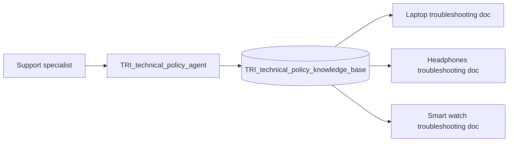

# Lab 1.2 — Worker Agent: RAG / Knowledge Base

Version 1.0.0 / Authors: Ramy Shosha, Olaf Hahnl, Juergen Lukas / Duration: ~2.5 hours (3 hours including optional)

---

## Notices

This information was developed for products and services offered in the USA. IBM may not offer the products, services, or features discussed in this document in other countries. Consult your local IBM representative for information on the products and services currently available in your area.

INTERNATIONAL BUSINESS MACHINES CORPORATION PROVIDES THIS PUBLICATION "AS IS" WITHOUT WARRANTY OF ANY KIND, EITHER EXPRESS OR IMPLIED, INCLUDING, BUT NOT LIMITED TO, THE IMPLIED WARRANTIES OF NON-INFRINGEMENT, MERCHANTABILITY OR FITNESS FOR A PARTICULAR PURPOSE.

This information could include technical inaccuracies or typographical errors. Changes are periodically made to the information herein; these changes will be incorporated in new editions of the publication.

This information contains examples of data and reports used in daily business operations. To illustrate them as completely as possible, the examples include the names of individuals, companies, brands, and products. All of these names are fictitious and any similarity to the names and addresses used by an actual business enterprise is entirely coincidental.

Trademarks: IBM, the IBM logo, and ibm.com are trademarks or registered trademarks of International Business Machines Corp., registered in many jurisdictions worldwide. Other product and service names might be trademarks of IBM or other companies. A current list of IBM trademarks is available at [www.ibm.com/legal/copytrade.shtml](https://www.ibm.com/legal/copytrade.shtml).

© Copyright International Business Machines Corporation 2026. This document may not be reproduced in whole or in part without the prior written permission of IBM. US Government Users Restricted Rights — Use, duplication or disclosure restricted by GSA ADP Schedule Contract with IBM Corp.

---

## Table of Contents

1. [Lab Introduction](#1-lab-introduction)
   - 1.1 [Lab Scenario](#11-lab-scenario)
   - 1.2 [Lab Setup Instructions](#12-lab-setup-instructions)
2. [Lab Instructions](#2-lab-instructions)
   - [Exercise 1: How Retrieval Grounds a Response](#exercise-1-how-retrieval-grounds-a-response-15-min) *(~15 min)*
   - [Exercise 2: Build a Knowledge Base from an Unoptimised Document](#exercise-2-build-a-knowledge-base-from-an-unoptimised-document-30-min) *(~30 min)*
   - [Exercise 3: Swap in a Restructured Document and Tune Chunking](#exercise-3-swap-in-a-restructured-document-and-tune-chunking-30-min) *(~30 min)*
   - [Exercise 4: Connect the Technical Policy Worker Agent and Verify Routing](#exercise-4-connect-the-technical-policy-worker-agent-and-verify-routing-30-min) *(~30 min)*
   - [Exercise 5: Tune Generation and Confidence Settings](#exercise-5-tune-generation-and-confidence-settings-30-min) *(~30 min)*
   - [Exercise 6: Control Knowledge Retrieval Token Bloat](#exercise-6-control-knowledge-retrieval-token-bloat-15-min) *(~15 min)*
   - [Exercise 7 *(Optional, Read-Only)*: Knowledge Base or Structured Tool?](#exercise-7-optional-read-only-knowledge-base-or-structured-tool-20-min) *(~20 min)*
   - [Exercise 8 *(Optional, Read-Only)*: Evaluate — From Manual Check to Regression Case](#exercise-8-optional-read-only-evaluate--from-manual-check-to-regression-case-10-min) *(~10 min)*
3. [Lab Complete](#lab-complete)

---

## 1. Lab Introduction

In Lab 1.1, tools grounded the Order agent in structured, queryable systems — a catalog table, an orders API, a customer record. Not all knowledge lives in a system of record. Troubleshooting steps, policy documents, and product manuals exist as prose, and no API returns "the fourth paragraph of the escalation policy." Retrieval-Augmented Generation (RAG) grounds an agent in this kind of unstructured content: a *knowledge base* splits documents into chunks, embeds them as vectors, and retrieves the chunks most relevant to a query at run time.

So, a knowledge base is one of two ways an agent can be grounded. The choice between them is a design decision, not a default:

| Grounding source | Best fit | Weak fit |
|---|---|---|
| **Tool (Lab 1.1)** | Exact records, counts, transactions, anything with a schema | Free-form prose, policy nuance, "why" explanations |
| **Knowledge base (this lab)** | Prose, troubleshooting steps, policy documents, product manuals | Counting, aggregation, anything requiring the full corpus at once |

A tool call always returns exact data; a knowledge base retrieval returns only the *most similar* passage, which is not always the *correct* one — because **retrieval quality depends on how the source document is structured, not just on what configuration you apply on top of it.** A well-chunked, well-organized document beats a large, cleverly-configured knowledge base pointed at disorganized prose.

### 1.1 Lab Scenario

Focus Corp support specialists need troubleshooting guidance for products they do not have a structured data source for — internal support articles written as prose by the hardware team, exactly the unstructured content a knowledge base is built for. You will build `(NAMESPACE)_TRI_technical_policy_knowledge_base`, ingest a real (deliberately unoptimised) support article, observe retrieval struggle with it, then restructure the source and re-ingest it. You will connect the resulting knowledge base to `(NAMESPACE)_TRI_technical_policy_agent` — the Trinity worker agent that answers technical troubleshooting and policy questions — and verify it routes correctly across more than one product.



*Figure 1. Lab 1.2 solution architecture — one worker agent grounded in a multi-document knowledge base.*

### 1.2 Lab Setup Instructions

#### 1.2.1 Prerequisites

Before starting, ensure you have:

1. The ADK CLI (version 2.15 or later) installed, connected to the event tenant, and authenticated.
2. Access to the shared wxO SaaS tenant and permission to create agents and knowledge bases.
3. The Trinity-Event repository (the event GitHub repository) cloned or downloaded to your machine. To get it, see the labs page of the event GitHub repository, section **4. Clone this GitHub**.

> 💡 **Tip:** To install, update, or connect the ADK CLI, see **Introduction to watsonx Orchestrate**, section **1.2.1 Before the Event — Prepare Your Local Environment**, and **Appendix: ADK CLI Setup Guide**. If a command fails with an authentication or token error, see **A.5 Connecting to the AWS wxO Environment**, Step 3.

**Placeholder convention:** Parentheses mark a value you must supply — the uppercase word or phrase inside names what's needed. Replace the entire `(...)` token with your actual value everywhere it appears, in both UI fields and commands, for example `(NAMESPACE)`.

**Namespace prefix convention:** All participants work on a shared wxO tenant. Every artifact you create must be prefixed with your assigned user ID (for example: `usr001`, `usr002`) followed by `_TRI_` to avoid naming conflicts (for example: `usr001_TRI_technical_policy_agent`). You will see `(NAMESPACE)_TRI_` as a placeholder throughout this lab — in instructions, tables, and commands — replace `(NAMESPACE)` with your assigned user ID (e.g. `usr001`) wherever it appears.

> **Note:** Because this is a shared wxO tenant specific to this enablement event, do not enter production credentials or customer data. All lab exercises use fictitious lab records.

#### 1.2.2 Knowledge Base Creation — Command Required Only

The Build UI's knowledge base wizard — expand the hamburger menu (☰) in the top left, click **Knowledge** under the **BUILD & RUN** category, then click **Create knowledge +** — supports several kinds of knowledge sources, including file-based documents and external data connections.

For a file-based source, though, its **Knowledge details** step exposes only a **Name** and **Description** — good enough for a simple, untuned knowledge base, but none of the fields this lab tunes and compares are reachable there: `chunk_size`, `chunk_overlap`, `extraction_strategy`, `conversational_search_tool` mode, or `confidence_thresholds`.

This lab needs those fields, so every knowledge base is authored externally as YAML, JSON, or Python and deployed with the ADK CLI — knowledge base creation stays Command Required throughout.

Where an exercise offers a **UI path**, it applies to creating the agent, attaching an existing knowledge base to it through the agent's **Knowledge** tab, and testing in Draft preview — never to the knowledge base creation step itself.

[↑ Back to Table of Contents](#table-of-contents)

---

## 2. Lab Instructions

> **Sequencing:** Complete these exercises in order, start to finish. Each one depends on the knowledge base, agent, and YAML configuration state left behind by the one before it — Exercise 4 assumes the agent built in Exercise 2 and restructured in Exercise 3; Exercise 6 assumes the exact dynamic-mode state Exercise 5 ends in. There is no supported way to jump into a later exercise on its own or skip one and continue — doing so leaves your knowledge base in a configuration state the later steps don't account for.

### Exercise 1: How Retrieval Grounds a Response (~15 min)

In this exercise, you will first watch an agent invent an answer with no knowledge base attached, then inspect the retrieval-then-generation pipeline that fixes this. Understanding this pipeline now means that later, when you tune a configuration setting, you'll know *why* it changed the agent's behavior — not just that it did.

#### Step 0: Watch an Ungrounded Agent Invent an Answer

1. Log in to the wxO tenant, expand the hamburger menu (☰) in the top left, click **Active inventory** under the **BUILD & RUN** category, then click **Agents**.

2. Click **Create agent +** in the top-right corner.

3. Select **Create from scratch**. The agent is created immediately with a default name — do not rename it or make any other changes.

4. Enter this prompt in **Draft preview**:

   `My laptop won't charge over USB-C. What should I check?`

5. Observe that the agent produces plausible-sounding but unverifiable troubleshooting steps.


*Figure 2. Ungrounded agent inventing USB-C troubleshooting steps in Draft preview.*

> **Note:** Model responses vary — yours may invent different specifics. What matters is the failure mode, the same one you saw in Lab 1.1 with no tool attached: with nothing to ground it, the model fills the gap with training data and states it with the same confidence it would use for a verified fact.

6. Click the three stacked dots (⋮) at the top right, to the left of the **Create version +** button, and select **Delete** to remove this agent — it was only needed to demonstrate the ungrounded failure mode.

#### Inspect the Retrieval-Then-Generation Pipeline

A document is usually too long, and covers too many topics, for a single retrieval match to be useful — so Ingestion splits it into smaller, overlapping chunks first. Overlap prevents a relevant sentence from being cut in half across a chunk boundary. Embedding then converts each chunk into a vector: a list of numbers positioning that chunk's *meaning* in space, produced by an embedding model, such that chunks about similar topics end up close together. Retrieval takes advantage of this by embedding the user's query the same way and finding the chunks whose vectors sit closest to it. Generation then hands those chunks to an LLM, which composes an answer from them rather than returning the chunks verbatim — a distinction that matters later, when a wrong answer traces back to how the LLM used a correctly-retrieved chunk, not to retrieval itself.

Ingestion and Embedding happen once, when the knowledge base is created and its documents are indexed. Retrieval and Generation happen on every query — this is the retrieval-then-generation step that Step 0's agent had neither of: no indexed chunks to retrieve, no retrieved content to generate from, so it filled the gap with training data instead.

Three checkpoints ground the rest of this lab before you touch a single setting: the four stages you'll tune, the mode switch that decides which of those settings actually apply, and the anti-patterns this lab is built to demonstrate.

1. Review the four stages every built-in knowledge base performs, and where each one's behavior is configured — you will tune these settings in later exercises.

   | Stage | What happens | Configured under |
   |---|---|---|
   | **Ingestion** | Documents are split into overlapping chunks. | `vector_index.chunk_size`, `chunk_overlap`, `extraction_strategy` |
   | **Embedding** | Each chunk is converted to a vector by an embedding model. | `vector_index.embeddings_model_name` (defaults to `ibm/slate-125m-english-rtrvr-v2` if omitted) |
   | **Retrieval** | The user's query is embedded and compared against chunk vectors; the closest matches are returned. | `generation.max_docs_passed_to_llm`, `confidence_thresholds.*` |
   | **Generation** | The LLM composes an answer from the retrieved chunks. | `generation.prompt_instruction`, `generated_response_length`, `idk_message` |

2. Review the two modes a knowledge base's `conversational_search_tool` can run in — the switch that decides which of the settings above are actually honored.

   | Mode | `query_source` | `generation.enabled` | Behavior |
   |---|---|---|---|
   | **Dynamic** (default) | `Agent` (or omitted) | `false` (default) | The agent's LLM composes the search query itself (not just the raw conversation) and decides how to use the retrieved chunks in its reply; the knowledge base only retrieves. |
   | **Classic** | `SessionHistory` | `true` | A linear pipeline: the knowledge base builds its own query straight from the conversation history — no agent judgment involved — retrieves, and generates the final answer itself; the agent just relays it. |

   > **Note:** Dynamic mode limits which generation and confidence settings actually apply — Exercise 5 covers exactly which ones survive and why.

3. With the mechanics and mode settled, preview the anti-patterns this lab is designed to demonstrate and avoid.

   | Anti-pattern | What it looks like |
   |---|---|
   | **[#17 "RAG Will Fix Disorganized Knowledge"][allen-chan-part3]** | Pointing a knowledge base at unstructured prose and expecting good retrieval by default. |
   | **[#19 One-Size-Fits-All Chunking][allen-chan-part3]** | Using the same `chunk_size` for FAQs, legal text, and step-by-step procedures. |
   | **[#21 Ignoring File Format Implications][allen-chan-part3]** | Assuming every file format ingests equally well. |
   | **[#18 Knowledge Retrieval Token Bloat][allen-chan-part3]** | Passing more retrieved documents to the LLM than the answer needs, on every turn. |
   | **[#20 Assuming RAG Has Full Corpus Context][allen-chan-part3]** | Asking a knowledge base a question that requires the whole corpus, like a count. |

Avoiding these anti-patterns mirrors the Agent-Computer Interface principle from Lab 1.1: a tool's `description` and `inputSchema` are model-facing contracts you design deliberately; a knowledge base's chunk boundaries and retrieved passages are equally a model-facing contract, shaped by *how you structure the source document*, not only by the settings on top of it.

✅ Exercise 1 complete. You can name the four retrieval stages, distinguish classic from dynamic mode, and recognize the anti-patterns this lab targets. In Exercise 2, you will build a knowledge base from a real, unoptimised support article and watch these anti-patterns happen.

[↑ Back to Table of Contents](#table-of-contents)

---

### Exercise 2: Build a Knowledge Base from an Unoptimised Document (~30 min)

In this exercise, you will create a built-in knowledge base from a realistic but poorly-structured support article and observe retrieval struggle with it — the "before" half of this lab's before/after arc.

> **Working directory:** This and the next several exercises are worked entirely inside `labs/lab-1x/solution/knowledge_bases/`. Every support document this lab uses already lives there, lab-prefixed — create your own knowledge base YAML in that same folder, and run every `orchestrate knowledge-bases` command from it, so every `documents:` entry resolves without copying anything.

1. Open `labs/lab-1x/solution/knowledge_bases/lab_1_2_USB_C_charging_unoptimised.txt` in a text editor.

2. Note that the troubleshooting steps (adapter wattage, cable and port inspection, power source, charging-state check, reducing power load) are embedded inside flowing paragraphs under headings like "Background," "Common Issues Reported," and "Troubleshooting" — there are no discrete, numbered steps a chunker can align to.

3. In `labs/lab-1x/solution/knowledge_bases/`, create a knowledge base definition file named `(NAMESPACE)_TRI_technical_policy_knowledge_base.yaml`.

   ```yaml
   spec_version: v1
   kind: knowledge_base
   name: (NAMESPACE)_TRI_technical_policy_knowledge_base
   description: |
     Technical troubleshooting and product policy knowledge for Focus Corp
     support specialists.
   documents:
     - lab_1_2_USB_C_charging_unoptimised.txt
   vector_index:
     chunk_size: 400
     chunk_overlap: 50
     extraction_strategy: standard
   ```

   > **What each field does:**
   > - `documents` — the only input you provide directly; Ingestion and Embedding run automatically against everything listed here.
   > - `vector_index.chunk_size` / `chunk_overlap` — Ingestion's two chunking controls from Exercise 1: how large each chunk is, and how much neighboring chunks overlap so a relevant sentence doesn't get split across a boundary.
   > - `extraction_strategy: standard` — how raw document bytes are converted to text before chunking; this is the setting that matters once you hit format-specific extraction problems (**[#21][allen-chan-part3]**, Exercise 3's "Going further" note).
   > - No `embeddings_model_name` is set here, so it falls back to the Embedding stage's default from Exercise 1's table: `ibm/slate-125m-english-rtrvr-v2`.

   > **Note:** `chunk_size: 400` and `chunk_overlap: 50` are the values used in IBM's own documented example for a first-pass knowledge base. They are a reasonable generic starting point — not yet tuned for this document.

4. Import the knowledge base.

   ```bash
   orchestrate knowledge-bases import -f (NAMESPACE)_TRI_technical_policy_knowledge_base.yaml
   ```

5. Re-run the status command every ~30 seconds until the `Ready` column shows `True` and `Built In Index Status` shows `ready` — right after import, both may still show `False` / `pending` while ingestion runs in the background.

   ```bash
   orchestrate knowledge-bases status --name (NAMESPACE)_TRI_technical_policy_knowledge_base
   ```

   > **Note:** Querying too early returns no results and can look like a configuration failure.


*Figure 3. `orchestrate knowledge-bases status` reporting Ready.*

#### Build and Query a Lab Agent

Create a lab-only agent so you have something to query the knowledge base through.

6. Expand the hamburger menu (☰) in the top left, click **Active inventory** under the **BUILD & RUN** category, then click **Agents**.
7. Click **Create agent +** in the top-right corner.
8. Select **Create from scratch**.
9. Enter the following values.

    | Field | Value |
    |---|---|
    | **Agent name** | `(NAMESPACE)_TRI_technical_agent_lab` |
    | **Description** | `Lab-only agent for testing the technical troubleshooting knowledge base in isolation.` |
    | **Model** | `Default` |
    | **Instructions** | `Answer technical troubleshooting questions using the connected knowledge base. Present retrieved information as-is. If nothing relevant is retrieved, say so.` |
    | **Style** | `ReAct Core` |

10. Click the **Knowledge** tab.
11. Click **Add Source +**.
12. In the **Add knowledge** pop-up window, select **Existing knowledge**.
13. Enter `(NAMESPACE)` into the search field to filter the available knowledge sources down to your own.
14. Click the `(NAMESPACE)_TRI_technical_policy_knowledge_base` tile to select it.
15. Click **Add knowledge**.


*Figure 4. Lab agent's Knowledge tab showing the attached knowledge base.*

> **Note:** Because the source prose has no clean sentence or paragraph boundaries around each troubleshooting point, a fixed `chunk_size` of 400 characters can split a single instruction across two chunks, or merge two unrelated instructions into one. LLM output is non-deterministic — you may see a passable answer on one run and a garbled one on the next. The instructive result is *inconsistency*, not one guaranteed failure.

16. Enter this prompt in **Draft preview**:

    `My laptop won't charge over USB-C. What should I check?`

17. Observe the response. Compare it against the actual document: check whether the retrieved passage keeps the adapter-wattage detail (the Focus Gamer Z2 needs at least 150 W) together with the rest of that troubleshooting point, or whether it is split, paraphrased, or dropped.


*Figure 5. Retrieval from the unoptimised document — partial or paraphrased steps.*

This is **[#17 "RAG Will Fix Disorganized Knowledge"][allen-chan-part3]** in action: retrieval did not compensate for the document's lack of structure — the disorganization simply carried through into the response.

✅ Exercise 2 complete. You built a working knowledge base and connected it to an agent, and you observed retrieval struggle against a genuinely unoptimised document. In Exercise 3, you will restructure the source content and re-tune chunking to fix it.

[↑ Back to Table of Contents](#table-of-contents)

---

### Exercise 3: Swap in a Restructured Document and Tune Chunking (~30 min)

This exercise uses the knowledge base and lab agent you created in Exercise 2. In this exercise, you will swap in a well-structured document and adjust the chunk settings to match it, directly comparing retrieval before and after.

1. Open `labs/lab-1x/solution/knowledge_bases/lab_1_2_TRI_technical_troubleshooting_laptop.txt` in a text editor — a copy of the finished Trinity solution's knowledge document for this product.

2. Compare its structure to the unoptimised document: both contain the same troubleshooting information, but the unoptimised version is written for a human reader who can skim and mentally reassemble it, while this one is structured for retrieval — numbered, titled steps ("Verify Power Adapter Compatibility," "Inspect USB-C Cable and Port," "Check Power Source," "Confirm Charging State," "Reduce Power Demand"), each self-contained, with the Focus Gamer Z2's 150 W requirement stated inside the step it belongs to (catalog item `CI-P23SDW`).

3. Update your knowledge base YAML to replace the unoptimised document with the structured one — `lab_1_2_TRI_technical_troubleshooting_laptop.txt` already sits in `labs/lab-1x/solution/knowledge_bases/` alongside your YAML file, no copying required — and increase `chunk_size` so each chunk holds one full numbered step rather than a generic paragraph.

   ```yaml
   spec_version: v1
   kind: knowledge_base
   name: (NAMESPACE)_TRI_technical_policy_knowledge_base
   description: |
     Technical troubleshooting and product policy knowledge for Focus Corp
     support specialists.
   documents:
     - lab_1_2_TRI_technical_troubleshooting_laptop.txt
   vector_index:
     chunk_size: 800
     chunk_overlap: 50
     extraction_strategy: standard
   ```

   > **Note:** `chunk_size: 800` is large enough to hold one full numbered step — title, sub-bullets, and all — without splitting it. This is the same value used by the finished Trinity solution's knowledge base. There is no universally correct chunk size; it is set relative to the natural unit of the content, which is exactly **[#19 One-Size-Fits-All Chunking][allen-chan-part3]** in reverse: a legal clause, an FAQ pair, and a numbered troubleshooting step each have a different natural size.

4. Remove the existing knowledge base, then re-import it, rather than just re-running `import` against the same name.

   ```bash
   orchestrate knowledge-bases remove -n (NAMESPACE)_TRI_technical_policy_knowledge_base
   orchestrate knowledge-bases import -f (NAMESPACE)_TRI_technical_policy_knowledge_base.yaml
   ```

   > **Note:** `chunk_size` only takes effect when a knowledge base's vector index is built, which happens at creation — not on a later update. Running `import` again with the same `name` against an *existing* knowledge base updates its documents and most `conversational_search_tool` settings in place, but silently keeps the original `chunk_size`. `remove` deletes the ingested data for a knowledge base built on documents (not an external vector index — see the `remove` command's own warning), so this only applies to knowledge bases like this lab's. Removing also detaches the knowledge base from any agent it was attached to; you will need to re-add it via **Add Source** on the agent's Knowledge tab afterward.

5. Re-run the status command every ~30 seconds until the `Ready` column shows `True` and `Built In Index Status` shows `ready` — right after import, both may still show `False` / `pending` while ingestion runs in the background.

   ```bash
   orchestrate knowledge-bases status --name (NAMESPACE)_TRI_technical_policy_knowledge_base
   ```

   > **Note:** Querying too early can return no results, since the `remove` + `import` in Step 4 rebuilt the knowledge base from scratch rather than updating it.

6. Removing the knowledge base in Step 4 detached it from the agent it was attached to. Re-add it: open `(NAMESPACE)_TRI_technical_agent_lab`, click the **Knowledge** tab, click **Add Source +**, select **Existing knowledge**, enter `(NAMESPACE)` to filter, click the `(NAMESPACE)_TRI_technical_policy_knowledge_base` tile, then **Add knowledge** — the same steps as Exercise 2, Steps 10–15.

7. Return to `(NAMESPACE)_TRI_technical_agent_lab` and enter the same prompt again in **Draft preview**:

   `My laptop won't charge over USB-C. What should I check?`

8. Compare the response with Exercise 2, Step 17. Verify that all five step titles now appear, in order, with the 150 W detail intact inside "Verify Power Adapter Compatibility."


*Figure 6. Retrieval from the restructured document — five complete steps in order.*

✨ The same knowledge base engine and the same embedding model now produce a complete, ordered answer — because the source document has natural, self-contained boundaries a chunker can respect. **Tuning `chunk_size` matters, but it is downstream of a decision that is more important: shape the source document itself before you tune anything on top of it.**

> **Going further — file formats:** This lab uses `.txt` throughout because it ingests predictably. A `.pdf` with multi-column layout, a scanned document, or an `.xlsx` with merged cells can each introduce format-specific extraction problems — this is **[#21 Ignoring File Format Implications][allen-chan-part3]**. Prefer `.csv` over `.xlsx` for tabular data, and treat OCR output from scanned documents as lower-confidence than native text.

✅ Exercise 3 complete. You swapped in a pre-restructured version of the source document and adjusted chunking to match it, and directly compared degraded and clean retrieval on the same query — a reminder that source document quality is what drives retrieval quality; tuning parameters on top of it is important, but secondary. In Exercise 4, you will connect the real Trinity technical policy agent and verify the knowledge base routes correctly across more than one product.

[↑ Back to Table of Contents](#table-of-contents)

---

### Exercise 4: Connect the Technical Policy Worker Agent and Verify Routing (~30 min)

In this exercise, you will create Trinity's actual `TRI_technical_policy_agent`, add a troubleshooting document for a second product, and verify the knowledge base retrieves the correct document for each product.

Before you begin, expand the hamburger menu (☰) in the top left, click **Active inventory** under the **BUILD & RUN** category, then click **Agents**, and confirm that `(NAMESPACE)_TRI_technical_policy_agent` does not already exist. If a previous attempt left one behind, delete it first.

1. Open `labs/lab-1x/solution/agents/lab_1_2_TRI_technical_policy_agent_complete.yaml` and `labs/lab-1x/solution/knowledge_bases/lab_1_2_TRI_technical_policy_knowledge_base_complete.yaml` — copies of the real Trinity solution's agent and knowledge base — and review their fields.

   | Field | Value | Purpose |
   |---|---|---|
   | `instructions` (agent) | Query using product category and reported issue; present retrieved steps exactly as returned; say "I don't have information about that in my knowledge base" if nothing relevant is found | Carries the grounding contract — see the Note below on why this matters more than it would in classic mode |
   | `knowledge_base` (agent) | `TRI_technical_policy_knowledge_base` | The knowledge base you have been building; the agent only references it by name |
   | `vector_index.chunk_size` / `chunk_overlap` (knowledge base) | `800` / `50` | Matches the tuning from Exercise 3 |
   | `conversational_search_tool.query_source` (knowledge base) | `Agent` | Dynamic mode — the agent, not the knowledge base, decides how to use retrieved content |
   | `conversational_search_tool.generation.enabled` (knowledge base) | `false` | Confirms dynamic mode is active |
   | `conversational_search_tool.generation.max_docs_passed_to_llm` (knowledge base) | `1` | In Trinity's one-document-per-issue design, a token-cost control, not what keeps the laptop and headphones responses separate (that's retrieval relevance and the confidence thresholds below). You will tune this in Exercise 6. |

   > **Note:** These retrieval and generation settings live on the **knowledge base's own** `vector_index` and `conversational_search_tool` blocks, not on the agent. The agent's `chat_with_docs` field is a separate, unrelated feature — it lets end users upload a document mid-conversation for the agent to answer questions about — and has no `chunk_size`, `chunk_overlap`, `query_source`, or `confidence_thresholds` fields. Don't confuse the two: attaching a knowledge base to an agent is done entirely through the agent's `knowledge_base:` list, and every retrieval/generation setting is tuned on the knowledge base file itself.

2. Update your knowledge base YAML to include the second product's troubleshooting document — `lab_1_2_TRI_technical_troubleshooting_headphones.txt` already sits in `labs/lab-1x/solution/knowledge_bases/` alongside the laptop document, no copying required.

   ```yaml
   spec_version: v1
   kind: knowledge_base
   name: (NAMESPACE)_TRI_technical_policy_knowledge_base
   description: |
     Technical troubleshooting and product policy knowledge for Focus Corp
     support specialists.
   documents:
     - lab_1_2_TRI_technical_troubleshooting_laptop.txt
     - lab_1_2_TRI_technical_troubleshooting_headphones.txt
   vector_index:
     chunk_size: 800
     chunk_overlap: 50
     extraction_strategy: standard
   conversational_search_tool:
     generation:
       max_docs_passed_to_llm: 1
   ```

3. Re-import.

   ```bash
   orchestrate knowledge-bases import -f (NAMESPACE)_TRI_technical_policy_knowledge_base.yaml
   ```

4. Re-run the status command every ~30 seconds until the `Ready` column shows `True` and `Built In Index Status` shows `ready` — right after import, both may still show `False` / `pending` while ingestion runs in the background.

   > **Note:** Querying too early can return no results, or still return results from only the laptop document, since this is updating an existing knowledge base rather than a first import.

#### Create and Query the Technical Policy Agent

Create the technical policy agent.

5. Expand the hamburger menu (☰) in the top left, click **Active inventory** under the **BUILD & RUN** category, then click **Agents**.
6. Click **Create agent +** in the top-right corner.
7. Select **Create from scratch**.
8. Enter the following values.

   | Field | Value |
   |---|---|
   | **Agent name** | `(NAMESPACE)_TRI_technical_policy_agent` |
   | **Description** | `Call when a specialist asks for product troubleshooting guidance or technical policy information for a product issue.` |
   | **Instructions** | `Technical support worker agent. Query the knowledge base using the product category and reported issue from the delegation. If relevant content is found, present the retrieved steps exactly as returned — same headers, same bullets, same order, nothing added. If the knowledge base does not contain the answer, respond: "I don't have information about that in my knowledge base."` |
   | **Style** | `ReAct Core` |

9. Click the **Knowledge** tab.
10. Click **Add Source +**.
11. In the **Add knowledge** pop-up window, select **Existing knowledge**.
12. Enter `(NAMESPACE)` into the search field to filter the available knowledge sources down to your own.
13. Click the `(NAMESPACE)_TRI_technical_policy_knowledge_base` tile to select it.
14. Click **Add knowledge**.


*Figure 7. Technical Policy agent's Knowledge tab showing the attached knowledge base.*

15. Enter this prompt in `(NAMESPACE)_TRI_technical_policy_agent`'s **Draft preview**:

    `My laptop won't charge over USB-C. What should I check?`

16. Verify the five laptop steps return, in order, exactly as in Exercise 3.

17. Click the twisty at the end of the response to expand it, revealing the source document(s) used to generate it — as expected, `lab_1_2_TRI_technical_troubleshooting_laptop.txt`. Click the source to open the original document.

18. Enter a second prompt in the same conversation or a fresh one:

    `My wireless headphones won't turn on.`

19. Verify the response now returns the headphones document's "Device Won't Turn On" steps — not the laptop steps — confirming the knowledge base selects the correct document per query rather than always returning the same one.

20. Click the twisty at the end of this response as well, and verify the source document is now `lab_1_2_TRI_technical_troubleshooting_headphones.txt` — confirming routing at the source-document level, not just in the text of the response.


*Figure 8. Same knowledge base correctly routing two different products to two different documents.*

> **Note:** This clean separation comes from retrieval relevance and `confidence_thresholds: High` — the headphones query's similarity to the laptop document's chunks is too low to clear the threshold, so only the correct document's chunks are ever retrieved. `max_docs_passed_to_llm` plays no role in this routing; you will meet it in Exercise 6, where it controls token cost instead.

✅ Exercise 4 complete. You created an agent matching Trinity's real technical policy agent, connected it to a multi-document knowledge base, and verified it retrieves the correct document per product rather than confusing them. In Exercise 5, you will see which knowledge base settings actually take effect in this agent's dynamic mode, and why.

[↑ Back to Table of Contents](#table-of-contents)

---

### Exercise 5: Tune Generation and Confidence Settings (~30 min)

This exercise uses the knowledge base and agent from Exercise 4. In this exercise, you will tune generation and confidence settings through the knowledge tile's settings panel, first in classic mode — where they take full effect — and then observe what changes when you switch back to the dynamic mode `TRI_technical_policy_agent` actually uses.

1. Temporarily switch your knowledge base to classic mode by setting `query_source: SessionHistory` explicitly and setting `generation.enabled: true`. (Leaving `query_source` unset, or explicitly setting it to `Agent` as shown elsewhere in this guide, both give dynamic mode — see Exercise 1 — so classic mode must be requested explicitly via `SessionHistory`.)

   ```yaml
   spec_version: v1
   kind: knowledge_base
   name: (NAMESPACE)_TRI_technical_policy_knowledge_base
   description: |
     Technical troubleshooting and product policy knowledge for Focus Corp
     support specialists.
   documents:
     - lab_1_2_TRI_technical_troubleshooting_laptop.txt
     - lab_1_2_TRI_technical_troubleshooting_headphones.txt
   vector_index:
     chunk_size: 800
     chunk_overlap: 50
     extraction_strategy: standard
   conversational_search_tool:
     query_source: SessionHistory
     generation:
       enabled: true
       max_docs_passed_to_llm: 1
       prompt_instruction: >
         Present exactly the steps found in the retrieved documents, in the
         order they appear. Do not add steps that are not in the source.
       generated_response_length: Concise
       idk_message: I don't have information about that in my knowledge base.
     confidence_thresholds:
       retrieval_confidence_threshold: High
       response_confidence_threshold: High
   ```

   > **Note:** `max_docs_passed_to_llm` is carried forward explicitly here, unlike `chunk_size`. The two behave oppositely on `import`: `chunk_size` only takes effect at creation and silently keeps its original value on every later update (Exercise 3), while `max_docs_passed_to_llm` updates immediately but resets to its default of `5` if a later import omits it rather than preserving the previous value. Every YAML from here through Exercise 6 keeps it explicit for this reason.

2. Re-import.

   ```bash
   orchestrate knowledge-bases import -f (NAMESPACE)_TRI_technical_policy_knowledge_base.yaml
   ```

3. Enter this prompt in **Draft preview**:

   `My laptop won't charge over USB-C. What should I check?`

4. Verify the response is noticeably shorter than in Exercise 4 — `generated_response_length: Concise` is now taking effect.

5. On the knowledge tile, click **Edit details**, then click the gear icon to open its **settings**, and ensure the **Classic** tab is selected (it should already be, since the knowledge base is now in classic mode). This exposes **Retrieval confidence threshold**, **Generated response length**, **Response confidence threshold**, and **Message when no answer is found** — the UI equivalents of the fields you just set in YAML.

6. Change **Generated response length** to **Verbose**, click **Save**, then click the agent's name in the breadcrumb to return and enter the same prompt again:

   `My laptop won't charge over USB-C. What should I check?`

   The UI gives no explicit confirmation that the change applied — unlike the import pipeline, there's no status to poll, so just ask again and check the result.

7. Compare the two responses.


*Figure 9. Concise vs. Verbose generated response length, side by side.*

8. Ask an out-of-scope question the knowledge base has no content for:

   `What's the return policy for a smart watch bought at a third-party reseller?`

9. Verify the agent returns the `idk_message` text instead of guessing — the same message set in your YAML in Step 1, which could equally have been changed via **Message when no answer is found** in the settings panel.

10. Back in the knowledge tile's settings, set **Retrieval confidence threshold** and **Response confidence threshold** to **Low**, click **Save**, return to the agent, and ask a borderline question — a real product issue phrased vaguely enough that it doesn't quote the knowledge base directly, for example:

    `My wireless headphones keep cutting out and the sound gets choppy sometimes.`

    Note that the agent attempts an answer, stretching a low-confidence retrieval to match the question to one of the in-scope issues.

11. Back in the knowledge tile's settings, set **Retrieval confidence threshold** and **Response confidence threshold** back to **High** — matching the YAML from Step 1 — click **Save**, return to the agent, and ask the identical question again:

    `My wireless headphones keep cutting out and the sound gets choppy sometimes.`

12. Compare the two responses: at the stricter threshold, the agent falls back to the `idk_message` instead of stretching the same low-confidence retrieval into an answer.


*Figure 10. Low vs. High confidence threshold response to the same borderline prompt, side by side.*

> **Note:** All of the settings in Steps 1–11 — `prompt_instruction`, `generated_response_length`, `idk_message`, and both confidence thresholds — belong to **classic mode**. They exist and take effect because `query_source` is explicitly set to `SessionHistory` and `generation.enabled` is `true`. Neither is the default — dynamic mode is what you get whether `query_source` is left unset or set explicitly to `Agent`, and whether `generation.enabled` is left unset or set explicitly to `false` (Exercise 1). `prompt_instruction` has no UI equivalent, which is why it stayed in the YAML in Step 1 while the rest moved to the settings panel.

13. Now restore dynamic mode: in your YAML file, add `query_source: Agent` and change `generation.enabled` to `false`. Leave `prompt_instruction`, `generated_response_length`, `idk_message`, and `confidence_thresholds` in place — matching the real `TRI_technical_policy_agent.yaml`, they stay in the file as inert leftovers rather than being deleted (see the **Going further** note below).

    ```yaml
    spec_version: v1
    kind: knowledge_base
    name: (NAMESPACE)_TRI_technical_policy_knowledge_base
    description: |
      Technical troubleshooting and product policy knowledge for Focus Corp
      support specialists.
    documents:
      - lab_1_2_TRI_technical_troubleshooting_laptop.txt
      - lab_1_2_TRI_technical_troubleshooting_headphones.txt
    vector_index:
      chunk_size: 800
      chunk_overlap: 50
      extraction_strategy: standard
    conversational_search_tool:
      query_source: Agent
      generation:
        enabled: false
        max_docs_passed_to_llm: 1
        prompt_instruction: >
          Present exactly the steps found in the retrieved documents, in the
          order they appear. Do not add steps that are not in the source.
        generated_response_length: Concise
        idk_message: I don't have information about that in my knowledge base.
      confidence_thresholds:
        retrieval_confidence_threshold: High
        response_confidence_threshold: High
    ```

    Then re-import.

    ```bash
    orchestrate knowledge-bases import -f (NAMESPACE)_TRI_technical_policy_knowledge_base.yaml
    ```

14. Open the knowledge tile's settings again. **Dynamic** is now pre-selected, showing only **Maximum Search Results** and **Citations** (present under Classic too, so their presence isn't new). The **Classic** tab is still there, and clicking it still shows **Generated response length**, both confidence thresholds, and **Message when no answer is found** with the values you set earlier — but it's no longer the selected tab. The settings panel gives no other indication that Classic is inactive — which tab opens pre-selected is the only signal of which mode is actually running; the Classic fields are left on screen, unchanged and unmarked, even though they no longer apply.

    > **Known issue:** **Maximum Search Results** reflects a value correctly only if it was last set through this same UI field. A value set via YAML import (as `max_docs_passed_to_llm`) is not read back here — the panel shows the default (`5`) instead, regardless of what is actually configured. Do not click **Save** on this panel unless you are intentionally changing **Maximum Search Results** — saving while it still shows this stale default silently overwrites your real configuration with `5`, with no indication anything changed.

15. Enter the same prompt again:

    `My laptop won't charge over USB-C. What should I check?`

    Observe that the response length is no longer affected by the `generated_response_length` value still sitting in the YAML — confirming it's dynamic mode, not a leftover UI choice, that makes it inert.

> **Per the ADK Docs:** [`knowledge_base/build_kb#configuring-generation-options`](https://developer.watson-orchestrate.ibm.com/knowledge_base/build_kb#configuring-generation-options): **"In dynamic knowledge bases, only the `max_docs_passed_to_llm` and `citations_shown` parameters apply. All other settings are ignored."** This is why `TRI_technical_policy_agent.yaml` repeats its grounding instruction — *"Present the retrieved steps exactly as returned... If the knowledge base does not contain the answer, respond..."* — inside the agent's own top-level `instructions:` field, not only inside the knowledge base's `prompt_instruction`. In dynamic mode, control over tone, length, and refusal behavior shifts from the knowledge base configuration to the calling agent's instructions.

> **Going further:** This also means the `confidence_thresholds: Highest/Highest` values still present in the real `TRI_technical_policy_knowledge_base.yaml` have no effect while the agent runs in dynamic mode — they are inert leftover configuration, not a mistake, but a reminder to check which mode is active before assuming a setting is doing anything.

✅ Exercise 5 complete. You tuned generation and confidence settings through the UI in classic mode where they take full effect, then confirmed which two settings survive the switch to dynamic mode — and that the settings panel itself changes to reflect it. In Exercise 6, you will tune one of those two survivors — `max_docs_passed_to_llm` — to control token cost.

[↑ Back to Table of Contents](#table-of-contents)

---

### Exercise 6: Control Knowledge Retrieval Token Bloat (~15 min)

This exercise uses the agent from Exercise 4. In this exercise, you will observe how `max_docs_passed_to_llm` (**Maximum Search Results** in the Settings UI) trades completeness for token cost, and why the default in this lab's KB is deliberately `1`.

1. Reimport the full YAML below regardless of what state you left Exercise 5 in — it sets `max_docs_passed_to_llm: 5` (up from `1` in Exercise 4) and reasserts dynamic mode and every other field explicitly, overriding whatever classic-mode or stale-value state might otherwise be lingering.

   ```yaml
   spec_version: v1
   kind: knowledge_base
   name: (NAMESPACE)_TRI_technical_policy_knowledge_base
   description: |
     Technical troubleshooting and product policy knowledge for Focus Corp
     support specialists.
   documents:
     - lab_1_2_TRI_technical_troubleshooting_laptop.txt
     - lab_1_2_TRI_technical_troubleshooting_headphones.txt
   vector_index:
     chunk_size: 800
     chunk_overlap: 50
     extraction_strategy: standard
   conversational_search_tool:
     query_source: Agent
     generation:
       enabled: false
       max_docs_passed_to_llm: 5
       prompt_instruction: >
         Present exactly the steps found in the retrieved documents, in the
         order they appear. Do not add steps that are not in the source.
       generated_response_length: Concise
       idk_message: I don't have information about that in my knowledge base.
     confidence_thresholds:
       retrieval_confidence_threshold: High
       response_confidence_threshold: High
   ```

   ```bash
   orchestrate knowledge-bases import -f (NAMESPACE)_TRI_technical_policy_knowledge_base.yaml
   ```

2. Open `(NAMESPACE)_TRI_technical_policy_agent` and enter this prompt in its **Draft preview**:

   `My laptop won't charge over USB-C. What should I check?`

3. Expand **Show reasoning** on the response, then click **Show more** to reveal the raw content passed to the LLM. With `max_docs_passed_to_llm: 5`, you see two JSON objects — one per retrieved document, each carrying its own title and body — even though the query is laptop-specific.


*Figure 11. Show reasoning → Show more revealing two JSON objects, one per retrieved document.*

4. Consider the cost: every retrieved document is resent to the LLM on every conversational turn, not once per conversation. Two documents on a five-turn conversation is twice the token volume of one document on the same conversation — and this corpus only has two documents to begin with; a larger corpus would make the gap wider still.

5. Click the twisty at the end of the response (as in Exercise 4) to reveal its citations. With `citations.citations_shown: -1` (show all) still in effect, three citation entries are shown, each a separate passage from the laptop document — the one document actually used to generate this response; none point to the headphones document. Citations reflect what was used for generation, not how many documents were retrieved — and the count is governed by `citations_shown` (**Citations** in the Settings UI), not by `max_docs_passed_to_llm` (**Maximum Search Results**): changing how many documents reach the LLM in step 1 had no effect on how many entries from the one used document are listed here.


*Figure 12. Citation twisty showing three citation entries from the laptop document, independent of max_docs_passed_to_llm.*

6. Open the knowledge base's Settings panel and set **Maximum Search Results** to `1`, then click **Save**. The field displays `5` when the panel opens regardless — this is the known issue from Exercise 5: because the current value of `5` was set via YAML import in step 1, not through this UI field, the panel can't read it back and falls back to showing the default. You are intentionally changing the value here, so saving is safe and takes effect correctly — and because this change is made through the UI, reopening the panel from now on will correctly show `1`.

7. Navigate back to `(NAMESPACE)_TRI_technical_policy_agent`'s **Draft preview** — this on its own clears the prior conversation, so no separate **Reset** step is needed. Enter the same prompt again:

   `My laptop won't charge over USB-C. What should I check?`

8. Expand **Show reasoning** → **Show more** again. This time only one JSON object is present — the laptop document — and the headphones document never reaches the LLM at all.


*Figure 13. Show reasoning → Show more showing a single JSON object after setting max_docs_passed_to_llm back to 1.*

9. Click the twisty at the end of the response to open its citations: the same three entries from step 5 are shown, unchanged by the switch to `max_docs_passed_to_llm: 1` — confirming `citations_shown` and `max_docs_passed_to_llm` are two independent settings, each controlling a separate aspect of the response regardless of what the other is set to.


*Figure 14. Citation twisty showing the same three citation entries as step 5, unchanged by max_docs_passed_to_llm.*

10. That single document is also the complete, correct answer to this query — nothing was lost by dropping the second document, only the token cost of sending it was. This is **[#18 Knowledge Retrieval Token Bloat][allen-chan-part3]**: more retrieved context is not free, and it is not automatically more accurate — Trinity's technical policy documents are one-document-per-issue, so a single best match is usually the complete, correct answer. A knowledge base where one topic legitimately spans several documents would need a higher limit; the number should reflect the corpus's actual shape, not a default left unexamined.

> **Note:** This setting can also change correctness, not just cost — but only in a corpus where more than one document's content can legitimately clear the confidence threshold for the same query (overlapping topics, or looser thresholds than this lab's `High`). There, `max_docs_passed_to_llm: 1` could drop a second genuinely relevant document, while a higher value risks letting an unrelated-but-plausible document bleed into the response. Trinity's one-document-per-issue design avoids that trade-off entirely, which is why `1` costs nothing here — a different corpus wouldn't get that for free.

11. Click the debug icon below this response to open the agent debugger, as in Lab 1.0 and Lab 1.1. On the **Execution timeline** (right side), expand the first **Agent Reasoning** node to see the model decide a knowledge base query is needed before any retrieval happens. Then expand the **Knowledge: `(NAMESPACE)_TRI_technical_policy_knowledge_base`** node immediately after it to see the knowledge base invoked as an internal tool — the query sent to it and what it returns.

   > **Note:** This is the same exchange **Show reasoning** has summarized throughout this exercise, just at the fuller detail level the debugger gives every agent regardless of what it calls — tool, collaborator agent, or knowledge base. **Show reasoning** is enough for day-to-day work; reach for the debugger when you want to see exactly where the knowledge base query sits relative to everything else happening in that turn. Explore the rest of the **Execution timeline** on your own if you'd like to compare it to the tool-calling examples from Lab 1.1.

✅ Exercise 6 complete. You measured the token cost of over-retrieving and confirmed why this knowledge base scopes each query to a single document, and identified citation display as a second influence on the generated response, independent of the previous aspect. Exercise 7 takes a step back to ask when a knowledge base is the wrong choice altogether.

[↑ Back to Table of Contents](#table-of-contents)

---

### Exercise 7 *(Optional, Read-Only)*: Knowledge Base or Structured Tool? (~20 min)

In this exercise, you will apply a decision framework for choosing between a knowledge base and a structured tool, using Trinity's warranty agent as the contrasting example.

1. Open `labs/lab-1x/solution/agents/lab_1_2_TRI_warranty_agent_complete.yaml` and `labs/lab-1x/solution/knowledge_bases/lab_1_2_TRI_warranty_info_complete.yaml` — copies of the real Trinity solution's warranty agent and knowledge base.

2. Note that warranty options are tier-based (Standard, Gold, Platinum discount logic) and enumerable — a fixed, countable set of options per tier — rather than free-form troubleshooting prose.

3. Apply this decision sequence to a candidate source of knowledge:

   1. Does answering require counting, aggregating, or comparing across the *entire* corpus (all products, all tiers, all policies at once)? If yes, this is **[#20 Assuming RAG Has Full Corpus Context][allen-chan-part3]** — use a structured tool or database, not a knowledge base.
   2. Is the source content naturally enumerable — a fixed set of options, tiers, or rules with a clear schema? Prefer a structured tool.
   3. Is the source content free-form prose where the "right chunk" varies by phrasing and context — troubleshooting steps, policy explanations, product manuals? A knowledge base is the better fit.

4. Apply the framework to these scenarios before reading the sample answers.

   | Scenario | Your choice |
   |---|---|
   | "How many warranty tiers do we offer?" | |
   | "My headphones won't pair over Bluetooth." | |
   | "What's the out-of-warranty discount for a Gold customer?" | |

5. Compare your choices with the sample answers.

   | Scenario | Recommended source | Rationale |
   |---|---|---|
   | "How many warranty tiers do we offer?" | Structured tool | A count over the full corpus; RAG returns similar chunks, not a reliable count — **[#20][allen-chan-part3]**. |
   | "My headphones won't pair over Bluetooth." | Knowledge base | Free-form troubleshooting prose with no natural schema — exactly this lab's use case. |
   | "What's the out-of-warranty discount for a Gold customer?" | Structured tool | An exact, enumerable lookup against a known tier — a tool call, like `TRI_warranty_agent`'s tier logic, returns the one correct number every time. |

✅ Exercise 7 complete. You read Trinity's warranty agent and knowledge base and applied a decision framework to three scenarios, confirming you can justify a knowledge base or a structured tool from the shape of the underlying content, not from which one is more novel to build. That judgment call is only worth as much as the configuration behind it stays correct over time — Exercise 8 closes the lab by turning the manual checks you've been running throughout into a repeatable regression check, so a later change can't silently break what you just verified.

[↑ Back to Table of Contents](#table-of-contents)

---

### Exercise 8 *(Optional, Read-Only)*: Evaluate — From Manual Check to Regression Case (~10 min)

Trinity maintains an automated test framework that reads structured test case definitions like the ones below and executes them end-to-end against a deployed environment — the framework itself is outside the scope of this lab. In this exercise, you will read a representative test case and identify the two kinds of assertions it uses to verify an agent's response.

1. Review this representative regression test case for the USB-C troubleshooting prompt from Exercise 1:

   ```yaml
   id: TC-UC-01-001_usb-c-troubleshooting
   description: "UC-01 prompt variant A: canonical USB-C troubleshooting"
   agent: (NAMESPACE)_TRI_technical_policy_agent
   input: "My laptop won't charge over USB-C. What should I check?"
   assertions:
     - contains: "USB-C"
     - contains: "charger"
     - contains: "cable"
     - contains: "port"
     - not_contains: "powercfg /batteryreport"
     - not_contains: "USB selective suspend"
     - not_contains: "PD 20 V"
   step_assertions:
     - tool_response_contains: "Verify Power Adapter Compatibility"
     - tool_response_contains: "Inspect USB-C Cable and Port"
     - tool_response_contains: "Check Power Source"
     - tool_response_contains: "Confirm Charging State"
     - tool_response_contains: "Reduce Power Demand"
   ```

2. Identify the two kinds of assertions.

   | Assertion type | Verifies | Example from this case |
   |---|---|---|
   | `contains` / `not_contains` | The final answer's content | `not_contains: "powercfg /batteryreport"` |
   | `step_assertions` | The trace — which agent was called, and whether any tool response recorded during the run contains this string, independent of what the final composed answer says | `tool_response_contains: "Verify Power Adapter Compatibility"` |

> **Note:** The `not_contains` strings in this case — `"powercfg /batteryreport"`, `"USB selective suspend"`, `"PD 20 V"` — are not generic hallucination guardrails. They are the exact fabricated details the ungrounded baseline agent produced in Exercise 1, Step 0, for this specific prompt, against this specific underlying LLM. A `not_contains` assertion only catches the hallucination it was written against — it is a regression guard for one observed failure, not a guarantee against every possible wrong answer. If the underlying LLM changes, it may fabricate different incorrect details for the same prompt, details these assertions were never written to catch — so this part of a regression suite needs re-review whenever the model changes, not only whenever the knowledge base content changes.

✅ Exercise 8 complete. You read a structured regression test case, as used in the Trinity solution, and distinguished its two assertion types — content assertions on the final answer and `step_assertions` on the trace — and saw why `not_contains` assertions guard against one observed failure on one specific model, not a permanent guarantee.

[↑ Back to Table of Contents](#table-of-contents)

---

## Lab Complete

This concludes the **Lab 1.2 — Worker Agent: RAG / Knowledge Base** lab.

In this lab you have:

- Built a knowledge base from a real, unoptimised support document and observed retrieval struggle with it.
- Swapped in a pre-restructured version of the source document and re-tuned chunking to fix retrieval on the same query.
- Connected the Trinity technical policy agent to a multi-document knowledge base and verified per-product routing.
- Distinguished classic mode from dynamic mode, and identified which generation and confidence settings survive each.
- Controlled knowledge retrieval token bloat with `max_docs_passed_to_llm` (Maximum Search Results in the Settings UI).
- Used Show reasoning throughout to inspect retrieval and citations, and the agent debugger to see a knowledge base invoked as an internal tool in the Execution timeline — confirming the same debugging approach from Lab 1.0 and Lab 1.1 applies to knowledge bases as well.
- Applied a decision framework for choosing a knowledge base over a structured tool, and vice versa.
- Read a structured regression test case and distinguished content assertions from trace assertions, and saw why its `not_contains` assertions are tied to a specific observed failure and model, not a permanent guarantee.

Congratulations on completing the lab!

Continue to **Lab 1.3 — Multi-Agent Collaboration** to combine the Order agent, the CRM lab agent, and the Technical Policy agent as collaborators under a single orchestrator.

[↑ Back to Table of Contents](#table-of-contents)

[allen-chan-part3]: https://achan2013.medium.com/ai-agent-anti-patterns-part-3-knowledge-document-processing-0caf472856ff "Allen Chan — AI Agent Anti-Patterns Part 3: Knowledge & Document Processing (Medium, external)"
