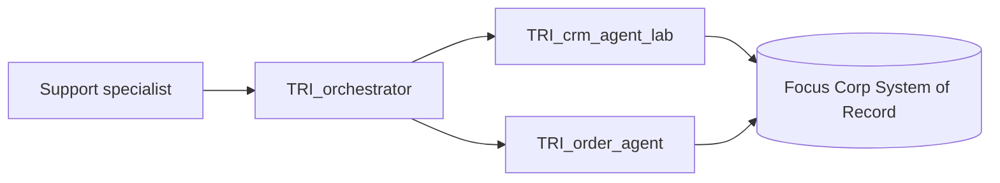

# Lab 1.3 — Multi-Agent Systems: Supervisor + Collaborator Patterns

Version 1.0.0 / Authors: Juergen Lukas, Olaf Hahnl / Duration: ~2.5 hours

---

## Notices

This information was developed for products and services offered in the USA. IBM may not offer the products, services, or features discussed in this document in other countries. Consult your local IBM representative for information on the products and services currently available in your area.

INTERNATIONAL BUSINESS MACHINES CORPORATION PROVIDES THIS PUBLICATION "AS IS" WITHOUT WARRANTY OF ANY KIND, EITHER EXPRESS OR IMPLIED, INCLUDING, BUT NOT LIMITED TO, THE IMPLIED WARRANTIES OF NON-INFRINGEMENT, MERCHANTABILITY OR FITNESS FOR A PARTICULAR PURPOSE.

This information could include technical inaccuracies or typographical errors. Changes are periodically made to the information herein; these changes will be incorporated in new editions of the publication.

This information contains examples of data and reports used in daily business operations. To illustrate them as completely as possible, the examples include the names of individuals, companies, brands, and products. All of these names are fictitious and any similarity to the names and addresses used by an actual business enterprise is entirely coincidental.

Trademarks: IBM, the IBM logo, and ibm.com are trademarks or registered trademarks of International Business Machines Corp., registered in many jurisdictions worldwide. Other product and service names might be trademarks of IBM or other companies. A current list of IBM trademarks is available at [www.ibm.com/legal/copytrade.shtml](https://www.ibm.com/legal/copytrade.shtml).

© Copyright International Business Machines Corporation 2026. This document may not be reproduced in whole or in part without the prior written permission of IBM. US Government Users Restricted Rights — Use, duplication or disclosure restricted by GSA ADP Schedule Contract with IBM Corp.

---

## Table of Contents

1. [Lab Introduction](#toc-1-lab-introduction)
   - [1.1 Lab Scenario](#toc-1-1-lab-scenario)
   - [1.2 Lab Setup Instructions](#toc-1-2-lab-setup-instructions)
2. [Lab Instructions](#toc-2-lab-instructions)
   - [Exercise 1: Why Multi-Agent? Experiencing the Problem *(~15 min)*](#toc-exercise-1)
   - [Exercise 2: Designing a Multi-Agent System — Patterns & Bare Shell *(~20 min)*](#toc-exercise-2)
   - [Exercise 3: The Baseline Failure — Testing the Bare Supervisor Shell *(~15 min)*](#toc-exercise-3)
   - [Exercise 4: The Wrong Fix — Routing by Instruction *(~30 min)*](#toc-exercise-4)
   - [Exercise 5: The Right Fix, Part 1 — Description as Capability Contract *(~25 min)*](#toc-exercise-5)
   - [Exercise 6: The Right Fix, Part 2 — Behavioral Policy & Robustness *(~25 min)*](#toc-exercise-6)
   - [Exercise 7: The Full Picture — Anatomy of What Went Wrong *(~15 min)*](#toc-exercise-7)
3. [Lab Complete](#toc-3-lab-complete)

---

<a id="toc-1-lab-introduction"></a>
## 1. Lab Introduction

Lab 1.1 Exercise 5 taught you to choose between an agent's flexible, probabilistic reasoning and a deterministic Agentic Workflow — using the rule "if the path is at least partially predetermined, review or approval is needed, or multiple users must collaborate → Agentic Workflow." This lab asks a related but different question: given that agent reasoning is the right mechanism, should it be one agent or several? The deciding factor is domain: can everything the task needs stay inside one, or does it genuinely span more than one?

In Lab 1.1, you built `TRI_order_agent` and `TRI_crm_agent_lab` as two separate agents, each scoped to one domain — a deliberate choice, not an oversight, and in this lab you'll see exactly why it mattered. A support specialist's real conversation doesn't stay inside one domain: a customer asking about an order often asks about their own account at the same time. Neither agent, on its own, can answer both halves of that conversation — what's missing is a third agent that sits above both, decides which one (or both) a request needs, and combines their answers. That third agent is the supervisor you'll build in this lab — named for what it does: it supervises, routing to the right specialist rather than handling the request itself. The two agents it coordinates become collaborator agents the moment they're registered under it (you met both terms in **Introduction to watsonx Orchestrate**).

The central design rule for building that supervisor is: **routing quality is description quality**. A supervisor agent never sees a collaborator's instructions or tools — only its `description` field — and relies on that field alone to decide when to delegate to it. Everything you build in this lab, from the supervisor shell through the two wrong fixes to the right fix, is in service of that one rule.

<a id="toc-1-1-lab-scenario"></a>
### 1.1 Lab Scenario

Focus Corp support specialists receive requests that cross domains within a single conversation. You've already seen this in Lab 0: *"List customer details and orders for customer id C-3DBZFE within last four weeks, show details for those containing a laptop"* — one request, but it needs the CRM domain (customer details) and the Order domain (order history, filtered by item) at the same time. The Order agent you built in Lab 1.1 only knows orders; the CRM lab agent only knows customers. Neither can answer that request on its own, and bolting every domain's tools onto a single agent doesn't scale — Exercise 1 will let you experience that problem firsthand.

In this lab, you will assemble `Trinity Orchestrator Agent` as a supervisor over the two collaborator agents you already built in Lab 1.1 — reused, not rebuilt. By the end, one entry point (the supervisor) will handle both "look up this customer" and "find orders for order ID O-DF340K," routing to the right collaborator by intent and, where one collaborator needs information only the other can supply, sequencing the calls correctly without ever being told to.



*Figure 1. Lab 1.3 solution architecture — the supervisor routes to the two collaborator agents built in Lab 1.1.*

<a id="toc-1-2-lab-setup-instructions"></a>
### 1.2 Lab Setup Instructions

### 1.2.1 Prerequisites

Before starting, ensure you have:

**Everyone:** **Builder** role on the shared wxO SaaS tenant (permissions to create and edit agents). If you completed any previous lab in this event, you already have this role.

> 💡 **Not sure?** Log in, expand the hamburger menu in the top left, and confirm the **BUILD & RUN** section is displayed. If not, contact your facilitator.

**If you have not completed Lab 1.1, or want to reset its artifacts** — you'll need to import the two pre-built collaborator agents and everything they depend on, including their connections and tools (see 1.2.2 below), which requires:

1. The ADK CLI (version 2.15 or later) installed, connected to the event tenant, and authenticated.
2. Your event credentials filled in `labs/event.env` (configured during **Setup & Event Credentials**, section **1.2 On Event Day**). Your SOR user ID (`sorUsername`) serves as your assigned namespace.
3. The Trinity-Event repository (the event GitHub repository) cloned or downloaded to your machine.

> 💡 **Tip:** To install, update, or connect the ADK CLI, see **Setup & Event Credentials**, section **1.1 On Event Day**. If a command fails with an authentication or token error, see the note on Authentication Expiry in section 1.1.

**Placeholder convention:** Parentheses mark a value you must supply — the uppercase word or phrase inside names what's needed. Replace the entire `(...)` token with your actual value everywhere it appears, in both UI fields and commands, for example `(NAMESPACE)`.

**Namespace prefix convention:** All participants work on a shared wxO tenant. Every artifact you create or reference must be prefixed with your assigned user ID followed by `_TRI_` (for example: `usr001_TRI_orchestrator`). You will see `(NAMESPACE)_TRI_` as a placeholder throughout this lab — in instructions, tables, and commands — replace `(NAMESPACE)` with your assigned user ID wherever it appears.

> **Note:** Because this is a shared wxO tenant specific to this enablement event, do not enter production credentials or customer data. All lab exercises use fictitious lab records.

### 1.2.2 Lab Artifacts

This lab does not build any new tools or connections. Starting in Exercise 2, it creates and configures a supervisor agent that routes to two collaborator agents. Everything else, this lab reuses as-is:

| Artifact | Type | Role | Built in |
|---|---|---|---|
| `(NAMESPACE)_TRI_orchestrator` | Agent | Supervisor — routes to the two collaborators below | **Built in this lab** |
| `(NAMESPACE)_TRI_order_agent` | Agent | Order-domain collaborator | Lab 1.1 |
| `(NAMESPACE)_TRI_crm_agent_lab` | Agent | CRM-domain collaborator | Lab 1.1 |
| `(NAMESPACE)_TRI_cp4ba_basic_member` | Connection | Order agent's OpenAPI tool credentials | Lab 1.1 |
| `(NAMESPACE)_TRI_cp4ba_keyvalue_team` | Connection | Shared by the Order agent's MCP catalog tool<br>and the CRM agent's Python tool | Lab 1.1 |
| `(NAMESPACE)_TRI_SOR_MCP` | Toolkit (MCP) | Registers 10 tools tenant-wide (this lab's<br>agents use only `TSOR_Catalog_get_catalog_items_by_category_`<br>`sub_category_and_price_ran`) | Lab 1.1 |
| `(NAMESPACE)_TRI_TSOR_Orders_get_order_by_id` | Tool (OpenAPI) | Order agent | Lab 1.1 |
| `(NAMESPACE)_TRI_TSOR_Orders_get_orders_by_`<br>`customer_id_and_item_category_last_xdays` | Tool (OpenAPI) | Order agent | Lab 1.1 |
| `(NAMESPACE)_TRI_TSOR_Orders_update_order` | Tool (OpenAPI) | Order agent | Lab 1.1 |
| `(NAMESPACE)_TRI_calculate_days_since_purchase` | Tool (Python) | CRM agent (no connection) | Lab 1.1 |
| `(NAMESPACE)_TRI_get_customer_by_id` | Tool (Python) | CRM agent (Key-Value Team connection) | Lab 1.1 |

**If you completed Lab 1.1:** all of the above are already active in your draft workspace. Skip ahead to Exercise 1 — no import needed.

**If you are starting directly here, or need to reset your work:** run the prep script below to import both collaborator agents and everything they depend on. This is also safe to re-run if you completed Lab 1.1 through the UI — re-importing the same namespaced artifacts simply confirms your Draft configuration.

1. Run `prepare_lab_1_3.py`. It reads your SOR credentials and namespace automatically from `labs/event.env`. It prepares the Lab 1.1 artifacts first if `labs/lab-1x/solution/lab-1-prepared` does not already exist yet (equivalent to running `prepare_lab_1_1.py` yourself), then imports, in order: the Key-Value Team and Basic Auth Member connections (with your Draft credentials), the MCP toolkit, the Order agent's OpenAPI tools, the Order agent itself, both CRM Python tools, and the CRM agent itself.

   ```bash
   python3 labs/lab-1x/solution/scripts/prepare_lab_1_3.py
   ```

   > **Note:** On Windows, use `python` if `python3` is not available. The script prints a numbered `[INFO]`/`[OK]` line for each of its 11 internal steps as it runs — if any step fails, re-run the same command once the underlying issue (credentials, connectivity, an existing namespaced artifact) is resolved; every step is safe to repeat.

   > **Note:** If the script's first `orchestrate` call fails with an authentication/token error, your CLI session has expired — this is expected if some time has passed since you last ran an `orchestrate` command. Re-activate your environment as described in **Setup & Event Credentials**, section **1.2 On Event Day** (using `orchestrate env activate trinity-lab -a <your-api-key>` with the `wxoAPIKey` saved in `labs/event.env`), then re-run the script.

   > **Note:** Step 10 may print a warning that the Key-Value Team connection (`(NAMESPACE)_TRI_cp4ba_keyvalue_team`) is not configured in the `live` environment. This is expected and safe to ignore — this lab only runs agents in the Draft Preview chat, which this connection's Draft credentials already cover. The warning would only matter if you later deployed the CRM agent to Live.

[↑ Back to Table of Contents](#table-of-contents)

---

<a id="toc-2-lab-instructions"></a>
## 2. Lab Instructions

> **Sequencing:** Complete these exercises in order, start to finish. Each one depends on the agent and configuration state left behind by the one before it — Exercise 3 assumes the bare supervisor shell built in Exercise 2; Exercise 4 assumes that same bare-shell, empty-instructions state, unchanged by Exercise 3's testing; Exercise 5 assumes the empty-instructions state Exercise 4 leaves behind; Exercise 6 assumes the capability-contract descriptions written in Exercise 5. There is no supported way to jump into a later exercise on its own or skip one and continue — doing so leaves your supervisor in a configuration state the later steps don't account for.

> ### 💡 Testing in this Lab: Understanding Probabilistic Behavior & Test Runs
>
> In multi-agent systems, agents reason dynamically using Large Language Models (LLMs). This means execution is **probabilistic, not deterministic code** — the same prompt evaluated against the same configuration can produce different reasoning traces or output shapes across runs.
>
> Keep the following principles in mind throughout this lab:
> - **One run is enough:** For every test step in this guide, entering the prompt **once** is completely sufficient to see how your supervisor coordinates its collaborators.
> - **Repetition is optional:** If you are curious to observe non-deterministic variations firsthand, feel free to reset the chat and rerun a prompt 2–3 times. However, this is strictly at your own discretion — you are never expected to loop through dozens of manual test runs.
> - **Benchmark statistics vs. live experience:** When this guide quotes statistical observations (such as *"succeeded in 80%+ of runs"* or *"across 20 test runs"*), these refer to benchmark datasets gathered during Trinity curriculum development to measure the stability of a given design. They explain what is likely to happen across many iterations, but your individual run may turn out differently (e.g. succeeding on a prompt where a subtle failure mode is discussed).
> - **No need to force failures:** If your test run succeeds where the guide explores a latent failure mode, do not keep re-running to force a failure to occur. The annotated screenshots, trace breakdowns, and reference explanations illustrate the underlying mechanics clearly so you can follow along without getting stuck.

Exercises 1 and 2 are mostly conceptual: Exercise 1 has you observe a single agent's failure and name its root cause, and Exercise 2 surveys the coordination patterns before you wire up a bare, empty supervisor shell. Exercise 3 puts that bare shell to the test for the first time — observing how an under-specified supervisor handles compound requests — before Exercise 4 shows you two well-intentioned instruction fixes fail and Exercise 5 shows you the contract-based approach that actually works. Understanding *why* a supervisor is needed and *what shape* it takes before you start building it means the configuration choices in Exercises 4–6 will make sense as you make them, not just in hindsight.

Throughout this lab, every **OPTIONAL** box carries one of two labels so you know up front whether to act or just read:

- *Read-along — no action needed* — the box walks through a screenshot of someone else's run. You can skip it, or read it without reproducing anything.
- *Hands-on, optional* — the box has you open something in your own session. Your run may differ from the screenshots shown, and that is fine.

---

<a id="toc-exercise-1"></a>
### Exercise 1: Why Multi-Agent? Experiencing the Problem *(~15 min)*

In this exercise, you will watch a single agent hit a hard reliability limit, name the actual root cause (not just the symptom), and then learn when adding a supervisor would actually be the *wrong* move.

---

### Watch the Agent Hit Its Limit

1. In the wxO UI, expand the hamburger menu (☰) in the top left, click **Active inventory** under the **BUILD & RUN** category, then click **Agents**. Search for `(NAMESPACE)` in the search field (**1**), then click the Order agent's card (**2**) to open it.

   

   *Figure 2: Active inventory > Agents list. (**1**) The search field. (**2**) The Order agent's card, among the other agents that match. The screenshots in this guide were captured with the namespace `usr111`, so wherever you see `usr111` in a screenshot, you will see your own `(NAMESPACE)` value instead.*

   > **Note:** The **Active inventory** search matches an agent's **display name**, not its artifact ID (the `(NAMESPACE)_TRI_...` form used in the artifact table and CLI commands throughout this guide) — the two are set independently in the agent's YAML (`name:` vs. `display_name:`). Look up an agent's display name from its source YAML's `display_name:` field when searching in the UI.

2. In **Draft Preview**, enter the primary customer lookup prompt from the Focus Corp support scenario you saw in the Trinity demo and in Lab 0:

   ```
   List customer details and orders for customer id C-3DBZFE within last four weeks, show details for those containing a laptop
   ```

   

   *Figure 3: Draft Preview panel with the customer lookup prompt typed in and the Order agent's response shown.*

   Observe the response text. The Order agent has no CRM tool attached, so it cannot actually resolve "customer details" — only the order-lookup half of the request is real. Depending on the model and run, you'll see one of three things: it states outright that it cannot retrieve customer profile details; it fabricates a plausible-sounding customer name and email from LLM training memory; or — as in the screenshot above — it quietly treats the customer ID already present in the prompt as sufficient "customer details" and skips any further profile lookup, without flagging that anything is missing.

   > **Note:** Model responses vary. All three outcomes are useful to observe — in each case, the order-lookup half of a domain-crossing request works while the customer-profile half either fails openly, is fabricated, or is silently skipped, on the same single agent.

3. In the Draft Preview response message, click **Show Reasoning** (**1**) to expand the execution trace. Under **Step 1**, check the tool's **Input** (**2**) and **Output** (**3**) panels.

   

   *Figure 3a: Draft Preview with Show Reasoning expanded. (**1**) The Reasoning toggle — it reads "Hide Reasoning" once the trace is open. (**2**) The tool's input parameters. (**3**) The tool's output payload.*

   **What the trace reveals:**
   - **Input (2):** The Order Agent executed its reasoning correctly within its domain — it mapped `customer_id: "C-3DBZFE"`, `item_category: "laptop"`, and calculated *"within last four weeks"* to `number_of_days: 28`.
   - **Output (3):** The Orders tool returned order `O-DF340K`, the `Focus Gamer Z2` laptop ($2,500), and `customer_id: "C-3DBZFE"`.
   - **The Missing Domain:** Nowhere in the Orders tool output do profile fields like `firstname`, `lastname`, `email`, `phone`, or account tier (`status: Platinum`) exist. The `customer_id` is merely a reference key.

   This proves the failure is **not an agent bug or a prompt misunderstanding**. The Order Agent executed its assigned tool flawlessly. The limitation is structural: resolving *who* that customer is requires querying the CRM System of Record.

4. Click the circular reset icon in the top right of the **Draft Preview** panel to reset the chat, then enter a second domain-crossing request:

   ```
   The customer is concerned about a billing charge for that order — can you pull their billing records?
   ```

   

   *Figure 4: Draft Preview panel showing the billing question and the Order agent's response stating it has no tool to retrieve billing records.*

   Observe that the agent cannot help with this either — billing is a third enterprise domain, completely outside what the Order agent was built to handle.

You just hit a domain-crossing gap: the Order agent is scoped to the orders domain, so a request that also needs customer-profile data falls outside what it can do. A tempting fix is to leave this as one agent and simply add CRM and billing tools to it — but that does not reliably solve the problem. Every tool added to an LLM-driven agent inflates its reasoning space, dilutes its instructions across unrelated concerns, and makes it more likely to pick the wrong tool between near-duplicates. That is a general reliability limit of LLM-driven agents: the same thing would happen to any single agent asked to cover too many domains, on any platform, by any team — Trinity included.

The documented fix for this general limitation is to keep agents narrowly scoped and coordinate several of them with a supervisor (ADK Docs: [`agents/agent_design/foundational_architecture`](https://developer.watson-orchestrate.ibm.com/agents/agent_design/foundational_architecture)) — which is exactly why Trinity split orders, CRM, and billing into separate agents in the first place, instead of building one agent that tries to do everything. Domain (orders vs. CRM vs. billing) is *a* clean decomposition axis — the one Trinity picked — but it is a design choice layered on top of this reliability limit, not the limit itself.

> **Note:** Splitting into multiple agents does not make the system deterministic. Every agent — alone or inside a supervisor/collaborator system — is still running the same non-deterministic LLM reasoning; that is expected of agents, not a defect to engineer away. What splitting fixes is domain-crossing and near-duplicate tool confusion, nothing more. If a task genuinely needs a guaranteed, repeatable outcome, the answer is rules, code, or an Agentic Workflow — not more agents.

A second symptom worth naming alongside domain-crossing: **tool overload** is a trigger for splitting an agent — not tool *count*, but tool *similarity*. Some agents manage 15+ well-defined tools without trouble, while others struggle with fewer than 10 overlapping ones. If `(NAMESPACE)_TRI_order_agent` had both an order-lookup tool and a near-duplicate "check delivery status" tool, the same reliability failure would show up even with zero domain-crossing — reinforcing that the fix is about scope and clarity per agent, not strictly about domain lines.

---

### When NOT to Use a Multi-Agent System

The governing question for every capability this lab programme introduces is *when not to use it*, and multi-agent systems are no exception. They carry real, ongoing costs — every delegation is an extra round-trip LLM call, more context has to cross an agent boundary, and there are more moving parts to debug. A supervisor is not the default answer to every agentic problem. Four situations where it is the wrong answer:

| Situation | Why a supervisor is the wrong move |
|---|---|
| A single agent with well-scoped tools is already sufficient | If a task fits neatly inside one domain, adding a supervisor adds latency and complexity with no benefit. Trinity uses multiple collaborator agents because its scenario genuinely spans several SOR domains — not because multi-agent is inherently better. Start single by default, and only split once a concrete signal shows up (branching logic getting unwieldy, or tool overload) — domain-crossing, as in Exercise 1's opening demo, is already a clear signal on its own. |
| The real problem is routing/collaborator selection, not missing agents | If a supervisor keeps routing to the wrong specialist, the cause is almost always a vague collaborator description — not a missing third agent. Before adding any agent, ask: *"If I rewrote this collaborator's description to be perfectly explicit, would routing work?"* If yes, fix the description — you'll practice exactly this in Exercise 5. If the domains genuinely overlap, decompose differently instead of adding another specialist on top. |
| The real problem is tool selection within one agent, not missing agents | If an agent keeps picking the wrong tool among its own near-duplicates — the tool-overload symptom described above — splitting it into a supervisor plus specialists doesn't fix anything; the ambiguity just moves up a level. Cut the number of overlapping tools, or sharpen each tool's description so the distinction is unambiguous, before reaching for a supervisor. |
| Coordination overhead outweighs the specialisation benefit | Every delegation adds a full LLM turn. For a single-turn lookup that completes in one tool call, a plain tool on a single agent is faster, cheaper, and equally capable. |

---

> #### OPTIONAL: Going further: Agent-Washing a Multi-Agent System
>
> *Read-along — no action needed.*
>
> This is optional, deeper architectural material — read it if you want a sharper test for when a single-tool agent is justified versus over-engineered; skip it if the four situations above already made the point. Nothing later in this exercise depends on it.
>
> The same test you apply to a single tool applies one level up to a whole agent — this is the **Agent-Washing** anti-pattern (documented in the official wxO ADK docs: [`agents/agent_design/tooling_scalability#agent-washing`](https://developer.watson-orchestrate.ibm.com/agents/agent_design/tooling_scalability)), applied one level up from a single tool to a whole agent: **every agent in a multi-agent system must earn its presence.** Building a supervisor plus two single-tool specialists, when one agent with two tools would have done the job just as well, is agent-washing — a multi-agent system that exists for its own sake rather than because a real domain boundary requires it. The test: if removing an agent would break a meaningful domain separation, it belongs. If removing it would simplify the system without losing anything, it is over-engineering.
>
> Trinity's own `TRI_crm_agent` is a useful test case, not a counter-example to avoid: it currently has a single tool, because the demo scenario only requires a customer-profile lookup through the LLM-driven agent layer. The broader CRM service exposes additional operations — warranty proof retrieval, payment info, fraud-risk evaluation — and none of those go through `TRI_crm_agent` at all:
>
> - `TRI_warranty_claim_workflow` calls `TSOR_CRM_get_customer_payment_info_by_customer_id` and `TSOR_CRM_evaluate_fraud_risk` directly as Call Tool nodes inside a Parallel Node.
> - A dedicated flow tool fetches the warranty-proof PDF straight from the CRM REST endpoint.
>
> That is not a domain-decomposition violation:
>
> - Domain decomposition governs how *LLM reasoning* is split across agents to avoid tool overload and domain-crossing — it does not require every access to a domain's SOR to pass through that domain's agent.
> - For a deterministic, single-path operation on sensitive data (a payment identifier, a fraud-risk input), routing the call directly from the workflow is the correct pattern — the same principle behind Lab 2's billing-record write, covered in the official ADK docs: [`agents/agent_design/foundational_architecture`](https://developer.watson-orchestrate.ibm.com/agents/agent_design/foundational_architecture), § "**Passing 'as-is' information through the model**".
> - It is also the flip side of **Agent-Washing**: wrapping that lookup in an LLM agent call would add latency and risk for no reasoning benefit.
>
> The domain decomposition is still correct: CRM is a genuine SOR boundary, and `TRI_crm_agent` would gain more *agent-facing* tools in a production deployment, where natural-language CRM questions require judgment the workflow's fixed Call Tool nodes don't. A domain agent that happens to be narrow *today* is not the same failure as a supervisor wrapping a single-tool agent with no domain rationale at all. The test is whether the boundary is meaningful — not whether it is currently fully populated, and not whether every call into the domain happens to pass through the agent.

✅ Exercise 1 complete. You have experienced a single agent's domain-crossing failure firsthand, named its actual root cause, and can now state four situations where a supervisor would be the wrong architecture rather than the automatic upgrade. In Exercise 2, you will design the multi-agent system this scenario actually calls for.

[↑ Back to Table of Contents](#table-of-contents)

---

<a id="toc-exercise-2"></a>
### Exercise 2: Designing a Multi-Agent System — Patterns & Bare Shell *(~20 min)*

Exercise 1 established *when* a supervisor earns its place. This exercise covers *what shape* it takes: which coordination patterns exist, which one wxO's agent layer is actually built for, and how to wire up the bare `collaborators:` mechanism in the UI. By the end, you will have a bare, routing-only supervisor shell in place — the settings that make it actually route correctly come in the following exercises.

---

### Coordination Patterns: Four Shapes, One Native to wxO

| Pattern | How it works | Trade-off |
|---|---|---|
| Peer-to-peer / group chat | Agents converse directly with each other, with no fixed router deciding who goes next. | Routing is unpredictable, and circular delegation is a real risk. Not natively supported anywhere in wxO — neither the agent layer nor the workflow layer. |
| Sequential pipeline | A fixed order: agent A always runs, then B, then C. | Rigid and often wasteful — a CRM lookup would run even for a billing-only question, whether or not it's needed. |
| Evaluator-optimizer / critic loop | One agent generates an answer, a second critiques and refines it. | Good for quality-gated output, but every cycle costs an extra round-trip. |
| **Supervisor / collaborator** (Trinity's choice) | One supervisor routes to focused specialists and combines their results. | Clean domain separation, independently tunable specialists, a single entry point for instrumentation and audit. |

"Supervisor" and "collaborator" are common terms across the industry for this pattern, and the ones Trinity and these guides use. The shape they describe — one coordinating agent routing to specialists and combining their output — is not wxO's or Trinity's invention: most agent frameworks that support multi-agent coordination describe the same pattern, just under different names (for example, "orchestrator" for the top-level agent and "worker agent" for the specialists). Recognize the shape, not any particular label for it, and don't be confused if you see it called something else elsewhere.

This lab will actually walk you through this pattern carrying slightly more weight than it first appears to, and naming that now will save confusion later: most of this lab teaches **routing** — the supervisor picks one collaborator from a known, fixed set, based on the intent of the request. Exercise 5 adds **dependency-driven sequencing** on top of that, once both collaborators are in play: when one collaborator's required input is only available from the other's output, that same reasoning over the request's intent also decides *what order* to call them in. It isn't a separate job sitting next to routing — it's routing's natural extension, visible only once a real dependency exists between two collaborators.

> **OPTIONAL: Going further:** *Read-along — no action needed.* wxO's agent layer also supports one further shape worth knowing, though it isn't exercised hands-on in this lab: a collaborator can itself have its own collaborators — a supervisor of supervisors, one level deeper, built exactly the same way you're about to build `(NAMESPACE) Trinity Orchestrator Agent`. If Trinity ever needed a domain with its own internal sub-specialists, the same `collaborators:` field you use in this exercise would scale to that with no new mechanism required. Each added layer is still a full LLM round-trip, though — a supervisor of supervisors doubles the delegation cost of a single-layer system, so reach for it only when a sub-domain genuinely needs its own internal specialists, not as a default way to scale.

---

### Where the Pattern Lives: Agent Layer vs. Workflow Layer

wxO's *agent* layer — the `collaborators:` field you'll use in this exercise — natively supports exactly one of the four patterns above: supervisor/collaborator (plus the nested variant in the note above). That is documented, not a gap in the platform: the official ADK docs state plainly that "the built-in supervisor/collaborator model does not support" patterns like critic loops, and direct you to "build the coordination logic as a generic agentic workflow" instead (ADK Docs: [`agents/agent_design/agentic_workflow_decision_guide`](https://developer.watson-orchestrate.ibm.com/agents/agent_design/agentic_workflow_decision_guide), § "Custom multi-agent coordination patterns"). So sequential pipelines and evaluator-optimizer critic loops can still be built in wxO, just one layer down — as an Agentic Workflow with an Agent node embedded at the step that needs reasoning, while the surrounding deterministic workflow enforces the sequence and structure. Peer-to-peer/group-chat has no native home in either layer.

This split is not an arbitrary wxO restriction — it reflects how the industry broadly divides the coordination problem: an agent decides the next step at runtime, while code or a workflow has its sequence of steps fixed at design time. Worth carrying as a rule of thumb: if the coordination logic itself needs to vary turn to turn based on reasoning, it belongs in the agent layer (`collaborators:`); if the shape is fixed or must be guaranteed to happen a certain way, it belongs in a workflow with an embedded Agent node — and always cap any loop in that workflow with a maximum iteration count.

---

### Where the Collaborator Lives: Native vs. External (A2A)

The `collaborators:` list you'll use in this lab only works between agents built inside the same wxO tenant. There's a separate, already-real standard — **A2A (Agent2Agent protocol)** — for reaching an agent *outside* that boundary: a different platform, a different vendor, a different team's build. An external A2A agent is registered by URL, discovered through a published capability description (an **Agent Card**), and then added to a native agent's `collaborators:` list exactly like a native collaborator — same YAML surface, different transport underneath.

Two things worth knowing, though neither is exercised hands-on in this lab: first, wxO's A2A support today is client-role only — it can call out to an external A2A agent, but exposing one of your own native agents over A2A for outside systems to call is not yet available. Second, A2A is a protocol/transport concern, not a coordination-pattern choice — it doesn't replace or correspond to the `style` setting (`react_core`) that governs how your supervisor actually delegates; A2A only changes *where* a collaborator lives, not how coordination behaves.

---

### Avoiding "Multi-Agent Chaos"

wxO's own documentation names an anti-pattern worth knowing before you build your first supervisor: **"multi-agent chaos"** — over-segmenting by org chart (an agent for every job title) rather than by domain, no clear coordinator, overlapping tool access between agents, and no termination rule. The fix has three parts: specialize agents by capability or domain instead, coordinate explicitly through a supervisor or routing rules, and right-size — start with fewer, broader agents, and split only once you have evidence a split will help. (ADK Docs: [`agents/agent_design/tooling_scalability`](https://developer.watson-orchestrate.ibm.com/agents/agent_design/tooling_scalability))

---

### Build the Supervisor Shell

> 💡 **Already built an agent in Lab 1.0 or 1.1?** Steps 1–4 below are the same create-agent mechanics you've already done once — skim through them. The lab-specific part starts at step 5, where you attach collaborators instead of tools.

1. In the wxO UI, expand the hamburger menu (☰), under **BUILD & RUN** expand **Active inventory** (**1**), then click **Agents** (**2**). On the top right, click **Create agent +** (**3**).

   

   *Figure 5: Active inventory > Agents list. (**1**) Active inventory, under BUILD & RUN. (**2**) Agents. (**3**) The Create agent + button in the top right.*

   This is the same **Agents** list you searched in Exercise 1. **Create agent +** is what starts the new supervisor you are about to build.

2. In the **Create an agent** dialog that opens, click **Create from scratch** (**1**), bottom left under "Other ways to start".

   

   *Figure 6: Create an agent dialog. (**1**) Create from scratch, bottom left under "Other ways to start".*

   Ignore **Build with AI** and the other two options (**Build from template**, **Import langGraph agent**) — this lab builds the supervisor's configuration by hand, step by step, so each setting's effect is visible as you make it.

3. Set the **Agent name** field (**1**) to `(NAMESPACE) Trinity Orchestrator Agent`.
4. Leave all other fields at their defaults — **Model** (**2**), **Description** (**3**), **Instructions** (**4**), **Guidelines** (**5**), and **Voice** (further down the page) — the Instructions field is deliberately left completely blank.

   

   *Figure 7: Agent Behavior tab. (**1**) Agent name, set to your namespace. (**2**) Model. (**3**) Description, with its pre-filled placeholder text. (**4**) Instructions, empty. (**5**) Guidelines. The Voice setting is further down the page and not visible here.*

   This is deliberate, not an oversight: once the collaborators are attached below, you want a supervisor with zero instructions of your own — so that whatever happens next in Exercise 3's test is explained entirely by the collaborators' own descriptions, not by anything you wrote into the supervisor.

   > **Note:** The **Description** field comes pre-filled with generic placeholder text ("A general-purpose AI agent that can assist with various tasks."). Leave it exactly as it is for now — you'll replace it with a real capability contract in Exercise 5.

5. Click the **Agents** tab (**1**) at the top, then click **Add Agents +** (**2**) on the right.

   

   *Figure 8: Agents tab, empty. (**1**) The Agents tab. (**2**) The Add Agents + button, top right.*

   "You haven't added any agents to support your agent in collaboration" is the Agents tab's own description of what this list is: the supervisor's `collaborators:` field, currently empty.

6. In the **Add Agents** window, click **Local instance** (**1**), not **Catalog** or **Import**.

   

   *Figure 9: Add Agents window. (**1**) Local instance, between Catalog and Import.*

   **Catalog** is for pre-built agents and **Import** is for registering an external agent (see "Where the Collaborator Lives: Native vs. External (A2A)" above) — neither applies here. Both collaborators you need already exist in this tenant, built in Lab 1.1, so **Local instance** ("choose from a list of agents available on this instance") is the right choice.

7. In the **Add agents to '(NAMESPACE) Trinity Orchestrator Agent'** window, type your `(NAMESPACE)` into the search field (**1**) at the top, tick the checkboxes (**2**) of both `(NAMESPACE)_TRI_order_agent` and `(NAMESPACE)_TRI_crm_agent_lab`, then click **Add to agent** (**3**) at the bottom right.

   

   *Figure 10: Add agents dialog. (**1**) Search field, filtered to the namespace. (**2**) The checkboxes of both collaborator agents, ticked. (**3**) Add to agent button, bottom right.*

   Note each card's description as shown here — `(NAMESPACE)_TRI_crm_agent_lab`'s one-liner ("Looks up customer profiles by C-* customer ID and demonstrates deterministic date arithmetic") is the thin description you will put under test below, and rewrite properly in Exercise 5.

   > **Note:** The search returns every agent you've built under your `(NAMESPACE)` prefix, not just these two — if you've completed other labs, you'll see more than two results here. Pick exactly `(NAMESPACE)_TRI_order_agent` and `(NAMESPACE)_TRI_crm_agent_lab` by name; the rest aren't needed for this lab.

8. The agent auto-saves as you go — there's no separate save button to click.

---

✅ Exercise 2 complete. You have surveyed the four coordination patterns, confirmed that wxO's agent layer natively supports only supervisor/collaborator — with sequential pipelines and critic loops pushed to the workflow layer instead — and learned to recognize "Multi-Agent Chaos" before it shows up in your own designs. You have also learned where native collaborators end and the A2A boundary begins, and created a bare supervisor with no instructions, zero tools, and both collaborator agents attached. In Exercise 3, you will put this bare shell under test and see exactly how unpredictable an under-specified supervisor really is.

[↑ Back to Table of Contents](#table-of-contents)

---

<a id="toc-exercise-3"></a>
### Exercise 3: The Baseline Failure — Testing the Bare Supervisor Shell *(~15 min)*

Exercise 2 assembled a bare supervisor shell — zero instructions, both collaborators attached with their original thin descriptions. This exercise puts that shell under test: one compound prompt is enough to expose the baseline routing challenges.

---

### Test the Bare Supervisor Shell

Now that the bare shell is assembled with zero instructions and thin collaborator descriptions, test how it handles our scenario's primary request in **Draft Preview**. A single compound prompt reveals the baseline problem. In practice, any given run will land in one of three outcome categories:

- **Visible failure:** the supervisor halts, declines, or otherwise says something is wrong. You know immediately not to trust the result. This is the most common outcome.
- **Silent failure:** the response *looks* complete and confident, with no hedge or error anywhere, but something real is missing or invented. Also common, and the dangerous one: nothing about its own text tells you to double-check it.
- **Success:** both collaborators get called correctly and the answer is completely real. In our benchmark testing, this was rare with an unconfigured supervisor. (You do not need to re-run to hunt for it; the reference screenshots illustrate each category).

Which of these you land on for any given run is not something you can predict or control from the prompt alone — the same words, run twice, can produce different outcomes. The cause is the same across all three: with thin collaborator descriptions and no supervisor instructions, nothing *reliably* tells the supervisor how to split and sequence a compound request across both collaborators.

1. In **Draft Preview**, click the **Reset chat** icon ($\circlearrowleft$) to ensure a clean session. Enter the primary customer lookup prompt from the demo and Lab 0:

   ```
   List customer details and orders for customer id C-3DBZFE within last four weeks, show details for those containing a laptop
   ```

   Click **Show Reasoning** to expand the step trace. This is the first, simplest level of looking under the hood: it shows which collaborator(s) were called, with what input, and what came back. Run the prompt once (or optionally 1–2 extra times if you wish to observe variation), using the self-check below to classify which bucket your run landed in, before reading the sections that follow.

---

### Two ways to look under the hood

The platform gives you two views of a run. You will use the first one every time and the second one only when a run is hard to read.

- **Show Reasoning** — the link under the chat reply that you opened in step 1. It lists the run as numbered steps (**Step 1**, **Step 2**, …): each collaborator call (a transfer to the CRM agent or the Order agent) and each tool call a collaborator made. Read two things: **how many steps** there are and **which collaborators appear in them**. That is enough to classify most runs.
- **Debug mode** — the bug icon beneath the final answer in Draft Preview. It opens a node graph and a full **Execution timeline** that shows *why* the supervisor routed the way it did. You do not need it to classify a run. The optional "Going further: using the Debug view" section at the end of this exercise walks through it, and the buckets below point back to it when a run needs more than Show Reasoning to settle.

---

### Quick self-check: which bucket are you in?

Before reading any of the sections below, open **Show Reasoning** on your run, match its step pattern first, then confirm against the final answer:

- **One step, a transfer to the CRM agent only** (the Order agent never appears) → read the answer. If it admits it can't look up orders or asks for more information, you're in [**Visible failure**](#bucket-visible-failure). If it instead presents a confident customer profile with fields CRM doesn't have (a company, an address, an account manager), it's a [**Silent failure**](#bucket-silent-failure) — an invented profile.
- **One step, a transfer to the Order agent only** (the CRM agent never appears) → the customer half of the request was never asked for. If the answer still opens by claiming to give customer details, it's a [**Silent failure**](#bucket-silent-failure).
- **Both collaborators appear, but CRM never runs a tool of its own** (typically three steps) → read the customer section of the answer. An honest "not provided" for every field is a [**Visible failure**](#bucket-visible-failure). A confident name, status, company or address is a [**Silent failure**](#bucket-silent-failure), and so is an answer that mixes an honest disclosure with a value stated as fact. Check any profile against the schema fact under Figure 14, below: CRM returns exactly seven fields, and none of them is a company or an address.
- **Four steps: CRM transfer, CRM tool call, Order transfer, Order tool call** → every field in the answer should trace back to something a collaborator returned. If it does, it's a genuine [**Success**](#bucket-success).

If the step pattern and the answer point to different buckets, trust the answer check: step count alone is never evidence that an answer is correct. When a run is still ambiguous, the optional Debug walkthrough at the end of this exercise shows how to settle it, but most runs won't need it.

To help you match your own output, here is what each bucket typically looks like. The exact wording varies from run to run, so match the *shape*, not the words:

| Bucket | What the final answer typically says | Show Reasoning typically shows | The tell |
|---|---|---|---|
| **Visible failure** | *"I'm sorry—I don't have a tool that can pull a customer's order history or filter those orders by product type…"* — or a Customer Details block in which every field reads `[Data not provided by the order lookup]`, above a correct laptop-order table | Usually one step, a transfer to the CRM agent; the Order agent is never called. In the rarer variants both collaborators appear. | The answer itself admits something is missing or declined. Nothing is invented. |
| **Silent failure** | *"Here are the details for customer C-3DBZFE…"* followed by only an order table — or a Customer Details block with Name, Company (*"Rivera Design Studio"*), and address fields, above a correct laptop-order table | One step to the Order agent only, or typically three steps where CRM is only a transfer and never runs a tool of its own. Occasionally one CRM-only step with an invented profile. | Confident, no hedge anywhere — but customer data is missing or invented. CRM returns exactly seven fields, and none of them is a company or an address. |
| **Success** | A Customer Profile with Marie Smith's real name, sex, email, phone, and Platinum status, followed by one laptop order (`O-DF340K`) with the bundled mouse excluded | Four steps: CRM transfer, CRM tool call, Order transfer, Order tool call. | Every field traces back to something a collaborator returned. |

Use this self-check to classify your run. You do not need to reproduce all three categories live — the sections below walk through the mechanics of each bucket with reference screenshots and traces.

---

<a id="bucket-visible-failure"></a>
### Visible failure

**What this looks like:** the final answer itself tells you something went wrong — an error, a request for more information, an honest decline. The response says so itself. To confirm why, click **Show Reasoning** under the reply (you opened it at step 1 above) and check: one step (**1**), CRM only — the Input (**2**) carries the full compound request straight to the CRM agent, and the Order agent is never called. The final answer (**3**) admits the gap.


*Figure 11 — Bare supervisor on the primary prompt, visible-failure case. (**1**) Step 1: only one step, the CRM transfer — the Order agent is never called. (**2**) Input: the full compound request handed verbatim to the CRM agent. (**3**) Final answer: the CRM agent's honest decline, relayed unchanged.*

**What happened:** Because the CRM agent's description mentions "customer profiles," the supervisor hands it the *entire* request verbatim — customer lookup and the laptop-order filter together — instead of splitting the two domains between its collaborators up front. The CRM agent has no order-lookup tool and replies that it needs specific order IDs or dates. Here, the supervisor simply relays that reply as its final answer. The exact wording varies run to run, but the shape is always the same: no data of any kind reaches the final answer, Show Reasoning shows exactly one step, and the Order agent is never called.

> #### OPTIONAL: Going further: Error variations and detailed analysis
>
> *Read-along — no action needed.*
>
> This is optional, deeper material — read it if you want the full technical mechanism behind two variations on the Visible failure case above; skip it if the primary case already made the point. Nothing in the rest of this exercise depends on it.
>
> Both variants below are uncovered using the platform's **Debug mode**, which goes one level deeper than Show Reasoning. If you haven't used Debug mode yet, see "OPTIONAL: Going further: using the Debug view" later in this exercise first to get oriented — it walks through the view step by step.
>
> ##### A successful result dropped at synthesis
>
> In the Debug view, select the supervisor's final **Agent Processing** node (**1**) and stay on the **Summary** tab. Compare the **Input request** (**2**) with the **Output response** (**3**) of that same call.
>
> 
>
> *Figure 12 — A rarer twist on the same visible-failure shape. (**1**) The supervisor's own final-synthesis call. (**2**) Input request: CRM actually succeeded and returned Marie Smith's complete profile. (**3**) Output response: only the honest order-limitation text — the profile is silently dropped. Same call, data present on one side and gone on the other.*
>
> Read on its own, the final answer looks identical to the halt above — a plain capability-gap admission. The surprise is what's missing: not the orders (expected, Order agent was never called), but the customer profile the supervisor had already successfully retrieved and never mentions. Not a capability gap this time — a generation-time data loss, confirmed by comparing one call's own input against its own output.
>
> ##### Honest disclosure when a collaborator never attempts its half
>
> ![Draft Preview final answer with two numbered callouts: 1 the three collapsed Show Reasoning steps, 2 the Customer Details block with Name, Contact, and Account status all reading "[Data not provided]", above a correct laptop-order table](Lab%201.3%20screenshots/exercise-3/ex2-step2.16-honest-disclosure-no-fabrication-answer-annotated.png)
>
> *Figure 13 — (**1**) Three collapsed steps in Show Reasoning: both collaborators were actually called this run. CRM declines a compound ask without even attempting the profile half it's fully capable of completing on its own, and the final synthesis still handles the resulting gap completely honestly. (**2**) The Customer Details block: every customer-profile field is explicitly marked as not provided, nothing invented. The identical bug stack can just as easily resolve the opposite way, with a fabricated value standing in for this honest disclosure — the Silent failure section ahead has that version.*

---

<a id="bucket-silent-failure"></a>
### Silent failure — the one to watch for

**What this looks like:** the final answer *looks* completely correct — formatted exactly like a real success, with no hedge or caveat anywhere — but something in it is invented or quietly missing. This is the dangerous bucket: nothing about the response's own text tells you to double-check it.


*Figure 14 — The most dangerous shape documented in this exercise. (**1**) Three collapsed steps in Show Reasoning, which on their own look like a genuine two-collaborator success. (**2**) The Customer Details block: Name, Company, Contact and Address, none of it real. The order half below it is completely real: `O-DF340K`, Focus Gamer Z2, $2,530, under warranty. But "Rivera Design Studio" and the street address are invented: the real CRM schema has exactly seven fields (`customer_id`, `email`, `firstname`, `lastname`, `phone`, `sex`, `status`) and none of them are "company" or "address." There is no caveat, no hedge, no disclosure anywhere — nothing distinguishes this, by its own text, from a genuine Success.*

**What happened:** You don't need Debug mode to catch this one — just the schema fact above. Three steps ran in Show Reasoning (**1**), which on its own looks like a genuine two-collaborator success. Step count and "both collaborators were called" are never evidence that an answer is correct; the only reliable check is comparing what a collaborator actually returned against what the final answer claims, and here two of the claimed fields in the Customer Details block (**2**) don't exist anywhere in what CRM can return.

> #### OPTIONAL: Going further: tracing the fabrication in Debug mode
>
> *Read-along — no action needed.*
>
> Show Reasoning's own step count makes this look like a genuine two-collaborator success — three steps, two of them real tool calls:
>
> 
>
> *Figure 14a — (**1**) Steps 1 and 2 are plain transfer stubs to CRM and then the Order agent, telling you nothing about which collaborator, if either, actually did its job. (**2**) Step 3 is where that changes: the Order agent's own tool call, `usr111_tri_tsor_orders_get_orders_by_customer_id_and_item_category_last_xdays`. (**3**) A genuine `customer_id` / `item_category` / `number_of_days` input. (**4**) A real orders array in response. This step is completely legitimate — the laptop order data in the final answer really was retrieved, not invented.*
>
> Debug mode is what shows the fabrication actually happening, and where:
>
> 
>
> *Figure 14b — (**1**) The supervisor's first reasoning call. (**2**) Its output plans only CRM. The Order agent isn't part of the plan yet; whatever brings it in happens later, after CRM's reply.*
>
> 
>
> *Figure 14c — (**1**) The CRM Collaborator node. (**2**) CRM's own reply, shown as this node's output, is completely honest: it names both of its real tools by exact function name, correctly states that neither returns order data, and asks for an order ID or a separate order-data service. CRM does not fabricate — this reply contains nothing false.*
>
> 
>
> *Figure 14d — (**1**) The supervisor's next reasoning call, the second Agent Processing node. (**2**) Its input is CRM's honest decline. (**3**) Its output: rather than relaying CRM's honest question back to the user, the supervisor decides on its own to call the Order agent next.*
>
> Putting the chain together: CRM declines honestly and offers a path forward (Figure 14c); instead of taking that path, the supervisor silently decides to call the Order agent on its own (Figure 14d) and gets a genuine result (Figure 14a); then, at final synthesis, the supervisor discards CRM's honest decline entirely and fabricates a complete customer profile to go with the real order data. This is a *reactive* mono-collaborator-then-expand plan (CRM first, Order added only after CRM replied) — the mirror image of the Success section's upfront dual-collaborator plan, ahead — composed with the same supervisor-fabricates-over-an-honest-decline mechanism documented in an optional Going further section below, except this time nothing in the final answer discloses it.

Not every Silent failure invents data — some just drop it.


*Figure 15 — A milder version of the same silent symptom. (**1**) Two collapsed steps in Show Reasoning. (**2**) The response claims to deliver customer details and then simply doesn't. (**3**) The order table beneath it is real — nothing is invented here, unlike Figure 14 — but nothing real is delivered for the customer half either, and the confident framing gives no hint anything is missing. The CRM agent is never called this run; see the optional "Going further: using the Debug view" section at the end of this exercise for the full Node-logs trace proving the false completeness is manufactured at final synthesis, not lost somewhere upstream.*

From here on, you'll see Notes like the one below naming a specific anti-pattern right next to something you just watched the bare shell do. We didn't know to call it that at the time. When our team first built this scenario — the same bare shell you just tested, with the two rounds of supervisor instructions still ahead in Exercise 4 — none of this had a name for us yet. We only connected our own repeated failures to documented patterns later: after more hands-on experimentation of our own, and after a colleague gave an internal presentation surveying common multi-agent anti-patterns, which sent us back to wxO's own ADK documentation to see how many of our mistakes were already named and explained there. From this point on, every anti-pattern Note in this guide uses the exact term wxO's documentation uses for it, with a link to where it's defined — not because we knew it going in, but so you don't have to learn it the way we did, by hitting it first and naming it after.

> **Note:** *Anti-pattern — "Wishful Delegation."* The supervisor didn't know it needed to call the CRM agent — the description gave it no reason to — so it never asked, and its final answer doesn't register that the request's customer half was ever unanswered. The same root cause can also surface as a fabricated identity instead of a silent omission (Figures 14 and 16 below are both confirmed examples) — either way, nothing in the response signals a problem.

> **Note:** *Anti-pattern — "Vague Capability Contract"* (Wishful Delegation applied to agent descriptions). A collaborator description that does not tell the supervisor what the agent takes or returns makes multi-agent coordination impossible. The supervisor cannot connect dots it cannot see.

> #### OPTIONAL: Going further: fabrication at two different layers
>
> *Read-along — no action needed.*
>
> 
>
> *Figure 16 — (**1**) Same one-step shape as Figure 11's halt — a single call to CRM, no Order agent — but this time CRM invents a complete, confident-sounding profile instead of declining. (**2**) The invented profile: name, company, contact, account tier, region, account manager. None of it is real; CRM never calls its own lookup tool this run, so there was no data to draw any of this from. (**3**) The only honest part of the reply is the closing note about order-history access, which only makes the fabrication above it read as more credible.*
>
> This is the same root cause the Wishful Delegation Note above predicts, just resolving as a fabricated identity instead of a silent omission — and the fabrication doesn't always happen in the same place. Debug mode on a different run shows CRM itself behaving honestly (declining, naming its real tools) while the *supervisor's own synthesis step* invents the identical fabricated profile on top of that honest reply — the same symptom, produced one layer up. Either way, Show Reasoning alone can't tell you which layer did it; only Debug mode can.

> #### OPTIONAL: Going further: honest disclosure next to a fabricated fix
>
> *Read-along — no action needed.*
>
> 
>
> *Figure 17 — Both collaborators are actually called this run, but two very different things sit in the same two-line block. (**1**) The Name field honestly admits it has no profile data. (**2**) The Status field right below it states "Active" as if it were a fact, hedged only with "(assumed based on recent purchases)" — an inference with nothing behind it. (**3**) The order table itself is correct.*
>
> Debug mode traces why: CRM declines the compound ask without even attempting the profile half it's fully capable of completing on its own, and the supervisor's next reasoning call reduces CRM's whole reply to "we need order info" — nothing in it registers that CRM had just offered the profile — and moves on to the Order agent instead of circling back. Honest disclosure in one field doesn't make the rest of the answer trustworthy; it can make the fabrication sitting right next to it *more* convincing, not less. The identical bug stack can just as easily resolve with no fabrication at all, as in the honest-disclosure variant under Visible failure, above — same root cause, two different downstream outcomes, decided only by what the final synthesis call chooses to do with the gap.

---

<a id="bucket-success"></a>
### Success — the rare, lucky case

**What this looks like:** both collaborators get called correctly and the answer is completely real — no hedge, no gap, no invention. Of the three buckets, this is the one you'll see least often.


*Figure 18 — A complete, correct answer. (**1**) Four steps in Show Reasoning, all collapsed here. (**2**) Marie Smith's real profile: name, sex, email, phone, Platinum status. (**3**) A laptop order table correctly filtered to the one qualifying order, with the bundled mouse correctly excluded from the laptop-only ask.*

**What this looks like under the hood:** The message the supervisor sends CRM in Step 1 still names the whole compound request, order history included — on the surface, the same shape as the mono-delegation instinct behind every failing run above. Debug mode shows the resemblance stops at the wording of that one message:


*Figure 18a — (**1**) The supervisor's very first reasoning call, before CRM has replied to anything. (**2**) Its output: "Need to get customer details from CRM agent. Then order info from order agent. **Use both.**" Every failing run documented above only ever plans one collaborator at this point. Here, both collaborators are already on the plan before the first one is even called. The CRM message that goes out next still bundles the whole request together — that part of the bug is unchanged — but it no longer matters, because the supervisor isn't waiting to see what CRM says before deciding to call the Order agent too.*

Show Reasoning's own step-by-step record (visible without going back to Debug mode) shows four steps this run, not the usual one or three: a call to CRM with the full combined request, CRM's own tool call this time actually succeeding and returning Marie Smith's full profile, a call to the Order agent already narrowed to just the order-lookup half, and the Order agent's own tool call returning the real, correctly-filtered order data that lands in the final answer.

Two separate pieces of luck stack up in this one run, neither one guaranteed by anything in the agent's description or instructions: the supervisor's own first-pass reasoning happening to settle on a plan that uses both collaborators (Figure 18a), and CRM happening to attempt its own tool instead of declining outright. Either one going the other way reproduces an outcome already documented above — drop the dual-collaborator plan and you're back to a mono-delegation Visible or Silent failure; keep the plan but have CRM decline anyway, and you likely land on something closer to Silent failure's hybrid variant, with the Order agent still called but CRM's half left to disclose or fabricate.

It's worth being precise about what actually changed between this run and every failing one above: nothing did. The collaborator descriptions, the (zero) supervisor instructions, and the prompt are identical across every run in this section. The only thing that varies is the output of the same reasoning call over the same inputs — a probabilistic inference, not a deterministic routing step, deciding how to split the request. Most of the time that inference locks onto one collaborator and never revisits the decision; this time it happened to land on a two-part plan on the first pass. There's nothing here that makes that outcome *likely*, only the absence of anything that would make it unlikely. A model that happens to get the plan right on a good day is not a model you can rely on to get it right on a bad one — closing that gap, by giving the supervisor something to constrain the plan with instead of leaving it to chance, is exactly what Exercise 4 takes on next.

---

> #### OPTIONAL: Going further: using the Debug view
>
> *Hands-on, optional — open Debug on your own run. Your run may differ from the screenshots below.*
>
> This section is optional — skip it if the buckets above already made sense from Show Reasoning alone. Read it if you want to verify any of this yourself, or if you ever hit a run that's genuinely ambiguous between Success and Silent failure.
>
> Show Reasoning's step trace is a good first filter, but it only shows which collaborators were called and the bare transfer-confirmation stub for each — it can't show *why* the supervisor's reasoning made the decision it made, or settle an ambiguous case where the step count alone can't tell a genuine success from a Silent failure wearing its clothes. For that, the platform has a second, more detailed view: **Debug mode**, opened by clicking the bug icon beneath the chat's final answer in Draft Preview. It opens a node graph of the whole run (every collaborator and tool the agent *could* call) alongside a full **Execution timeline** you can step through node by node, each with its own Input, Output, Summary, and Node logs panels.
>
> The walkthrough below uses one specific run as a worked example — your own run may land in a different bucket entirely, and that's fine; the point here is learning to navigate the view, not matching this exact outcome. The buckets above sometimes point back here when a question needs more than Show Reasoning to settle.
>
> In the run used below, the supervisor sent the whole compound request to the Order agent only, never called CRM, and the final answer still opened by claiming to cover customer details — the omission-only Silent failure from Figure 15, above. Here's how Debug mode exposes that, level by level.
>
> By default, the Agent flow diagram shows every node the agent is wired to, used or not. To see only the path your run took, click the **Highlight all nodes used in this run** icon in the toolbar above the Execution timeline (callout **1** in Figure 19), then look at which branches stay highlighted.
>
> 
>
> *Figure 19 — Agent flow with "Highlight all nodes used in this run" active. (**1**) The toolbar icon that switches the highlighting on. (**2**) The CRM agent and its tools, greyed out: they never fired. (**3**) The Order agent's branch, highlighted: the only collaborator this run called.*
>
> The right-hand **Execution timeline** lists every step the run took, top to bottom: *User input* → `POST /orchestrate/runs` → `LangGraph` → **Agent Reasoning** (with a nested `WatsonxChatModel.chat` call) → *Preparing collaborator call* → *Calling collaborator* → **Collaborator: usr111 TRI order agent** → **Agent Processing** → *Answer*. Expand **Agent Reasoning** and select the `WatsonxChatModel.chat` node nested one level below it (**1**). That is the actual model call that made the routing decision. In the **Summary** tab, check two fields: `tool_calls[].name` (**2**) for which collaborator it decided to call, and `tool_calls[].args.message` (**3**) for what it handed over. Then check `additional_kwargs.reasoning` (**4**) for the model's own reasoning text at the moment of that decision.
>
> 
>
> *Figure 19a — The model call that decided the routing. (**1**) The `WatsonxChatModel.chat` node selected under Agent Reasoning. (**2**) `tool_calls[].name`: `chat_with_collaborator_usr111_tri_order_agent` — the Order agent, not CRM. (**3**) `tool_calls[].args.message`: the entire original compound request, unsplit. (**4**) `additional_kwargs.reasoning`: "We need to ask order agent." — nothing in the reasoning ever considers the customer-lookup half. The decision to skip CRM and hand the whole request to the Order agent is made here, in a single model call, before anything else happens.*
>
> Now select the second `WatsonxChatModel.chat` node, nested under **Agent Processing** (**1**). This is the call that turns the Order agent's reply into the final answer. The Input and Output tabs alone won't settle the question here — Input collapses back down to just the original request, losing the tool-call history in between — so this is the one point in this walkthrough where we drop to the **Node logs** tab (**2**), the raw generation span underneath. Scroll down to the `llm.input` array (**3**) and read its messages.
>
> 
>
> *Figure 19b — The final-answer model call, Node logs tab. (**1**) The second `WatsonxChatModel.chat` node, selected. (**2**) The **Node logs** tab. (**3**) The start of the `llm.input` array, whose first message is the user's original request.*
>
> Scroll through the array: it holds exactly three messages — the user's original request, the supervisor's own tool call to the Order agent, and the Order agent's reply (a laptop order table, nothing else). No customer name, email, or profile field appears anywhere in it, because none was ever fetched. Then scroll to the `output`: it takes that same order table and opens with "Here are the details for customer C‑3DBZFE…" — a sentence promising customer details while the model has literally never seen any. The false completeness isn't added later or lost upstream; it's manufactured right here, in a single call whose entire input history never had customer data to lose.
>
> Node logs made one appearance here because it was the only panel able to answer the specific question this run raised — most of the Debug-mode checks elsewhere in this exercise only need the Summary tab's Input/Output side-by-side view, not Node logs.

> **OPTIONAL: Going further:** *Hands-on, optional — use the Evaluate tab on your own supervisor.* Running the same prompt by hand and counting outcomes is how you found the three buckets above. The **Evaluate** tab you used in Lab 1.0 does the same thing in a repeatable way: click **Save as test** in Draft Preview to keep a conversation, then run it again from the **Evaluations** tab whenever you want. What is new for a multi-agent setup is that Evaluate scores the path the agent took (which agent and tool were actually called), not only the final answer — so it can flag a Silent failure that reads like a success. This lab does not use Evaluate further, but it is the tool to reach for when you want a saved, repeatable test of your own supervisor.


✅ Exercise 3 complete. You tested the compound prompt against the bare shell, classified your run into one of the three baseline outcome buckets — a visible halt or an honestly-incomplete answer, a silent failure that claims completeness while fabricating or quietly dropping real data, or a rare lucky success — and used Show Reasoning (and, optionally, the Debug view) to understand why each one happens. In Exercise 4, you will follow the natural instinct to fix this with supervisor instructions, and watch why that instinct fails.

[↑ Back to Table of Contents](#table-of-contents)

---

<a id="toc-exercise-4"></a>
### Exercise 4: The Wrong Fix — Routing by Instruction *(~30 min)*

**The Core Rule:** *The supervisor's Instructions field is not suitable for describing routing procedures or fixed workflows.* Trying to force an LLM to execute deterministic if-then branching via natural language instructions is an anti-pattern that leads to brittle prompts and hidden failure modes.

When routing breaks, the natural instinct is to patch the supervisor's instructions with keyword rules and step-by-step procedures. This exercise walks through that prompt-repair spiral to demonstrate why instruction-based routing inevitably breaks down — and why the fix must come from collaborator descriptions instead.

---

### Section 1 — The First Routing Iteration: Keyword Rules (`STEP 1`–`STEP 3`)

To fix the baseline failures from Exercise 3, we first attempted a structured routing prompt that divides routing into sequential keyword-matching steps:

Open `(NAMESPACE) Trinity Orchestrator Agent` → **Behavior** tab → **Instructions** field, and paste this initial instruction block generated by Bob:

```
You are an AI copilot assisting a support specialist during live customer inquiries.

ROUTING RULES:
STEP 1: ORDER LOOKUPS
- If the user mentions an order, order ID, O-*, delivery, tracking, catalog, or product lookup: delegate to the Order agent.

STEP 2: CUSTOMER PROFILE LOOKUPS
- If the user mentions a customer, customer ID, C-*, name, email, phone, profile, or account details: delegate to the CRM agent.

STEP 3: COMBINED REQUESTS
- If the user needs both: call the Order agent first, then the CRM agent with the customer_id from the order result.
```


*Figure 20: Instructions field with Bob's initial routing block pasted in. (**1**) STEP 1, order lookups. (**2**) STEP 2, customer profile lookups. (**3**) STEP 3, combined requests.*

This is the first-round fix Bob generated: three numbered rules keyed off literal keywords (`order`, `order ID`, `O-*` for `STEP 1`; `customer`, `customer ID`, `C-*` for `STEP 2`) plus a chaining rule for combined requests (`STEP 3`). It replaces the bare shell's empty Instructions field from Exercise 2.

### The Standard Prompt Now Succeeds

Click the **Reset chat** icon ($\circlearrowleft$) in Draft Preview to start a fresh conversation. Retest the prompt our team tried to fix *first* — the primary compound customer-lookup prompt that halted in Exercise 3's Figure 11 — same words, now against Bob's keyword instructions instead of an empty Instructions field:

```
List customer details and orders for customer id C-3DBZFE within last four weeks, show details for those containing a laptop
```

Expand **Show Reasoning**.


*Figure 21 — Initial routing block on the primary compound prompt, correctly combined. (**1**) Four steps in Show Reasoning. (**2**) The real customer profile: Marie Smith, Platinum tier. (**3**) The real order table: `O-DF340K`, Focus Gamer Z2, $2,530 total.*

**What happened:** The keyword instruction works here — the supervisor delegates both halves correctly and synthesizes an accurate answer. This feels like an immediate fix over Exercise 3's baseline: in benchmark testing, this instruction block succeeded on ~80% of runs against this specific prompt.

However, two distinct anti-patterns are embedded in this approach:

> **Note:** *Anti-pattern — Agent-as-Business-Process Fallacy* (ADK Docs: [`agents/agent_design/foundational_architecture`](https://developer.watson-orchestrate.ibm.com/agents/agent_design/foundational_architecture)). Look closely at `STEP 3`: "call the Order agent first, then the CRM agent with the `customer_id` from the order result." That's not a routing rule — it's a hardcoded procedural sequence telling the LLM to execute a fixed two-step workflow. Even when keywords match, the model is still prone to failing the written sequence on any given run because natural-language instructions are probabilistic guides, not deterministic code.

> **Note:** *Anti-pattern — Longer Prompts Reduce Reliability* (ADK Docs: [`agents/agent_design/agentic_workflow_decision_guide`](https://developer.watson-orchestrate.ibm.com/agents/agent_design/agentic_workflow_decision_guide)). Keyword routing in instructions works only for prompts matching exact listed keywords. Every implicit phrasing requires another rule, which expands the prompt and creates new failure paths. This is how early prompts balloon without resolving root causes.

Test it yourself: run the prompt once in **Draft Preview**. In our benchmarks, this keyword block succeeded on ~80% of runs — meaning your test will likely succeed like Figure 21. You do not need to hunt for failures with repeated runs. The cases below illustrate what happens under the hood when this keyword approach breaks down.

### Problem: Undisclosed Tool Failure


*Figure 22 — Same primary compound prompt as Figure 21, a different run: the Order agent is correctly delegated to (self-correcting its own first attempt) and returns real data. (**1**) The final answer invents a complete customer profile anyway: "Jordan Lee," `jordan.lee@example.com`. (**2**) The order table beneath it is real.*


*Figure 22a — The same run as Figure 22, Show Reasoning expanded. (**1**) Step 2: Order agent's self-corrected attempt. (**2**) Step 3: Order agent tool call. (**3**) Real order JSON. The CRM attempt fails immediately on a hallucinated tool name.*

**What happened:** `STEP 2`'s keyword rule matches "customer id C-3DBZFE" and the supervisor attempts to call CRM. However, the supervisor issues a tool call with a hallucinated tool name (`chat_with_collaborator_usr111_tri_crm_agent` missing `_lab`). The platform returns an error, but the supervisor suppresses the error and hallucinates a complete "Jordan Lee" profile instead of reporting the failure.

> #### OPTIONAL: Going further: tracing the failed tool call in Node logs
>
> *Read-along — no action needed.*
>
> In Debug mode's **Node logs** tab, the tool call is flagged: `"is_hallucinated_tool_call": true`, returning `"Error: this tool does not exist."` The supervisor repeats the incorrect name, and Agent Processing builds the fictional "Jordan Lee" profile directly on top of the error string.

### Problem: Capability Overreach

Not every bad run invents data or stalls. On some runs, both halves succeed cleanly, but the answer closes by offering to handle warranty claims or account updates for which no tools exist. This is capability overreach, addressed later in behavioral policies.

### Problem: Stalled Bridge from Order to CRM

Click the **Reset chat** icon ($\circlearrowleft$) to start a fresh conversation. Test the keyword block once against an implicit-filter prompt:

```
Customer C-3DBZFE is calling, has a laptop order from about a month ago. Pull up their account and the relevant order.
```

Click **Show Reasoning** to expand the step trace.


*Figure 23 — Initial routing block on the implicit-filter prompt. (**1**) Only one tool call, to the Order agent. (**2**) Delegation message drops "laptop." (**3**) The supervisor relays Order's clarifying question as its final answer. CRM is never called.*

**What happened:** The supervisor recognizes the combined request, but drops "laptop" from its handoff to Order. When Order asks for clarification, the supervisor halts and relays the question. Because `STEP 3` hardcodes a sequence where CRM is called *only after* Order provides a `customer_id`, the supervisor never attempts CRM, despite `C-3DBZFE` being available directly in the user prompt.

---

### Section 2 — Expand the Instruction — The AI Prompt Repair Spiral

When faced with these failures, the common reaction is to ask an AI assistant to patch the instructions with more rules.

**The Repair Logic: Why Bob Generated This Prompt**

To address each observed failure, Bob generated targeted instruction patches:

- **Fixing Undisclosed Tool Failure (Figure 22):** Added strict `⚠️ CRITICAL EXECUTION RULES ⚠️` (`ONLY provide information that agents actually returned`, `NEVER fabricate...`) to prevent inventing profiles when a tool call fails silently.
- **Fixing Stalled Bridge (Figure 23):** Replaced `STEP 3` with an explicit step-by-step procedural workflow (`* Delegate to Order... * Extract customer_id... * Delegate to CRM...`) to force the handoff through to completion.
- **Fixing Phrasing Breakdowns:** Expanded `STEP 1` with keyword synonyms (`order reference, order number, reference number, tracking number`).

This produced the expanded instruction block below:

1. In `(NAMESPACE) Trinity Orchestrator Agent` → **Instructions**, replace the keyword block with this expanded version:

   ```
   You are an AI copilot assisting a support specialist during live customer inquiries.

   ═══════════════════════════════════════════════════════════════════════════
   ⚠️ CRITICAL ROUTING RULES ⚠️
   ═══════════════════════════════════════════════════════════════════════════

   STEP 1: ORDER LOOKUPS
   - If the user provides an order reference (e.g. O-XXXXXX, order number, reference number, tracking number, or mentions a specific order), ALWAYS delegate to the Order agent first.

   STEP 2: CUSTOMER PROFILE LOOKUPS
   - If the user provides a customer ID (e.g. C-XXXXXX) or asks about customer details (name, email, phone, account, profile), delegate to the CRM agent.

   STEP 3: COMBINED REQUESTS
   - If the user needs both order and customer information:
     * Delegate to the Order agent first to retrieve order details
     * Extract the customer_id field from the order result
     * Delegate to the CRM agent with that customer_id to retrieve the customer profile
     * Synthesise both results into a single response

   STEP 4: AMBIGUOUS REQUESTS
   - If you cannot determine which agent to call, ask the user to clarify whether they have an order ID or a customer ID.

   ═══════════════════════════════════════════════════════════════════════════
   ⚠️ CRITICAL EXECUTION RULES ⚠️
   ═══════════════════════════════════════════════════════════════════════════

   - NEVER fabricate customer names, emails, or contact details
   - ALWAYS use real data returned by the agents
   - ONLY provide information that agents actually returned
   - If an agent returns incomplete data, say so rather than supplementing from memory
   ```

   Notice how thorough and authoritative this looks. Every line traces directly to a diagnosed failure. It feels like a complete, production-ready specification. Test it now to see both what it fixes and how it breaks in new ways.

Click the **Reset chat** icon ($\circlearrowleft$) to start a fresh conversation. Retest our main entry prompt once against the expanded instruction block:

```
List customer details and orders for customer id C-3DBZFE within last four weeks, show details for those containing a laptop
```

### The Expanded Instructions Still Mostly Succeed


*Figure 24 — The expanded instruction on the primary compound prompt, succeeding cleanly. (**1**) Real customer profile. (**2**) Real laptop order, correctly filtered. (**3**) The response itself notes why the bundled mouse was left out. This is still the most common outcome you'll see on this prompt — Section 1's 80%+ figure for its own keyword block carries over, roughly, to this expanded version too.*

Because LLM reasoning is probabilistic, your single run might succeed cleanly or encounter a variation. You do not need to re-run multiple times; the sections below explain the two latent failure shapes discovered during our benchmark testing that instructions failed to prevent.

### Problem Cases Still Surface

The expanded instructions were written to close the exact gaps Section 1 exposed. They don't fully close them. Two distinct failure shapes still turn up on this same prompt, against this same expanded block — one where the model diagnoses the right fix and never executes it, one where a complete, correct result is already in hand and gets dropped one step later.

#### Problem: The Stalled Retry


*Figure 25 — A different run, same prompt, same instructions. (**1**) Show Reasoning shows one step, a transfer to the Order agent, and nothing after it. (**2**) The final answer reads as an announcement of what it's about to do, not a report of what it did — and no order table, no customer profile, no data of any kind actually arrives.*

**What happened:** One step runs, then nothing. The final answer's own wording is the tell: "I'll fetch any orders..." is future tense, not a completed result — and sure enough, no table, no profile, no data of any kind follows it. `STEP 3`'s explicit four-bullet procedure is still sitting right there in the instructions, unexecuted. Something inside that single Order agent call didn't produce usable data, but neither the final answer nor Show Reasoning's single transfer stub says what.

> #### OPTIONAL: Going further: tracing the stalled retry in Debug mode
>
> *Read-along — no action needed.*
>
> This section is optional — the mandatory takeaway is already above: even `STEP 3`'s explicit chaining procedure can produce a dead stop with no data and no visible error. Read on only if you want to see exactly where this run breaks down.
>
> 
>
> *Figure 25a — (**1**) The Order agent's Collaborator node, selected. (**2**) Its own reply, visible as the node's output. It behaves correctly: its tool needs a product category as well as a customer ID to filter "last four weeks," the supervisor's call to it didn't include one, so it asks back for one instead of guessing or failing silently. This isn't the bug — the next step is.*
>
> 
>
> *Figure 25b — (**1**) The supervisor's very next reasoning call, with the Order agent's request for a category as its input. (**2**) Its output. `additional_kwargs.reasoning`: "User wants laptop orders. So provide category." — the correct fix, decided correctly, one step after the problem that needed it. And then nothing: no `Preparing collaborator call`, no second `Calling collaborator` step, no retry. The timeline goes straight from this reasoning call to `Agent Processing` and `Answer`, which simply turns the decided-but-unexecuted fix into the same sentence Figure 25 already showed — a correct intention, formatted as if it were a completed action, with no mechanism in between that ever carries it out.*
>
> This is a sharper failure than anything Section 1 produced: `STEP 3` anticipated exactly this shape of request, and the model's own reasoning correctly diagnosed exactly what to do about the one problem it hit. Diagnosing the fix and executing it are two different steps, and nothing in an instructions-only approach guarantees the second one happens just because the first one did.

#### Problem: A Profile Dropped at Synthesis


*Figure 26 — A third run of the primary compound prompt against the same expanded instructions. Three steps ran this time, not one: (**1**) CRM was called first, (**2**) then Order, in the two collapsed steps. (**3**) The final answer only relays a clarifying question about the order filter. The customer profile CRM already returned is never mentioned.*

**What happened:** CRM is called first and Marie Smith's complete profile is retrieved into context. But at the final synthesis step, the supervisor relays only Order's clarifying question, completely dropping the retrieved customer profile. The negative rule `If an agent returns incomplete data, say so` failed to prevent this because the data was complete when returned — it was simply lost during final generation.

> #### OPTIONAL: Going further: tracing the dropped profile in Debug mode
>
> *Read-along — no action needed.*
>
> In the Debug view:
> 1. Figure 26a shows the supervisor calling CRM first on its own initiative, departing from the written `STEP 3` order.
> 2. Figure 26b shows CRM's profile response present in context.
> 3. Figure 26c shows Order asking for a category filter. The profile drops during final synthesis between Step 2 and the Answer node.

---

### Edge Case Testing: Open-Ended Briefing Requests

To test how instructions handle natural phrasing rather than keyword-matched test prompts, test this open-ended VIP request:

2. Enter the VIP prep prompt:

   ```
   I'm prepping for a VIP call with customer C-3DBZFE regarding their recent laptop order. Give me a complete account and order briefing so I'm fully prepared.
   ```

   

   *Figure 27 — First run: clean success with customer profile (**1**), order details (**2**), and call-prep bullets (**3**).*

   

   *Figure 28 — Second run: supervisor halts before invoking collaborators (**2**), demanding an order reference because no explicit order ID was provided.*

   **What happened:** Because the prompt lacks an explicit order ID, following `STEP 3`'s literal order-first workflow causes the supervisor to halt and demand an order reference (Figure 28). When it succeeds (Figure 27), it does so by bypassing the written rule. Natural language instructions cannot reliably govern this branching.

---

### Summary of Exercise 4 Instruction-Based Routing Behaviors

| Outcome Pattern | Typical Identifier | Underlying Flaw |
|---|---|---|
| **Clean Synthesis** (~80% runs) | Full customer profile and order table returned | Works only when exact keywords match and the model follows written sequence by chance. |
| **Undisclosed Tool Failure** | Invented customer identity ("Jordan Lee") | Model fails on a tool name, hides the error, and hallucinates profile data despite keyword match. |
| **Stalled Bridge** | Halts asking for order filter; CRM never called | Hardcoded procedural ordering (`Order -> CRM`) blocks CRM lookup if Order fails or requests clarification. |
| **Stalled Retry** | Future-tense announcement ("I'll fetch...") with no data | Model diagnoses the missing parameter internally but fails to trigger the subsequent tool execution. |
| **Dropped Profile at Synthesis** | Complete CRM profile fetched in reasoning trace, omitted from final reply | Execution rules cannot force synthesis retention; data gets lost during final response assembly. |
| **VIP Request Halt** | Stops asking for order reference before calling any agent | Unstructured, conversational prompt lacks the explicit order keywords required by `STEP 1` / `STEP 3`. |

> 💡 **Automated Testing in Production:**
> Running test prompts repeatedly by hand in Draft Preview is useful for initial debugging, but validating non-deterministic multi-agent systems at scale requires automation. In production setups, teams use the wxO **Evaluations** tab or automated batch test scripts (via the Orchestrate Run API) to run test suites 20+ times automatically, tracking routing accuracy and tool-call paths across iterations without manual effort.

---

**Key Takeaway:** Adding more rules to the supervisor's instructions does not produce reliability. It creates brittle keyword dependencies, conceals tool errors, and fails on unscripted prompts. The supervisor needs rich collaborator descriptions (capability contracts) rather than procedural instructions.

> **Note:** *Anti-patterns — Longer Prompts Reduce Reliability and Rules Encoded in Prompts* (both ADK Docs: [`agents/agent_design/agentic_workflow_decision_guide`](https://developer.watson-orchestrate.ibm.com/agents/agent_design/agentic_workflow_decision_guide)). **Longer Prompts Reduce Reliability:** attention degrades across long prompts. **Rules Encoded in Prompts:** NEVER/ALWAYS directives act as statistical biases rather than strict logic gates.

**Before you continue, do this now:**

1. Open `(NAMESPACE) Trinity Orchestrator Agent` and clear its **Instructions** field back to completely empty, exactly as it was before this exercise's two instruction iterations.
2. Save the agent.

   

   *Figure 29 — (**1**) The Instructions field cleared back to empty, ready for Exercise 5. Exercise 5 assumes this empty state — its first test will be misleading if any instruction text is still in place.*

✅ Exercise 4 complete. You have watched two successive AI-assisted rounds of supervisor instructions fail to fix the actual cause — each round suppressing one symptom while creating new ones, never shrinking, never converging. In Exercise 5, you will fix the real cause: the collaborator descriptions themselves.

[↑ Back to Table of Contents](#table-of-contents)

---

<a id="toc-exercise-5"></a>
### Exercise 5: The Right Fix, Part 1 — Description as Capability Contract *(~25 min)*

Exercise 4 demonstrated that patching supervisor instructions cannot compensate for missing collaborator contracts. In this exercise, you will establish clear capability contracts in collaborator descriptions so the supervisor understands what each specialist can retrieve and what required inputs they need. You will leave the supervisor's Instructions field completely empty to see how effectively contracts drive multi-agent routing on their own.

---

### The Capability Contract: Four Questions Every Description Must Answer

A good collaborator description functions as a contract, not a summary. It answers four questions explicitly:

1. **When should I be called?** — the trigger intent, or the synonyms a request might use.
2. **What input do I need?** — specific parameters, marked `[Required]`, with the exact format pattern where one exists (`C-*` for a customer ID, `O-*` for an order ID).
3. **What output do I produce?** — the exact fields returned, not just "customer info" or "order details."
4. **What do I explicitly NOT handle?** — a negative guard telling the supervisor what this agent cannot provide.

wxO documentation emphasizes that description quality directly drives routing accuracy ([`agents/descriptions`](https://developer.watson-orchestrate.ibm.com/agents/descriptions)). Applying the discipline of explicit inputs and outputs to collaborator descriptions gives the supervisor the contract it needs to plan multi-agent workflows.

Neither collaborator has this yet. `(NAMESPACE)_TRI_order_agent` still carries the same bare one-liner it had at the end of Exercise 2 — *"Handles order and catalog lookups for Focus Corp customer support specialists."* — and `(NAMESPACE)_TRI_crm_agent_lab` still carries the one-line description you wrote for it in Lab 1.1: *"Looks up customer profiles by C-* customer ID and demonstrates deterministic date arithmetic."* Open each one in the UI and confirm this for yourself. Both gesture at a trigger, but neither has an explicit `[Required]` marker, output fields, or a negative guard — exactly the gap Exercise 1's opening demo made you feel firsthand.


*Figure 30 — The Order agent's Behavior tab. (**1**) The Description field: one generic sentence, with no required-input marker, no output fields, and no negative guard.*


*Figure 31 — The CRM agent's Behavior tab. (**1**) The Description field: one generic sentence, with no required-input marker, no output fields, and no negative guard.*

That's the gap you'll close now — on both collaborators.

---

### Section 1 — Write the Four-Element Contract

1. Open `(NAMESPACE) Trinity Orchestrator Agent` and confirm its **Instructions** field is completely empty (as left at the end of Exercise 4).
2. Open `(NAMESPACE)_TRI_order_agent` and replace its `description:` field with a complete four-element contract. Use this target phrasing (copied from production `TRI_order_agent`'s own description — text only, not the file itself):

   > Call when a specialist needs to look up orders, search the catalog, or update an order item.
   >
   > Four capabilities:
   >
   > (1) Order lookup by order ID: provide order_id `[Required]` (`O-*` pattern) — returns order_id, order_date, total, customer_id, items (order_item_id, catalog_item_id, name, category, sub_category, price, quantity, under_warranty).
   >
   > (2) Order lookup by customer: provide customer_id `[Required]`, item_category `[Required]` (e.g. "laptop", "headset"), number_of_days `[Required]` (number of days back from today, e.g. 28 for "last four weeks") — returns matching orders with the same item fields as above.
   >
   > (3) Catalog search: provide category `[Required]`, sub_category `[Required]`, minimum_price `[Required]`, maximum_price `[Required]` (use exact category, sub_category from context; do not substitute a blank or wildcard) — returns catalog_item_id, name, description, category, sub_category, price, warranty_period per matching item.
   >
   > (4) Order update: provide order_id `[Required]`, order_item_id `[Required]` (the item being replaced), catalog_item_id `[Required]` (the new item) — returns the updated order with the same structure as capability (1).
   >
   > Does not return customer detail or profile information — customer_id in order results is a reference key only. Name, email, phone, and status require a separate CRM lookup.

   

   *Figure 32 — (**1**) The Order agent's Description field filled in with the four-element contract, shown with its line breaks.*

   Notice all four elements here: four numbered capabilities (trigger + input), explicit return fields per capability (output), and a closing negative guard — everything the thin one-liner in Figure 30 was missing.

3. Open `(NAMESPACE)_TRI_crm_agent_lab` and replace its `description:` field with a complete four-element contract. Use this target phrasing (adapted from production `TRI_crm_agent`'s own description, with a negative guard added to complete all four elements for this exercise — text only, not the file itself):

   > Call when a specialist needs to look up a customer profile or customer details like name. A customer_id (`C-*` pattern) is required — do not call this agent without one.
   >
   > One capability:
   >
   > (1) Customer profile lookup: provide customer_id `[Required]` (`C-*` pattern) — returns customer_id, firstname, lastname, sex, email, phone, status.
   >
   > Does not return order history, order details, or catalog items.

   

   *Figure 33 — (**1**) The CRM agent's Description field filled in with the four-element contract, shown with its line breaks.*

4. Each agent auto-saves as you switch away — no separate save step needed.

---

### Section 2 — Re-run the Standard Prompts: Zero Instructions, Full Routing

Return to `(NAMESPACE) Trinity Orchestrator Agent`, click **Reset chat** to start a fresh conversation, and re-run the primary compound prompt you opened Exercise 4 with:

```
List customer details and orders for customer id C-3DBZFE within last four weeks, show details for those containing a laptop
```

### Routing Now Succeeds, Reliably


*Figure 34 — Supervisor's Draft Preview response on the primary compound prompt, with the supervisor's instructions completely empty. (**1**) Four steps in Show Reasoning. (**2**) The real customer profile: Marie Smith, Platinum tier. (**3**) The real laptop order table: `O-DF340K`, correctly combined with the profile.*

**What happened:** With zero words in the supervisor's **Instructions** field, the model deduced that it needed both collaborators, invoked CRM for the customer profile and Order for the order history, and translated "within last four weeks" and "containing a laptop" into the exact parameters specified in the Order agent's capability contract.

Run this prompt once in **Draft Preview**. In our benchmarks across 20 test runs, 100% routed successfully without instructions (16 runs were completely clean; 4 appended an unprompted closing offer). Capability contracts carry routing reliably across varied phrasings because the supervisor plans from what each specialist can do rather than matching keywords.

#### Behavioral Variation: Unprompted Offers


*Figure 35 — Correctly combined profile and order, with an unprompted closing offer. (**1**) Real customer profile. (**2**) Real laptop order. (**3**) Unprompted offer of warranty and replacement details.*

**What happened:** The data retrieval and synthesis are 100% accurate. The only flaw is the trailing line: offering warranty or replacement assistance that was never requested. Capability contracts describe *what each agent can retrieve*; they do not govern *how the supervisor behaves* once data is assembled. You will address this behavioral boundary in Exercise 6.


---

### Section 3 — Beyond Simple Routing: Dynamic Dependency & Multi-Turn State

Section 2 showed descriptions carrying simple routing — determining *which* collaborators to call. This section explores two advanced coordination capabilities that work with zero supervisor instructions:

1. **Dynamic Dependency Resolution:** How the supervisor detects that CRM needs data from Order, automatically sequencing the calls. You will test this with a counter-test that removes and restores `[Required]`.
2. **Multi-Turn State Propagation:** How context flows naturally across turns using conversation thread history and capability contracts.

### Dependency Drives Sequencing

Start by showing that this already works, with just the two capability contracts in place. Click **Reset chat** and run the second standard prompt:

```
List customer details and the details for the order with the order id O-DF340K
```

This one is trickier than it looks. Getting customer details means calling the CRM agent, and the CRM agent's own description says a `customer_id` is `[Required]` — but the prompt never gives one. All it gives is an order ID. The only way to answer this at all is to notice that the Order agent's order-lookup capability returns a `customer_id` as part of its result, call the Order agent first to get that, and then call the CRM agent with the `customer_id` just retrieved — a two-hop chain the prompt itself never spells out.


*Figure 36 — Draft Preview response on the order-ID prompt with empty supervisor instructions. (**1**) Four steps in Show Reasoning: Order agent called first, then CRM. (**2**) Customer profile details from CRM. (**3**) Order details and item table from Order agent.*

Show Reasoning shows the order the calls happened in: the Order agent first, the CRM agent second. Nobody wrote that sequence anywhere — no `STEP 1`–`STEP 4` block, no pseudo-code procedure like Exercise 4's `STEP 3`. The model worked it out from the CRM description's own `[Required] customer_id` and the Order agent's own listed output fields: one collaborator needs something the other one's output happens to supply, so get that one first.

> #### OPTIONAL: Going further: reading the supervisor's routing decision in Debug mode
>
> *Hands-on, optional — open Debug on your own run. Your run may differ from the screenshots below.*
>
> To see the model state that plan in its own words, click the bug icon beneath the final answer in Draft Preview to open **Debug mode**. The optional "Going further: using the Debug view" section at the end of Exercise 3 walks through the view if you haven't used it yet. In the **Execution timeline**, select the first **Agent Reasoning** node (**1**), then read **Output response** (**2**) in the **Summary** tab.
>
> 
>
> *Figure 36a — The supervisor's very first reasoning call, before any tool is touched. (**1**) The first Agent Reasoning node, selected. (**2**) Output response: "We need to fetch customer details and order details. Need order lookup first to get customer_id, then CRM lookup. Use functions." The sequence is stated outright, before any collaborator is called.*

This is the same reasoning already on display with the primary compound prompt in Section 2, just inverted: there, the supervisor read two separate needs out of one prompt and split them across two collaborators; here, it reads one need (`customer_id`) the prompt never states at all, and finds it by recognizing which *other* collaborator's output already supplies it. `[Required]` is the one piece of a four-element contract that makes a dependency like this visible to the supervisor in the first place — not just what a collaborator can do once called, but what it needs before it can be called at all. Prove that by taking it away.

1. Open `(NAMESPACE)_TRI_crm_agent_lab` and temporarily reduce its description to: *"Retrieves customer profiles."* — no `[Required]` marker, no format pattern, no output fields.

   ![CRM agent's Behavior tab: Description field reduced to the single line "Retrieves customer profiles." — no `[Required]` marker, no customer_id pattern, no output fields listed](Lab%201.3%20screenshots/exercise-5/ex4-step2-crm-description-reduced-annotated.png)

   *Figure 37 — (**1**) The CRM agent's Description field stripped back to a single line, with the four-element contract from Section 1 removed. This is the only change about to be made — the Order agent's description and the supervisor's Instructions field are both untouched.*
2. Click **Reset chat** on the supervisor and re-run the prompt once:

   ```
   List customer details and the details for the order with the order id O-DF340K
   ```

   ![Draft Preview, Show Reasoning expanded: a single Step 1, a call to the CRM agent with the message "Please provide the customer profile for the order with ID O-DF340K." — the Order agent is never called. The CRM agent's own reply explains it has no way to convert an order ID to a customer ID. The supervisor's final answer relays this honestly: "I'm unable to retrieve the customer profile because the only tool available for looking up a profile works with a customer ID (C-* format)... If you can provide the customer's ID (e.g., C-3DBZFE), I can immediately look up the full CRM profile for you."](Lab%201.3%20screenshots/exercise-5/ex4-step2-crm-required-removed-honest-decline-annotated.png)

   *Figure 38 — Draft Preview with Show Reasoning expanded when `[Required]` is removed from CRM description. (**1**) Step 1: single transfer to CRM agent. (**2**) CRM agent's honest decline and supervisor final response.*

3. Observe what actually happened: in our benchmarks, stripping `[Required]` frequently caused the supervisor to send the request solely to CRM (which honestly declines, as shown in Figure 38) because nothing signaled that CRM depends on data from Order. Even if non-deterministic reasoning occasionally happens to guess Order first in your individual run, removing `[Required]` structurally breaks the dependency contract that ensures proper sequencing across diverse prompts. The Order agent is never guaranteed to be called first without `[Required]` making that prerequisite explicit.
4. Open `(NAMESPACE)_TRI_crm_agent_lab` again and add the full four-element contract from Section 1 back into its `description` field:

   > Call when a specialist needs to look up a customer profile or customer details like name. A customer_id (`C-*` pattern) is required — do not call this agent without one.
   >
   > One capability:
   >
   > (1) Customer profile lookup: provide customer_id `[Required]` (`C-*` pattern) — returns customer_id, firstname, lastname, sex, email, phone, status.
   >
   > Does not return order history, order details, or catalog items.

   

   *Figure 39 — (**1**) The CRM agent's Description field restored to the exact text from Section 1 (Figure 33), undoing the single-line reduction from Figure 37.*

5. Go back to `(NAMESPACE) Trinity Orchestrator Agent`, click **Reset chat**, and re-run the same prompt to confirm the Order $\rightarrow$ CRM chain works again:

   ```
   List customer details and the details for the order with the order id O-DF340K
   ```

   

   *Figure 40 — Draft Preview response with `[Required]` restored to CRM description. (**1**) Customer profile table from CRM agent. (**2**) Order details and item table from Order agent.*

Marking `customer_id` as `[Required]` in CRM's description is the single signal that makes this dependency visible to the supervisor. It allows the model to calculate that CRM requires an input only Order's output provides, automatically sequencing Order before CRM without any procedural routing rules in the supervisor's instructions.

### State Carries Across Turns, Not Through Instructions

One more critical capability of a multi-agent system is maintaining context across turns. In watsonx Orchestrate, state carries across turns implicitly via thread history and description contracts without needing procedural memory rules.

To observe this state propagation in action:

1. Click **Reset chat** ($\circlearrowleft$) in the **Draft Preview** panel.

2. Enter the following prompt to pull up the customer's profile for Turn 1:

   ```
   Pull up customer C-3DBZFE's profile.
   ```

   

   *Figure 40a — Turn 1 of a multi-turn conversation. (**1**) Show Reasoning confirms only the CRM agent is called. (**2**) The final answer displays Marie Smith's profile.*

3. Enter the following prompt in the same conversation thread for Turn 2, asking for their laptop orders without specifying the customer ID again:

   ```
   What laptop orders do they have from the last four weeks?
   ```

   

   *Figure 40b — Turn 2: (**1**) The supervisor's final response automatically resolves the pronoun "they" into the customer ID `C-3DBZFE` (from Turn 1) and displays the correct laptop order details table, without needing you to repeat any customer details or open Show Reasoning.*

State propagates naturally through thread history and description contracts: when Turn 2 asked about "they," the supervisor automatically resolved the missing `customer_id` from Turn 1's context to call Order. Writing explicit state-tracking rules in instructions is an anti-pattern (ADK Docs: [*Longer Prompts Reduce Reliability*](https://developer.watson-orchestrate.ibm.com/agents/agent_design/agentic_workflow_decision_guide#why-agents-should-not-enforce-business-rules-or-orchestrate-fixed-processes)) that causes prompt bloat without improving reliability.

---

### Section 4 — The Limit of Descriptions Alone

Capability contracts fix routing and chaining. They do not, by themselves, put any limit on what the supervisor volunteers once routing and chaining have already succeeded. Bring back the toughest prompt from Exercise 4:

1. Click **Reset chat**, and enter:

   ```
   I'm prepping for a VIP call with customer C-3DBZFE regarding their recent laptop order. Give me a complete account and order briefing so I'm fully prepared.
   ```

   Click **Show Reasoning**.

   

   *Figure 41 — Draft Preview response on VIP prompt, retrieved data section. (**1**) VIP customer profile table from CRM agent. (**2**) Recent laptop orders table from Order agent.*

   ![Draft Preview final answer, part 2 of the same response: a "Talking Points & Opportunities" table (Thank-you & Appreciation, Product Satisfaction, Warranty & Support, Upsell/Cross-sell, Feedback Loop, Future Purchases — "Mention upcoming releases in the Focus line (e.g., new 2027 models)", Personal Touch — "if she previously expressed interest in high-refresh-rate displays") followed by a 6-item "Action Checklist for the Call" including "Offer Loyalty Perk — Mention exclusive Platinum-level discount"](Lab%201.3%20screenshots/exercise-5/ex4-step2-vip-overreach-run1-advisory-annotated.png)

   *Figure 41a — Draft Preview response on VIP prompt, ungrounded additions. (**1**) Talking Points & Opportunities table. (**2**) Action Checklist with ungrounded recommendations.*

2. Observe what actually happened: this isn't the **partial fulfillment** you might expect from Exercise 4's pattern — the retrieval is *complete*. Both collaborators were called, the laptop filter and the 60-day window were both derived correctly from phrasing that never stated either explicitly, and the two real orders came back with correct warranty status. The failure is on the other side: the supervisor didn't stop at answering what was asked. It kept going, past "give me a complete account and order briefing," into a full call-prep script that nothing in either collaborator's description authorizes it to produce, because nothing in that data says anything about upsell opportunities, loyalty discounts, or next year's product line.

This is the same shape of problem as the unprompted closing offer in Figure 35 — the supervisor filling silence about *scope* with content nobody asked for — but at a different scale. A stray closing sentence is easy to spot and easy to ignore. A second, equally well-formatted table sitting right under the real data is not: a rep skimming this brief has no visual cue that the warranty table above is grounded in real records and the talking-points table below it is invented. Capability contracts describe what each collaborator *can retrieve*. They say nothing about what the supervisor is and isn't allowed to add once it has that data in hand — because constraining the supervisor's own behavior was never a job a collaborator's description could do. That's the job Exercise 6 gives to the supervisor's instructions: a rule that keeps every part of an answer grounded in what a tool actually returned, and invents nothing beyond it.

**Why this happened:** Exercise 4 avoided ungrounded inventions only because its instructions contained explicit grounding constraints (`NEVER fabricate...`, `ONLY provide information returned`). Clearing the Instructions field in Exercise 5 isolated routing, but also removed those grounding guards. Collaborator descriptions define what each agent can retrieve — they cannot dictate how the supervisor behaves with retrieved data.

This establishes the core architectural division: **descriptions define capability contracts (routing and dependency); instructions define behavioral standards (grounding, formatting, and conciseness).**

✅ Exercise 5 complete. You verified that four-element capability contracts enable autonomous routing, two-hop dependency resolution, and multi-turn state preservation without procedural instruction rules. In Exercise 6, you will add a concise behavioral policy to eliminate unprompted offers, ungrounded additions, and formatting variations.

[↑ Back to Table of Contents](#table-of-contents)

---

<a id="toc-exercise-6"></a>
### Exercise 6: The Right Fix, Part 2 — Behavioral Policy & Robustness *(~25 min)*

Exercise 5 fixed routing and chaining with descriptions alone and left the supervisor's Instructions field empty on purpose. That proved descriptions carry routing — but it also left a set of problems that no description can fix, because they are not about *what a collaborator can do*. They are about *how the supervisor behaves* with the data it already has. This exercise gives the Instructions field the one job it is suited for: a short behavioral policy. You will list the problems that were still open at the end of Exercise 5, insert one set of instructions that targets all of them, and then re-run three prompts from Exercise 5 to check whether each one is now stable.

---

### Section 1 — What Exercise 5 Left Open

With the two capability contracts in place and the Instructions field empty, routing and chaining were correct in every run you saw in Exercise 5. Three problems were not. None of them is a routing problem.

| # | Problem | Where you saw it | What goes wrong |
|---|---|---|---|
| 1 | Unprompted capability offer | Figure 35 | The answer is correct, then closes with an offer of help (warranty details, a replacement) that nobody asked for and no collaborator can deliver. |
| 2 | Ungrounded additions | Figures 41 and 41a | The retrieved data is correct, then the supervisor adds a talking-points table, upsell ideas, and a loyalty discount that appear in no tool result. |
| 3 | Inconsistent formatting | Exercise 5, Section 2 | The same correct data arrives as a table in one run, a plain list in the next, and with a different field order in a third. |

All three problems share one root cause, which Exercise 5 named: a capability contract describes what *one collaborator* can retrieve. It says nothing about what the supervisor itself may add, how it should present results, or how it should end a response.

---

### Section 2 — Insert One Behavioral Policy

In Exercise 4 the team turned to Bob for a fix and got rules about routing. This time the problems are about behavior, so the fix is a short policy about behavior. It has one paragraph for each problem, and no routing keywords at all.

Add the following text to the **Instructions** field of `(NAMESPACE) Trinity Orchestrator Agent`, and click **Save**:

```
Ground every response in what the collaborator agents return. Present only the fields and records they returned. Do not infer or derive values, and do not add advice, suggestions, or talking points of your own.

Present results as tables, never as raw JSON. Use one table for the customer profile and one table for the order items, in the same layout on every response.

End the response with the requested information. Add no closing offer of further help.
```

The policy is three short paragraphs, about 80 words. Each paragraph answers one problem from Section 1:

- **Paragraph 1, grounding** — answers problem 2. The VIP talking points were not wrong data; they were data nobody asked for. The paragraph does not say "get the data right", which the descriptions already do. It says *add nothing that is not in the data*. It is also the direct replacement for the four grounding lines Exercise 4's instruction block carried and Exercise 5 cleared.
- **Paragraph 2, one layout** — answers problem 3. Fixing the layout removes the run-to-run variation a specialist would otherwise have to re-read on every call.
- **Paragraph 3, no closing offer** — answers problem 1. The production Trinity supervisor bans closing offers outright. In earlier production testing, 5 of 10 runs invented capabilities such as shipping details or a confirmation email at the end of a response, and a softer "only offer what you can do" wording did not stop it.

Compare this with every instruction block in Exercise 4. It has no routing keywords, no "if order ID then..." conditions, no numbered procedure, and no `NEVER`/`ALWAYS` capitals. It tells the supervisor how to behave once routing is already correct. That is the division of labor this lab is teaching: **descriptions define capability contracts; instructions define behavioral standards.**

> **Note:** The wording follows the production `TRI_orchestrator` instructions, which use the term "worker agents" and are 111 lines in total. This policy is the clean subset that applies to a two-collaborator lab, reworded to use "collaborator agents". The rest of the production file is warranty, billing, and catalog logic that does not apply here. Do not copy the full production file as a pattern.

> **Note:** "Do not" is still a natural-language rule on a non-deterministic model, and Exercise 4 showed what that costs. The difference here is not that the wording is stronger. It is that the rule is small, has one job, and does not try to carry routing logic. Whether that is enough is a measurement question, which is what Section 3 answers.

---

### Section 3 — Re-run Three Exercise 5 Prompts

Run the same three prompts from Exercise 5 again, this time with the behavioral policy in the Instructions field in addition to the two capability contracts, and experience how stable the system is now. A clean answer meets all four of these:

- Every collaborator the request needs was called, and the data is complete.
- Every value in the answer traces to a collaborator result — nothing added, nothing invented.
- The answer ends with the requested information, with no offer of further help.
- Results are in tables, not raw JSON or a loose list.

**Prompt A — primary compound prompt:**

```
List customer details and orders for customer id C-3DBZFE within last four weeks, show details for those containing a laptop
```

Compare this with Figure 35. The data is the same. The closing offer is gone.

**Prompt B — order-ID prompt:**

```
List customer details and the details for the order with the order id O-DF340K
```

**Prompt C — VIP briefing prompt:**

```
I'm prepping for a VIP call with customer C-3DBZFE regarding their recent laptop order. Give me a complete account and order briefing so I'm fully prepared.
```

Compare this with Figures 41 and 41a. The retrieval is the same as before, and nothing in it needed fixing. What changes is what comes after it: the policy removes content instead of adding a collaborator call.

> **Note:** In our own tests, Prompt A and Prompt B now work very reliably, in more than 90% of runs. Even the VIP prompt, Prompt C, is quite stable at about 80% or better. It still sometimes fails in part, so remember that this is still a probabilistic system.

---

### Section 4 — The Final Architecture Rule: Non-Deterministic Reasoning vs. Deterministic Workflows

Capability contracts plus a short behavioral policy took this system from a supervisor that routed correctly but behaved unpredictably to one that behaves the same way run after run on every prompt you have used in this lab. But be precise about what was achieved: **reliability improved; determinism did not.** The supervisor and both collaborators are still LLM-driven and still reason probabilistically on every turn. Nothing you did in Exercises 5 and 6 changed that, and nothing could, because it is a property of the mechanism, not a configuration setting.

If a business process genuinely needs 100% mathematical determinism, regulatory auditability, strict schema conformance, or a hard state-machine transition that must never vary, the answer is not more prompt tuning on an agent. It is an **Agentic Workflow, or procedural code**, exactly as taught in Lab 1.1 Exercise 5 and in Lab 2. Multi-agent systems like this one are the right tool when the task benefits from flexible, language-driven reasoning across domains. They are the wrong tool when the task needs a guarantee.

One more comparison to carry forward: for this scenario, our team's early `agent_copilot` implementation reached roughly 1,310 lines of instructions across four agents (an orchestrator plus three domain workers). The system you have just built — a supervisor and two collaborators, the same scenario, the same tools — needs two descriptions and a three-paragraph policy. That is not because this lab's version is incomplete. It is because every line in it does a job that a description, a `[Required]` marker, or a short behavioral paragraph can actually do, and nothing more. Exercise 7 shows where those 1,310 lines came from.

✅ Exercise 6 complete. You listed the behavioral problems Exercise 5 left open, inserted one three-paragraph policy that targets them, and re-ran three Exercise 5 prompts to check that the three problems no longer appear. In Exercise 7, you will trace an early version of Trinity back to the anti-patterns you just avoided.

[↑ Back to Table of Contents](#table-of-contents)

---

<a id="toc-exercise-7"></a>
### Exercise 7: The Full Picture — Anatomy of What Went Wrong *(~15 min)*

Exercises 4–6 walked you through a controlled, two-collaborator version of a real history: two wrong fixes (Exercise 4), then the right fix in two parts (Exercises 5 and 6). This closing exercise shows the real, uncontrolled version of that same history — an early version of Trinity that took the wrong turns at every one of those forks and never corrected course — and then gives you a decision framework to carry into your own projects.

---

### Section 1 — The Orchestrator Anatomy

An early version of Trinity — internally called `agent_copilot` — took the instruction-patching path from Exercise 4 all the way to its conclusion instead of stopping at it. Its orchestrator instructions grew to roughly 560 lines, structured as a numbered `STEP 1` through `STEP 5` procedure with keyword tables for each step — the same shape as Bob's two draft iterations in Exercise 4, just carried much further and never abandoned.

A fair caveat: `agent_copilot` ran on an entirely different stack — its own simulated system-of-record and hand-written Python tools, not the BAW-backed SOR and MCP tools this lab uses — so its reliability can't be directly measured against the live tests you just ran in Exercise 4. Its collaborator descriptions were also already short, real sentences naming a trigger and purpose (not the deliberately bare one-liners this lab started from in Exercise 2) — the growth below happened entirely on the instruction side, on top of descriptions that were already better than this lab's starting point.

**Patterns visible in that growth, by name:**
- *Agent-as-Business-Process Fallacy* — the entire orchestrator is a numbered procedural workflow written in prose, trying to make an LLM execute deterministic branching logic.
- *Longer Prompts Reduce Reliability* — each `STEP`'s keyword table grew every time a new phrasing broke the previous version, exactly as you watched happen in miniature in Exercise 4.
- *The Monolithic Mega-Prompt* — full worked examples, sample responses, and formatting templates are embedded directly in the instructions, rather than left to the model's own reasoning or moved to a collaborator description.

---

### Section 2 — The `technical_worker` Split

One of `agent_copilot`'s four agents, `technical_worker`, carried an explicit state machine inside its instructions: a `WARRANTY CLAIM ONLY` branch and a separate `TECHNICAL SUPPORT` branch, joined by a hardcoded `✅ IF YES → STOP HERE` decision block that the model was expected to follow turn by turn.

Trinity's architecture dissolves that single, overloaded agent into two single-purpose collaborators — a technical-policy agent and a warranty agent — each needing only a one-line, properly-scoped description for the supervisor to route to it correctly. The state machine disappears entirely: there is no branch to maintain, because there is no longer one agent trying to decide, by instruction, which of two unrelated jobs it is currently doing.

This is *Agent-as-Business-Process* compounding into *Everything Agent*: one agent instructed to behave like two different specialists depending on conversation state, instead of being two specialists a supervisor can route between.

---

### Section 3 — The wxO Analyzer Verdict

Running `agent_copilot`'s four agents through the wxO analyzer's own anti-pattern scorecard puts a number on what Sections 1–2 showed by example: three of its four agents land in the Critical range on Monolithic Mega-Prompt, and its orchestrator also lands in the Critical range on Invisible State (its three workers score Warning). Running the same analyzer against Trinity's full production agent set — seven agents, including the four this lab doesn't build hands-on — returns zero agents in the Critical range on any anti-pattern. Same evaluation framework, same scenario, two very different outcomes — and the difference traces back to exactly the choices this lab walked you through: descriptions as capability contracts, instructions as behavioral policy, and nothing more in either field than that. The analyzer is one of the wxO skills that IBM ships with the ADK. For an introduction to the skill set and to what `wxo-analyzer` does, see ADK Docs: [`agents/agent_design/wxo_skills`](https://developer.watson-orchestrate.ibm.com/agents/agent_design/wxo_skills#4-wxo-analyzer).

---

### Section 4 — Decision Framework

#### Decision Framework: When to Use What

| Situation | Right answer | Why |
|---|---|---|
| Single domain, well-bounded tools | Single agent + tools | No coordination overhead; simpler to build, test, and debug. |
| Multiple SOR domains, each with distinct tools | Multi-agent (supervisor + domain specialists) | Domain separation keeps each agent's tool set small and unambiguous; the supervisor is a single instrumentation point. |
| Complex deterministic business logic (rules, approvals, writes) | Agentic Workflow (the "Composite Tool" pattern, covered in Lab 2) | The outcome must be guaranteed and repeatable; agents reason non-deterministically. |
| Routing failure despite a reasonable-looking description | Fix the description, not the architecture | A multi-agent system cannot compensate for an underspecified capability contract — you proved this yourself in Exercise 5. |
| Supervisor needs to behave more exhaustively or more consistently | Add short, non-routing behavioral policy to the supervisor's instructions | Behavioral standards belong in instructions; routing capability belongs in descriptions — you proved this yourself in Exercise 6. |

✅ Exercise 7 complete — and with it, the lab. You have a working supervisor that routes by intent, resolves dependencies between collaborators, and applies a short behavioral policy — and you've seen the real, uncorrected version of every wrong turn this lab walked you past, with the numbers to show what each one costs.

[↑ Back to Table of Contents](#table-of-contents)

---

<a id="toc-3-lab-complete"></a>
## 3. Lab Complete

This concludes the **Lab 1.3 — Multi-Agent Systems: Supervisor + Collaborator Patterns** lab.

In this lab you have:

- Watched a single agent hit its reliability limit on a domain-crossing question — and learned that's a general LLM limit, not a Trinity quirk — then learned three situations where adding a supervisor would have been the *wrong* move anyway.
- Named the coordination pattern wxO's agent layer is built for (supervisor/collaborator) versus the patterns that need the workflow layer instead, learned where native collaborators end and the A2A boundary begins, and assembled a bare, tool-free supervisor shell.
- Watched a vague collaborator description fail, then watched two rounds of AI-assisted supervisor instructions fail to fix it — each round suppressing one symptom while creating new ones.
- Fixed the actual cause with a four-element capability contract — all standard prompts passed with zero supervisor instructions, dependency resolution and the call-order it forces proved out by removing and restoring one `[Required]` marker, and state carrying across turns with no tracking instruction at all.
- Added a short, evidence-based behavioral policy to the supervisor, closed the gaps descriptions alone couldn't close — then named the firm boundary between non-deterministic multi-agent reasoning and deterministic workflows.
- Traced an early version of Trinity's 560-line orchestrator and its state-machine agent back to the exact anti-patterns you avoided.

You've built a working supervisor/collaborator system from two agents you already had, using nothing but description quality and instruction discipline — no new tools, no new mechanism. You can now look at any task that spans more than one domain and make a grounded call: one agent, many agents, or a workflow — and if you choose many agents, you know exactly what makes their descriptions reliable routing contracts and their instructions a reliable behavioral policy.

Congratulations on completing the lab!

Continue to **Lab 2 — Agentic Workflow: Billing Dispute**, which picks up a thread from this chapter's own decision framework: some coordination isn't agent routing at all — it's deterministic business logic (a rule, an approval gate) that belongs in an Agentic Workflow instead. One terminology flag worth carrying forward: Lab 2 uses "supervisor" for a *human* approval role in a HITL step — an unrelated meaning from this chapter's *agent* supervisor. Don't let the two senses blur together.

[↑ Back to Table of Contents](#table-of-contents)
