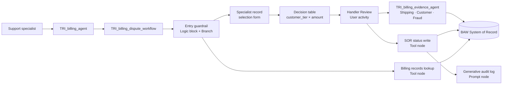

# Lab 2 — Agentic Workflow: Billing Dispute

Version 1.0.0 / Authors: Pooja Luthra, Olaf Hahnl / Duration: ~4 hours (~4.5–5.5 hours including optional)

---

## Notices

This information was developed for products and services offered in the USA. IBM may not offer the products, services, or features discussed in this document in other countries. Consult your local IBM representative for information on the products and services currently available in your area.

INTERNATIONAL BUSINESS MACHINES CORPORATION PROVIDES THIS PUBLICATION "AS IS" WITHOUT WARRANTY OF ANY KIND, EITHER EXPRESS OR IMPLIED, INCLUDING, BUT NOT LIMITED TO, THE IMPLIED WARRANTIES OF NON-INFRINGEMENT, MERCHANTABILITY OR FITNESS FOR A PARTICULAR PURPOSE.

This information could include technical inaccuracies or typographical errors. Changes are periodically made to the information herein; these changes will be incorporated in new editions of the publication.

This information contains examples of data and reports used in daily business operations. To illustrate them as completely as possible, the examples include the names of individuals, companies, brands, and products. All of these names are fictitious and any similarity to the names and addresses used by an actual business enterprise is entirely coincidental.

Trademarks: IBM, the IBM logo, and ibm.com are trademarks or registered trademarks of International Business Machines Corp., registered in many jurisdictions worldwide. Other product and service names might be trademarks of IBM or other companies. A current list of IBM trademarks is available at [www.ibm.com/legal/copytrade.shtml](https://www.ibm.com/legal/copytrade.shtml).

© Copyright International Business Machines Corporation 2026. This document may not be reproduced in whole or in part without the prior written permission of IBM. US Government Users Restricted Rights — Use, duplication or disclosure restricted by GSA ADP Schedule Contract with IBM Corp.

---

## Table of Contents

1. [Lab Introduction](#1-lab-introduction)
   - 1.1 [Lab Scenario](#11-lab-scenario)
   - 1.2 [Lab Setup Instructions](#12-lab-setup-instructions)
     - 1.2.1 [Prerequisites](#121-prerequisites)
     - 1.2.2 [Required Setup — Import Your Billing Tools](#122-required-setup--import-your-billing-tools)
2. [Lab Instructions](#2-lab-instructions)
   - [Exercise 1: Build the Billing Dispute Agent](#exercise-1-build-the-billing-dispute-agent-20-mins) *(~20 mins)*
   - [Exercise 2: Build the Bare Agentic Workflow and the Dispute Entry Guardrail](#exercise-2-build-the-bare-agentic-workflow-and-the-dispute-entry-guardrail-30-40-mins) *(~30-40 mins)*
   - [Exercise 3: Selection of Disputed Record by Specialist](#exercise-3-selection-of-disputed-record-by-specialist-30-mins) *(~30 mins)*
   - [Exercise 4: Deterministic Approval Routing via Decision Table](#exercise-4-deterministic-approval-routing-via-decision-table-30-40-mins) *(~30-40 mins)*
   - [Exercise 5: Dispute Handler Activity: Embedded Agent Evidence Loop and Verdict Form](#exercise-5-dispute-handler-activity-embedded-agent-evidence-loop-and-verdict-form-30-mins) *(~30 mins)*
   - [Exercise 6: SOR Write, Audit Log, and Resolution Banner](#exercise-6-sor-write-audit-log-and-resolution-banner-30-mins) *(~30 mins)*
   - [Error Handling Background (Exercises 7 and 8)](#error-handling-background-exercises-7-and-8)
   - [Exercise 7: Error Handling for Tool Reads: Domain and Infrastructure Errors](#exercise-7-error-handling-for-tool-reads-domain-and-infrastructure-errors-20-30-mins--optional) *(~20-30 mins — Optional)*
   - [Exercise 8: Error Handling for the SOR Write: Recovering Safely from Non-Idempotent Failures](#exercise-8-error-handling-for-the-sor-write-recovering-safely-from-non-idempotent-failures-20-mins--optional) *(~20 mins — Optional)*
3. [Lab Complete](#3-lab-complete)

---

## 1. Lab Introduction

In this lab, you will build a production-grade **Agentic Workflow** — `(NAMESPACE)_TRI_billing_dispute_workflow` — from scratch using the watsonx Orchestrate low-code flow builder. You will learn how to combine deterministic business rules, multi-role human-in-the-loop interactions, a sub-agent evidence loop, and an auditable system-of-record write into a single callable automation tool that a billing agent can invoke.

### Understanding watsonx Orchestrate Agentic Workflows

An **Agentic Workflow** is a structured automation capability within watsonx Orchestrate that lets you define, orchestrate, and execute multi-step business processes as a single callable tool. It is exposed to agents as a tool — when an agent invokes it, the full workflow executes and returns a result, just like any other tool call.

Agentic workflows are specialized tools that allow an agent to run a sequence of activities within a single, reusable structure. These activities include calling tools, prompting for user input, logical logic blocks, or branching logic.

Rather than handling each step individually, agents can start an agentic workflow to manage the entire process from beginning to end. Agentic workflows are ideal for tasks that require coordination across systems or multiple decision points.

> **Why this matters for this lab:** You are building `TRI_billing_dispute_workflow` as exactly this — a workflow that `TRI_billing_agent` calls as a single tool. Inside, it runs a decision table, pauses for a human supervisor, calls a sub-agent, and writes to the System of Record. From the agent's perspective, it is one tool call. From a compliance perspective, it is a fully auditable, deterministic process.

#### How Agentic workflows are different

- **Unified Logic & AI** — Flow Builder combines deterministic logic with generative AI in a seamless platform for powerful automation.
- **Enterprise Governance** — Designed for compliance and security, Flow Builder supports enterprise-grade governance needs effectively.
- **No-Code & Pro-Code Building** — Supports both no-code and pro-code development, enabling users of varying expertise to create workflows.
- **Integration & Transparency** — Offers robust integration capabilities with focus on reuse, transparency, and workflow orchestration.

#### Key characteristics

1. **Graph-based execution** — A workflow is a directed graph of nodes (actions) connected by edges (transitions). Paths can be sequential, branching, looping, or parallel. The graph is always explicit — no hidden LLM reasoning decides which node runs next.
2. **Hybrid automation** — The same workflow can contain deterministic logic (decision tables, branches, code blocks), human steps (HITL forms), and non-deterministic AI (agent nodes, generative prompts). Each step uses the right tool for the job.
3. **Single callable unit** — The entire workflow is exposed as one tool to calling agents. This is the **Composite Tool** pattern: the agent invokes it, the workflow handles the complexity internally, and the agent receives a clean result.
4. **Stateful execution** — Workflow variables carry state between nodes. A value captured in a HITL form is available to every downstream node — no re-fetching, no LLM memory required.
5. **Human-in-the-loop (HITL)** — Execution can pause at a User Activity node and wait for a human to submit a form before continuing. This pause is enforced by the platform — it cannot be bypassed by the LLM or a crafted prompt.

> **The deterministic × non-deterministic distinction:**
> LLM agents are non-deterministic: flexible, natural language, handles variation — but the same prompt can produce different results on different runs. Structured workflows, decision tables, and logic blocks are deterministic: they produce the same output every time for the same input. The power of an Agentic Workflow is that it spans both in one callable unit.

### Why a Workflow for Billing Disputes? (The Three-Question Test)

Before writing any prompt or building an agent, apply the **Three-Question Test** from the IBM watsonx Orchestrate documentation ([*Agent-washing*](https://developer.watson-orchestrate.ibm.com/agents/agent_design/tooling_scalability#agent-washing); see also [Allen Chan #9 — Agent-Washing](https://achan2013.medium.com/ai-agent-anti-patterns-part-2-tooling-observability-and-scale-traps-in-enterprise-agents-42a451ea84ec)):

| Question | Billing Dispute Answer | Implication |
|---|---|---|
| **1. Is tool selection dynamic?** | **No.** The eligibility check is always the same rule (`customer_tier` × `billing_amount`). | Deterministic routing is required. |
| **2. Is the path conditional on unpredictable output?** | **No.** The inputs are known; the threshold outcome is deterministic. | A Decision node is preferred over LLM reasoning. |
| **3. Is there an open-ended feedback loop?** | **No.** Once the supervisor approves or rejects, the status is written to the SOR and the workflow ends. | Linear, auditable process flow. |

Because all three answers are **No**, wrapping the entire dispute process in an LLM reasoning loop is an anti-pattern (see [*The agent-as-business-process fallacy*](https://developer.watson-orchestrate.ibm.com/agents/agent_design/foundational_architecture#the-agent-as-business-process-fallacy) in the IBM watsonx Orchestrate documentation and [Allen Chan #2 — The Agent-as-Business-Process Fallacy](https://achan2013.medium.com/ai-agent-anti-patterns-part-1-architectural-pitfalls-that-break-enterprise-agents-before-they-32d211dded43)). Financial decisions and audit-trailed writes belong in a deterministic Agentic Workflow.

### 1.1 Lab Scenario

**Focus Corp** customer support specialists handle billing inquiries and payment disputes. When customer **Laura Henderson** (`C-33310`, Platinum tier) calls to report a duplicate charge on order `O-A33310` ("I sent the first laptop back three weeks ago and I'm still being charged for it"), the specialist triggers the **Billing Dispute Workflow** from the Trinity agent chat.

In this lab, you will build `(NAMESPACE)_TRI_billing_dispute_workflow` from scratch. The workflow implements the following Focus Corp billing dispute process:

1. **Entry Guardrail:** Fetches billing records and counts active ones. Fewer than two → workflow halts with an informational notice; no dispute form is shown.
2. **Specialist Record Selection:** Specialist views all billing records in a selectable table, picks `B-TD3310` ($2,500), and clicks **Continue**.
3. **Decision Table Evaluation:** Evaluates `customer_tier` × `billing_amount` against the Focus Corp authorization policy. Platinum over $1,000 → supervisor review required.
4. **Specialist Notification:** Workflow informs the specialist that supervisor review is required and resolution takes ~5 business days.
5. **Supervisor Handoff & Evidence Gathering:** Supervisor sees a role banner and an information-retrieval form. The supervisor can type a question and click **Get Information** — an embedded evidence agent (`TRI_billing_evidence_agent`) queries shipping records and fraud data and returns the results. The supervisor clicks **Make Decision** when ready.
6. **Decision Form:** Supervisor selects the billing record to act on, chooses a verdict (**Approve Cancellation** or **Reject Cancellation**) from a dropdown, enters a reason, and clicks **Complete**.
7. **Compliant SOR Write:** Updates the billing record status (`resolved-cancelled` or `resolved-rejected`) in the BAW System of Record.
8. **Generative Audit Log & Resolution Banner:** A Generative prompt node synthesizes a compliance narrative; the resolution banner displays the outcome.



*Figure 1. Lab 2 solution architecture — `TRI_billing_agent` invokes `TRI_billing_dispute_workflow`, which sequences a logic-based entry guardrail, a decision table, a human-in-the-loop handler activity with an embedded evidence agent, a SOR status write, and a generative audit log.*

### 1.2 Lab Setup Instructions

#### 1.2.1 Prerequisites

**No lab dependency.** This lab has no dependency on any previous lab. You can start it directly without completing any earlier exercises in this event.

**Complete this lab start to finish.** Each exercise builds directly on the workflow state left by the previous one — start at Exercise 1 and work through the exercises in order.

**Everyone:** **Builder** role on the shared wxO SaaS tenant (permissions to create and edit agents and workflows). If you completed any previous lab in this event, you already have this role.

> 💡 **Not sure?** Log in, expand the hamburger menu in the top left, and confirm the **BUILD & RUN** section is displayed. If not, contact your facilitator.

**If you need to set up your billing tools** — the three Billing OpenAPI tools required for this lab must exist in your namespace before you start Exercise 1 (see **1.2.2** below). This requires:

1. The ADK CLI (version 2.15 or later) installed, connected to the event tenant, and authenticated.
2. Your SOR user ID, SOR password, and SOR base URL. Your SOR user ID is your assigned namespace. To get these values, see the labs page of the event GitHub repository, section **2. Grab your system of record credentials**.
3. The Trinity-Event repository (the event GitHub repository) cloned or downloaded to your machine. To get it, see the labs page of the event GitHub repository, section **4. Clone this GitHub**.

> 💡 **Tip:** To install, update, or connect the ADK CLI, see **Introduction to watsonx Orchestrate**, section **1.2.1 Before the Event — Prepare Your Local Environment**, and **Appendix: ADK CLI Setup Guide**.

**Placeholder convention:** Parentheses mark a value you must supply — the uppercase word or phrase inside names what's needed. Replace the entire `(...)` token with your actual value everywhere it appears, in both UI fields and commands, for example `(NAMESPACE)`.

**Namespace prefix convention:** All participants work on a shared wxO tenant. Every artifact you create must be prefixed with your assigned user ID followed by `_TRI_` — for example: `usr001_TRI_billing_dispute_workflow`. The placeholder `(NAMESPACE)` in every input table means your assigned user ID (e.g. `usr001`). Use parentheses, not square brackets.

> **Note:** Because this is a shared wxO tenant specific to this enablement event, do not enter production credentials or customer data. All lab exercises use fictitious lab records.

#### 1.2.2 Required Setup — Import Your Billing Tools

The artifacts below must be in your namespace before you start Exercise 1. Run the prep script now — it takes about a minute.

**If you completed Lab 1.1:** your Key-Value connection, MCP toolkit, and Basic-auth connection already exist. The script detects each one and skips its import — it only refreshes credentials and imports the Billing tools and evidence agent.

1. Refresh your ADK CLI token before running the script. Pass your API key directly to avoid the interactive prompt:

   ```bash
   orchestrate env activate trinity-lab -a (YOUR-API-KEY)
   ```

   > 💡 **Tip:** Don't know where to get your API key? See **Introduction to watsonx Orchestrate**, **Appendix: ADK CLI Setup Guide**, section **A.5 Connecting to the AWS wxO Environment**, Step 1.

2. Run `prepare_lab_2.py`:

   ```bash
   python3 labs/lab-2/solution/scripts/prepare_lab_2.py --sor-base-url (YOUR-SOR-BASE-URL) --sor-user-id (YOUR-SOR-USER-ID) --sor-password (YOUR-SOR-PASSWORD)
   ```

   > **Note:** On Windows, use `python` if `python3` is not available. The script prints a numbered `[INFO]`/`[OK]`/`[SKIP]` line for each step as it runs. If any step fails, re-run the same command once the underlying issue (credentials, connectivity) is resolved — every step is safe to repeat.

3. Confirm the three tools appear in the wxO UI: expand the hamburger menu (☰), click **Active inventory** → **Tools**, and search for `(NAMESPACE)_TRI_TSOR_Billing`. You should see all three tools listed.

**What the script sets up — artifact reference:**

| Artifact | Type | Role | Source |
|---|---|---|---|
| `(NAMESPACE)_TRI_billing_dispute_workflow` | Workflow | **Built in this lab** | — |
| `(NAMESPACE)_TRI_billing_agent` | Agent | **Built in this lab** | — |
| `(NAMESPACE)_TRI_cp4ba_keyvalue_team` | Connection | Key-Value/team credentials for the MCP toolkit | Lab 1.1 or prep script |
| `(NAMESPACE)_TRI_SOR_MCP` | Toolkit (MCP) | Provides `TSOR_CRM_get_customer_by_id` (Exercise 1) and SOR tools used by the evidence agent | Lab 1.1 or prep script |
| `(NAMESPACE)_TRI_cp4ba_basic_member` | Connection | Member-scoped credentials for Billing OpenAPI tools | Lab 1.1 or prep script |
| `(NAMESPACE)_TRI_TSOR_Billing_get_billing_record_by_id` | Tool (OpenAPI) | Used inside the workflow to verify SOR state on the error-recovery path | Prep script |
| `(NAMESPACE)_TRI_TSOR_Billing_get_billing_records_by_order_id_ext` | Tool (OpenAPI) | Fetches billing records for the dispute entry guardrail | Prep script |
| `(NAMESPACE)_TRI_TSOR_Billing_update_billing_record_status_description` | Tool (OpenAPI) | Writes the dispute outcome to the SOR (Exercise 6) | Prep script |
| `(NAMESPACE)_TRI_billing_evidence_agent` | Agent | Pre-built evidence lookup agent called by the `Handler Review` evidence loop in Exercise 5. Provides shipping records, customer profile, and fraud-risk lookups to the supervisor during dispute review. **You do not build this agent** — it is imported fully configured by the prep script above. | Prep script |

[↑ Back to Table of Contents](#table-of-contents)

---

## 2. Lab Instructions

---

### Exercise 1: Build the Billing Dispute Agent *(~20 mins)*

The only way to test an agentic workflow is to embed it into an agent and trigger it from there — the Flow builder itself has no standalone way to run a full conversational test. Before building any workflow logic, you will create that agent now so it is ready to test against as you add each workflow segment in the exercises that follow.

To speed up testing in this lab, you will invoke this agent directly rather than through a supervisor agent, as the real Trinity solution does — see **Lab 1.3** for the supervisor/collaborator pattern.

In the full solution, this agent is called by the orchestrator, which has already resolved the customer's full profile by the time it delegates here. Its description below, while not actually used in direct testing (you're calling the agent directly, so no supervisor ever reads it to decide whether to delegate), covers both capabilities for completeness.

Its instructions, however, include an extra paragraph — calling `TSOR_CRM_get_customer_by_id` to resolve `customer_name` and `customer_tier` when only a `customer_id` is provided — added specifically so this agent can resolve customer information itself during testing. In the real Trinity solution, the orchestrator has already supplied the full customer context before delegating; this lookup step is not needed there.

#### Steps

#### Build the Billing Dispute Agent

1. Expand the hamburger menu (☰) in the top left, click **Active inventory** under the **BUILD & RUN** category, then click **Agents**.


*Figure 2: The "Build agents and tools" page showing the agent grid*

2. Click **Create agent +** in the top-right corner, then select **Create from scratch**


*Figure 3: The "Create an agent" dialog with Create from scratch selected*

3. In the **Profile** section on the **Behavior** tab, configure:
   - **Agent name**: `(NAMESPACE)_TRI_billing_agent`
   - **Model**: Keep default (GPT-OSS 120B — OpenAI via Groq)
   - **Description**:
   ```
   Call when a specialist needs to initiate a billing dispute for an order.

   Billing dispute workflow: provide order_id [Required], customer_id [Required]
   (C-* pattern), customer_name [Required], customer_tier [Required],
   reason_for_dispute [Required] — initiates the billing dispute review process.
   ```
   - **Instructions**:
   ```
   If billing dispute request start the billing dispute workflow immediately —
   do not present the order_id, customer_id, customer_name, customer_tier, or
   reason_for_dispute values back to the specialist for confirmation first;
   those values have already been validated before being passed to you. Call
   the workflow tool directly with them.

   Before invoking the billing dispute workflow: if customer_name or customer_tier
   are not already provided in the delegation, call TSOR_CRM_get_customer_by_id
   with the customer_id first to retrieve them. Pass customer_id, customer_name
   (first_name + last_name), customer_tier (status field), order_id, and
   reason_for_dispute to the workflow.
   ```

   > **Note:** The second instruction paragraph above — resolving `customer_name` and `customer_tier` via `TSOR_CRM_get_customer_by_id` — is added for standalone testing only. In the real Trinity solution this agent does not have that tool; the CRM collaborator agent fulfills that role and the supervisor passes the resolved values when delegating.


*Figure 4: Agent Behavior tab showing name, description, and instructions configured*

4. Select the **Tools** tab, click **Add Tool +**, then under **Add from**, select **Local instance**


*Figure 5: Tools tab with + Add Tool button highlighted*

5. Enter `(NAMESPACE)_TRI_SOR_MCP:TSOR_CRM_get_customer_by_id` in the search field, select the tool, then click **Add to agent**

   > **Note:** `TSOR_CRM_get_customer_by_id` is the counterpart to the second instruction paragraph that resolves customer information, making the agent self-contained for testing on its own. In the real Trinity solution, this agent does not have this tool — the CRM collaborator agent fulfills that role instead. You will add the billing dispute workflow as a second tool in Exercise 2.
   >
   > This tool comes from your own `(NAMESPACE)_TRI_SOR_MCP` toolkit, imported by the prep script in section 1.2.2. The billing-related OpenAPI tools used inside the workflow are separate — those carry your namespace prefix and use member-scoped credentials to preserve each participant's data partition so that writes from one participant do not affect another's records (see **Lab 1.1 Exercise 3** for the full explanation).


*Figure 6: Tools tab showing the CRM tool selected before clicking Add to agent*

6. Observe that the tool now appears on the **Tools** tab


*Figure 7: Tools tab showing the CRM tool added to the agent*

#### Test the Billing Dispute Agent

The billing dispute workflow does not exist yet, so a full end-to-end test is not possible at this stage. However, you can already verify that the agent resolves customer information correctly — the first thing it will need to do before invoking the workflow in later exercises.

7. In the **Draft Preview** chat window on the right, enter the prompt:
   ```
   I need to look up customer C-33310.
   ```

8. Observe the agent calls `TSOR_CRM_get_customer_by_id` and returns the customer profile — when the workflow exists and a dispute is triggered, this same lookup is what populates `customer_name` and `customer_tier` before the workflow is invoked


*Figure 8: Agent response showing the customer profile, with the reasoning trace expanded to show the CRM tool call*

---

✅ Exercise 1 complete. You created `(NAMESPACE)_TRI_billing_agent` in draft mode with the CRM customer lookup tool for standalone testing. In Exercise 2, you will create the workflow shell and attach it to this agent; you will build out its internal logic in Exercises 3–8.

[↑ Back to Table of Contents](#table-of-contents)

---


### Exercise 2: Build the Bare Agentic Workflow and the Dispute Entry Guardrail *(~30-40 mins)*

In this exercise, you will create the workflow frame, configure its input variables and flow settings, then add the three-node entry guardrail that enforces a core Trinity scenario requirement: a customer must have at least two active billing records before a dispute can be opened.

#### What you are building

An LLM agent cannot reliably enforce business rules. You could instruct an agent to "only open a dispute if multiple active billing records exist" — but the model will approximate that rule, not enforce it. On a bad run it may skip the check, miscount, or proceed anyway. The same applies to the record selection step in Exercise 3: you need the specialist to explicitly identify which billing record the customer considers the duplicate, confirmed with a deliberate click — not a conversational guess that the agent infers and acts on unilaterally. Both of these are exactly the kinds of deterministic, auditable gates that workflows are designed for.

In this exercise you build the first gate: a three-node entry guardrail that enforces the minimum condition for a dispute to be valid at all. A customer can only dispute a duplicate charge if multiple active billing records exist — checking this immediately, before any form is shown, enforces fail-fast protection. If a previous run already cancelled the duplicate, the workflow exits gracefully rather than prompting the specialist for input that can never succeed.

The three nodes you add in this exercise implement that check:

| Node | Type | Purpose |
|---|---|---|
| **Get Billing Records** | Tool | Calls `TSOR_Billing_get_billing_records_by_order_id_ext` with the incoming `order_id` |
| **Determine number of active billing records** | Logic block | Counts records with `status == "active"` → outputs `number_of_active_billing_records` |
| **Has multiple active billing records?** | Branch | Routes to dispute flow if `>= 2`; exits with a notice if not |

> ⚠️ **Important: Node display names must match exactly as specified in this lab.** Logic blocks reference nodes by their display names in Python code, and Message controls do the same through `{flow[...]}` variable references in their Output message (e.g., `flow["Get Billing Records"].output.result`, `flow["Handler Review"]["Billing Dispute Decision"].output["Dispute verdict"]`). If you use different display names, the workflow will fail at runtime with errors like "KeyError" or "node not found," or a Message control will simply fail to resolve its variable. Use the exact display names provided in each step — preserve capitalization, spacing, and punctuation exactly, and copy-paste from this guide rather than retyping where possible. If you do make a naming mistake, you must either rename the node to match the lab instructions, or update all Python code and Message control references to use your custom name.

#### Steps

#### Build the Dispute Entry Criteria

1. Open a new browser tab and paste the URL from the tab where `(NAMESPACE)_TRI_billing_agent` is open — you will use one tab for editing the workflow in the flow builder and the other for chat testing via **Draft Preview** for the rest of this lab

2. On the **Tools** tab of `(NAMESPACE)_TRI_billing_agent`, click **Add Tool +**

3. Under **Add from**, select **Agentic workflow**


*Figure 9: Add Tool dialog with Agentic workflow selected as the tool type*

4. In the **Name your agentic workflow** dialog, enter `(NAMESPACE)_TRI_billing_dispute_workflow` as the name and click **Start building**


*Figure 10: Name your agentic workflow dialog with the Name field filled in*

5. The flow builder canvas opens. Click **Flow settings** (the gear icon ⚙ in the top toolbar) to open the settings panel


*Figure 11: Flow builder canvas with the Flow settings button highlighted in the top toolbar*

6. In the **Flow settings** panel, locate **Agent summarization** — it is off by default and should remain off

   When summarization is on, the calling agent appends its own LLM-generated sentence after each workflow step; keeping it off ensures the workflow's own present-to-user messages appear exactly as written, not paraphrased.


*Figure 12: Flow settings panel with Agent summarization toggled OFF*

7. Click the **Parameters** tab on the left, then click **Add input +** at the top right of the Inputs table. Select the **Data type** of the input to add, then specify the **Name**, **Description**, and whether it is required, before clicking **Add** to add the input definition. Do this five times, once for each input shown below:

   > **Note:** Inputs are not variables — they are read-only values passed in by the calling agent when it invokes the workflow. They cannot be modified during execution. They can be referenced anywhere inside the workflow — in data mappings, gateway conditions, message text, and logic block code — but their values are fixed from the moment the workflow starts.

   | Property Name | Type | Required | Description |
   |---|---|---|---|
   | `order_id` | String | ✅ Yes | Order ID in format O-*, e.g. O-DF340K |
   | `customer_id` | String | ✅ Yes | Customer ID in format C-*, e.g. C-3DBZFE |
   | `customer_name` | String | ✅ Yes | Full name of the customer, e.g. Marie Smith |
   | `customer_tier` | String | ✅ Yes | Customer loyalty tier (Platinum, Gold, Silver, Bronze, Standard) |
   | `reason_for_dispute` | String | ✅ Yes | Reason for the dispute as stated by the specialist or customer, e.g. "Duplicate charge for single order" |


*Figure 13: Add input dialog on the Parameters tab of the Flow settings*

8. Close the Flow settings dialog by clicking the **x** in the top right corner

9. Observe that the Start node now shows 5 inputs defined. Click on the **Start** node to open the dialog where you can see and edit the inputs — the second way to do it


*Figure 14: Start node showing 5 inputs defined*

10. On the canvas, click **Add your first step +**, then select **Call a tool** — this switches the palette to the **Tools** tab


*Figure 15: Canvas with the Add your first step + label clicked and the node picker open showing Call a tool option*

11. Enter `(NAMESPACE)_TRI_TSOR_Billing_get_billing_records_by_order_id_ext` in the **Search for tools** search field. Verify that the icon in front of the tool shows **API**, then drag and drop the tool onto the canvas

12. Click the tool call node, then click the pencil icon next to the default name and replace it with `Get Billing Records`

13. Click the `Get Billing Records` link to see the tool's inputs and outputs, then click the **×** in the top-right corner to close the details page

In agentic workflows, tool calls have inputs for which different mapping options exist — Auto-map, Explicit mapping, or an expression — with Auto-map applied by the flow engine by default. Outputs, however, are not explicitly mapped to variables: any activity that follows a tool call can access its outputs implicitly, without any additional mapping step.

14. Click **Edit data mapping**, hover over the **order_id** input variable, click the **{x}** variable icon, click **Input** on the left side of the picker, and select the **order_id** flow input. Finally, click the **×** in the top-right corner to close the picker

> **Going further — Auto-map vs. explicit mapping:** Since the tool's expected input is also called `order_id`, and that's the exact same name as the flow input, keeping **Auto-map** on would have worked just as well here. Whether to auto-map or map explicitly in a case like this is a matter of choice. When the naming doesn't line up as cleanly, explicit mapping becomes the better option. A mismatch in data types when the names do match is actually a good use case for auto-map, since it performs the type conversion automatically — something explicit mapping cannot do.


*Figure 16: Tool node configuration panel showing Display name set to Get Billing Records and the order_id input mapping*

The entry guardrail needs to count how many billing records have an `active` status and branch on that number. In pure low-code this is awkward — you would need a Foreach or Loop, a counter variable, and a Branch node to do what is essentially one line of Python. This is exactly where a **Logic block** comes to the rescue: a code node that lets you write lightweight Python inline in the workflow, without leaving the canvas. Logic blocks are intentionally limited — no filesystem access, no external imports — but for data transformation and counting operations like this one they are the right tool. The result is exposed as a named output that downstream nodes (the Branch you will add next) can branch on.

15. Click **Add +** on the line after the **Get Billing Records** node, then select **Add a flow activity** → **Logic block**. Click the pencil icon next to the default name and replace it with `Determine number of active billing records`.

16. Click **Define outputs** for the Logic block, then click **Add output +** in the top right corner of the Outputs table. Select **Integer** as the data type, enter `number_of_active_billing_records` as the name, and click **Add**.

17. Switch to the **Code editor** tab and copy-paste the following Python code, replacing the default code:

    ```python
    # The tool's response is wrapped in a "result" object that also carries is_error
    result = flow['Get Billing Records'].output.result

    # Fall back to an empty list if no billing records are returned (e.g. empty or missing list)
    billing_records = result.billing_records or []

    # Count the records whose status is "active"; an empty list yields 0
    self.output.number_of_active_billing_records = sum(
        1 for record in billing_records if record.get("status") == "active"
    )
    ```

    > **Note:** `flow['Get Billing Records'].output` references the previous node by its display name, and the tool's response (`billing_records` and `is_error`) is nested under `.result`. `self.output` exposes the computed value to downstream nodes. To get the correct syntax for assigning a value to a Logic block output, copy the value from the **Python Id** column for that output in the Outputs table — it gives you the exact `self.output.<name>` expression to use in code. The code editor also provides contextual help: when you start typing `flo`, a tooltip appears that lets you select previously defined nodes, flow inputs, and flow variables by name, so you can build references without having to remember the exact syntax.

18. Close the dialog by clicking the **×** in the top right corner


*Figure 17: Logic block node with the code and the number_of_active_billing_records output defined*

19. Click **Add +** on the line after the **Determine number of active billing records** node, then select **Add a flow control** → **Branch**. Click the pencil icon next to the default name and replace it with `Has multiple active billing records?`

20. Rename the paths: click the **Path 1 (if)** label and rename it to `Dispute possible`; click the **Path 2 (else)** label and rename it to `Dispute not possible`

21. Click **Edit condition** for the `Dispute possible` path, click **Add condition +**, select `number_of_active_billing_records` from the **Determine number of active billing records** Logic block, set the operator to `>=`, and set the value to `2`. Click anywhere on the canvas to close the Branch editor


*Figure 18: Branch node showing the condition on the Dispute possible path and the two named exit paths*

The guardrail exit requires a way to surface the message to the specialist and wait for acknowledgement before the workflow ends — that is exactly what a **user activity** is for. A user activity is the construct an agentic workflow uses to interact with a human mid-flow, directly inside the chat interface: it can display information or collect input. Display controls stream straight through without pausing; the workflow only pauses when the activity contains a form or a collect-from-user control and waits for the specialist to respond. The one you are building here uses a form with two display controls — a list of the billing records and a message explaining why the dispute cannot proceed — and a single **Complete** button to pause and wait for acknowledgement.

22. Click **Add +** on the **Dispute not possible** path and select **Add a form** — this adds a User activity containing a form and opens the form editor directly. Put `Dispute Not Possible` into both the **Form title** and the **Node name**

23. Rename the action button to `Complete` and turn off the **Cancel** button by toggling it off

24. Click **+** in the form editor and select **Present to user** → **List**. Configure:
    - **Label**: `Billing Records`
    - **Source variable**: select `billing_records` from the **Get Billing Records** tool call

25. Click **Edit columns**. Hide the `order_id` and `billing_record_id` columns by clicking the eye icon in the **Visibility** column for each. Use drag-and-drop to reorder the remaining visible columns to: `billing_date`, `status`, `amount`, `description`, with `order_id` and `billing_record_id` at the end. Verify that each **Element Label** has a human-friendly value, then click **Done**

26. Click **+** below the List control and select **Present to user** → **Message**. Set the following as the **Output message**:

    ```
    At least two active billing records are required to create a billing dispute.

    **Actions:**
    1. Inform the customer that a **dispute is not possible** as at least two active billing records are required.
    2. Thank the customer for calling Focus Corp and ask if there are any other topics they would like to discuss today.
    ```

27. Click the **×** in the top right corner to close the form editor

28. Click on the User activity node to open its properties, set both the **Label** and **Node name** to `Inform Specialist Dispute Not Possible`, and leave **Assign to** set to **Flow initiator** — it is always the specialist who handles this step


*Figure 19: Completed Exercise 2 canvas: Start → Get Billing Records → Determine number of active billing records → Has multiple active billing records? The Dispute not possible exit path leads to the Inform Specialist activity and then to End*

#### Test the Dispute Entry Criteria

You will run the workflow twice — once with a customer whose order has two active billing records (the guardrail passes) and once with a customer whose order has only one (the guardrail fires). Comparing the two runs confirms that the entry check routes correctly in both directions.

**Run 1 — guardrail passes (two active billing records)**

29. Switch to the agent tab with `(NAMESPACE)_TRI_billing_agent` open and enter the following prompt in the **Draft Preview** chat window:
   ```
   Customer C-33310 wants to start a dispute for the second charge for the order O-A33310. The reason is "Duplicate charge for single order"
   ```

30. Observe a response similar to:
   ```
   The billing dispute workflow has been initiated for customer C-33310 (Laura Henderson, Platinum tier) regarding order O-A33310 with the reason "Duplicate charge for single order."
   ```

   
   *Figure 20: Agent response confirming the billing dispute workflow has been initiated*

   > **Note:** You may see the agent runtime providing a summary of the workflow execution even though **Agent summarization** is turned off in the Flow settings. This is a known open defect — the summarization feature is not fully suppressed in all cases.

31. Click **Show reasoning** next to the agent's response, then expand step 1 — the call that resolves the customer information — and step 2 — the invocation of the workflow. Confirm in the **Input** section of step 2 that all five required inputs (`order_id`, `customer_id`, `customer_name`, `customer_tier`, `reason_for_dispute`) have been extracted from the prompt and the first tool call and are passed to the workflow

   
   *Figure 21: Reasoning trace with step 2 (workflow invocation) expanded, showing all five inputs*

32. Click the three stacked dots (⋮) on the Workflow tool tile, then select **Open flow inspector**

   
   *Figure 22: Workflow tool tile menu with "Open flow inspector" selected*

   The Flow inspector dialog shows a list of flows in the center with filter options on the left. It should show the `(NAMESPACE)_TRI_billing_dispute_workflow` flow that was just started, with a **Flow run status** of **Completed**.

   > **Going further — Flow inspector capabilities:** When you select a node on the canvas during design, the Flow Inspector panel displays that node's properties, input/output schema, variable mappings, and configuration settings. You can edit these directly in the inspector without opening separate dialogs. During runtime debugging, the inspector shows execution traces, variable values at each step, error messages, and the complete execution timeline — making it essential for both building and troubleshooting workflows throughout this lab.

33. Click the **View details** link in the rightmost column to see the flow details, which open in a new tab/window

34. Click the **Get Billing Records** step on the left-hand side of the Flow Events tab, then click **See all** in the **Current value** column of the `billing_records` output. Observe that two active billing records have been returned for order `O-A33310`

   
   *Figure 23: Flow Events detail for the Get Billing Records step, showing two active billing records in the output*

35. Click the **Determine number of active billing records** step and observe the `number_of_active_billing_records` output in the **Current value** column — it should read `2`, confirming the Logic block counted both active records correctly

   
   *Figure 24: Flow Events detail for the Determine number of active billing records step, showing number_of_active_billing_records = 2*

36. Click the **Has multiple active billing records?** step and observe that the `Dispute possible` path has been taken. Since the `Dispute possible` path has no further nodes yet — you have not yet built that part of the workflow — the flow ends here

    
    *Figure 25: Flow Events detail for the Has multiple active billing records? Branch step, showing the Dispute possible path taken and the flow ending*

37. Close the tab/window showing the flow instance details, then click **×** in the top right corner to close the Flow inspector overlay

**Run 2 — guardrail fires (one active billing record)**

38. In the **Draft Preview** chat window, enter the prompt:
    ```
    Customer C-33300 wants to start a dispute for the second charge for the order O-33300X. The reason is "Duplicate charge for single order"
    ```

39. Observe the response — the workflow finds only one active billing record for order `O-33300X` and presents the specialist with a table of the billing records for the order and the guardrail message: at least two active billing records are required to create a billing dispute. No record-selection form is shown and the workflow ends gracefully

    
    *Figure 26: Agent response showing the Dispute Not Possible guardrail message and billing records table for customer C-33300*

40. Click **Complete** to close the guardrail form and end the workflow

41. Click the three stacked dots (⋮) on the Workflow tool tile, then select **Open flow inspector**

42. Click the **View details** link for the latest flow instance, which should show a Flow run status of **Completed**

43. Click the **Get Billing Records** step on the left-hand side of the Flow Events tab, then click **See all** in the **Current value** column of the `billing_records` output. Observe that only one billing record has been returned for order `O-33300X`

    
    *Figure 27: Flow Events detail for the Get Billing Records step, showing one billing record in the output*

44. Click the **Determine number of active billing records** step and observe the `number_of_active_billing_records` output in the **Current value** column — it should read `1`

    
    *Figure 28: Flow Events detail for the Determine number of active billing records step, showing number_of_active_billing_records = 1*

45. Click the **Has multiple active billing records?** step and observe that the `Dispute not possible` path has been taken, routing to the **Inform Specialist Dispute Not Possible** user activity and its **Dispute Not Possible** form

    
    *Figure 29: Flow Events detail for the Has multiple active billing records? Branch step, showing the Dispute not possible path taken*

46. Close the tab/window showing the flow instance details, then click **×** in the top right corner to close the Flow inspector overlay

✅ Exercise 2 complete. You have created the workflow, defined input variables, configured flow settings, and built the active-record entry guardrail. In the Trinity scenario, a customer must have at least two active billing records to open a billing dispute — the guardrail you just built enforces exactly that rule before any form is shown. In Exercise 3, you will build the specialist record-selection form.

[↑ Back to Table of Contents](#table-of-contents)

---

### Exercise 3: Selection of Disputed Record by Specialist *(~30 mins)*

In this exercise, you will create the interactive form where the specialist after ascertaining in the previous step, that there is a valid charge, now, selects the specific billing record that the customer wants to dispute. In this path, you will also be giving the flexibility to the specialist to cancel the charge.

In Exercise 2 the user activity only displayed information. Here you use its second capability: **collecting input from the specialist**. A form inside a user activity can mix display controls (text, lists) with input controls (selectable tables, dropdowns, text fields) in a single conversation turn. The workflow pauses at the form and waits for the specialist to make a selection and click a button before continuing — that deliberate click is what distinguishes a confirmed specialist decision from a conversational guess an agent might infer on its own.

#### What you are building

The specialist must be able to see all billing records for the order and select the one the customer identified as the duplicate during the call. This requires a selectable table — not a free-text field. The form also captures `billing_record_id` (a technical key the SOR write needs later) without exposing it to the specialist: it travels silently as a hidden binding on the selected row.

The form has two buttons: **Continue** (captures the selected row and proceeds) and **Cancel** (abandons the dispute cleanly without touching the SOR). The cancel path is a necessary graceful exit — mid-conversation, the customer may change their mind about disputing the charge, for example because they realise they never actually sent the item back. Real conversations are unpredictable, and a workflow that offers no way out forces the specialist into a dead end. Designing the cancel path now, before any SOR write has occurred, is the right moment: there is nothing to undo and no data to protect.

The node structure inside the **Specialist to Select Disputed Record** user activity:

| Node | Type | Purpose |
|---|---|---|
| **Select Billing Record to be Disputed** | Form | Selectable table + Continue/Cancel buttons |
| **Set Not Cancelled & Selected Entry Values** | Logic block | Captures selected-row fields into private variables (Continue path) |
| **Set Cancelled** | Logic block | Sets `is_cancelled = True` (Cancel path) |
| **Inform specialist** | Display message | Shows cancellation notice; no button (Cancel path) |

#### Steps

#### Build the Specialist Record Selection Form

1. Click **Add +** on the **Dispute possible** path and select **Add a form** — this adds a User activity containing a form and opens the form editor directly. Put `Select Billing Record to be Disputed` into both the **Form title** and the **Node name**

2. Rename the action button to `Continue` and leave the **Cancel** button toggled on with the name `Cancel`

3. Click **+** in the form editor and select **Present to user** → **Message**. Set the following as the **Output message**:

   ```
   **Customer reason for dispute:** {reason_for_dispute}
   ```

   To insert the variable, click **{x}** in the message editor and select `reason_for_dispute` from the list of available flow inputs.

   > **Note:** A Message control can render plain text, HTML, or Markdown — the bold `**Customer reason for dispute:**` label above is Markdown.

4. Click **+** below the Message control and select **Collect from user** → **Single choice**. Configure:
   - **Label**: `Billing Records`
   - **Source variable**: select `billing_records` from the **Get Billing Records** tool call
   - **Display as**: `Table`
   - **Required**: ✅ ON

5. Click **Edit columns**. Hide the `order_id` and `billing_record_id` columns by clicking the eye icon in the **Visibility** column for each. Use drag-and-drop to reorder the remaining visible columns to: `billing_date`, `status`, `amount`, `description`, with `order_id` and `billing_record_id` at the end. Verify that each **Element Label** has a human-friendly value, then click **Done**

6. Click **+** below the List control and select **Present to user** → **Message**. Set the following as the **Output message**:

   ```
   **Actions:**
   1. **Identify and select** the billing record the customer wants to dispute.
   2. Either click **Continue** or **Cancel** to proceed.
   ```

7. Click the **×** in the top right corner to close the form editor

8. Click on the User activity node to open its properties, set both the **Label** and **Node name** to `Specialist to Select Disputed Record`, and leave **Assign to** set to **Flow initiator** — it is always the specialist who handles this step


*Figure 30: Form editor showing the three components (dispute reason message, selectable billing table, actions message) and Continue/Cancel buttons*


Both the **Cancel** and the action buttons have individual navigation paths — steps that follow each button can be modelled independently inside those paths. However, it is not possible to query which button was clicked anywhere outside that immediate path — for example, in a Branch or a logic block after the user activity has completed. If that information is needed later in the flow, a Logic block inside each button's path must set a flow variable to record the choice.

There is also a current bug in wxO where a Decision node cannot directly access the properties of a complex object — such as a form's selected-row output. The individual field values from the selected billing record must therefore be stored as individual flow variables before the Decision node runs.

Both constraints are handled together in the **Continue** path logic block in step 11: it sets `is_cancelled = False`, and it unpacks the selected row into individual `flow.private` flow variables. The **Cancel** path in step 14 only needs to set `is_cancelled = True`. The `Is cancelled?` Branch in step 18 can then read `is_cancelled`, and the Decision node in Exercise 4 can read each billing field directly.

9. Click the **{x}** icon in the top left corner of the canvas to show the flow variables, then click **Add +** to add each of the following variables:

   | Name | Type |
   |---|---|
   | `is_cancelled` | Boolean |
   | `billing_amount` | Decimal |
   | `billing_date` | Date/Time → Date |
   | `billing_description` | String |
   | `billing_record_id` | String |
   | `billing_status` | String |

10. Click **Add +** on the **Continue** edge (outside the form, within the user activity) and select **Add a flow activity** → **Logic block**

11. Click the pencil icon next to the default name and replace it with `Set Not Cancelled & Selected Entry Values`, then click **Open code editor** and replace the default code with:

    ```python
    # Mark this path as not cancelled
    flow.private.is_cancelled = False

    # Read the row the specialist selected from the billing records table
    selected = flow["Specialist to Select Disputed Record"]["Select Billing Record to be Disputed"].output["Billing Records"]

    # Store individual fields as flow variables so the Decision node can read them
    flow.private.billing_amount = selected.amount
    flow.private.billing_date = selected.billing_date
    flow.private.billing_description = selected.description
    flow.private.billing_record_id = selected.billing_record_id
    flow.private.billing_status = selected.status
    ```

12. Hover over the **Cancel** output pill on the form node, click the connection point, and drag a connection line to the **End** node. The flow engine treats any unwired node as implicitly connected to End, but an explicit visible edge is required before you can insert additional nodes on that path — and the Cancel path needs two more nodes, so the connection must be drawn now
13. Click **Add +** on the **Cancel** edge and select **Add a flow activity** → **Logic block**

    > **Tip:** After adding nodes on the Cancel path the canvas can look cluttered. Click the middle icon — **Tidy canvas** — in the top-left toolbar (next to the flow variables icon) to automatically re-arrange the remaining nodes into a clean layout.

14. Click the pencil icon next to the default name and replace it with `Set Cancelled`, then click **Open code editor** and replace the default code with:

    ```python
    # Mark this path as cancelled
    flow.private.is_cancelled = True
    ```

15. Click **Add +** after **Set Cancelled** and select **Present to user** → **Message**
16. Click the **pencil icon** above the node shape and specify `Inform specialist` as the node name
17. In the message configuration pane on the right, enter the following in the **Agent message** field of the Message control:

    ```
    You chose to cancel creating a billing dispute.

    **Actions:**
    1. Inform the customer that **no billing dispute** was created.
    2. Thank the customer for calling Focus Corp and ask if there are any other topics they would like to discuss today.
    ```


*Figure 31: Completed user activity showing the form, both logic block paths (Continue and Cancel), and the Inform specialist display message*

18. Click **+** below the **Specialist to Select Disputed Record** user activity (outside it, on the outer canvas) and select **Add a flow control** → **Branch**. Click the pencil icon next to the default name and replace it with `Is cancelled?`

19. Rename the paths: click the **Path 1 (if)** label and rename it to `Not cancelled`; click the **Path 2 (else)** label and rename it to `Cancelled`

    > **Note:** A bug in wxO may cause wires or activity names to disappear when renaming paths. If this happens, complete the remaining steps to configure the Branch, then close the workflow by clicking **Done** in the top right corner and reopen it from the agent editor — the canvas will render correctly after reopening.

20. Click **Edit condition** for the `Not cancelled` path, click **Add condition +**, select the `is_cancelled` variable from the **Flow variables** category, set the operator to `is`, and set the value to `False`. Click anywhere on the canvas to close the Branch editor

    > **Note:** To set the value to `False`, you must first click the toggle once to set it to `True`, then click it again to set it to `False` — the toggle must be interacted with before the platform registers any value at all.


*Figure 32: Canvas showing the Specialist to Select Disputed Record activity, the Is cancelled? Branch, and the Cancelled exit path wired to End*

The **Not cancelled** path will be wired in the next exercise. The **Cancelled** (default) path intentionally remains empty. You may wonder why the **Inform specialist** message was placed inside the Cancel button path of the user activity rather than here on the Cancelled Branch path — both are valid designs. The choice was made to keep the canvas cleaner: a Message node can only exist inside a user activity, so placing it on the Cancelled Branch path would have required adding another user activity node to the outer canvas, cluttering the diagram. This is a deliberate design choice, and the empty Branch path is an expected consequence of it.

#### Test the Specialist Record Selection Form

You will run the workflow twice using the same prompt — once clicking **Cancel** to verify the cancel path, once clicking **Continue** to verify the selection form.

**Run 1 — specialist cancels**

21. Switch to the tab with `(NAMESPACE)_TRI_billing_agent` open and enter the following prompt in the **Draft Preview** chat window:

   ```
   Customer C-33310 wants to start a dispute for the second charge for the order O-A33310. The reason is "Duplicate charge for single order"
   ```

22. When the **Select Billing Record to be Disputed** form appears, click **Cancel**

23. Observe the **Inform specialist** message displayed in the chat:

   ```
   You chose to cancel creating a billing dispute.

   **Actions:**
   1. Inform the customer that **no billing dispute** was created.
   2. Thank the customer for calling Focus Corp and ask if there are any other topics they would like to discuss today.
   ```

   
   *Figure 33: Chat showing the Inform specialist message after the specialist clicks Cancel*

   > **Note:** You may see the agent runtime providing a summary of the workflow execution even though **Agent summarization** is turned off in the Flow settings. This is a known open defect — the summarization feature is not fully suppressed in all cases.

**Run 2 — specialist selects a record**

24. Click the **Reset chat** icon in the top right of **Draft Preview** to start a fresh conversation

25. Enter the same prompt again in the **Draft Preview** chat window:

   ```
   Customer C-33310 wants to start a dispute for the second charge for the order O-A33310. The reason is "Duplicate charge for single order"
   ```

26. When the **Select Billing Record to be Disputed** form appears, click **Continue** without selecting a record first — observe that the form shows a validation error, because the **Billing Records** single choice control was configured as **Required**

   
   *Figure 34: Chat showing the validation error on the Billing Records field after clicking Continue without a selection*

27. Select the billing record with the description `Shipping before laptop return` and click **Continue**

28. Observe that the workflow proceeds past the form — since the **Not cancelled** path has no further nodes yet, the flow ends here

   
   *Figure 35: Chat showing the selection form with the Shipping before laptop return record selected and Continue clicked*


29. Click the three stacked dots (⋮) on the Workflow tool tile, then select **Open flow inspector**

30. Click the **View details** link for the latest flow instance, which should show a Flow run status of **Completed**

31. On the left-hand side of the Flow Events tab, observe that the **Set Not Cancelled & Selected Entry Values** step appears in the execution trace, confirming the **Continue** path was taken and the selected row was captured

32. Click the **Is cancelled?** step and observe that the `Not cancelled` (if) path has been taken, confirming `is_cancelled` was set to `False`

    
    *Figure 36: Flow Events detail for the Is cancelled? Branch step, showing the Not cancelled path taken*

33. Click the **Flow parameters** tab and scroll to the **Flow variables** section at the bottom. Observe that `is_cancelled` is set to `False` and the billing fields (`billing_amount`, `billing_date`, `billing_description`, `billing_record_id`, `billing_status`) are populated with the values from the selected `Shipping before laptop return` record

    
    *Figure 37: Flow parameters tab showing Flow variables populated with is_cancelled = False and the selected billing record field values*

34. Close the tab/window showing the flow instance details, then click **×** in the top right corner to close the Flow inspector overlay


✅ Exercise 3 complete. You have built the specialist record-selection form with hidden key binding and a cancel exit path. In Exercise 4, you will configure the decision table that determines whether supervisor approval is required.

[↑ Back to Table of Contents](#table-of-contents)

---

### Exercise 4: Deterministic Approval Routing via Decision Table *(~30-40 mins)*

Once the disputed billing record has been selected, the workflow must answer one question deterministically: can the specialist resolve this dispute directly, or does it require a supervisor? That decision depends on two facts already in the flow — the customer's tier and the disputed amount — evaluated against a policy table that never approximates, never varies, and requires no LLM inference.

In this exercise you will build the decision table that evaluates those facts — setting both the routing flag and `role_label` as outputs — wire a branch on the result, and on each branch resolve the `approver` User variable that Exercise 5 uses to assign the approval activity to the right person. The supervisor path closes with a message giving the specialist hand-off instructions; the specialist path resolves the approver silently and converges on End. The full resolution form for both paths comes in Exercise 5.

#### Why a Decision node, not an agent instruction?

The approval rule here combines two dimensions — customer tier and a precise monetary boundary — and the boundary differs per tier. An agent instruction encoding this as natural language (*"standard customers need approval above $200, gold customers above $500..."*) gives the LLM a rule it may follow on one run and misapply or skip on the next. The model is not designed to enforce exact numeric thresholds consistently across varying prompt contexts — as the official wxO design guidance puts it, *"agents approximate processes rather than execute them exactly"*. This is [Allen Chan #36 — The Probabilistic Rule Engine](https://achan2013.medium.com/agent-anti-patterns-part-5-05da1c3c1828) and [#40 — The Prompt-Secured Workflow](https://achan2013.medium.com/agent-anti-patterns-part-5-05da1c3c1828): business policies and security-critical approval gates must be enforced in the workflow engine, not in prompt instructions. For routing based on finite, known conditions like these, the guidance is explicit: use conditional logic in the workflow, not agent reasoning. A Decision node evaluates the same two inputs (`customer_tier` × `billing_amount`) against the same table every single time. The boundary is exact, the output is guaranteed, and the routing never varies.

IBM watsonx Orchestrate docs: [`agents/agent_design/foundational_architecture`](https://developer.watson-orchestrate.ibm.com/agents/agent_design/foundational_architecture) · [`agents/agent_design/agentic_workflow_decision_guide`](https://developer.watson-orchestrate.ibm.com/agents/agent_design/agentic_workflow_decision_guide)

The node structure for this exercise:

| Node | Type | Purpose |
|---|---|---|
| **Determine Required Approval Level** | Decision | 5-tier rule table → sets `is_supervisor_required` boolean **and** `role_label` string |
| **Supervisor required?** | Branch | Routes to `Yes` (supervisor) or `No` (specialist) |
| **Set Approver - Supervisor** | Logic block | `Yes` path — resolves `approver` User variable only; `role_label` already set by decision table |
| **Specialist Message** | User activity | `Yes` path — outer container for the closing message; assigned to the flow initiator |
| **Supervisor Hand-Off Instructions** | Message | Inside `Specialist Message` — closing guidance displayed to the specialist; non-blocking, continues to End |
| **Set Approver - Specialist** | Logic block | `No` path — resolves `approver` User variable only; wires directly to End |

Both paths converge on the outer **End** node. The `No` path resolves the approver silently and exits with no output — the full resolution form for the specialist comes in Exercise 5. The `Yes` path resolves the approver and then displays a closing message so the specialist can wrap up the call with the customer.

#### Steps

#### Add the Flow Variables

Before building any nodes, declare the three private flow variables that this exercise writes to. The decision table sets `is_supervisor_required` and `role_label`; the logic blocks on each path set `approver`. Declaring them upfront makes them available as targets when you configure the decision table output columns and the logic block code.

1. Click the **{x}** icon in the top left corner of the canvas to show the flow variables panel, then click **Add +** to add each of the following variables:

   | Name | Type |
   |---|---|
   | `is_supervisor_required` | Boolean |
   | `role_label` | String |
   | `approver` | User |

#### Build the Decision Table

2. On the canvas, click the **+** on the **Not cancelled** edge from the `Is cancelled?` Branch and select **Add a flow activity** → **Decision**.


*Figure 38: Canvas with the + connector on the Not cancelled edge and the node picker showing the Decision option*

3. The decision editor opens immediately. Click the pencil icon next to the default name and replace it with `Determine Required Approval Level`

4. Click **Select variable** in the header of the first condition column, select **Inputs** → `customer_tier`, and rename the column to `Tier`. Leave the match type set to **Exact match**.

5. Click the **⋮** menu on the `Tier` condition column and select **Insert column right**. Set the new condition column name to `Amount`, click **Select variable**, select **Flow variables** → `billing_amount`, and set the match type to **Maximum inclusive**.

6. Click **Select variable** in the header of the first action column, select **Flow variables** → `is_supervisor_required`, and rename the column to `Supervisor required`.

7. Click the **⋮** menu on the `Supervisor required` action column and select **Insert column right**. Set the new action column name to `Role label`, click **Select variable**, and select **Flow variables** → `role_label`.

8. Fill in the decision table rules as follows:

   | Tier | Amount | `is_supervisor_required` | `role_label` |
   |---|---|---|---|
   | `Standard` | `200` | `false` | `specialist` |
   | `Bronze` | `300` | `false` | `specialist` |
   | `Silver` | `400` | `false` | `specialist` |
   | `Gold` | `500` | `false` | `specialist` |
   | `Platinum` | `1000` | `false` | `specialist` |

   The default values are not entered in the main rules table. At the bottom you will find a separate **Default action** section — set `is_supervisor_required` to `true` and `role_label` to `supervisor`.


*Figure 39: Decision node rule table showing the five tier-amount rows and the default catch-all row*

#### Branch on the Decision Table Output

9. Click the **+** after `Determine Required Approval Level` and select **Add a flow control** → **Branch**. Click the pencil icon next to the default name and replace it with `Supervisor required?`.

10. Rename the paths: click the **Path 1 (if)** label and rename it to `Yes`; click the **Path 2 (else)** label and rename it to `No`

11. Click **Edit condition** for the `Yes` path, click **Add condition +**, select `is_supervisor_required` from the **Flow variables** category, set the operator to `==`, and click the toggle once to set the value to `True`. Click anywhere on the canvas to close the Branch editor


*Figure 40: Branch node showing the Yes and No exit edges*

Both paths need to populate the `approver` User variable — the person who will receive the approval activity in Exercise 5. `role_label` has already been set by the decision table, so the logic blocks here do only one thing: resolve the current user's email address to a typed `User` object.

User activities — and some document processing nodes you will encounter in Lab 3 — let you specify who receives the activity in three ways: the flow initiator, a named single user, or a user from a variable. Only the third option makes the assignment dynamic at runtime. A `User` typed variable can only be initialised in two ways: through a people-picker field inside a user activity form (which requires a human to make the selection) or through a Logic block. Since we need to resolve the approver programmatically without human input, a Logic block is the right tool. This is a general pattern worth remembering: whenever wxO's low-code nodes do not cover what you need — type conversions, lookups, computed assignments — a Logic block with a small amount of Python is the appropriate escape hatch. Keep the code minimal and focused on a single responsibility, as this one is.

#### Set the Specialist Approver

12. Click **Add +** on the **No** edge and select **Add a flow activity** → **Logic block**. Click the pencil icon next to the default name and replace it with `Set Approver - Specialist`. Click **Open code editor** and replace the default code with:

    ```python
    # Assign the flow initiator as the specialist approver
    current_email = system.context.get_variable('wxo_email_id')
    flow.private.approver = system.user.search_by_email(current_email)
    ```

    > **Note:** `system.context.get_variable('wxo_email_id')` retrieves the email address of the currently authenticated user from the platform session context. `system.user.search_by_email()` resolves that address to the typed `User` object the **Assign to** setting on a user activity expects. This two-line pattern — get email, resolve to User — is the standard way to wire user assignment dynamically in an wxO workflow.


*Figure 41: Set Approver - Specialist Logic block with the code shown in the editor*

#### Set the Supervisor Approver and Print the Hand-Off Message to Specialist

13. Click the **+** on the **Yes** edge and select **Add a flow activity** → **Logic block**. Click the pencil icon next to the default name and replace it with `Set Approver - Supervisor`. Click **Open code editor** and replace the default code with:

    ```python
    # Lab simplification: route the supervisor activity back to the flow initiator
    # so the same participant can act as supervisor during the lab.
    # In a real deployment, resolve the supervisor's email address instead:
    #   flow.private.approver = system.user.search_by_email("supervisor@focuscorp.com")
    current_email = system.context.get_variable('wxo_email_id')
    flow.private.approver = system.user.search_by_email(current_email)
    ```

    > **Note:** In this lab we use only one user for testing, so we assign the flow initiator also as the supervisor — this means the same person acts as both specialist and supervisor during the exercise. In a real deployment this is where you would determine the supervisor's email address programmatically — for example from business rules or a manager lookup — and initialise the `approver` variable based on that.


*Figure 42: Set Approver - Supervisor Logic block with the code shown in the editor*

14. Click **Add +** on the line after `Set Approver - Supervisor` and select **Present to user** → **Message**

15. Click the **pencil icon** above the node shape and specify `Supervisor Hand-Off Instructions` as the node name

16. In the message configuration pane on the right, enter the following in the **Agent message** field:

    ```
    ### The disputed amount of ${flow.private.billing_amount} exceeds the direct approval limit for this customer tier.

    **Actions:**
    1. Let the customer know that this request requires a **supervisor review**.
    2. Resolution is expected within **5 business days** when Customer Support will reach out with next steps.
    3. Thank the customer for calling Focus Corp and ask if there are any other topics they would like to discuss today.
    ```

    > **Note:** `${flow.private.billing_amount}` is a variable reference that the platform resolves at runtime to the actual disputed amount captured in Exercise 3. When the variable reference would not be part of the text to copy paste, you could place the cursor at the desired position in the message and use the **{x}** variable picker to select `billing_amount` from **Flow variables** — the platform will insert the reference for you.

    The message node has no button — it advances automatically, so the specialist sees the hand-off instructions and the workflow exits cleanly for this turn.

17. Click on the User activity node to open its properties, set both the **Label** and **Node name** to `Specialist Message`, and leave **Assign to** set to **Flow initiator** — this message is shown to the specialist before the supervisor gets involved, so the flow initiator is the correct recipient.


*Figure 43: Canvas showing the complete Exercise 4 structure: Decision node → Supervisor required? branch → Yes path with Set Approver - Supervisor → Supervisor Hand-Off Instructions → End, and No path with Set Approver - Specialist → End*

#### Test the Deterministic Approval Routing

Run the workflow twice — once with the demo scenario customer (Platinum / $2,500 → supervisor path, message fires) and once with a below-threshold scenario (specialist path, no message, variables set silently).

**Run 1 — supervisor path (demo scenario)**

18. Switch to the tab with `(NAMESPACE)_TRI_billing_agent` open and click the **Reset chat** icon in the top right of **Draft Preview** to start a fresh conversation

19. Enter the following prompt in the **Draft Preview** chat window:

   ```
   Customer C-33310 wants to start a dispute for the second charge for the order O-A33310. The reason is "Duplicate charge for single order"
   ```

20. When the **Select Billing Record to be Disputed** form appears, select the billing record with the description `Shipping before laptop return` and click **Continue**

21. Observe the **Supervisor Hand-Off Instructions** message displayed in the chat — the disputed amount exceeds the Platinum threshold, so the supervisor path fired and the specialist sees the closing instructions.

   
   *Figure 44: Chat showing the Supervisor Hand-Off Instructions message with the billing amount and the three action steps*

22. Optionally, click the three stacked dots (⋮) on the Workflow tool tile, then select **Open flow inspector** and follow steps 23–29 to verify the execution trace.

23. Click the **View details** link for the latest flow instance

24. On the left-hand side of the **Flow Events** tab, confirm that the **Set Approver - Supervisor** and **Supervisor Hand-Off Instructions** steps both appear in the execution trace.

25. Click the **Determine Required Approval Level** step. Under **Values used** confirm that `customer_tier` is `Platinum` and `billing_amount` is `2500`. Under **Actions taken** confirm that `is_supervisor_required` is `true` and `role_label` is `supervisor`. This maps directly to the default catch-all row in the decision table — the Platinum threshold is `1000`, and since `2500 > 1000` none of the five explicit rows matched, so the default fired. Had the amount been `1000` or below, row 5 would have matched and the specialist could have resolved the dispute directly.

   
   *Figure 45: Flow inspector showing the Determine Required Approval Level step with Values used and Actions taken*

26. Click the **Supervisor required?** step and confirm that the **Yes** path was taken

27. Click the **Set Approver - Supervisor** step and confirm that the `approver` variable contains a User object.

    
    *Figure 46: Flow inspector showing the Supervisor required? step with the Yes path taken*

28. Click the **Flow parameters** tab and observe that the `approver` flow variable at the bottom shows your own user as the resolved value.

29. Close the flow instance details by closing the tab/window that opened. Close the Flow inspector by clicking **×** in the top right corner.

**Run 2 — specialist path (below-threshold scenario)**

30. Click the **Reset chat** icon in the top right of **Draft Preview** to start a fresh conversation

31. Enter the following prompt:

    ```
    Customer C-44400 wants to start a dispute for the second charge for the order O-44400X. The reason is "Promised to send for free"
    ```

32. When the **Select Billing Record to be Disputed** form appears, select the billing record for `$5.99` with the description `Additional HDMI Adapter` and click **Continue**

33. Observe that the workflow completes with no message output — the specialist path sets the variables silently and exits. No hand-off message appears because the `No` path has no output step.

34. Optionally, click the three stacked dots (⋮) on the Workflow tool tile, then select **Open flow inspector** and follow steps 35–38 to verify the execution trace.

35. Click the **View details** link for the latest flow instance

36. Click the **Determine Required Approval Level** step. Under **Values used** confirm that `billing_amount` is `5.99`. Under **Actions taken** confirm that `is_supervisor_required` is `false` and `role_label` is `specialist` — the amount is well within the Standard tier threshold of `200`, so row 1 matched.

    
    *Figure 47: Flow inspector showing the Determine Required Approval Level step with Values used and Actions taken for the specialist path*

37. Click the **Supervisor required?** step and confirm that the **No** path was taken

38. Close the flow instance details and the Flow inspector

✅ Exercise 4 complete. You have built the decision table that routes disputes deterministically based on customer tier and amount, wired each branch to set the `role_label` and `approver` variables, and added a closing hand-off message on the supervisor path. In Exercise 5, you will build the shared approval activity that both paths feed into — the `approver` and `role_label` variables set here will drive who receives it and what they see inside it.

[↑ Back to Table of Contents](#table-of-contents)

---

### Exercise 5: Dispute Handler Activity: Embedded Agent Evidence Loop and Verdict Form *(~30 mins)*

In Exercise 4 you determined who should handle the dispute — either the specialist or the supervisor — and stored that as the `approver` User variable. In this exercise you build the single `Handler Review` user activity that both routing paths converge on. The activity is dynamically assigned to whoever `approver` resolved to, so no separate activity is needed for each role.

The business requirement for both the specialist and the supervisor is to investigate the billing records and decide whether the dispute should be accepted and the record cancelled, or rejected. Because the grounds for that decision vary — an unusual shipping history, a pattern of prior disputes, a fraud-risk signal — it is impossible to pre-model every question the handler might need to ask. The solution therefore embeds a free-text prompt capability inside the activity: the handler can type any question in natural language, an agent responds with a consolidated answer, and the handler can ask again as many times as needed before committing to a verdict.

**The central teaching point of this exercise:** the `Handler Review` activity is the point where the workflow spans the full deterministic–non-deterministic spectrum in a single callable unit. Look at the three layers it combines:

- **Decision table** (Exercise 4, before this activity) — pure deterministic rules: same inputs, guaranteed output every time
- **Call Agent node** (this exercise, inside the activity) — pure non-deterministic: an LLM that handles open-ended questions the workflow cannot pre-model
- **HITL forms** (this exercise, inside the activity) — human decision: the handler reviews evidence and commits a verdict

Each layer uses the right tool for the job. The calling agent (`TRI_billing_agent`) sees none of this complexity — it invokes one workflow tool and receives one outcome. This is the **Composite Tool** pattern operating at full range.

A role banner is shown conditionally based on `is_supervisor_required` as a lab convenience: because the same user plays both roles in the lab, the banner signals to the participant that they are now acting as the supervisor. In a real deployment with distinct users, the activity would simply appear in the supervisor's queue and no such banner would be needed. When the handler is ready, they advance to a decision form where they select the billing record to update, enter a reason, and choose a verdict from a dropdown before submitting.

---

#### What you are building

You are building a single **User activity** — `Handler Review` — dynamically assigned to either the specialist or the supervisor via the `approver` variable set in Exercise 4. Both routing paths converge on this one activity; the same person handles it in the lab because both roles resolve to the same user.

Inside **Handler Review**, the node sequence is:

| Inner node | Type | Purpose |
|---|---|---|
| **--- SUPERVISOR ROLE ---** | Display message | Role banner shown only when supervisor routing applies — auto-advances |
| **Information Retrieval** | Form | Read-only billing table + free-text query field; buttons: **Get Information** / **Make Decision** |
| **Call Billing Evidence Agent** | Agent | Sends the query to `(NAMESPACE)_TRI_billing_evidence_agent`; returns lookup response |
| **Display Additional information** | Display message | Shows the agent's response — auto-advances back to **Information Retrieval** (loop) |
| **Billing Dispute Decision** | Form | Selectable billing table + **Dispute verdict** dropdown + **Reason** text field; button: **Complete** |

The **Get Information** button triggers the agent call and displays the response, then loops back to the form. The **Make Decision** button exits the loop and advances directly to the **Billing Dispute Decision** form.

#### Steps

#### Build the Handler Review Activity

1. On the outer canvas, click the blue **+** in the top-left corner of the canvas to open the node palette. On the **Flow nodes** tab, drag a **User activity** node and drop it onto the outbound line of the `Specialist message` activity.

2. Click on the node to open its properties and set both the **Label** and **Node name** to `Handler Review`.

3. Find the **Assigned to** field and change it to **User from a variable**. In the variable picker, select `approver` from the **Flow variables** category.

4. Click the line from `Set Approver - Specialist` to select it. Move the mouse to the end of the line until the cursor changes to a move cursor (four arrows). Drag the line end and drop it onto the user icon at the top of the `Handler Review` activity.


*Figure 48: Canvas showing both routing paths converging on Handler Review: the Specialist message activity on the Yes path and Set Approver - Specialist on the No path both wired into Handler Review*

5. Inside `Handler Review`, click **Add +** and select **Add a flow control** → **Branch**. Click the pencil icon next to the default name and replace it with `Is Supervisor?`.

6. Rename the paths: click the **Path 1 (if)** label and rename it to `Yes`; click the **Path 2 (else)** label and rename it to `No`

7. Click **Edit condition** for the `Yes` path, click **Add condition +**, select `is_supervisor_required` from the **Flow variables** category, set the operator to `==`, and click the toggle once to set the value to `True`. Click anywhere to close the Branch editor.

8. On the `Yes` path of `Is Supervisor?`, click **Add +** and select **Present to user** → **Message**.

9. Click the **pencil icon** above the node shape and specify `--- SUPERVISOR ROLE ---` as the node name

10. In the message configuration pane on the right, enter the following in the **Agent message** field:

    ```
    # You are now acting in the supervisor role.

    | Dispute Information |   |
    | ---- | ---- |
    | **Customer:** | {flow.input.customer_name} ({flow.input.customer_tier})|
    | **Order:** |{flow.input.order_id} |
    | **Disputed record:** |{flow.private.billing_record_id}/ **Amount:** ${flow.private.billing_amount} / **Comment:** {flow.private.billing_description} |
    | **Reason stated:** |{flow.input.reason_for_dispute} |

    **Actions:**
    1. **Review** the billing records.
    2. **Gather** any additional information you need.
    3. **Proceed** to making a decision.
    ```


*Figure 49: Display message node inside Handler Review showing the `--- SUPERVISOR ROLE ---` role banner text*

11. Click **+** on the line after the `--- SUPERVISOR ROLE ---` message and select **Add a form** — this opens the form editor directly. Put `Information Retrieval` into both the **Form title** and the **Node name**.

12. Rename the primary action button to `Get Information` and rename the **Cancel** button to `Make Decision`.

   > **Note:** The cancel button is shown on the left and the primary action button on the right. When more than one action button is defined, the additional buttons are hidden behind a twisty on the first — making them easy to miss. Since this form has no fields whose data needs to be submitted, we use the cancel button for **Make Decision** so that both choices are immediately visible as left and right buttons.

13. Click **+** in the form editor and select **Present to user** → **List**. Configure:
   - **Label**: `Customer Billing Records`
   - **Source variable**: select `billing_records` from the **Get Billing Records** tool call

14. Click **Edit columns**. Hide the `order_id` and `billing_record_id` columns by clicking the eye icon in the **Visibility** column for each. Use drag-and-drop to reorder the remaining visible columns to: `billing_date`, `status`, `amount`, `description`, with `order_id` and `billing_record_id` at the end. Verify that each **Element Label** has a human-friendly value, then click **Done**
15. Click **+** below the **Customer Billing Records** control and select **Collect from user** → **Text**. Configure:
   - **Label**: `Request information`
   - **Required**: OFF
   - **Input type**: `Single line`
   - **Placeholder text**: toggle ON and set the value to `Provide a prompt to retrieve more information`


*Figure 50: Information Retrieval form showing the read-only billing table, the Request information text field, and Get Information / Make Decision buttons*

16. Click the **×** in the top right corner to close the form editor

17. Wire the **No** path of `Is Supervisor?` to the **Information Retrieval** form: click the **No** edge to select it. Move the mouse to the end of the line until the cursor changes to a move cursor (four arrows). Drag the line end and drop it onto the connection point of the `Information Retrieval` form node.

18. Click **+** on the Get Information edge and select **Call an agent** — this switches the palette to the **Agents** tab. Enter `(NAMESPACE)_TRI_billing_evidence_agent` in the search field, then drag and drop the agent onto the line.

    > **About `(NAMESPACE)_TRI_billing_evidence_agent`:** This is a single-turn lookup agent imported by the prep script that the handler can query inline during dispute review. It provides access to three capabilities:
    >
    > | Capability | Input required |
    > |---|---|
    > | Shipping records lookup | `order_id` (O-* format) |
    > | Customer profile lookup | `customer_id` (C-* format) |
    > | Fraud risk lookup | `customer_id` (C-* format) + claim amount |

    Click the pencil icon next to the default name and replace it with `Call Billing Evidence Agent`.

    Under **AI agent settings**, click **Edit**.

    Toggle **Context continuity** to **ON**.

    > **Note — Context continuity:** When enabled, the full conversation history of the thread is available to the agent — including all agent turns that happened before the workflow was invoked, such as the customer lookup, order retrieval, and billing records discussion. This means the agent already knows who the customer is and which order is in dispute without needing those values repeated explicitly in the prompt. If the handler asks multiple questions, the agent also retains earlier exchanges within the same run.

    In the **User prompt** field, enter the following:

    ```
    Order ID: {flow.input.order_id}, Customer ID: {flow.input.customer_id}. Request: {flow["Handler Review"]["Information Retrieval"].output["Request information"]}
    ```

    > **Note — Explicit IDs in the user prompt:** Although context continuity makes the thread history available, it cannot be guaranteed that `order_id` and `customer_id` will always be retrievable from it — this depends on factors outside the workflow designer's control, such as context window limits or how the platform assembles the history at runtime. The user prompt therefore explicitly includes both IDs alongside the handler's actual request, ensuring these two critical inputs are always available to the agent regardless of what the context window contains.

    Click the **×** in the top right corner to close the agent configuration.


*Figure 51: Agent node configuration showing Call Billing Evidence Agent, the user prompt with inline variables, and Context continuity toggled ON*

19. Click **+** after **Call Billing Evidence Agent** and select **Present to user** → **Message**. Click the **pencil icon** above the node shape and specify `Display Additional information` as the node name. In the message configuration pane on the right, enter the following in the **Agent message** field:

    ```
    {flow["Handler Review"]["Call Billing Evidence Agent"].output.value}
    ```

20. Click the **{x}** icon in the top left corner of the canvas to show the flow variables panel, then click **Add +** to add the two variables that drive the verdict dropdown in the **Billing Dispute Decision** form:

    - **`handling_choices`** — Type: `String`, check **List of String**, toggle **Set default values** ON, then click **Add value +** twice and enter `Approve Cancellation` and `Reject Cancellation`
    - **`default_handling_choice`** — Type: `String`, toggle **Set default value** ON and enter `Reject Cancellation`

21. Wire the output of `Display Additional information` back to the `Information Retrieval` form: click the output edge of `Display Additional information` to select it. Move the mouse to the end of the line until the cursor changes to a move cursor (four arrows). Drag the line end and drop it onto the connection point of the `Information Retrieval` form node.

    > **Note:** This completes the investigation loop. Each time the handler submits a prompt, the evidence agent responds and the flow returns to the **Information Retrieval** form — allowing the handler to ask as many questions as needed before clicking **Make Decision** to proceed to the verdict form.

22. Hover over the **Make Decision** output pill on the `Information Retrieval` form node, click the connection point, and drag a connection line to the **End** node of the **Handler Review** user activity. The flow engine treats any unwired button as implicitly connected to End, but an explicit visible edge is required before you can insert additional nodes on that path — and the Make Decision path needs the Billing Dispute Decision form node next, so the connection must be drawn now.

23. Click **+** on the Make Decision edge and select **Add a form** — this adds a form node on the Make Decision path and opens the form editor directly. Put `Billing Dispute Decision` into both the **Form title** and the **Node name**. Rename the primary action button to `Complete` and turn off the **Cancel** button by toggling it off.

24. Click **+** in the form editor and select **Collect from user** → **Single choice**. Configure:
   - **Label**: `Billing Records`
   - **Source variable**: select `billing_records` from the **Get Billing Records** tool call
   - **Display as**: `Table`
   - **Required**: ✅ ON

25. Click **Edit columns**. Hide the `order_id` and `billing_record_id` columns by clicking the eye icon in the **Visibility** column for each. Use drag-and-drop to reorder the remaining visible columns to: `billing_date`, `status`, `amount`, `description`, with `order_id` and `billing_record_id` at the end. Verify that each **Element Label** has a human-friendly value, then click **Done**

    > **Note:** `billing_record_id` is bound to the selected row but not shown. The handler's selection here — not the specialist's earlier selection — determines which billing record gets updated in the SOR.

Both the Approve and Reject verdicts must submit the same form data — the selected billing record and the reason text. This rules out using the cancel button for one of the verdicts, since the cancel button does not submit form field values. Adding a second action button is possible but results in a less optimal UI: the cancel button position is left blank, and any additional action buttons are hidden behind a twisty on the primary button, making them easy to miss. A **Single choice** dropdown is therefore chosen as the verdict control — it makes the decision an explicit, required form field that submits together with all other values when the handler clicks **Complete**.

26. Click **+** after the **Billing Records** control and select **Collect from user** → **Single choice**. Configure:
   - **Label**: `Dispute verdict`
   - **Source variable**: select `handling_choices` from the **Flow variables** category
   - **Required**: ✅ ON
   - Toggle **Default value** ON and select `default_handling_choice` from the **Flow variables** category

27. Click **+** after the **Dispute verdict** control and select **Collect from user** → **Text**. Configure:
   - **Label**: `Reason`
   - **Required**: ✅ ON
   - **Input type**: `Single line`
   - Toggle **Placeholder text** ON and set the value to `Enter the reason why this billing dispute is approved or rejected.`

28. Click the **×** in the top right corner to close the form editor.


*Figure 52: Billing Dispute Decision form showing the selectable billing table, the Dispute verdict combobox, the Reason text field, and the Complete button*

29. Click **+** after the **Billing Dispute Decision** form and select **Add a flow control** → **Branch**. Click the pencil icon next to the default name and replace it with `Cancel Charge?`.

30. Rename the paths: click the **Path 1 (if)** label and rename it to `Yes`; click the **Path 2 (else)** label and rename it to `No`.

31. Click **Edit condition** for the `Yes` path, click **Add condition +**, select `Dispute verdict` from the **Billing Dispute Decision** form output, set the operator to `==`, and set the value to `Approve Cancellation`. Click anywhere on the canvas to close the Branch editor.


*Figure 53: Completed Handler Review user activity showing the Is Supervisor? branch, role banner, Information Retrieval form with evidence loop, and Billing Dispute Decision form*

#### Test the Dispute Handler Activity

32. Switch to the tab with `(NAMESPACE)_TRI_billing_agent` open and click the **Reset chat** icon in the top right of **Draft Preview** to start a fresh conversation

33. Enter the following prompt in the **Draft Preview** chat window:

   ```
   Customer C-33310 wants to start a dispute for the second charge for the order O-A33310. The reason is "Duplicate charge for single order"
   ```

34. When the **Select Billing Record to be Disputed** form appears, select the billing record with the description `Shipping before laptop return` and click **Continue**

35. Observe the **Supervisor Hand-Off Instructions** message displayed in the chat — the disputed amount exceeds the Platinum threshold, so the supervisor path fired and the specialist sees the closing instructions

36. Observe the **You are now acting in the supervisor role.** message displayed in the chat, showing the customer name and tier, the order ID, the disputed record details (billing date, amount, description), the reason stated, and the three action steps

37. Observe the **Information Retrieval** form shown below the message — it contains a read-only table listing the billing records for the order and a **Request information** text field

38. Enter `Show shipping records` into the **Request information** field and click **Get Information**

39. After the agent call completes (this can take 20–30 seconds), observe a table with the shipping records displayed in the chat, followed by a short conclusion text. The **Information Retrieval** form then reappears with the read-only billing records table and the **Request information** field ready for another query

40. Enter `Show fraud information` into the **Request information** field and click **Get Information**

41. After the agent call completes, observe the fraud-related information returned by the agent in the chat. The **Information Retrieval** form reappears again — this is the evidence loop in action: each query is an independent agent call and the form loops until you click **Make Decision**

42. Click **Make Decision**

43. Observe the **Billing Dispute Decision** form — select the billing record with the description `Shipping before laptop return`, select `Approve Cancellation` in the **Dispute verdict** dropdown, enter `Laptop was returned` in the **Reason** field, and click **Complete**

44. Observe that the flow finishes and the workflow ends

    
    *Figure 54: Draft Preview chat after the workflow completes, showing the full conversation: Supervisor Hand-Off Instructions, role banner, Information Retrieval form with agent responses, Billing Dispute Decision form, and the workflow end*

45. Click the three stacked dots (⋮) on the Workflow tool tile, then select **Open flow inspector**

46. Click the **View details** link for the latest flow instance

47. On the left-hand side of the **Flow Events** tab, confirm that the **--- SUPERVISOR ROLE ---** step appears in the execution trace inside the **Handler Review** activity

48. Click the **Call Billing Evidence Agent** step and observe the agent output produced in response to the shipping records query. Note that a second **Call Billing Evidence Agent** step also appears, corresponding to the fraud information query

49. Click the **Billing Dispute Decision** step and observe the output reflecting the billing record, verdict, and reason you entered

50. Click the **Cancel Charge?** step and confirm that the **Yes** path was taken, confirming that `Approve Cancellation` was correctly evaluated

51. Close the flow instance details by closing the tab/window that opened. Close the Flow inspector by clicking **×** in the top right corner


✅ Exercise 5 complete. You have built the Handler Review activity — a dynamically assigned user activity with a conditional role banner, an embedded agent evidence loop, and a verdict form. In Exercise 6, you will write the SOR update, synthesize an audit log with a Generative prompt node, and display the resolution banner.

[↑ Back to Table of Contents](#table-of-contents)

---

### Exercise 6: SOR Write, Audit Log, and Resolution Banner *(~30 mins)*

In this exercise, you complete the full verdict-to-close pipeline. Starting from the `Cancel Charge?` branch built inside `Handler Review` at the end of Exercise 5, you will:

1. **Translate the verdict into the correct SOR status** — two logic blocks set the status string and a tool node writes it to the billing record.
2. **Synthesize an auditable closing narrative** — a **Generative prompt** node uses an LLM in one stateless call to produce a concise, factual log entry from all populated workflow variables.
3. **Display the resolution banner** — a **Display message** node presents the final outcome summary, embeds the generated audit log entry, and continues to End.

#### What you are building

| Node | Type | Purpose |
|---|---|---|
| **Update status - Cancelled** | Logic block | Sets flow variable `update_status` to `"resolved-cancelled"` on the `Yes` path of `Cancel Charge?` |
| **Update Status - Rejected** | Logic block | Sets flow variable `update_status` to `"resolved-rejected"` on the `No` path of `Cancel Charge?` |
| **Update billing record** | Tool | Calls `TSOR_Billing_update_billing_record_status_description`; writes the new status to the SOR |
| **Record Prompt** *(inside Handler Review — preparation)* | Logic block | Appends each handler query to flow variable `prompts` as the evidence loop runs — feeds the Generative prompt |
| **Flatten prompts** *(inside Handler Review — preparation)* | Logic block | Joins flow variable `prompts` into a single string `flattened_prompts` — the Generative prompt reads this as its "Queries" input |
| **Generate closing log entry** | Generative prompt | LLM synthesizes the audit narrative — including the flattened query history — in one stateless call |
| **--- BILLING DISPUTE RESOLVED ---** | Message (Present to user) | Resolution message shown to the specialist; embeds the generated audit log entry; non-blocking, continues to End |

#### Steps

#### Build the SOR Write

The verdict from the `Cancel Charge?` branch must now be written back to the billing record in the SOR. There are two ways to approach this:

- **One tool call per branch** — add a separate `Update billing record` tool node on both the `Yes` and `No` paths.
- **Shared variables, single tool call** — set a flow variable on each branch to hold the new status string for the billing record, let the two paths converge, then call the tool once on the joined path.

Both are valid. This exercise uses the shared-variable approach for two reasons:

1. **The difference between the two paths is small** — each branch only needs to supply a different status string to the same tool call. Duplicating the entire tool node for a one-field difference adds unnecessary weight.
2. **Error handling is cleaner** — Exercise 8 adds an error-handling path to the `Update billing record` node. With a single node, that path is configured once. With two nodes — one per branch — the error-handling configuration would need to be duplicated on both, doubling the effort and creating a risk of inconsistency if one copy is later updated and the other is not.

---

1. Click the **{x}** icon in the top left corner of the canvas to show the flow variables panel, then click **Add +** to add the following variable:

   - **`update_status`** — Type: `String`

2. Click the **+** on the **Yes** path of the `Cancel Charge?` branch (inside `Handler Review`) and select **Add a flow activity** → **Logic block**. Click the pencil icon next to the default name and replace it with `Update status - Cancelled`. Click **Open code editor** and replace the default code with:

   ```python
   # Set the status value for the shared Update billing record tool call
   flow.private.update_status = "resolved-cancelled"
   ```

3. Click **Add +** on the **No** path of `Cancel Charge?` and select **Add a flow activity** → **Logic block**. Click the pencil icon next to the default name and replace it with `Update Status - Rejected`. Click **Open code editor** and replace the default code with:

   ```python
   # Set the status value for the shared Update billing record tool call
   flow.private.update_status = "resolved-rejected"
   ```

4. Inside the `Handler Review` activity, click the **+** on the line from `Update status - Cancelled` to the `End` node and select **Call a tool** — this switches the palette to the **Tools** tab.

5. Enter `(NAMESPACE)_TRI_TSOR_Billing_update_billing_record_status_description` in the **Search for tools** search field. Verify that the icon in front of the tool shows **API**, then drag and drop the tool onto the line.

6. Click the tool call node, then click the pencil icon next to the default name and replace it with `Update billing record`.

7. Click **Edit data mapping** and map each input as follows:

   - Hover over the **billing_record_id** input, click the **{x}** variable icon, navigate to **Handler Review** → **Billing Dispute Decision** and select `Billing Records.billing_record_id`. Click the **×** to close the picker.

     > **Note:** This is the billing record the handler selected in the **Billing Dispute Decision** form at the end of their review — not the record the specialist initially flagged as disputed in Exercise 3. The handler's selection is the definitive choice of which record to update.

   - Hover over the **description** input, click the **{x}** variable icon, navigate to **Handler Review** → **Billing Dispute Decision** and select `Reason`. Click the **×** to close the picker.

   - Hover over the **status** input, click the **{x}** variable icon, select **Flow variables** and select `update_status`. Click the **×** to close the picker.

8. Click the line from `Update Status - Rejected` to the `End` node to select it. Move the mouse to the end of the line until the cursor changes to a move cursor (four arrows). Drag the line end and drop it onto the connection point of the `Update billing record` tool node.


*Figure 55: Canvas showing the two logic blocks on the Yes/No paths of Cancel Charge? converging on the shared Update billing record tool node*

> **Why this matters — three principles at work here:**
>
> **Workflows handle writes** ([`context/background.md`](../../context/background.md) § "Why agentic AI + BA, not agentic AI alone"): the billing record update is the only point in the entire lab where data actually changes in the SOR. Placing this write inside a deterministic workflow — not an agent instruction — means the outcome is guaranteed, the decision trail is baked into the workflow structure, and no LLM inference stands between the handler's explicit verdict and the SOR change.
>
> **Explicit state, not LLM memory** ([Allen Chan #3 — Invisible State](https://achan2013.medium.com/ai-agent-anti-patterns-part-1-architectural-pitfalls-that-break-enterprise-agents-before-they-32d211dded43)): the decision, the reason, the billing record ID, and the new status all travel as named typed workflow variables (`update_status`, `Billing Records.billing_record_id`, `Reason`) — never as something the LLM is expected to remember from a previous turn. If the workflow were an agent instruction loop, any of these could be misremembered, paraphrased, or dropped between turns.
>
> **Route compliance data around the model** ([Allen Chan #5 — Passing As-Is Information Through the Model](https://achan2013.medium.com/ai-agent-anti-patterns-part-1-architectural-pitfalls-that-break-enterprise-agents-before-they-32d211dded43)): the `billing_record_id` and the final status travel directly from the HITL form output to the Call Tool input — the LLM never touches them. Routing an exact technical identifier through an LLM risks paraphrasing, truncation, or silent reformatting. The data mapping you just configured bypasses the model entirely for these two fields.

#### Synthesize an Auditable Closing Narrative

FocusCorp maintains a customer interaction log that spans every customer-facing process — billing disputes are one entry in a broader record of all interactions a customer has with the company. Each entry records not just the outcome — cancelled or rejected — but the reasoning behind it: which billing record was reviewed, what the handler's stated reason was, and what evidence queries they submitted during the investigation. The goal is a narrative that a compliance reviewer, a team lead, or a future handler can read in isolation and understand exactly how the resolution was reached.

At this point in the workflow, all the raw material exists but is scattered across multiple steps: the verdict sits in the `Billing Dispute Decision` form output, the reason is a free-text field the handler typed, and the evidence queries were submitted one at a time through the investigation loop. A rigid template could assemble these fields mechanically, but a Generative prompt is more appropriate here — it can weave the structured fields and free-text inputs into a single coherent narrative, handling variation in how many queries were asked and how long the reason text is, without requiring a separate template for every possible combination.

Before the Generative prompt node can reference the query history, the queries need to be collected and flattened into a single readable string. Two preparation logic blocks inside `Handler Review` handle this — they are added first, then the Generative prompt node and the resolution banner that follows it are added inside the same `Handler Review` activity, after the `Update billing record` tool.

##### Prepare the Query History for the Audit Log

Before adding the Generative prompt node, you need to make the handler's evidence queries available as a single readable string. During the evidence loop in Exercise 5, the handler may have submitted one or more free-text queries — each was processed by the agent individually, but they were never collected in one place. Two logic blocks inside `Handler Review` handle this: the first appends each query to a list as the loop runs; the second flattens that list into a string the Generative prompt can read. Without these two steps, the "Queries" field in the audit log will always be empty, regardless of how many questions the handler asked.

9. Click the **{x}** icon in the top left corner of the canvas to show the flow variables panel, then click **Add +** to add the following variable:

   - **`prompts`** — Type: `String`, check **List of String**


10. Click **+** on the **Get Information** pill of the `Information Retrieval` form (the edge leading to `Call Billing Evidence Agent`) and select **Add a flow activity** → **Logic block**. Click the pencil icon next to the default name and replace it with `Record Prompt`. Click **Open code editor** and replace the default code with:

   ```python
   # Initialise the prompts list on the first iteration if it does not exist yet
   if flow.private.prompts is None:
       flow.private.prompts = []

   # Append the handler's current query to the list before the agent call runs
   flow.private.prompts.append(flow["Handler Review"]["Information Retrieval"].output["Request information"])
   ```

   > **Note:** This logic block fires every time the handler clicks **Get Information** — once per loop iteration. Each query string is appended to `flow.private.prompts` before the agent call runs, so the list grows with each question the handler asks.

11. Click **+** on the line from the **Make Decision** pill of the `Information Retrieval` form to the `Billing Dispute Decision` form and select **Add a flow activity** → **Logic block**. Click the pencil icon next to the default name and replace it with `Flatten prompts`. Click **Define outputs**, add a `String` output variable named `flattened_prompts`, then switch to the **Code editor** tab and replace the default code with:

   ```python
   # Join all handler queries into a single semicolon-separated string for the audit log
   self.output.flattened_prompts = "; ".join(flow.private.prompts or [])
   ```

   > **Note:** This runs once, after the handler exits the loop by clicking **Make Decision**. It joins the accumulated query list into a single semicolon-separated string. The Generative prompt's user prompt references `flow["Handler Review"]["Flatten prompts"].output.flattened_prompts` directly.


*Figure 56: Handler Review activity showing Record Prompt on the Get Information path and Flatten prompts on the Make Decision path*

##### Build the Generative Audit Log

Before adding the node, take a moment to consider which node type is appropriate here. wxO agentic workflows offer three active node types for invoking AI or external services:

> **Three active node types — choosing the right one:**
>
> | Node type | Statefulness | LLM? | Tools? | Use when |
> |---|---|---|---|---|
> | **Call Tool** | Stateless | No | — | You need a deterministic result from an API or system — same inputs always produce the same output |
> | **Call Agent** | Stateful, multi-turn | Yes | Yes | The step requires tool use, iterative reasoning, or the ability to ask follow-up questions — as in the evidence loop in Exercise 5 |
> | **Generative prompt** | Stateless, single-shot | Yes | No | You need an LLM to synthesize or transform data in one call — no tools, no loops, faster and cheaper than a full agent turn |
>
> For this step — generating a concise audit narrative from populated workflow variables — none of those properties require statefulness or tool access. A Generative prompt node is the correct choice: one call, one output, no overhead.
>
> **Why not a static template?** The billing dispute workflow branches across multiple paths: supervisor review vs. specialist direct resolution; Approve vs. Reject; multiple evidence queries or none. A static string template would need complex, brittle nested conditionals to reproduce every combination. A Generative prompt node receives all populated variables and synthesizes a coherent narrative regardless of which paths executed — zero branching logic required.

12. Click **+** on the line from the `Update billing record` node to the `End` node and select **Add a flow activity** → **Generative prompt**. The properties panel opens directly.

   Keep the default LLM. In the **System prompt** field, copy and paste:

   ```
   You are a log archivist. Your role is to convert the information into a concise, factual summary suitable for a permanent log entry.

   Use a neutral, objective, and professional tone. Describe only information present in the supplied data. Do not speculate, assign blame, add opinions, or invent missing details.

   Write in the past tense. Preserve important identifiers, decisions, and outcomes. If relevant information is unavailable, state "Not provided." The log entry should provide each fact as a full sentence on a new line.
   Return only the requested log entry.
   ```

   In the **User prompt** field, copy and paste:

   ```
   Summarize below information an archival log entry.

   Include:
   - order id this relates to
   - billing record id this relates to
   - customer reason for dispute
   - queries for additional information executed if any
   - supervisor decision
   - reason for decision
   - billing record id the supervisor updated

   Highlight the key information in bold. Keep the summary concise and factual. Do not infer information that is not explicitly present.

   Use this format:

   **Outcome:** <final result>

   **Summary:**
   <concise summary>

   Input data:
   Order id: {flow.input.order_id}
   Customer disputed billing record id: {flow.private.billing_record_id}
   Customer dispute reason: {flow.input.reason_for_dispute}
   Queries: {flow["Handler Review"]["Flatten prompts"].output.flattened_prompts}
   Supervisor decision/final result: {flow["Handler Review"]["Billing Dispute Decision"].output["Dispute verdict"]}
   Supervisor reason: {flow["Handler Review"]["Billing Dispute Decision"].output.Reason}
   Supervisor billing record id: {flow["Handler Review"]["Billing Dispute Decision"].output["Billing Records"].billing_record_id}
   ```

   Ensure **Output as object** is **OFF** and **Include chat history as input** is **OFF**.

   > **Note:** For this lab we are not providing any examples or adjusting LLM parameters. The UI allows you to add one or more sample input/output pairs — showing the model exactly what a good log entry looks like for a given input. It also lets you tune the minimum and maximum number of tokens to generate, a stop sequence, and a creative threshold. In a production system, configuring these would improve the consistency and quality of the generated log entries.

   Click the **×** in the top right corner of the properties panel to close it.

13. Click the Generative prompt node on the canvas to open the small properties panel, then click the pencil icon next to the default name and replace it with `Generate closing log entry`.


*Figure 57: Generative prompt node on the canvas renamed to Generate closing log entry*

#### Build the Resolution Banner

14. Click **+** on the line from `Generate closing log entry` to the `End` node and select **Present to user** → **Message**.

15. Click the pencil icon above the node shape and set the name to `--- BILLING DISPUTE RESOLVED ---`.

16. In the message configuration pane on the right, enter the following in the **Agent message** field:

    ```
    # Billing dispute for order {flow.input.order_id} completed

    | Dispute outcome |   |
    | ---- | ---- |
    | **Updated billing record:** | {flow["Handler Review"]["Billing Dispute Decision"].output["Billing Records"].billing_record_id}|
    | **Verdict:**|{flow["Handler Review"]["Billing Dispute Decision"].output["Dispute verdict"]}|
    | **New status:**|{flow.private.update_status}|
    |**Reason:**|{flow["Handler Review"]["Billing Dispute Decision"].output.Reason}|

    The customer was informed about the result via email.

    **Audit Log record created in CRM:**

    {flow["Handler Review"]["Generate closing log entry"].output.value}


    # You are now acting again in the specialist role.
    ```


*Figure 58: --- BILLING DISPUTE RESOLVED --- Display message node with the Agent message field populated*


*Figure 59: Completed workflow canvas — all nodes from Start to End visible: Handler Review activity (with Record Prompt and Flatten prompts inside), Update billing record tool, Generate closing log entry Generative prompt, and --- BILLING DISPUTE RESOLVED --- Display message*

#### Test the SOR Write, Audit Log, and Resolution Banner

17. Switch to the tab with `(NAMESPACE)_TRI_billing_agent` open and click the **Reset chat** icon in the top right of **Draft Preview** to start a fresh conversation.

18. Enter the following prompt:

   ```
   Customer C-33310 wants to start a dispute for the second charge for the order O-A33310. The reason is "Duplicate charge for single order"
   ```

19. When the **Select Billing Record to be Disputed** form appears, select the billing record with the description `Shipping before laptop return` and click **Continue**.

20. In the **Information Retrieval** form, enter `Show shipping records` in the **Request information** field and click **Get Information**. Wait for the agent response.

21. Enter `Show fraud information` in the **Request information** field and click **Get Information**. Wait for the agent response, then click **Make Decision**.

   > Submitting queries before clicking **Make Decision** ensures flow variable `prompts` is populated — the audit log will include a non-empty Queries entry. Running without any query is also valid and produces "Queries: None".

22. In the **Billing Dispute Decision** form:
   - Select the billing record with description `Shipping before laptop return`
   - Select `Approve Cancellation` in the **Dispute verdict** dropdown
   - Enter `Item was returned but record not cancelled` in the **Reason** field
   - Click **Complete**

23. Observe the **Billing dispute for order O-A33310 completed** message appear in the chat. Verify:
   - The outcome table shows the billing record, verdict (`Approve Cancellation`), reason `Item was returned but record not cancelled`, and new status `resolved-cancelled`
   - The AI-generated audit log entry appears beneath the table and contains both the `Show shipping records` and `Show fraud information` queries
   - The workflow completes after the message is displayed


*Figure 60: Billing dispute for order O-A33310 completed message showing the outcome table with verdict, reason, and resolved-cancelled status, and the AI-generated audit log entry with both queries*

24. Optionally, click the three stacked dots (⋮) on the Workflow tool tile, then select **Open flow inspector** and follow steps 25–29 to verify the execution trace.

25. Click the **View details** link for the latest instance. Click the **Flatten prompts** step inside `Handler Review` and verify the output `flattened_prompts` contains both query strings.

26. Click the **Cancel Charge?** step and confirm that the **Yes** path was taken, confirming that `Approve Cancellation` was correctly evaluated.

27. Click the **Update billing record** step, then in the **Outputs** section click **See all** in the **Current value** column and observe the updated billing record reflecting the new status and description.

28. Click the **Generate closing log entry** step and verify the LLM output contains the correct order ID, billing record ID, verdict, reason, and both flattened queries.

29. Close the flow instance details by closing the tab/window that opened. Close the Flow inspector by clicking **×** in the top right corner.

30. Optionally, click the **Reset chat** icon to start a fresh conversation, and enter the same prompt again:

    ```
    Customer C-33310 wants to start a dispute for the second charge for the order O-A33310. The reason is "Duplicate charge for single order"
    ```

    Observe that the workflow now fires the **Dispute not possible** guardrail — the billing record that was just resolved-cancelled is no longer active, leaving only one active record for the order, which is below the two-record minimum required to open a dispute.

✅ Exercise 6 complete. You have completed the verdict-to-close pipeline: the handler reviewed the evidence across two agent queries, made a decision, and the workflow wrote the outcome to the SOR, generated an AI audit log capturing the queries and verdict, and displayed the resolution message to the specialist. In Exercises 7 and 8, you will add error handling: first to the billing records lookup, then a graceful error path to the `Update billing record` tool node so that SOR write failures surface a clear message rather than aborting the workflow silently.

---

### Error Handling Background (Exercises 7 and 8)

Picture a specialist mid-conversation with a customer. The billing dispute has been reviewed, the handler has made a decision, and the specialist clicks to confirm. The workflow calls the SOR to update the billing record. Nothing comes back. The workflow silently aborts. The chat shows nothing. The specialist has no idea whether the record was updated or not — whether the customer's refund is in motion or whether the dispute is still open. There is nothing actionable on screen, no indication of what happened, and a customer still on the line waiting for a resolution. That is not a recoverable situation.

That scenario is the direct result of building only for the happy path — the assumption that tool calls succeed, agents respond, and backend systems are available. For a Tech Jam or a classroom demo that is a reasonable assumption. No production data is at risk, no money changes hands, and resetting a chat session is the worst-case recovery. But in a production contact-centre deployment, the happy path is not a plan — it is wishful thinking. This is [Allen Chan #11 — Happy-Path Engineering](https://achan2013.medium.com/ai-agent-anti-patterns-part-2-tooling-observability-and-scale-traps-in-enterprise-agents-42a451ea84ec) — building agents and workflows that only work when everything goes right. It is listed as one of the most common anti-patterns in the official wxO docs for exactly this reason.

Making it worse: the problem is not just missing error handling — it is also *how* errors surface when handling is present but poorly designed. [Allen Chan #32 — The Useless Error](https://achan2013.medium.com/ai-agent-anti-patterns-part-4-b72d77b95d61) is a generic "something went wrong" message, a raw stack trace, or an unhandled workflow abort. These technically handle the error in the sense that the system did not crash. But they leave the specialist in exactly the same position: nothing actionable on screen. Good error handling is not just about catching failures; it is about surfacing them with enough signal to act on. Both #11 and #32 must be addressed together.

> ADK Docs: [`agents/agent_design/tooling_scalability#happy-path-engineering`](https://developer.watson-orchestrate.ibm.com/agents/agent_design/tooling_scalability) · [`tools/flows/error_handling`](https://developer.watson-orchestrate.ibm.com/tools/flows/error_handling)

Following Murphy's law, all of these will happen — endpoints will be unavailable, credentials will expire, calls will time out, backends will reject requests. Errors in agentic workflows fall into four broad categories, and each requires a different response:

- **Transient errors** — temporary conditions that resolve on their own: a network timeout, a brief endpoint unavailability, a momentary spike in backend latency. A retry after a short pause is usually the right response.
- **Permanent errors** — conditions that will not resolve without intervention: expired or revoked credentials, a decommissioned endpoint, a misconfigured connection. Retrying is pointless; the workflow must surface the failure and exit cleanly so a human can investigate.
- **Ambiguous errors** — the most dangerous category. The call was made, but no response arrived in time. Did the request reach the backend? Did the backend process it and only the response was lost? There is no way to know from the calling side. This is the scenario in the opening paragraph — and Murphy's law says it will happen at the worst possible moment.
- **Domain errors** — the call succeeded and the backend responded correctly, but the business answer is negative: a customer ID that does not exist, a billing record that has already been closed, an order that belongs to a different account. These are not infrastructure failures — the system is working exactly as designed. They require a different response: not a retry, not an escalation to a system administrator, but a meaningful message to the specialist that helps them continue the conversation.

Domain errors look like permanent errors in one respect — retrying will not help. But the cause and the right response are completely different. A permanent infrastructure error means something is broken and needs fixing by someone with system access. A domain error means the data or the business state does not match what the workflow assumed — and the specialist is the right person to handle it, right now, with the customer on the line.

This is where tool design becomes a critical upstream factor. Whether a workflow can distinguish between these categories at all depends entirely on how the tool — or the back-end behind it — surfaces errors. In practice you will meet three patterns:

- **Differentiated HTTP status:** the back-end returns a genuine 4xx for a domain error (order not found, record already closed) and a 5xx for an infrastructure failure. This is the cleanest contract, because the status alone already tells the two apart and a workflow could in principle use that to retry only the transient failures. It only helps when the back-end was designed that way and when the workflow engine actually makes use of the status — do not assume it does; check how your engine's error handling treats the different status codes.
- **Undifferentiated failure status:** the back-end signals every failure, domain or infrastructure, with the same status — typically HTTP 500 — and only the response body tells them apart, for example a reason code such as `ORDER_NOT_FOUND` embedded in the error text. To the flow engine all failures look alike: the status cannot be used to branch, and the retry configuration applies equally to a transient outage and to a domain error that can never succeed. The workflow has to inspect the error text to classify the failure — which, as you will see in Exercise 7, takes a small extra step because the platform does not expose that text directly.
- **Success status with an error wrapper:** the tool returns HTTP 200 and reports the outcome in a structured wrapper in the response body — for example `{ "result": { "is_error": true, "error_code": "ORDER_NOT_FOUND" } }`. The flow engine sees a successful call; the error is only detectable by inspecting the result. The retry configuration and the failure edge never come into play, so the workflow must read the wrapper and branch on it before proceeding. Infrastructure problems between the platform and the back-end — a timeout, an unavailable endpoint — never produce a wrapper, so they still arrive as real errors and need handling as well.

A well-designed tool ([Allen Chan #32 — The Useless Error](https://achan2013.medium.com/ai-agent-anti-patterns-part-4-b72d77b95d61)) returns structured, discriminating errors — not raw stack traces or a generic error code that collapses infrastructure failures and domain mismatches into the same signal. When using an existing tool that collapses or mixes these signals, the workflow must compensate with explicit inspection of the error text or the result. Exercise 7 shows how to do that for the two patterns this lab's SOR uses. This is why error contract design — covered in Lab 1.1 — is not just a documentation concern. It is what makes intelligent error handling in a workflow possible at all.

Exercises 7 and 8 apply these principles to two concrete situations in the billing dispute workflow. Exercise 7 covers a **read operation** — looking up billing records for an order ID that does not exist — to demonstrate domain error handling in a low-stakes, safe-to-retry context. Exercise 8 covers the **SOR write** — updating the billing record status — which is the most consequential step in the entire flow and requires a fundamentally different strategy.

[↑ Back to Table of Contents](#table-of-contents)

---

### Exercise 7: Error Handling for Tool Reads: Domain and Infrastructure Errors *(~20-30 mins — Optional)*

This exercise covers the first situation, the read operation. It alternates between observing the current behaviour (the Test steps) and improving it (the Build steps), and it covers the ways this back-end signals a domain error: as an undifferentiated failure that the flow engine captures and handles — the domain error arrives as an HTTP 500 like any infrastructure failure and has to be classified from the error text (Builds 1–3) — and as a modelled error inside the result wrapper of a successful call (Build 4).

The first tool in the workflow — `Get Billing Records` (`TSOR_Billing_get_billing_records_by_order_id_ext`) — is a pure read. Calling it twice changes nothing in the SOR, so it is safe to retry on transient failures. But retrying blindly on a domain error — an order ID that simply does not exist — is pointless: every attempt will fail identically, adding latency for a failure that was immediately diagnosable.

This exercise adds an error edge to the billing records lookup and tests it by forcing a domain error. It also surfaces the tool-design question in practice: how does this specific tool signal "order not found" — as an HTTP error (which the platform can capture, but which may not tell a domain error from an infrastructure failure) or as a success response with an error-bearing body (which requires explicit result inspection)?

> **Note — test tool designed for this exercise:** `TSOR_Billing_get_billing_records_by_order_id_ext` was purposely built to simulate different error conditions so that every path in this exercise can be observed and tested in a controlled way. The following order IDs are used in the tests below to trigger each path:
>
> - **`O-SYSERR`** — simulates a system or infrastructure error (for example, an unhandled backend exception or an unavailable service); returned as HTTP 500 with no reason code in the response body.
> - **`O-NOTFOUND`** — raises HTTP 500; the SOR response body embeds `ORDER_NOT_FOUND` as the reason code.
> - **`O-NOTFOUNDRESULT`** — the call completes with HTTP 200, but the structured envelope signals a domain error: `result.is_error = true`, `result.error_code = "ORDER_NOT_FOUND"`.
> - **`O-DF340K`** (or any real order ID) — the call completes normally with HTTP 200 and returns the billing records: `result.is_error = false`.
>
> During this exercise you will learn how to respond to each of these signalling approaches so the right technique can be applied when working with real tools that use one pattern or the other.

Before building the full error-handling configuration, you will first observe the current default behaviour to understand exactly what it is you are fixing.

---

#### Test 1 — Observe the default behaviour

Without any error handling configured, an HTTP 500 from the SOR causes the workflow to fail immediately and print a generic error message in the chat. The specialist has nothing actionable — no indication of what failed, no next step, no way to know whether a retry would help.

1. Switch to the tab with `(NAMESPACE)_TRI_billing_agent` open and enter the following prompt in the **Draft Preview** chat window:

   ```
   Customer C-3DBZFE wants to start a dispute for the second charge for the order O-SYSERR. The reason is "Duplicate charge for single order"
   ```

   > **Note:** `O-SYSERR` is a dedicated test order ID in the SOR that forces an unhandled system error (HTTP 500) on every call to `Get Billing Records`. It was built into the SOR specifically to simulate infrastructure failures for training purposes — it will never return a valid billing record. This behaviour — all errors surfaced as HTTP 500 with no structured envelope — is the realistic default for many backends.

2. Observe the chat response. The workflow has ended and the chat shows a generic error message:

   > *Something went wrong while running 'Get Billing Records'*

   You will see in Build 1 where this message is configured — it is the default **Fail and send message** error handling mode on the `Get Billing Records` node.


3. Click the three stacked dots (⋮) on the **Workflow tool tile**, then select **Open flow inspector**.

4. In the Flow inspector, locate the workflow instance that just ran. Observe that its **Flow run status** shows **Failed**. Click the **View details** link in the rightmost column to open the flow details in a new tab/window.

5. In the Flow Events tab, click the **Get Billing Records** step on the left-hand side. Observe that the step is marked as failed and review the failure details shown. Then close the tab/window.


6. Click **×** in the top right corner to close the Flow inspector overlay.

---

#### Build 1 — Configure retry for transient errors

A transient infrastructure error — a brief backend restart, a momentary network hiccup — might resolve on its own if the workflow simply tries again after a short pause. For a **read-only, idempotent tool** like `Get Billing Records`, this is safe: calling it two or three times has no side effects. Enabling automatic retries is the first and simplest improvement.

1. Switch to the **Flow builder** tab. On the canvas, click the `Get Billing Records` tool node to open its properties panel. Click the **pencil icon** next to **Error handling (Fail and send message)** to open the error handling configuration dialog.

2. Toggle **Retry on error** to ON. Set **Maximum number of retries** to `2`. Note the **Wait time between retries (ms)** setting — leave it at the minimum value of `1000` ms (1 second).

3. Also observe that **Fail and send error message** is still selected under **On error**, with the generic message *"Something went wrong while running 'Get Billing Records'"*. This is why the chat printed that message and the flow ended — the retry exhaustion falls through to this handler. You will change this setting to **Create failure branch** shortly, when you add the explicit error path.

   Click anywhere on the canvas to close the properties panel.

4. Observe that the `Get Billing Records` node now shows a small icon in its top-right corner — this indicates that automatic retries are configured. Also note that the **Error handling** label on the node now reads **Error handling (Fail and send message)** — the text in parentheses shows the currently selected error behaviour. Below that label the retry settings are shown: **Retry on error, every 1000ms, up to 2 times**.


---

#### Test 2 — Observe retry in action

With retry enabled, the platform will now call `Get Billing Records` up to three times (one initial attempt plus two retries) before falling through to the error handler. Use the same test prompt to watch this play out.

1. Click the **Reset chat** icon in the top right of **Draft Preview** to start a fresh conversation and enter the same prompt again:
   ```
   Customer C-3DBZFE wants to start a dispute for the second charge for the order O-SYSERR. The reason is "Duplicate charge for single order"
   ```

2. The chat will again show the generic error message — the end result is the same because `O-SYSERR` always returns HTTP 500. The difference is what happened before the message appeared.

3. Click the three stacked dots (⋮) on the **Workflow tool tile**, then select **Open flow inspector**. Click the **View details** link next to the new failed instance to open the flow details in a new tab/window.

4. In the Flow Events tab, click the **Get Billing Records** step on the left-hand side. Observe that the step now shows an **Error handling** section listing **two attempts** — both retry attempts, both marked as failed. The platform made three calls in total (the initial call plus two retries) before falling through to the error handler.

   > **Note:** For a genuine transient error, a second or third attempt might have succeeded. When configuring retries, two factors need to be balanced: the risk of overloading the backend with rapid repeated calls, and the total time the specialist must wait for a final result (number of retries × retry interval in milliseconds). A retry interval of 1000 ms with 2 retries adds up to 2 seconds of additional waiting before the error handler fires. For backends known to take longer to recover, increase the interval; to limit how long the specialist waits regardless, reduce the number of retries.


5. Close the tab/window showing the flow instance details, then click **×** in the top right corner to close the Flow inspector overlay.

---

#### Build 2 — Switch from generic platform abort to a modelled failure branch

Now that you have seen the retry mechanism in action, you will switch the error mode from the generic platform abort to a modelled failure branch and add a placeholder message — just enough to verify the path is reached before refining it in later steps.

1. Switch to the **Flow builder** tab. On the canvas, click the `Get Billing Records` tool node to open its properties panel. Click the **pencil icon** next to **Error handling (Fail and send message)** to open the error handling configuration dialog.

2. Change **On error** from **Fail and send error message** to **Create failure branch**. Confirm that **Retry on error** is still ON and **Maximum number of retries** is still `2` from Build 1. Click on a blank spot on the canvas to close the configuration dialog.

   A dashed failure edge now appears on the `Get Billing Records` node. Any node wired to this edge will run only when all retry attempts are exhausted.

   

3. Click the **+** on the failure line and select **Present to user → Message**.

   A **Message 1** step is created inside a new User activity. In the **Message 1** step, locate the **Agent message** field and enter:

   ```
   A failure occurred and was caught by modelling
   ```

4. In the **Agent message** field, click the **Insert variable** icon (the `{}` icon or the variable picker) to explore what is available. Notice that only `result.*` fields are shown — but the `result` output will not be populated when an error occurred, because the tool call never completed successfully. There is no access to any error description from here. Close the variable picker without inserting anything.

   > **Note:** This is an important limitation to understand. When a tool node takes its failure edge, the result outputs of that node are empty — the tool never returned a result. The only information the platform makes available about the failure is on the implicit outputs of the failed node itself (which you will examine in Test 3, step 5). Those implicit outputs are not accessible through the standard variable picker inside a user activity.

5. Click on the User activity that was automatically created when you added the Message step. Rename it to **Display Error Information**.

   > **Note:** Follow the naming convention used throughout this guide — title-case display names for all user activities (for example, "Display Error Information", not "display error information" or "displayErrorInformation").

   

---

#### Test 3 — Observe the graceful completion and inspect the implicit error outputs

With the failure branch in place, you can now see the difference between a crashed flow and one that handles errors through a modelled path — and discover what information the platform actually makes available on that path.

1. Click the **Reset chat** icon in the top right of **Draft Preview** to start a fresh conversation. Enter the same prompt as before:

   ```
   Customer C-3DBZFE wants to start a dispute for the second charge for the order O-SYSERR. The reason is "Duplicate charge for single order"
   ```

2. This time, instead of the default platform message, the chat shows your message: *"A failure occurred and was caught by modelling"*. The flow did not crash — it reached the modelled failure path and presented the message to the specialist before completing normally.

   

3. Click the three stacked dots (⋮) on the **Workflow tool tile**, then select **Open flow inspector**.

4. In the Flow inspector, locate the workflow instance that just ran. Observe that its **Flow run status** now shows **Completed** — not Failed. The workflow handled the error through the modelled failure branch and reached the End node cleanly. Click the **View details** link in the rightmost column to open the flow details.

   

5. In the flow details, locate the **Get Billing Records** step on the left-hand side. Click on it and look at its outputs. You will see an empty `result` output — the tool never completed, so nothing was returned — alongside three additional outputs that are **not modelled in the tool itself** — they are injected by the flow engine whenever a tool node takes its failure edge:

   | Output | Description |
   |---|---|
   | `__error__` | Internal platform error flag |
   | `error_message` | Generic platform-level description of the failure |
   | `error_detail` | Full raw failure string, including the original SOR response body |

   These three outputs are only present on the failure branch — they do not appear in the tool's published schema and they are not accessible through the standard variable picker in any downstream node. This is why the variable picker in Build 2 showed only the regular `result.*` fields declared by the tool, with no sign of the error information.

   

6. Close the flow details tab. Then click **×** in the top right corner to close the Flow inspector overlay.

---

#### Build 3 — Extract and classify the error with a Python tool

You have just seen the problem: the failure branch carries two pieces of information that would be very useful — `error_message` and `error_detail` — but they are not accessible in any downstream node because they are not surfaced as named, referenceable entities — neither as tool outputs, flow variables, nor in the expression editor.

The solution is a small trick: introduce a Python tool that declares exactly two inputs with the same names as those implicit outputs — `error_message` and `error_detail` — and returns them together with derived classification fields. When you place this tool on the failure branch and leave **Auto-map** selected, the flow runtime will automatically bind the implicit outputs of `Get Billing Records` to the inputs of the Python tool. From that point, all five outputs of the Python tool (`error_message`, `error_detail`, `is_domain_error`, `sor_error_code`, `sor_error_detail`) are available as regular named flow variables that any downstream step — a Gateway, a Branch condition, a Display message, or a script — can reference.

The tool has also been enhanced for the specific SOR back-end used in this lab. When a domain error occurs (for example, an order ID that does not exist), the BAW SOR returns a structured response that embeds a domain error code inside the response body. The Python tool parses that code and surfaces it as `sor_error_code`, sets `is_domain_error` to `True`, and extracts a readable explanation into `sor_error_detail`. For a generic infrastructure failure with no error code, `is_domain_error` is `False`. This is what makes intelligent branching between domain and infrastructure errors possible. The logic is specific to how this SOR back-end returns its errors — in a real project, the parsing logic would need to be adapted to match the error contract of whatever back-end system is being called.

Interested participants can review the Python source at `labs/lab-2/solution/tools/TRI_sor_error_detail/TRI_sor_error_detail.py` — but the focus here is on the tool's contract and how it is wired into the flow, not on the parsing implementation.

1. Switch back to the **Flow builder** tab.

2. Click the **+** on the failure line **before** the **Display Error Information** User activity — that is, on the connector between the failure edge of `Get Billing Records` and the User activity. Select **Add a tool**. Enter `(NAMESPACE)_TRI_sor_error_detail` in the search field, then drag and drop the tool onto the line. The tool node is inserted between the failure edge and the User activity.

   

3. Click on the new **`(NAMESPACE)_TRI_sor_error_detail`** step to open its properties panel. Click the **pencil icon** next to the default name and replace it with `Extract Tool Error Information`. Then click **Edit data mapping**.

   As explained above, there is no direct access to the implicit outputs of the failed `Get Billing Records` node through the standard mapping interface. Leave **Auto-map** selected — the flow runtime will automatically bind `error_message` and `error_detail` from the failed node to the matching inputs of this tool.

   

Now that the error signals are available as named outputs, replace the generic placeholder message with a Branch that routes to a purpose-built message for each error type.

4. Click on the **Message 1** step inside the **Display Error Information** User activity. Click the **trash icon** above the node shape to delete it.

5. Inside the **Display Error Information** User activity, click **Add +** and select **Add a flow control → Branch**. Click the **pencil icon** next to the default name and replace it with `Failure type?`.

6. Rename the paths: click the **Path 1 (if)** label and rename it to `Domain`; click the **Path 2 (else)** label and rename it to `Infrastructure`.

7. Click on the **Domain** path to edit its condition. Set the condition as follows:

   | Field | Value |
   |---|---|
   | **Step** | `Extract Tool Error Information` |
   | **Output field** | `is_domain_error` |
   | **Operator** | `==` |
   | **Value** | `True` |

   

8. Click **Add +** on the **Infrastructure** path and select **Present to user → Message**. Set the message title to **Infrastructure Error** and enter the following in the **Agent message** field:

   ```
   ## Infrastructure Error

   **General error message:** {flow["Extract Tool Error Information"].output.error_message}
   **SOR error details:** {flow["Extract Tool Error Information"].output.sor_error_detail}
   **General error details:** {flow["Extract Tool Error Information"].output.error_detail}
   ```

   

9. Click **Add +** on the **Domain** path and select **Present to user → Message**. Set the message title to **Domain Error** and enter the following in the **Agent message** field:

   ```
   ## Domain Error
   **General error message:** {flow["Extract Tool Error Information"].output.error_message}
   **SOR domain error code:** {flow["Extract Tool Error Information"].output.sor_error_code}
   **SOR error details:** {flow["Extract Tool Error Information"].output.sor_error_detail}
   **General error details:** {flow["Extract Tool Error Information"].output.error_detail}
   ```

   

With this Branch in place, the failure path now distinguishes between two fundamentally different situations: a domain error (a known business-level rejection the specialist can act on, such as an order ID that does not exist in the SOR) and an infrastructure error (a technical failure the specialist should escalate). Each path displays the relevant details extracted by the Python tool.

> **Note:** In a production solution you would not simply print this information to the specialist. For a domain error you might offer a retry prompt with a corrected order ID, display a structured summary that the specialist can relay to the customer, or trigger a different workflow path. For an infrastructure error you might open an incident ticket automatically, apply a manual retry loop, or present different options depending on the error code. The purpose of this exercise is to demonstrate how to access, classify, and surface error information from the failure branch — what you do with that information depends entirely on the requirements of the use case.


---

#### Test 4 — Observe infrastructure and domain error classification

**Run 1 — infrastructure error (`O-SYSERR`)**

1. Click the **Reset chat** icon in the top right of **Draft Preview** to start a fresh conversation. Enter the same prompt as before:

   ```
   Customer C-3DBZFE wants to start a dispute for the second charge for the order O-SYSERR. The reason is "Duplicate charge for single order"
   ```

2. Observe that the chat now shows the **Infrastructure Error** message with the three error fields populated. The **SOR error details** field contains a portion of the raw SOR response — this is the SOR-specific parsing implemented in the Python tool. The **General error message** and **General error details** fields are the platform-level values passed through directly.

   

3. Click the three stacked dots (⋮) on the **Workflow tool tile**, then select **Open flow inspector**. Click the **View details** link for the latest flow instance.

4. Click the **Get Billing Records** step on the left-hand side. In the **Error handling** section, observe that two retry attempts are listed — the same retry behaviour as before. Also observe the new information box indicating that the **failure branch was triggered** after retry exhaustion.

   

5. Click the **Extract Tool Error Information** step. Observe that the flow engine has successfully mapped the two implicit failure outputs of the `Get Billing Records` step — `error_message` and `error_detail` — to the Python tool inputs via Auto-map. The outputs section shows all five explicit outputs the tool produces: `error_message`, `error_detail`, `is_domain_error` (`false`), `sor_error_code` (`null`), and `sor_error_detail`.

   

6. Click the **Failure type?** step. Observe that the **Infrastructure** (else) path was taken — consistent with `is_domain_error` being `false`.

   

7. Close the flow details tab. Then click **×** in the top right corner to close the Flow inspector overlay.

**Run 2 — domain error (`O-NOTFOUND`)**

8. Click the **Reset chat** icon in the top right of **Draft Preview** to start a fresh conversation. Enter the following prompt:

   ```
   Customer C-3DBZFE wants to start a dispute for the second charge for the order O-NOTFOUND. The reason is "Duplicate charge for single order"
   ```

9. Observe that the chat now shows the **Domain Error** message. In addition to the general error fields, the **SOR domain error code** field is now populated — the Python tool parsed the structured SOR response and extracted the domain error code. The **SOR error details** field contains a more specific and readable description of what went wrong compared to the infrastructure error case.

   

10. Optionally, click the three stacked dots (⋮) on the **Workflow tool tile**, then select **Open flow inspector** and follow steps 11–12 to verify the execution trace.

11. Click the **View details** link for the latest flow instance. Click the **Extract Tool Error Information** step and observe that the outputs now show `is_domain_error` = `true` and `sor_error_code` = `ORDER_NOT_FOUND` — the Python tool successfully identified this as a domain error from the structured SOR response.

    

12. Close the flow details tab. Then click **×** in the top right corner to close the Flow inspector overlay.

---

#### Build 4 — Handle domain errors signalled in the result wrapper

So far, every error you handled was signalled as a real error: the SOR answered with an HTTP 500, the flow engine recognised the call as failed, retried it, and finally took the failure edge. That is the second of the three patterns introduced in the Error Handling Background (undifferentiated failure status).

The third pattern is a tool that models domain errors itself. Following the tool design principles discussed earlier, such a tool can return HTTP 200 and report the outcome in a structured wrapper in its response — for example `result.is_error`, `result.error_code`, and `result.error_message`. To the flow engine this is a successful call, so neither the retry configuration nor the failure edge ever comes into play. The workflow has to inspect the response itself and branch on it.

Our SOR uses both of the last two patterns. Native BAW failures arrive as an HTTP 500, as you have just seen, while two operations built for this lab — `Get Billing Records` and the billing record update — report domain errors through the wrapper instead. `Get Billing Records` is the one you will handle here: for the order ID `O-NOTFOUNDRESULT` it returns HTTP 200 with `result.is_error = true`, `result.error_code = "ORDER_NOT_FOUND"`, and an error message. You will now add a check for that to the success path.

1. Switch to the **Flow builder** tab. On the canvas, click the **+** on the line between the **Get Billing Records** node and the **Determine number of active billing records** node, then select **Add a flow control → Branch**.

2. Click the **pencil icon** next to the default name and replace it with `Is Error?`. Rename the two paths to `Yes` and `No`.

3. Click **Edit condition** for the **Yes** path, click **Add condition +**, and set the condition as follows:

   | Field | Value |
   |---|---|
   | **Step** | `Get Billing Records` |
   | **Output field** | `result.is_error` |
   | **Operator** | `==` |
   | **Value** | `True` |

   Click anywhere on the canvas to close the Branch editor.

   

4. Click the **+** on the **Yes** path and select **Present to user → Message**.

   A **Message 1** step is created inside a new User activity.

5. Click on the User activity that was automatically created and rename it to **Display Error to Specialist**. Then click on the **Message 1** step and rename it to **Error occurred**.

6. In the **Agent message** field of the **Error occurred** step, enter:

   ```
   ## Domain error

   **Error code:** {flow["Get Billing Records"].output.result.error_code}
   **Error message:** {flow["Get Billing Records"].output.result.error_message}
   ```

7. Click on the line from the **Display Error to Specialist** User activity to the **Determine number of active billing records** step and remove it, so that the **Yes** path no longer continues into the dispute logic.

   

> **Note:** As before, in a production solution you would handle the domain error appropriately — for example by prompting the specialist for a corrected order ID. For this sample it is enough to identify whether the call was successful and to stop here when it was not.

---

#### Test 5 — Observe the domain error signalled in the result wrapper

**Run 1 — domain error in the wrapper (`O-NOTFOUNDRESULT`)**

1. Click the **Reset chat** icon in the top right of **Draft Preview** to start a fresh conversation. Enter the following prompt:

   ```
   Customer C-3DBZFE wants to start a dispute for the second charge for the order O-NOTFOUNDRESULT. The reason is "Duplicate charge for single order"
   ```

   This instructs the SOR operation to return a domain error as part of the response wrapper, with HTTP 200.

2. Observe that the chat shows the **Domain error** message with **Error code:** `ORDER_NOT_FOUND` and **Error message:** `The order was not found`.

   

3. Click the three stacked dots (⋮) on the **Workflow tool tile**, then select **Open flow inspector**. Click the **View details** link for the latest flow instance.

4. Click the **Get Billing Records** step on the left-hand side and observe that its outputs contain the error marker `is_error` = `true` together with the error code and the error message. Note that, unlike in the earlier tests, the call itself succeeded — no retries and no failure branch.

5. Click the **Is Error?** step and observe that the **Yes** path was taken — a domain error occurred.

   

6. Close the flow details tab. Then click **×** in the top right corner to close the Flow inspector overlay.

**Run 2 — no error (`O-44400X`)**

Finally, verify that the regular flow is not affected when no error occurs.

7. Click the **Reset chat** icon in the top right of **Draft Preview** to start a fresh conversation. Enter the following prompt:

   ```
   Customer C-44400 wants to start a dispute for the second charge for the order O-44400X. The reason is "Promised to send for free"
   ```

8. Observe that the **Select Billing Record to be Disputed** form is displayed, exactly as before. Click **Cancel** — there is no need to run through the whole flow again. The point is only to demonstrate that you still reach the regular form when no error occurs while fetching the billing records.

9. Click the three stacked dots (⋮) on the **Workflow tool tile**, then select **Open flow inspector**. Click the **View details** link for the latest flow instance.

10. Click the **Get Billing Records** step and observe that its output contains the billing records and `is_error` = `false`.

11. Click the **Is Error?** step and observe that the **No** path was taken.

    

12. Close the flow details tab. Then click **×** in the top right corner to close the Flow inspector overlay.

✅ Exercise 7 complete. The billing records lookup now handles failures explicitly. After all retries are exhausted, the flow engine's implicit error outputs are extracted by the Python tool and surfaced as named variables. A Branch inside the Display Error Information activity routes to a Domain Error message or an Infrastructure Error message depending on whether the failure carries a recognisable SOR error code. Domain errors that the SOR signals in the result wrapper of a successful call are caught by the Is Error? Branch on the success path. In Exercise 8, you will apply a different strategy to the SOR write, where the stakes and the correct error response are fundamentally different.

[↑ Back to Table of Contents](#table-of-contents)

---

### Exercise 8: Error Handling for the SOR Write: Recovering Safely from Non-Idempotent Failures *(~20 mins — Optional)*

Exercise 7 handled failures on a read operation, where retrying is harmless. This exercise turns to the most consequential step in the entire flow: the SOR write.

All the steps before it — billing lookup, decision table routing, the handler review — are read operations or user interactions. If any of them fail, the specialist can try again without side effects. But `Update billing record` changes state in a backend system. Cancelling a billing record triggers internal transactions: the SOR records the dispute outcome, refund logic is initiated, and audit entries are written. If the call is made and the response times out, the SOR may have applied the change before the connection dropped. A retry could apply the same cancellation twice, duplicating a refund. Not retrying when the record was never written leaves the dispute unresolved. The workflow has no way to tell the difference — and without explicit error handling, neither does the specialist. This is the scenario from the opening of the Error Handling Background, made concrete.

Like the billing record lookup tool in Exercise 7, `TSOR_Billing_update_billing_record_status_description` follows the result-wrapper pattern: a call with a non-existent billing record ID returns HTTP 200 with `is_error = true` in the response wrapper rather than HTTP 5xx. You already know exactly how to handle that — it is the same `Is Error?` Branch on the success path you built in Build 4 of Exercise 7, applied here to the write tool instead. If you want to practice, you can optionally implement this part yourself using the self-directed section below. The guided steps in this exercise focus on what is genuinely new: handling a transient infrastructure failure on a non-idempotent write, where retrying blindly is not safe.

> **Note — test tool designed for this exercise:** `TSOR_Billing_update_billing_record_status_description` was purposely built to simulate different error conditions.
>
> - **`B-ERRTOG`** (order `O-ER7T0G`) — the first call returns HTTP 500 (transient infrastructure failure), the second call succeeds with `is_error = false`. Used to test the guided retry-with-state-verification loop.
> - **`B-INVALID`** (order `O-ER8T0G`) — the call completes with HTTP 200 and the response wrapper signals a domain error: `is_error = true`, `error_code = "RECORD_NOT_FOUND"`. The failure edge does **not** fire. Used to test the self-directed domain error handling below.

---

#### Build it yourself — Domain error on the write *(self-directed / optional)*

`TSOR_Billing_update_billing_record_status_description` uses the same result-wrapper pattern as `Get Billing Records`. On the success path, check `billing_record_update_status.is_error`. If it is `true`, display the error code and error message to the specialist and stop — do not continue to the confirmation banner.

You built exactly this pattern in Build 4 of Exercise 7 (`Is Error?` Branch after `Get Billing Records`, `Yes` path → Display message). Apply it here on the success path of `Update billing record`.

**Test your implementation** by running the full workflow with the following prompt:

```
Customer C-3DBZFE wants to start a dispute for the second charge for the order O-ER8T0G. The reason is "Duplicate charge for single order"
```

When the **Select Billing Record to be Disputed** form appears, select the billing record with description **"Lab 2 error simulation fixture"** and submit the form. In the subsequent **Billing Dispute Decision** form, select the same billing record with description **"Lab 2 error simulation fixture"** again — it is the handler's selection here that determines which `billing_record_id` is passed to `Update billing record`. Submit the form. The workflow should follow the `Is Error?` Yes path and display the domain error — the `--- BILLING DISPUTE RESOLVED ---` confirmation should **not** appear.

---

#### Retry-with-State-Verification Loop *(advanced / optional)*

When `Update billing record` fails with an infrastructure error — a timeout, a dropped connection, or a backend fault — the failure edge fires. This is the ambiguous case: the error tells you the call did not complete cleanly, but it does not tell you whether the SOR had already committed the change before the connection dropped. Retrying the write blindly risks applying the same status change twice. The correct approach is to read the billing record first, check its current status, and only then decide whether a retry is needed.

> **Allen Chan's Blog: [`#33 — Stateful Tool Trap`](https://achan2013.medium.com/ai-agent-anti-patterns-part-4-b72d77b95d61):** **Retry on error OFF** is deliberate on the `Update billing record` node. The write tool is non-idempotent — retrying without first verifying the current SOR state can duplicate the side effect. The multi-node loop below is the correct retry strategy: it reads before it retries, so a double-apply is structurally impossible.

The correct retry pattern for a non-idempotent write is a multi-node loop driven by a counter variable:

```
initialise: flow.private.write_attempts = 0

LOOP:
  [Script]    flow.private.write_attempts += 1
  [Call Tool] TSOR_Billing_update_billing_record_status_description
      → success → confirmation (exit loop)
      → error   → [Call Tool] TSOR_Billing_get_billing_record_by_id
                      → Is Record Updated?
                          → Yes (write went through before timeout) → confirmation (exit loop)
                          → No  (write did not go through)
                              → write_attempts < MAX_ATTEMPTS? → back to LOOP
                              → exhausted → specialist fallback message
```

Three properties make this correct: (1) the read is cheap, idempotent, and safe on every iteration; (2) the write is only retried when the pre-check confirms the record is still in the original state — a double-apply is structurally impossible; (3) the specialist fallback only appears when automated recovery has genuinely exhausted its options, not on the first failure.

In this exercise we build a simplified version of this loop — without the counter and the max-retries exit branch — to focus on the core learning point: the read-before-retry pattern that makes the loop safe. This is appropriate here because `TSOR_Billing_update_billing_record_status_description` is implemented as a toggle: the first call fails, the second call succeeds. One retry is structurally guaranteed to resolve, so the escalation branch is not needed to complete the exercise.

##### What you are building

| Node | Type | Purpose |
|---|---|---|
| **`Update billing record`** error handling | Configuration | Retry on error OFF; creates a failure branch instead of the default platform abort |
| **Check Billing Record Status** | Call Tool (`TSOR_Billing_get_billing_record_by_id`) | On the failure edge: reads the current billing record status to determine whether the write went through before the timeout |
| **Is Record Updated?** | Branch | Checks whether the current SOR status matches the intended status; `Yes` exits to confirmation, `No` loops back to `Update billing record` |

##### Steps

1. Inside the `Handler Review` activity, click the `Update billing record` tool node to open its properties panel. Click the **pencil icon** next to **Error handling (Fail and send message)** to open the error handling settings. Set **On error** to **Create a failure branch**. Set **Retry on error** to OFF. Click anywhere on the canvas to close the properties panel.

   > **Why Retry on error OFF (Allen Chan's Blog: [`#33 — Stateful Tool Trap`](https://achan2013.medium.com/ai-agent-anti-patterns-part-4-b72d77b95d61)):** A timeout does not tell you whether the SOR applied the change before the connection dropped. Disabling automatic retry prevents a blind re-attempt that could apply the same status change twice — for example duplicating a `resolved-cancelled` event and triggering an unintended refund.

2. Click **Add +** on the failure edge and select **Add a tool**. Enter `(NAMESPACE)_TRI_TSOR_Billing_get_billing_record_by_id` in the search field, then drag and drop the tool onto the line.

   Click on the new tool step to open its properties panel. Click the **pencil icon** next to the default name and replace it with `Check Billing Record Status`. Then click **Edit data mapping**. Map the `billing_record_id` input to the **Billing Records.billing_record_id** output from the **Billing Dispute Decision** form step.

   Click anywhere on the canvas to close the properties panel.

3. Click **Add +** on the line after `Check Billing Record Status` and select **Add a flow control → Branch**. Click the **pencil icon** next to the default name and replace it with `Is Record Updated?`. Rename the two paths to `Yes` and `No`.

4. Click on the `Is Record Updated?` branch. Click **Edit condition** for the **Yes** path.

   > **Note — use the Expression editor, not the Condition builder:** The `Yes` condition requires variable references on both sides of the `==` operator. The Condition builder only supports a literal value on the right-hand side and cannot express this condition. Switch to the **Expression editor** tab instead.

   Enter the following expression:

   ```
   flow["Handler Review"]["Check Billing Record Status"].output.billing_record.status == flow.private.update_status and flow["Handler Review"]["Billing Dispute Decision"].output["Billing Records"].description == flow["Handler Review"]["Billing Dispute Decision"].output.Reason
   ```

   This checks whether the billing record the `Check Billing Record Status` read-back returned already reflects what `Update billing record` tried to write: the `status` field must equal the intended update status, and the `description` field must equal the reason the handler recorded. If **both** match, the write went through before the connection dropped — the SOR is already consistent and nothing further needs to be done. The `Yes` path exits to `Generate closing log entry` as if the write had succeeded normally. If either field does not match, the write did not go through and the `No` path retries.

   > **Note — in our test scenario** `B-ERRTOG` is designed so the first call always fails before the SOR commits, so the `Yes` path will not be taken on the first iteration. The loop retries, the second call succeeds, and the workflow exits via the normal success path of `Update billing record` — the `Is Record Updated?` branch is never reached on that iteration.

   Click anywhere on the canvas to close the Branch editor.

5. Wire the **Yes** path to the `Generate closing log entry` step — the same step the success path of `Update billing record` leads to.

6. Wire the **No** path back to the `Update billing record` tool node to close the loop. The workflow will retry the write only after confirming via `Check Billing Record Status` that the previous attempt did not go through.


##### Test

7. Run the workflow by entering the following prompt in the **Draft Preview** chat window:

   ```
   Customer C-3DBZFE wants to start a dispute for the second charge for the order O-ER7T0G. The reason is "Duplicate charge for single order"
   ```

8. When the **Select Billing Record to be Disputed** form appears, select the billing record with description **"Lab 2 error simulation fixture"** and click **Continue**. In the subsequent **Billing Dispute Decision** form, select the same billing record with description **"Lab 2 error simulation fixture"**, select **Approve Cancellation** in the **Dispute verdict** dropdown, enter `Duplicate charge confirmed` in the **Reason** field, and click **Complete**.

9. Observe the **Billing dispute for order O-ER7T0G completed** message appear in the chat with the **Verdict**, **New status**, and **Reason** as you selected.

   From the specialist's perspective in the chat, everything appears to have completed normally and smoothly without any error messages or interruptions — which is ideal for the conversation with the customer on the phone.


10. Click the three stacked dots (⋮) on the **Workflow tool tile**, then select **Open flow inspector**. Locate the latest workflow instance with status **Completed**, and click the **View details** link in the rightmost column to open the flow details in a new tab/window.

11. On the left-hand side of the **Flow Events** tab, select the first **Update billing record** step. Observe the banner indicating that the step failed and that the **failure branch was triggered**.


12. Click the **Check Billing Record Status** step (the GET call executed immediately after the failure) and observe the returned values in the **Outputs** section. Note that the billing record status is still in its original, active state.


13. Click the **Is Record Updated?** step and observe that the **No** path was taken, confirming that the transient error did not update the record in the SOR when the problem occurred.


14. Click the second **Update billing record** step on the left-hand side. Observe that this step has no failure banner, and in the **Outputs** section confirm that the billing record was now updated successfully.

    > **Note:** This confirms the value of the retry-with-state-verification loop: the initial transient error did not update the record in the SOR, and the safe retry went through, updating the record cleanly.


15. As the second write did not cause a runtime failure, click the **Is Write Error?** branch step and verify that the **No** path was taken, continuing with the remaining activities (`Generate closing log entry` and `--- BILLING DISPUTE RESOLVED ---`) for a successful completion of the billing dispute resolution.


16. Close the flow instance details tab/window, then click **×** in the top right corner to close the Flow inspector overlay.

✅ Exercise 8 complete. You have applied domain error handling on the write tool — handling domain errors via the result-wrapper pattern on the success path (self-directed), and building a retry-with-state-verification loop on the failure edge for infrastructure errors. Together with Exercise 7, the workflow now handles failures explicitly at every level, and the specialist always has something actionable on screen.

[↑ Back to Table of Contents](#table-of-contents)

---

## 3. Lab Complete

This concludes the **Lab 2 — Agentic Workflow: Billing Dispute** lab.

### What You Built and Learned

- **Created the Billing Dispute Agent** (`(NAMESPACE)_TRI_billing_agent`) equipped with CRM customer lookup tools, configured to invoke the agentic workflow as a callable tool (Exercise 1).
- **Built the Bare Agentic Workflow** (`(NAMESPACE)_TRI_billing_dispute_workflow`) and implemented an **Active Billing Record Guardrail** (Tool → Logic block → Gateway) that prevents opening a dispute when fewer than two active charges exist (Exercise 2).
- **Designed an interactive Specialist Record Selection Form** featuring a selectable table, hidden `billing_record_id` key binding, and a clean cancellation branch (Exercise 3).
- **Implemented deterministic Approval Routing via Decision Table** evaluating customer tier × disputed amount against authorization thresholds, with dynamic role assignment for supervisor review vs. specialist direct resolution (Allen Chan's Blog: [`#36 — Probabilistic Rule Engine`](https://achan2013.medium.com/agent-anti-patterns-part-5-05da1c3c1828), [`#40 — Prompt-Secured Workflow`](https://achan2013.medium.com/agent-anti-patterns-part-5-05da1c3c1828)) (Exercise 4).
- **Built the Dispute Handler Activity** (`Handler Review`) featuring dynamic user assignment and an embedded **Call Agent** node (`(NAMESPACE)_TRI_billing_evidence_agent`) — demonstrating how Agentic Workflows natively coordinate multi-person business processes across roles (even though a single participant plays both roles in this lab), while enabling structured flows to embed probabilistic AI agents and seamlessly span the full continuum from fully deterministic process flows to fully probabilistic agent reasoning and everything in between (Exercise 5).
- **Executed a compliant SOR Status Write** (`resolved-cancelled` or `resolved-rejected`), synthesized an auditable CRM compliance narrative using an inline **Generative prompt** node, and displayed the **--- BILLING DISPUTE RESOLVED ---** resolution banner (Exercise 6).
- **Applied Error Handling for Tool Reads** (Exercise 7): configured retries for transient errors, built a modelled failure branch with a Python extraction tool (`TRI_sor_error_detail`) to classify domain vs. infrastructure errors, and handled domain errors signalled in result wrappers via an `Is Error?` branch.
- **Applied Resilient Error Handling for the SOR Write** (Exercise 8): disabled automatic retries on mutating operations to prevent duplicate writes (Allen Chan's Blog: [`#33 — Stateful Tool Trap`](https://achan2013.medium.com/ai-agent-anti-patterns-part-4-b72d77b95d61)), built a **retry-with-state-verification loop** (read-before-retry via `Check Billing Record Status` and `Is Record Updated?`), and handled domain error wrappers with an `Is Write Error?` branch.

### Key References & Further Reading

**IBM watsonx Orchestrate & ADK Documentation:**
- [Agentic Workflow Decision Guide](https://developer.watson-orchestrate.ibm.com/agents/agent_design/agentic_workflow_decision_guide)
- [Foundational Architecture & The Agent-as-Business-Process Fallacy](https://developer.watson-orchestrate.ibm.com/agents/agent_design/foundational_architecture)
- [Tooling Scalability & Anti-Patterns](https://developer.watson-orchestrate.ibm.com/agents/agent_design/tooling_scalability)
- [Flows & Error Handling](https://developer.watson-orchestrate.ibm.com/tools/flows/error_handling)

**Allen Chan's Agent Anti-Patterns Blog Series:**
- [Part 1: Architectural Pitfalls (#1–#6)](https://achan2013.medium.com/ai-agent-anti-patterns-part-1-architectural-pitfalls-that-break-enterprise-agents-before-they-32d211dded43) — *includes #2 The Agent-as-Business-Process Fallacy*
- [Part 2: Tooling, Observability, and Scale Traps (#7–#15)](https://achan2013.medium.com/ai-agent-anti-patterns-part-2-tooling-observability-and-scale-traps-in-enterprise-agents-42a451ea84ec) — *includes #9 Agent-Washing and #11 Happy-Path Engineering*
- [Part 4: MCP Tools & Integration Layer (#24–#33)](https://achan2013.medium.com/ai-agent-anti-patterns-part-4-b72d77b95d61) — *includes #32 The Useless Error and #33 The Stateful Tool Trap*
- [Part 5: Prompt Design & The Illusion of Control (#34–#41)](https://achan2013.medium.com/agent-anti-patterns-part-5-05da1c3c1828) — *includes #36 The Probabilistic Rule Engine and #40 The Prompt-Secured Workflow*

Congratulations on completing the lab!

[↑ Back to Table of Contents](#table-of-contents)

Also consider exploring **Lab 3 — Agentic Workflow: Document Processing** to learn how to handle unstructured invoice and receipt uploads using document extraction, confidence scoring, and automated warranty evaluation.
