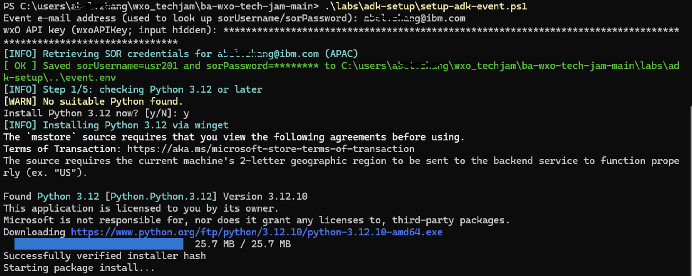
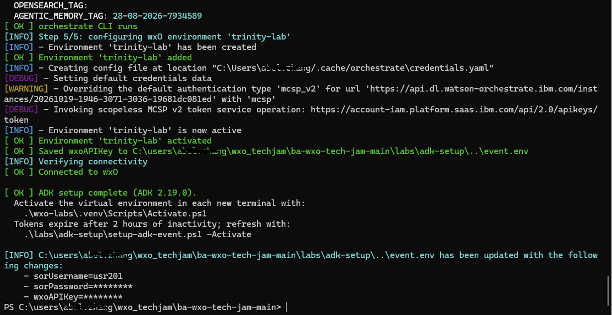

# Setup & Event Credentials

Version 1.0 / Authors: Olaf Hahnl, Juergen Lukas / Duration: ~20–30 min

---

## Notices

This information was developed for products and services offered in the USA. IBM may not offer the products, services, or features discussed in this document in other countries. Consult your local IBM representative for information on the products and services currently available in your area.

INTERNATIONAL BUSINESS MACHINES CORPORATION PROVIDES THIS PUBLICATION "AS IS" WITHOUT WARRANTY OF ANY KIND, EITHER EXPRESS OR IMPLIED, INCLUDING, BUT NOT LIMITED TO, THE IMPLIED WARRANTIES OF NON-INFRINGEMENT, MERCHANTABILITY OR FITNESS FOR A PARTICULAR PURPOSE.

This information could include technical inaccuracies or typographical errors. Changes are periodically made to the information herein; these changes will be incorporated in new editions of the publication.

This information contains examples of data and reports used in daily business operations. To illustrate them as completely as possible, the examples include the names of individuals, companies, brands, and products. All of these names are fictitious and any similarity to the names and addresses used by an actual business enterprise is entirely coincidental.

Trademarks: IBM, the IBM logo, and ibm.com are trademarks or registered trademarks of International Business Machines Corp., registered in many jurisdictions worldwide. Other product and service names might be trademarks of IBM or other companies. A current list of IBM trademarks is available at [www.ibm.com/legal/copytrade.shtml](https://www.ibm.com/legal/copytrade.shtml).

© Copyright International Business Machines Corporation 2026. This document may not be reproduced in whole or in part without the prior written permission of IBM. US Government Users Restricted Rights — Use, duplication or disclosure restricted by GSA ADP Schedule Contract with IBM Corp.

---

## Table of Contents

1. [Event Preparation & Access](#1-event-preparation--access)
   - 1.1 [On Event Day — Retrieve Credentials & Configure](#11-on-event-day--retrieve-credentials--configure)
   - 1.2 [Shared Tenant Environment: Access Control and Collaboration Model](#12-shared-tenant-environment-access-control-and-collaboration-model)
2. [Appendix: ADK CLI Setup Guide — Manual Setup Reference](#appendix-adk-cli-setup-guide--manual-setup-reference)
   - A.1 [Prerequisites & Python Setup](#a1-prerequisites--python-setup)
   - A.2 [Installing the ADK CLI on Windows](#a2-installing-the-adk-cli-on-windows)
   - A.3 [Installing the ADK CLI on macOS / Linux](#a3-installing-the-adk-cli-on-macos--linux)
   - A.4 [Updating an Existing ADK CLI Installation](#a4-updating-an-existing-adk-cli-installation)
   - A.5 [Connecting to the AWS wxO Environment](#a5-connecting-to-the-aws-wxo-environment)

---

## 1. Event Preparation & Access

### 1.1 On Event Day — Retrieve Credentials & Configure

On the first day of the event, you run one setup script. It retrieves your Trinity SOR credentials from your email address, installs Python and the ADK CLI if you do not have them, and connects the CLI to the event tenant. Along the way it sends you to a separate guide, [Generate Your wxO API Key](Generate%20Your%20wxO%20API%20Key.md), and waits while you generate your personal wxO API key. You will use the CLI throughout Labs 1.0–1.3, Lab 2, and Lab 3.

> **Before you start:** Make sure you have cloned the Tech Jam repository, or downloaded it as a ZIP file and extracted it, into a local folder, for example `C:\Users\<UserID>\wxo-techjam\ba-wxo-tech-jam-main` (Windows) or `/Users/<UserID>/wxo-techjam/ba-wxo-tech-jam-main` (macOS/Linux). The setup script is in this folder, and it keeps your credentials in `labs/event.env` inside it. You do not need to edit that file yourself: the Service instance URL is already filled in, and the script saves everything else.

> **⚠️ Disclaimer — convenience script modifies your local system**
> The setup script may install or upgrade Python (3.12 or later) and the ADK CLI (version 2.15 or later) on your machine. You run it at your own risk. IBM provides it as a convenience and accepts no liability for changes it makes to your local environment. If you prefer full control over what gets installed, or if you run into issues with the script due to your system configuration, use the manual approach instead: see [Appendix A.1–A.5](#a1-prerequisites--python-setup) for the step-by-step walkthrough, or the official [ADK Installation Guide](https://developer.watson-orchestrate.ibm.com/getting_started/installing).

You complete four steps:

**Step 1: Run the setup script**

Run the script from the repository folder. It is safe to re-run at any time.

   - **Windows:** Open a **PowerShell** console (not Command Prompt — the script is a `.ps1` file), change to the repository folder, then run:
     ```powershell
     cd C:\Users\<UserID>\wxo-techjam\ba-wxo-tech-jam-main
     .\labs\adk-setup\setup-adk-event.ps1
     ```
     > If PowerShell blocks the script from running, allow it for this session first: `Set-ExecutionPolicy -Scope Process -ExecutionPolicy Bypass`

   - **macOS/Linux:** Open a terminal, change to the repository folder, then run:
     ```bash
     cd /Users/<UserID>/wxo-techjam/ba-wxo-tech-jam-main
     ./labs/adk-setup/setup-adk-event.sh
     ```

If the script reports that `labs/event.env` was not found, you started it from the wrong folder: change to the repository folder and run it again.

**Step 2: Enter your email address**

When asked, enter the email address you registered with for the event. The script uses it to retrieve your SOR user ID and password from the Jam User Management App. Your SOR user ID (for example `usr001`) is the prefix for all lab artifacts you create in the **TechJam** tenant (for example `usr001_TRI_order_agent`).

- If the email address does not look valid, the script asks whether it is the right one. Answer `y` to keep it, or `n` to enter a new one.
- If the address is not registered for the event, the script stops with the message that it could not find the address in SOR. Contact the Tech Jam team to get it registered, then run the script again.

The email address is mandatory. If your SOR user ID and password are already saved in `labs/event.env`, the script uses them and does not ask for the email address.

**Step 3: Generate your wxO API key**

Once your SOR credentials are retrieved, the script highlights a message in green and waits:

   1. **Write down your SOR user ID**, as shown in the message.
   2. Open the link from the message (it comes from `wxoKeyGenUrl` in `labs/event.env`). It opens the guide [Generate Your wxO API Key](Generate%20Your%20wxO%20API%20Key.md).
   3. Follow that guide to generate the key. Use your **SOR user ID as the API key name**.
   4. Copy the generated key. **It is shown only once.**

Leave the script window open while you do this.

**Step 4: Paste the API key and let the setup finish**

Return to the terminal and paste the API key at the prompt. The input is hidden, so nothing appears as you paste. The API key is mandatory: if you leave it empty, the script stops with a message before it installs anything.

The script then checks Python and the ADK CLI and installs or upgrades only what is missing or too old. It registers the `trinity-lab` environment and activates it.



*Figure 1. Setup script start (Windows PowerShell shown) — email address and API key entered; the script retrieves your SOR credentials and installs what is missing*

After the API key is accepted, the script saves it to `labs/event.env` (`wxoAPIKey`), together with your SOR user ID and password, so that you can refresh your session later without typing the key again. When the script finishes, it reports that the ADK setup is complete and lists the entries it added or changed in `labs/event.env` (passwords and keys are masked), so you can see exactly what was written:



*Figure 2. Setup script finish (Windows PowerShell shown) — the environment is active and the updated event.env entries are listed*

   > **⚠️ Important:**
   > - **Authentication Expiry:** Remote environment authentication tokens expire after **2 hours**. If a CLI command fails later in the labs with an authentication or token error, refresh your session with the script's activate option. It reads your API key from `labs/event.env` (`wxoAPIKey`) and does not reinstall or re-register anything:
   >   - **Windows:** `.\labs\adk-setup\setup-adk-event.ps1 -Activate`
   >   - **macOS/Linux:** `./labs/adk-setup/setup-adk-event.sh --activate`
   >
   > - **Starting over:** To remove the `trinity-lab` environment, run the script with `-Reset` (Windows) or `--reset` (macOS/Linux). It removes the environment, clears the saved API key, SOR user ID and SOR password in `labs/event.env`, and stops. Run the script again without that option: it asks for your email address, fetches the SOR user ID and password again, and registers the environment with a new API key.

### 1.2 Shared Tenant Environment: Access Control and Collaboration Model

**How wxO on AWS works:**

Trinity runs on watsonx Orchestrate deployed on AWS. wxO's access model varies by deployment platform: wxO on IBM Cloud uses a Projects and Catalogs approach with Workspace Collaborator Roles, while wxO on AWS uses a Tenant-based access model with Platform Personas. For all development labs (Labs 1.0–1.3, 2, and 3), this event uses the AWS model on the **TechJam(EMEA|APAC|Americas)** tenant, where multiple participants collaborate within a single shared environment with access controlled through standardized roles that determine what you can build, test, and deploy.

SaaS Docs: [`users/roles-watsonx-orchestrate`](https://www.ibm.com/docs/en/watsonx/watson-orchestrate/base?topic=users-roles-watsonx-orchestrate) · ADK Docs: [`connections/overview`](https://developer.watson-orchestrate.ibm.com/connections/overview)

**Platform Personas (Roles):**

| Role | What They Can Do |
|---|---|
| **Builder** | Access the Agent Development Kit (ADK), build agents, tools, and configurations. All Builders share the Draft development environment. |
| **Analyst** | Import, test, and publish skills to the Catalog; train natural language prompts. |
| **User** | Chat with deployed Live agents only through Orchestrate Chat. Zero development access. |
| **Admin** | Manage tenant settings, user roles, and system configuration. |

**For this event:** You have been assigned the **Builder** role on the **TechJam(EMEA|APAC|Americas)** tenant, giving you full access to develop in the shared Draft environment. This means:
- You can see, modify, and test all draft artifacts created by other Builders
- Your work is visible to other Builders in real time
- When you deploy to Live, your agents become available to Users (read-only chat access)

**Naming convention to keep shared workspace organized:**

Because all Builders share the Draft environment, every artifact you create must follow this strict naming convention to prevent conflicts: prefix all artifact names with `(NAMESPACE)_TRI_`, where `(NAMESPACE)` is your assigned user ID (for example: `usr001_TRI_order_agent`, `usr002_TRI_knowledge_base`).

**Critical rule: Only modify and delete artifacts that belong to you.** Always verify that an artifact is prefixed with your own `(NAMESPACE)_` before making changes or running operations. If you see an artifact with a different participant's prefix, do not modify it — it belongs to someone else. If you accidentally modify another participant's artifact, inform your facilitator immediately so they can investigate and restore it if needed.

This naming convention is foundational to all labs in this series. You will see it reinforced in Labs 1.0, 1.1, and beyond. Following it carefully keeps the shared workspace functioning smoothly for everyone.

**Why this model matters:**

This shared-tenant, role-based approach enables tight collaboration during development (all Builders see each other's work in Draft) while maintaining separation between development and production (Live is where Users access deployed agents). Everyone builds in the same space, but the naming convention and role boundaries keep the workspace organized and safe.

[↑ Back to Table of Contents](#table-of-contents)

---

## Appendix: ADK CLI Setup Guide — Manual Setup Reference

> **Important:** The Agent Development Kit (ADK) CLI is **mandatory** for this event. The recommended way to install and connect it is the setup script, covered in [1.1 On Event Day](#11-on-event-day--retrieve-credentials--configure). **If you already followed those steps, you can skip this appendix.**
>
> This appendix is a manual, step-by-step reference — useful if you want to understand what the script automates, prefer to run the commands yourself, or need to troubleshoot a specific step.

The Agent Development Kit (ADK) CLI (`orchestrate`) provides developer-focused command-line tooling to build, test, package, and deploy agents, tools, knowledge bases, and workflows to watsonx Orchestrate.

For full details and reference on the ADK CLI, refer to the official documentation:
- [Installing the ADK](https://developer.watson-orchestrate.ibm.com/getting_started/installing)
- [ADK CLI Reference](https://developer.watson-orchestrate.ibm.com/getting_started/cli)
- [Configuring Remote Environments](https://developer.watson-orchestrate.ibm.com/environment/initiate_environment)

> **Version Requirement:** These labs require ADK CLI version **2.15** or higher.

---

### A.1 Prerequisites & Python Setup

The ADK CLI requires **Python 3.12** (or later).

#### Checking Python on Windows

1. Open **PowerShell** or **Command Prompt** and verify if Python 3.12+ is installed:
   ```powershell
   python --version
   ```
   *(or `py --version`)*

2. If Python is not installed or the version is older than 3.12:
   - Download the Python 3.12 installer from [python.org/downloads/windows](https://www.python.org/downloads/windows/).
   - Run the installer and **be sure to check the box: "Add python.exe to PATH"** before clicking **Install Now**.
   - Alternatively, install via Windows Package Manager:
     ```powershell
     winget install Python.Python.3.12
     ```
   - Restart your terminal and re-run `python --version` to confirm.

#### Checking Python on macOS / Linux

1. Open your terminal and check:
   ```bash
   python3 --version
   ```
2. If Python is not installed or older than 3.12:
   - **macOS:** Install via Homebrew: `brew install python@3.12`
   - **Ubuntu/Debian:** `sudo apt-get update && sudo apt-get install -y python3 python3-pip python3-venv`
   - **RHEL/Fedora:** `sudo dnf install -y python3 python3-pip`

---

### A.2 Installing the ADK CLI on Windows

Follow these steps to create a dedicated lab workspace and install the ADK CLI inside a Python virtual environment using `pip` (see official [System and Virtual Environment Installation](https://developer.watson-orchestrate.ibm.com/getting_started/installing#setting-up-and-installing-the-adk)):

1. Open **PowerShell** and create a dedicated workspace directory:
   ```powershell
   mkdir wxo-labs
   cd wxo-labs
   ```

2. Create a Python virtual environment:
   ```powershell
   python -m venv .venv
   ```

3. Activate the virtual environment:
   ```powershell
   .\.venv\Scripts\activate
   ```
   *(Your terminal prompt will now show `(.venv)`)*

4. Install the ADK CLI package via `pip`:
   ```powershell
   pip install --upgrade ibm-watsonx-orchestrate
   ```

5. Verify the version:
   ```powershell
   orchestrate --version
   ```
   Confirm that the output reports **2.15.x** or higher.

---

### A.3 Installing the ADK CLI on macOS / Linux

Follow these steps to create a dedicated lab workspace and install the ADK CLI inside a Python virtual environment using `pip`:

1. Open your terminal and create a dedicated workspace directory:
   ```bash
   mkdir wxo-labs
   cd wxo-labs
   ```

2. Create a Python virtual environment:
   ```bash
   python3 -m venv .venv
   ```

3. Activate the virtual environment:
   ```bash
   source .venv/bin/activate
   ```
   *(Your terminal prompt will now show `(.venv)`)*

4. Install the ADK CLI package via `pip`:
   ```bash
   pip install --upgrade ibm-watsonx-orchestrate
   ```

5. Verify the version:
   ```bash
   orchestrate --version
   ```
   Confirm that the output reports **2.15.x** or higher.

---

### A.4 Updating an Existing ADK CLI Installation

If you already have the ADK CLI installed from a prior event or project, verify your current version:

```bash
orchestrate --version
```

If the reported version is below **2.15**, upgrade the package:

1. Activate your existing virtual environment:
   - **Windows:** `.\.venv\Scripts\activate`
   - **macOS / Linux:** `source .venv/bin/activate`
2. Run the upgrade command:
   ```bash
   pip install --upgrade ibm-watsonx-orchestrate
   ```
3. Verify that the version has been updated:
   ```bash
   orchestrate --version
   ```

---

### A.5 Connecting to the AWS wxO Environment

> **ℹ️ Event-day only:** The steps in this section can only be completed once the event has begun and you have been invited to the wxO tenants (wxO-Playground and TechJam(EMEA|APAC|Americas)). You cannot connect to these environments before the event starts.
>
> **Already connected using the setup script?** You don't need this section — it documents the manual equivalent of what the script does in [1.1 On Event Day](#11-on-event-day--retrieve-credentials--configure).

Once installed, connect the ADK CLI to the **TechJam(EMEA|APAC|Americas)** watsonx Orchestrate instance. The actual tenant name depends on the event you are participating in (for example, TechJamEMEA, TechJamAPAC, or TechJamAmericas).

Before starting, get your **Service instance URL** (the `wxoServiceInstanceURL` value in `labs/event.env`) and generate your **API key** by following [Generate Your wxO API Key](Generate%20Your%20wxO%20API%20Key.md) (use your SOR user ID as the API key name).

#### Step 1: Add the Remote Environment

Register the remote environment in the CLI using the `mcsp` authentication type for AWS instances:

```bash
orchestrate env add -n trinity-lab -u <service-instance-url> --type mcsp
```
*(Replace `<service-instance-url>` with the Service instance URL you saved earlier.)*

#### Step 2: Activate the Environment

Authenticate and set `trinity-lab` as your active target environment:

```bash
orchestrate env activate trinity-lab
```

Alternatively, pass your API key directly to avoid the interactive prompt:

```bash
orchestrate env activate trinity-lab -a <API-KEY>
```

If using the interactive method, paste your **API key** when prompted.

> **Note on Authentication Expiry (you saved your API key in `labs/event.env` under `wxoAPIKey`):**
> Remote environment authentication tokens expire after **2 hours**. If a CLI command fails later with an authentication or token error, re-run the activation command:
> ```bash
> orchestrate env activate trinity-lab -a <API-KEY>
> ```
> If you used the setup script, `setup-adk-event.sh --activate` (macOS/Linux) or `setup-adk-event.ps1 -Activate` (Windows) does this for you using the key in `labs/event.env`.

#### Step 3: Verify Connectivity

Test that the CLI can communicate with the **TechJam(EMEA|APAC|Americas)** instance:

```bash
orchestrate agents list
```
The command lists the agents in the instance. A new instance shows only the built-in agents, such as `AskOrchestrate`.

[↑ Back to Table of Contents](#table-of-contents)
