# Setup & Event Credentials

Version 1.0 / Authors: Olaf Hahnl, Juergen Lukas / Duration: ~20–30 min

---

## Notices

This information was developed for products and services offered in the USA. IBM may not offer the products, services, or features discussed in this document in other countries. Consult your local IBM representative for information on the products and services currently available in your area.

INTERNATIONAL BUSINESS MACHINES CORPORATION PROVIDES THIS PUBLICATION "AS IS" WITHOUT WARRANTY OF ANY KIND, EITHER EXPRESS OR IMPLIED, INCLUDING, BUT NOT LIMITED TO, THE IMPLIED WARRANTIES OF NON-INFRINGEMENT, MERCHANTABILITY OR FITNESS FOR A PARTICULAR PURPOSE.

This information could include technical inaccuracies or typographical errors. Changes are periodically made to the information herein; these changes will be incorporated in new editions of the publication.

This information contains examples of data and reports used in daily business operations. To illustrate them as completely as possible, the examples include the names of individuals, companies, brands, and products. All of these names are fictitious and any similarity to the names and addresses used by an actual business enterprise is entirely coincidental.

Trademarks: IBM, the IBM logo, and ibm.com are trademarks or registered trademarks of International Business Machines Corp., registered in many jurisdictions worldwide. Other product and service names might be trademarks of IBM or other companies. A current list of IBM trademarks is available at [www.ibm.com/legal/copytrade.shtml](https://www.ibm.com/legal/copytrade.shtml).

© Copyright International Business Machines Corporation 2026. This document may not be reproduced in whole or in part without the prior written permission of IBM. US Government Users Restricted Rights — Use, duplication or disclosure restricted by GSA ADP Schedule Contract with IBM Corp.

---

## Table of Contents

1. [Event Preparation & Access](#1-event-preparation--access)
   - 1.1 [Before the Event — Prepare Your Local Environment](#11-before-the-event--prepare-your-local-environment)
   - 1.2 [On Event Day — Retrieve Credentials & Configure](#12-on-event-day--retrieve-credentials--configure)
   - 1.3 [Shared Tenant Environment: Access Control and Collaboration Model](#13-shared-tenant-environment-access-control-and-collaboration-model)
2. [Appendix: ADK CLI Setup Guide — Manual Setup Reference](#appendix-adk-cli-setup-guide--manual-setup-reference)
   - A.1 [Prerequisites & Python Setup](#a1-prerequisites--python-setup)
   - A.2 [Installing the ADK CLI on Windows](#a2-installing-the-adk-cli-on-windows)
   - A.3 [Installing the ADK CLI on macOS / Linux](#a3-installing-the-adk-cli-on-macos--linux)
   - A.4 [Updating an Existing ADK CLI Installation](#a4-updating-an-existing-adk-cli-installation)
   - A.5 [Connecting to the AWS wxO Environment](#a5-connecting-to-the-aws-wxo-environment)

---

## 1. Event Preparation & Access

> **ℹ️ For pre-event readers:** This document is split into two phases. Section 1.1 (Before the Event) contains actionable steps you can take now to prepare your local environment. Section 1.2 (On Event Day) describes what you'll do when the event begins to retrieve your credentials. Section 1.3 (Shared Tenant Environment) is valuable pre-reading to understand the architecture you'll be working in.

### 1.1 Before the Event — Prepare Your Local Environment

Start now by ensuring your local environment is ready. These steps are self-contained and do not require access to wxO.

You need **Python 3.12 or later** and the **ADK CLI (version 2.15+)** installed locally — you will use the CLI throughout Labs 1.0–1.3, Lab 2, and Lab 3 (including importing pre-built artifacts, Python tools, and agentic workflows). Follow the steps below to setup the ADK environment.

**You will need to download the pre-event setup script for your platform before installation:**
- **Windows** - Download **setup-adk-pre-event.ps1** from path labs\adk-setup.
- **Mac** - Download **setup-adk-pre-event.sh** from path labs/adk-setup.

  
> **⚠️ Disclaimer — convenience scripts modify your local system**
> The setup script provided below installs Python and the ADK CLI on your machine. You run it at your own risk. IBM provides it as a convenience and accepts no liability for changes it makes to your local environment. If you prefer full control over what gets installed and how, or if you run into issues with the script due to your system configuration, use the manual approach instead: see [Appendix A.1–A.4](#a1-prerequisites--python-setup) for the step-by-step walkthrough, or the official [ADK Installation Guide](https://developer.watson-orchestrate.ibm.com/getting_started/installing).

1. **Run the pre-event setup script for your platform** (installs Python and the ADK CLI — no wxO connection needed yet):

   > **Note:** This script installs and verifies the ADK CLI only. On event day you will run a separate script to connect to the **TechJam** tenant (see "On Event Day" below).

   - **Windows:** Open a **PowerShell** console (not Command Prompt — the script is a `.ps1` file), then run:
     ```powershell
     .\labs\adk-setup\setup-adk-pre-event.ps1
     ```
     > If PowerShell blocks the script from running, allow it for this session first: `Set-ExecutionPolicy -Scope Process -ExecutionPolicy Bypass`

   - **macOS/Linux:** Open a terminal, then run:
     ```bash
     ./labs/adk-setup/setup-adk-pre-event.sh
     ```

   The script is safe to re-run at any time, including if you already have the ADK CLI from a prior event — it won't change anything that's already in place and meets the version requirements.

2. *(Optional)* **IBM Bob account** — Only needed if you want to try the optional "Build with Bob" exercises in Lab 1.0. You can set this up anytime before or during the event. If you don't have a Bob license, you can get a 30 days free trial license here: **https://bob.ibm.com/trial**.

### 1.2 On Event Day — Retrieve Credentials & Configure

On the first day of the event, you will access the Jam User Management App to retrieve your Trinity SOR credentials and other required URLs. You will need to complete the following steps:

**Step 0: Open your credential file**

Before you start, open `labs/event.env` in a text editor — this is the file where you will store all your credentials. You will fill in the five values in this file over the next two steps, and the lab scripts will read from it automatically so you do not need to type them again.

**Step 1: Trinity System of Record (SOR) credentials**

During the event, use the Jam User Management App to retrieve your SOR username and password. Your SOR user ID (for example: `usr001`) serves as the prefix for all lab artifacts you create in the **TechJam** tenant (for example: `usr001_TRI_order_agent`) and is also used as the name for your wxO API key in the next step.

   1. Open the [Jam User Management App](https://jam-usermanagement-jam-usermanagement.swat-dev-roks-vpc-02-464887bc828751e1b00625ca9211fbca-0000.eu-de.containers.appdomain.cloud/UserManagement)

   2. Enter the email address you registered with for the event. Ensure the location matches the geo you are registered for (for example, **APAC** if you registered for APAC)

      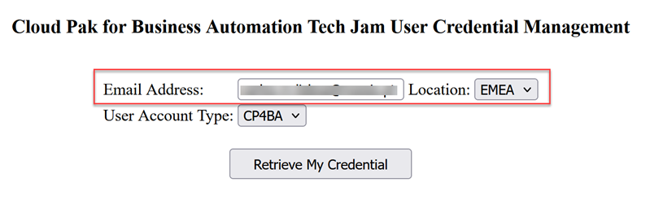

      *Figure 1. Jam User Management App — enter your email address*

   3. Click **Retrieve My Credential**

      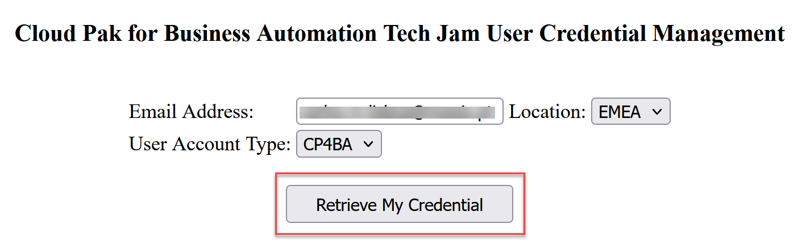

      *Figure 2. Jam User Management App — click Retrieve My Credential*

   4. Copy the **User ID** and **Password** and paste them into `labs/event.env` as the values for `sorUsername` and `sorPassword`. Unlike the API key (which can only be viewed once), SOR credentials can be retrieved at any time from this app.

      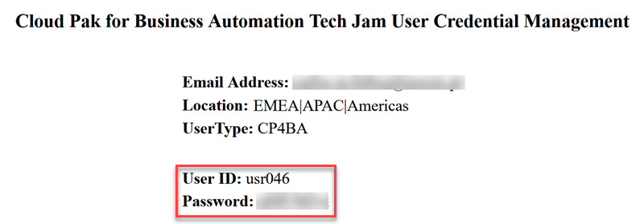

      *Figure 3. Jam User Management App — retrieved User ID and Password*

**Step 2: Get your wxO Service instance URL and generate an API key**

   1. Open the following link in your browser and log in using your **IBM ID** (not your SOR `usrXXX` username/password):
      ```
      https://dl.watson-orchestrate.ibm.com
      ```

      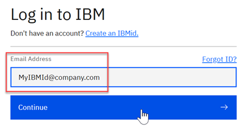

      *Figure 4. IBM ID login page*

   2. If you have access to multiple wxO tenants, you will see an account selection page — select **TechJam(APAC)**. If you have access to only one tenant, you will land directly in TechJam(APAC) without a selection page.

      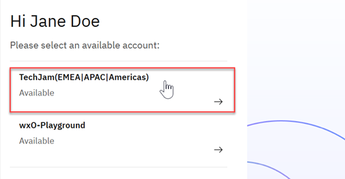

      *Figure 5. Account selection page — select TechJam(APAC) if prompted*

   3. Click your user profile icon (top-right), then click **Settings**.

      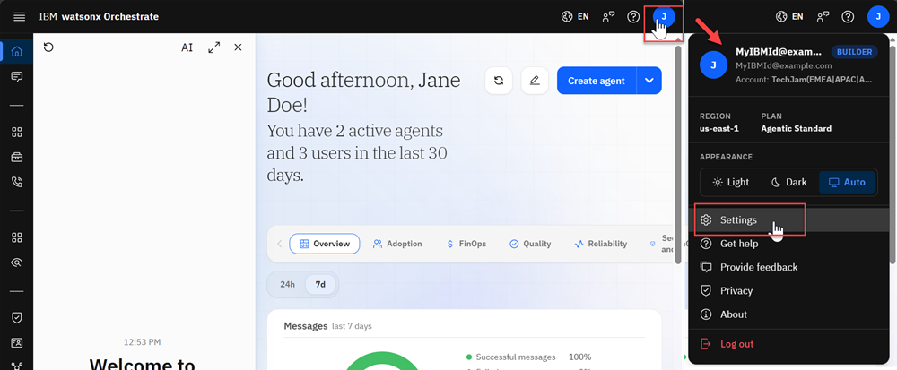

      *Figure 6. User profile icon menu with Settings highlighted*

   4. Click the **API details** tab.

      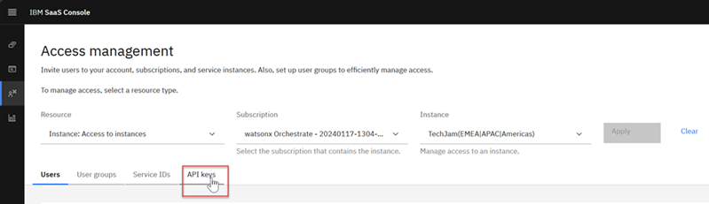

      *Figure 7. Settings page — click the API details tab*

   5. Copy the **Service instance URL** and paste it into `labs/event.env` as the value for `wxoServiceInstanceURL`.

      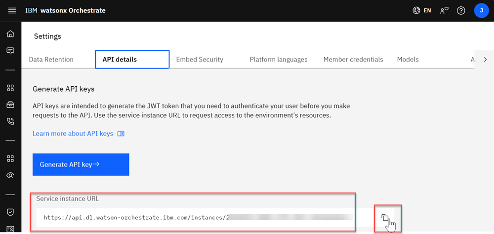

      *Figure 8. API details tab — copy the Service instance URL*

   6. Click **Generate API key**. The IBM SaaS Console opens in a new browser tab.

      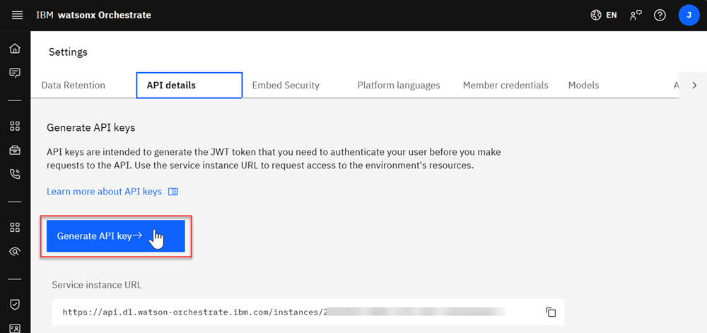

      *Figure 9. API details tab — click Generate API key*

   7. If the IBM SaaS Console asks you to sign in, sign in.
   8. Confirm that the page shows **Access management** and that **TechJam(APAC)** is selected as the **Instance**. If not, select it and click **Apply**.

      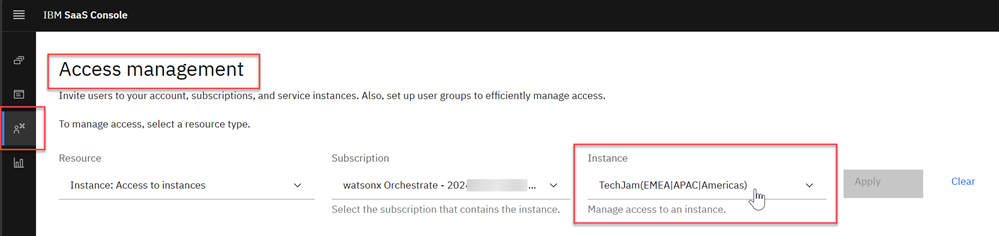

      *Figure 10. IBM SaaS Console — Access management page with the correct Instance selected*

   9. Click the **API keys** tab.

      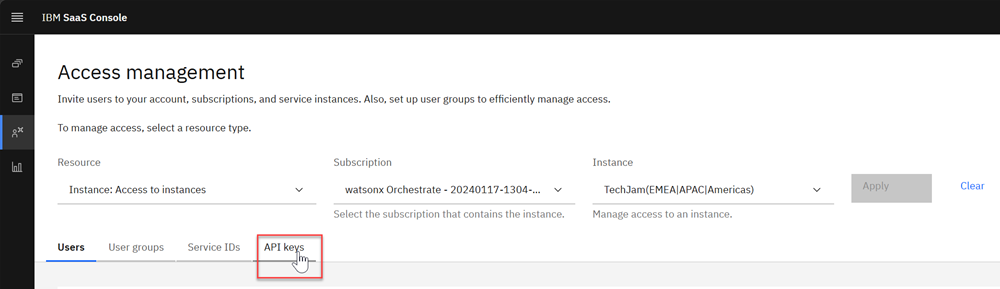

      *Figure 11. IBM SaaS Console — click the API keys tab*

   10. Click **Generate key +**.

       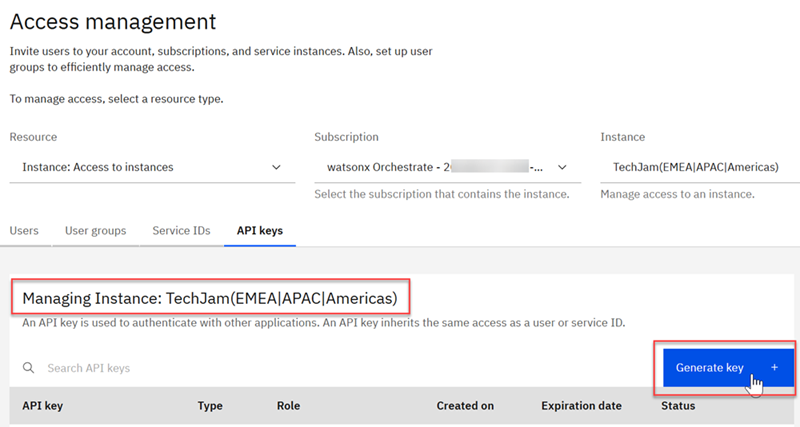

       *Figure 12. IBM SaaS Console — click the Generate key button*

   11. Select **Personal** as the **Type**.
   12. Enter your SOR user ID (from step 1 above, for example `usr012`) as the **API key name**.
   13. Enter a date after the end of the event as the **Expiration date**, in `MM/DD/YYYY` format.
   14. Click **Generate key**.

       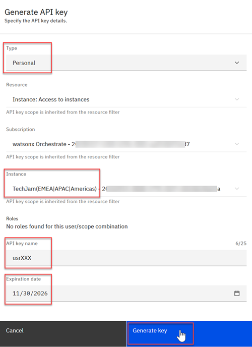

       *Figure 13. Generate API key dialog — with Type, API key name, and Expiration date filled in*

   15. Click **Copy to clipboard** and paste the key into `labs/event.env` as the value for `wxoAPIKey`. **The API key is shown only once** — if you close this dialog before pasting it, you will need to generate a new key.

       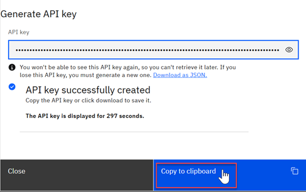

       *Figure 14. IBM SaaS Console — generated API key with Copy to clipboard button*

   16. Close the IBM SaaS Console tab.

   > **Note:**
   > - The API key is shown only once, for about 5 minutes. You cannot retrieve it later. If you lose it, generate a new key.
   > - The API key has the same access as your user. In the **Generate API key** dialog, **Roles** shows **Builder** and **Service user**. The key is for the instance selected in step 8, so it does not work for other instances. **This is why it is critical to ensure that TechJam(APAC) is selected in step 8 — this is the instance all labs except Lab 0 use.**
   > - If you see the message `API key not created, try to create it again`, or a page that lists accounts but no instance, ask a facilitator to check your role assignment.

**Step 3: Connect the ADK CLI to TechJam(APAC)**

> **⚠️ Disclaimer — convenience script modifies your local system**
> The event-day setup script may install or upgrade Python and the ADK CLI on your machine. You run it at your own risk. IBM provides it as a convenience and accepts no liability for changes it makes to your local environment. If you prefer full control, or if you run into issues with the script due to your system configuration, use the manual approach instead: see [Appendix A.5](#a5-connecting-to-the-aws-wxo-environment) for the step-by-step walkthrough.

> **⚠️ Disclaimer — You need to have already performed steps in section 1.1 before starting the setup here.**

Run the event-day setup script to register and activate the environment. If you filled in `labs/event.env` in the previous steps, the script reads your Service instance URL and API key from there automatically — you do not need to pass any parameters. Run it from a **PowerShell** console on Windows, or a terminal on macOS/Linux, same as before.

   - **Windows:**
     ```powershell
     .\labs\adk-setup\setup-adk-event.ps1
     ```

   - **macOS/Linux:**
     ```bash
     ./labs/adk-setup/setup-adk-event.sh
     ```

   If you prefer to pass the values explicitly (for example to override what is in `event.env`), you can still do so:

   - **Windows:** `.\labs\adk-setup\setup-adk-event.ps1 -u <service-instance-url> -k <your-api-key>`
   - **macOS/Linux:** `./labs/adk-setup/setup-adk-event.sh -u <service-instance-url> -k <your-api-key>`

   > **⚠️ Important:**
   > - **API key on command line:** Passing the API key as a command-line parameter makes it visible in your shell history and process list. Since this environment exists only for the duration of this event and is discarded afterward, the practical risk is minimal. The recommended approach is to store it in `labs/event.env` and let the script read it from there — the key is never echoed to the terminal that way.
   > - **Authentication Expiry:** Remote environment authentication tokens expire after **2 hours**. If a CLI command fails later in the labs with an authentication or token error, re-run: `orchestrate env activate trinity-lab -a <your-api-key>` — you saved your API key in `labs/event.env` (`wxoAPIKey`). Omit `-a <your-api-key>` to be prompted instead.


### 1.3 Shared Tenant Environment: Access Control and Collaboration Model

**How wxO on AWS works:**

Trinity runs on watsonx Orchestrate deployed on AWS. wxO's access model varies by deployment platform: wxO on IBM Cloud uses a Projects and Catalogs approach with Workspace Collaborator Roles, while wxO on AWS uses a Tenant-based access model with Platform Personas. For all development labs (Labs 1.0–1.3, 2, and 3), this event uses the AWS model on the **TechJam(APAC)** tenant, where multiple participants collaborate within a single shared environment with access controlled through standardized roles that determine what you can build, test, and deploy.

SaaS Docs: [`users/roles-watsonx-orchestrate`](https://www.ibm.com/docs/en/watsonx/watson-orchestrate/base?topic=users-roles-watsonx-orchestrate) · ADK Docs: [`connections/overview`](https://developer.watson-orchestrate.ibm.com/connections/overview)

**Platform Personas (Roles):**

| Role | What They Can Do |
|---|---|
| **Builder** | Access the Agent Development Kit (ADK), build agents, tools, and configurations. All Builders share the Draft development environment. |
| **Analyst** | Import, test, and publish skills to the Catalog; train natural language prompts. |
| **User** | Chat with deployed Live agents only through Orchestrate Chat. Zero development access. |
| **Admin** | Manage tenant settings, user roles, and system configuration. |

**For this event:** You have been assigned the **Builder** role on the **TechJam(APAC)** tenant, giving you full access to develop in the shared Draft environment. This means:
- You can see, modify, and test all draft artifacts created by other Builders
- Your work is visible to other Builders in real time
- When you deploy to Live, your agents become available to Users (read-only chat access)

**Naming convention to keep shared workspace organized:**

Because all Builders share the Draft environment, every artifact you create must follow this strict naming convention to prevent conflicts: prefix all artifact names with `(NAMESPACE)_TRI_`, where `(NAMESPACE)` is your assigned user ID (for example: `usr001_TRI_order_agent`, `usr002_TRI_knowledge_base`).

**Critical rule: Only modify and delete artifacts that belong to you.** Always verify that an artifact is prefixed with your own `(NAMESPACE)_` before making changes or running operations. If you see an artifact with a different participant's prefix, do not modify it — it belongs to someone else. If you accidentally modify another participant's artifact, inform your facilitator immediately so they can investigate and restore it if needed.

This naming convention is foundational to all labs in this series. You will see it reinforced in Labs 1.0, 1.1, and beyond. Following it carefully keeps the shared workspace functioning smoothly for everyone.

**Why this model matters:**

This shared-tenant, role-based approach enables tight collaboration during development (all Builders see each other's work in Draft) while maintaining separation between development and production (Live is where Users access deployed agents). Everyone builds in the same space, but the naming convention and role boundaries keep the workspace organized and safe.

[↑ Back to Table of Contents](#table-of-contents)

---

## Appendix: ADK CLI Setup Guide — Manual Setup Reference

> **Important:** The Agent Development Kit (ADK) CLI is **mandatory** for this event. The recommended way to install and connect it is the setup script, covered in [1.1 Before the Event](#11-before-the-event--prepare-your-local-environment) and [1.2 On Event Day](#12-on-event-day--retrieve-credentials--configure). **If you already followed those steps, you can skip this appendix.**
>
> This appendix is a manual, step-by-step reference — useful if you want to understand what the script automates, prefer to run the commands yourself, or need to troubleshoot a specific step.

The Agent Development Kit (ADK) CLI (`orchestrate`) provides developer-focused command-line tooling to build, test, package, and deploy agents, tools, knowledge bases, and workflows to watsonx Orchestrate.

For full details and reference on the ADK CLI, refer to the official documentation:
- [Installing the ADK](https://developer.watson-orchestrate.ibm.com/getting_started/installing)
- [ADK CLI Reference](https://developer.watson-orchestrate.ibm.com/getting_started/cli)
- [Configuring Remote Environments](https://developer.watson-orchestrate.ibm.com/environment/initiate_environment)

> **Version Requirement:** These labs require ADK CLI version **2.15** or higher.

---

### A.1 Prerequisites & Python Setup

The ADK CLI requires **Python 3.12** (or later).

#### Checking Python on Windows

1. Open **PowerShell** or **Command Prompt** and verify if Python 3.12+ is installed:
   ```powershell
   python --version
   ```
   *(or `py --version`)*

2. If Python is not installed or the version is older than 3.12:
   - Download the Python 3.12 installer from [python.org/downloads/windows](https://www.python.org/downloads/windows/).
   - Run the installer and **be sure to check the box: "Add python.exe to PATH"** before clicking **Install Now**.
   - Alternatively, install via Windows Package Manager:
     ```powershell
     winget install Python.Python.3.12
     ```
   - Restart your terminal and re-run `python --version` to confirm.

#### Checking Python on macOS / Linux

1. Open your terminal and check:
   ```bash
   python3 --version
   ```
2. If Python is not installed or older than 3.12:
   - **macOS:** Install via Homebrew: `brew install python@3.12`
   - **Ubuntu/Debian:** `sudo apt-get update && sudo apt-get install -y python3 python3-pip python3-venv`
   - **RHEL/Fedora:** `sudo dnf install -y python3 python3-pip`

---

### A.2 Installing the ADK CLI on Windows

Follow these steps to create a dedicated lab workspace and install the ADK CLI inside a Python virtual environment using `pip` (see official [System and Virtual Environment Installation](https://developer.watson-orchestrate.ibm.com/getting_started/installing#setting-up-and-installing-the-adk)):

1. Open **PowerShell** and create a dedicated workspace directory:
   ```powershell
   mkdir wxo-labs
   cd wxo-labs
   ```

2. Create a Python virtual environment:
   ```powershell
   python -m venv .venv
   ```

3. Activate the virtual environment:
   ```powershell
   .\.venv\Scripts\activate
   ```
   *(Your terminal prompt will now show `(.venv)`)*

4. Install the ADK CLI package via `pip`:
   ```powershell
   pip install --upgrade ibm-watsonx-orchestrate
   ```

5. Verify the version:
   ```powershell
   orchestrate --version
   ```
   Confirm that the output reports **2.15.x** or higher.

---

### A.3 Installing the ADK CLI on macOS / Linux

Follow these steps to create a dedicated lab workspace and install the ADK CLI inside a Python virtual environment using `pip`:

1. Open your terminal and create a dedicated workspace directory:
   ```bash
   mkdir wxo-labs
   cd wxo-labs
   ```

2. Create a Python virtual environment:
   ```bash
   python3 -m venv .venv
   ```

3. Activate the virtual environment:
   ```bash
   source .venv/bin/activate
   ```
   *(Your terminal prompt will now show `(.venv)`)*

4. Install the ADK CLI package via `pip`:
   ```bash
   pip install --upgrade ibm-watsonx-orchestrate
   ```

5. Verify the version:
   ```bash
   orchestrate --version
   ```
   Confirm that the output reports **2.15.x** or higher.

---

### A.4 Updating an Existing ADK CLI Installation

If you already have the ADK CLI installed from a prior event or project, verify your current version:

```bash
orchestrate --version
```

If the reported version is below **2.15**, upgrade the package:

1. Activate your existing virtual environment:
   - **Windows:** `.\.venv\Scripts\activate`
   - **macOS / Linux:** `source .venv/bin/activate`
2. Run the upgrade command:
   ```bash
   pip install --upgrade ibm-watsonx-orchestrate
   ```
3. Verify that the version has been updated:
   ```bash
   orchestrate --version
   ```

---

### A.5 Connecting to the AWS wxO Environment

> **ℹ️ Event-day only:** The steps in this section can only be completed once the event has begun and you have been invited to the wxO tenants (wxO-Playground and TechJam(APAC)). You cannot connect to these environments before the event starts.
>
> **Already connected using the setup script?** You don't need this section — it documents the manual equivalent of what the script does in [1.2 On Event Day](#12-on-event-day--retrieve-credentials--configure).

Once installed, connect the ADK CLI to the **TechJam(APAC)** watsonx Orchestrate instance. The actual tenant name depends on the event you are participating in (for example, TechJamEMEA, TechJamAPAC, or TechJamAmericas).

Before starting, obtain your **Service instance URL** and **API key** using the steps in [1.2 On Event Day](#12-on-event-day--retrieve-credentials--configure).

#### Step 1: Add the Remote Environment

Register the remote environment in the CLI using the `mcsp` authentication type for AWS instances:

```bash
orchestrate env add -n trinity-lab -u <service-instance-url> --type mcsp
```
*(Replace `<service-instance-url>` with the Service instance URL you saved earlier.)*

#### Step 2: Activate the Environment

Authenticate and set `trinity-lab` as your active target environment:

```bash
orchestrate env activate trinity-lab
```

Alternatively, pass your API key directly to avoid the interactive prompt:

```bash
orchestrate env activate trinity-lab -a <API-KEY>
```

If using the interactive method, paste your **API key** when prompted.

> **Note on Authentication Expiry (you saved your API key in `labs/event.env` under `wxoAPIKey`):**
> Remote environment authentication tokens expire after **2 hours**. If a CLI command fails later with an authentication or token error, re-run the activation command:
> ```bash
> orchestrate env activate trinity-lab
> ```

#### Step 3: Verify Connectivity

Test that the CLI can communicate with the **TechJam(APAC)** instance:

```bash
orchestrate agents list
```
The command lists the agents in the instance. A new instance shows only the built-in agents, such as `AskOrchestrate`.

[↑ Back to Table of Contents](#table-of-contents)
