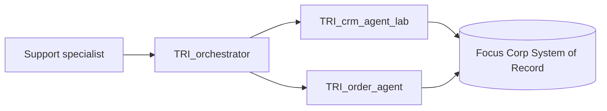

# Lab 1.3 — Authoring Notes (working draft, canonical)

> **Owner:** Jürgen
> **Status:** Draft outline in progress — not yet reviewed or approved. Nothing here has been written into `lab-guides/Lab Guide - Lab 1.3 - multi-agent.md` yet.
>
> **What this document is:** The single canonical working document for Lab 1.3 ("Multi-Agent Systems: Supervisor + Collaborator Patterns") — scenario framing, exercise breakdown, teaching points, and source grounding — built incrementally and interactively before any guide prose is written. It sits between the programme-level spec (`specs/lab-design.md`) and the actual guide document (`lab-guides/Lab Guide - Lab 1.3 - multi-agent.md`).
>
> **Moved here 2026-09-28:** all Lab 1.3 content previously drafted in `handover/overall-agent-lab-brainstorm.md` § "Chapter 'Multi-Agent Systems'" has been consolidated into this file, which is now the canonical, actively-maintained source for Lab 1.3 authoring — not the brainstorm doc. `handover/overall-agent-lab-brainstorm.md` has been reverted to its `main` state and will **not** be updated further for Lab 1.3; treat any Lab 1.3 content still visible there as historical/superseded by this file. Cross-chapter bookkeeping that also concerns other labs (the Q4/Q5/Q6/Q8 decision rows, forward-references from Labs 1.0–1.2 into this chapter) stays in the brainstorm doc since it's shared context, not owned by this file.
>
> **What this document is not:** The lab guide itself (that is `lab-guides/Lab Guide - Lab 1.3 - multi-agent.md`, not touched until this draft is signed off), the programme-level intent (that is `specs/lab-design.md` § "Lab 1.3"), or the formatting/style conventions (`lab-guides/LAB-GUIDE-CONVENTIONS.md`). Do not duplicate content from those files here — reference them instead.
>
> Companion file for the Introduction to watsonx Orchestrate–Lab 1.2 authoring notes: `labs/lab-1x/specs/lab-authoring-notes.md` (Ramy). This file is kept separate rather than added as a section there, since Lab 1.3 has a different owner and is still in active flux.

---

## Status of the scope decision

Resolved 2026-09-28: both halves of the lab reuse `TRI_order_agent` + `TRI_crm_agent_lab` (built in Lab 1.1) under the real `TRI_orchestrator` — no dedicated Warranty Supervisor or new stub agents. See `specs/lab-design.md` § "Lab 1.3" and `context/decisions.md` (2026-09-28 row) for the full rationale.

## Terminology

Decided 2026-09-28, revised same day (see `context/decisions.md`): the guide's primary, consistent vocabulary is **"supervisor"** for the top-level coordinating agent and **"collaborator"** for the specialist agents it delegates to. This is the pairing best grounded in IBM's own documentation, not an arbitrary programme choice.

- **"Collaborator"** is unanimous across every IBM source checked: both wxO ADK docs (`agent_design/foundational_architecture`, `connect_agent`) and the IBM Knowledge Center's `understanding-agent-orchestration` page all use "collaborator agents" for the specialist role. It is also wxO's own schema term — the `collaborators:` field in agent YAML.
- **"Supervisor"** appears explicitly, twice, in the ADK docs — *"Use a supervisor agent to handle routing and orchestration"* (`agent_design/foundational_architecture`, in its fix for the "monolithic mega-prompt" anti-pattern) and *"descriptions are used by supervisor agents to determine how to route user requests"* (`connect_agent`). ADK is the technical, builder-facing doc surface — the one that matches this lab's own audience (Low-Code/IT Developer) most closely.
- **"Primary agent"** is the term the IBM Knowledge Center's own conceptual page (`agents-understanding-agent-orchestration`) uses for the identical top-level role — no "supervisor," no "orchestrator" as an entity name appears there. Named once in the guide as an IBM-doc synonym.
- **"Orchestrator"** and **"Manager"** are named once as synonyms for the same role: "Orchestrator" is Trinity's own artifact name (`TRI_orchestrator`) and this programme's originally-considered term (see the superseded decision below); "Manager" is the term used by other frameworks (LangGraph, OpenAI). Neither is an IBM documentation term.
- **"Worker agent"** is kept only as an informal category label inherited from this programme's own Labs 1.0–1.2 titles ("Worker Agent: ..."). It is not IBM's term and is not used as this chapter's primary vocabulary — "collaborator" is used instead, consistent with IBM's docs.
- **Explicit disambiguation required in the guide:** "supervisor" is *also* used elsewhere in the lab programme (Lab 2's billing dispute) for a **human** approval role — a person who approves or rejects a workflow HITL step. That is unrelated to this chapter's agent pattern, and the risk of confusion is now higher since "supervisor" is the primary agent-pattern term too. Flag this once, plainly, so the two meanings don't bleed together for participants who take both labs.
- **Full IBM-doc evidence trail (checked 2026-09-28):** wxO ADK `agent_design/foundational_architecture` — "supervisor agent"/"sub-agents". wxO ADK `connect_agent` — "supervisor agents" (routing) and "collaborators"/"external agents"/"native agent" (registration). IBM Knowledge Center `agents-understanding-agent-orchestration` — "primary agent"/"collaborator agents" (also "sub-collaborator" for nested collaboration). Neither "orchestrator" nor "worker" appears in any of these three IBM sources.
- **Superseded decision (2026-09-28, same day):** this chapter's vocabulary was briefly set to "orchestrator"/"worker agent" earlier the same day, on the reasoning that no IBM source named the pattern and Trinity's own `TRI_orchestrator` artifact name should therefore anchor the choice. That reasoning was corrected once the "supervisor agent" citations above were found in ADK — IBM *does* name this pattern, twice, in its own builder docs, so the programme now uses IBM's term instead of defaulting to the artifact name. Trinity's `TRI_orchestrator.yaml` artifact name itself is unaffected — this is a change in which English word the guide teaches, not a rename of the artifact.

Rationale and full research trail: `context/decisions.md` (2026-09-28 rows, "Orchestrator/Worker terminology decision" and "Supervisor/Collaborator terminology decision (revision)").

## Chapter goal and framing

**Goal:** Participants leave this chapter able to apply wxO's supervisor/collaborator pattern confidently in their own projects. That means: (1) knowing when a multi-agent system is the right architecture and when it is not; (2) writing collaborator agent descriptions that function as high-quality routing contracts; (3) keeping the supervisor prompt minimal and routing-only; and (4) knowing how to sequence collaborator agent calls dynamically based on available input. The chapter anchors all of this in the `TRI_orchestrator` architecture — participants build a functioning supervisor agent that, by the end, mirrors the same 13-line instruction set used in the live Trinity demo system.

The chapter teaches both coordination halves of the pattern. The **supervisor** half teaches routing by intent (which specialist?). The **collaborator** half teaches sequencing by available input (in what order?). Together they are the building blocks of `TRI_orchestrator` and the pattern wxO's collaborator architecture is designed for. Participants reuse `TRI_order_agent` and `TRI_crm_agent_lab` built in earlier chapters — the payoff lands when the two agents they already know are combined under a supervisor that can handle *"look up this customer"* and *"find orders for order ID O-DF340K"* through the same single entry point.

**Opening callout — point back to Lab 1.1, don't re-teach agent-vs-deterministic:** Checked 2026-09-29 whether the "when to use an agent vs. a deterministic implementation, and how to mix the two" foundation is already established before this chapter. It is — **Introduction to watsonx Orchestrate** introduces the concept (the Agentic Workflow construct, the "predictability and control" criterion), and Lab 1.1 Exercise 5 gives the deepest, most direct treatment: its own opening line states *"Tools connect flexible, probabilistic agent reasoning to deterministic software"* (Lab 1.1, line 49), and Exercise 5 gives the explicit decision rule — *"If the path is at least partially predetermined, review or approval is needed, or multiple users must collaborate → Agentic Workflow"* (line 845) — worked through the same two Trinity examples (Billing Dispute, Warranty Claim) used in **Introduction to watsonx Orchestrate**. Lab 1.0 only touches this tangentially (the "Agent-Washing" anti-pattern) and is not a citation target. This chapter's Lab Introduction must open by pointing back to Lab 1.1 Exercise 5 rather than re-explaining the concept, framing multi-agent as the next question *after* that one has already been settled:

  > Before this lab, you've already made the single-agent-vs-deterministic call repeatedly: Lab 1.1 Exercise 5 gave you the decision rule — *"If the path is at least partially predetermined, review or approval is needed, or multiple users must collaborate → Agentic Workflow."* That's a call between one agent's probabilistic reasoning and deterministic orchestration. This lab asks a different but related question: given that a task should be handled by *agent reasoning*, should it be one agent or several? The same instinct — match the mechanism to how predictable the task's shape is — carries over directly.

**Writing-style rule (owner correction, 2026-09-30) — applies to every remaining exercise in this chapter and to future chapters:** This guide's audience is participant-facing technical IBMers and IBM Business Partners, not an internal research memo. Two concrete rules:
1. **Don't narrate the citation.** Avoid phrasing that points at a source using its own voice — e.g. "the wxO ADK's own stated rationale," "OpenAI's own field guidance," "its own guidance says." State the fact or rationale directly, in plain declarative language, without a meta-comment about where it came from or that it is "self-described." This reads as unprofessional in a lab guide even when the underlying claim is accurate.
2. **Don't name non-IBM vendors or their articles in guide prose.** Never write "Anthropic's *Building Effective Agents* describes..." or "OpenAI's *A practical guide to building agents* recommends..." in `lab-guides/Lab Guide - Lab 1.3 - multi-agent.md` (or any future lab guide). Fold the underlying insight into the explanation as general, unattributed knowledge instead — the participant needs the idea, not a competitor-product citation trail. **The source citations stay in this authoring-notes file** (as they already are, throughout "Outline content" and "Source grounding" above) — this rule is about guide prose only, not about removing the research/validation trail from the canonical authoring source. IBM's own official docs (ADK Docs, IBM Knowledge Center links) are the one exception and may still be cited/linked in guide prose — the concern is competitor/third-party vendor name-dropping, not citing the platform's own documentation.

**Fixed 2026-09-30 under this rule:** Exercise 1's root-cause paragraph (Step 0) no longer says "the wxO ADK's own stated rationale" or names Anthropic's *Building Effective Agents* — reworded to "a widely recognized, industry-general limitation of single-agent design," keeping the ADK Docs link (IBM's own docs — allowed) but dropping the vendor name-drop. The tool-overload paragraph no longer says "OpenAI's own field guidance identifies" — reworded to state tool overload as a fact directly. The "When NOT to Use" section's Note no longer says "OpenAI's own guidance takes the opposite starting point" — reworded to "There's a useful counter-instinct here." **Before drafting Exercise 2 onward** (which in the outline below leans heavily on named cross-vendor citations — OpenAI's Manager pattern, LangGraph's Agent Supervisor, Anthropic's Routing/Orchestrator-workers, Google's A2A Agent Card), apply this same de-naming pass to every sentence before it goes into the guide file: keep the underlying concept, drop the vendor name, keep the citation only here in the authoring notes.

**Authoring notes carried over:**
- **Forward-reference closure:** Lab 1.0 (Building Your First Agent, Description field step) includes a forward reference to this chapter: *"when this agent is later registered as a collaborator under a supervisor, this description becomes a routing signal the supervisor reads to decide when to call it."* This chapter is where that promise is fulfilled. Open the description-as-capability-contract topic early and explicitly call back to Lab 1.0: *"In Lab 1.0 we wrote a brief description for our order agent. Now we will see why that field is the most important thing in a multi-agent system."*
- **Naming prefix:** Every artifact name in every input table must include the `(NAMESPACE)_TRI_` prefix (e.g. `usr001_TRI_orchestrator`, where `usr001` is the participant's assigned BAW user ID). The convention is established in the Introduction chapter — do not re-explain it per table, just include the placeholder. See [`lab-guides/LAB-GUIDE-CONVENTIONS.md`](../../../lab-guides/LAB-GUIDE-CONVENTIONS.md) § "Input tables".
- **"If you are starting here" callout — merged into §1.2.2 (owner decision 2026-09-30):** Unlike Lab 1.0/1.1's per-exercise placement, this chapter merges it into **§1.2.2 Lab Setup Instructions**: a table of what the lab reuses, then a "completed Lab 1.1" branch vs. a "starting here" branch with the import steps. See the detailed rationale/decision note under "If You Are Starting Here" in the outline content section below, and `context/decisions.md` (2026-09-30).
- **Trinity reference files:** `solution/agents/TRI_orchestrator.yaml` (reference supervisor — 13 lines of instructions, no tools, `react_core`, 6 collaborators: `TRI_crm_agent`, `TRI_order_agent`, `TRI_billing_agent`, `TRI_technical_policy_agent`, `TRI_warranty_agent`, `TRI_admin_agent` — re-verified 2026-09-29, corrected from a stale "5 collaborators" count), `solution/agents/TRI_crm_agent.yaml` (description with 4-element capability contract), `solution/agents/TRI_order_agent.yaml` (description with 4 capability entries and input/output contracts). Read all three before writing the description-contract hands-on steps — these are the exact patterns participants are learning to replicate. Instruct participants explicitly in the guide: *"Open `solution/agents/TRI_orchestrator.yaml`. Notice it has no tools, no `guidelines:` block, and 13 lines of instructions. This is the running supervisor in the Trinity demo system. Your supervisor will look like this by the end of the chapter."*

## Outline content (carried over from brainstorm, to be reworked into guide structure)

- **Step 0 — The felt problem: what happens when one agent does everything**
  Do this before the patterns table, before any theory. It takes three minutes and makes everything that follows feel necessary.
  1. Re-open `(NAMESPACE)_TRI_order_agent` (from the Tools chapter — it has MCP and OpenAPI tools attached). Ask it: *"Look up the full name and email address of the customer who placed order O-DF340K."* The agent either says it cannot help (no CRM tool), or fabricates a customer name/email from training knowledge. The order lookup works; the customer-*profile* lookup does not. Write down the agent's response.
     **Fixed 2026-09-30 (bug found live: Step 2 was passing when it should fail).** The original prompt — *"Look up the customer who placed order O-DF340K"* — actually succeeds on `TRI_order_agent` alone: its order-lookup tool returns `customer_id` as part of every order record (per the checkpoint's four-capability description, capability 1's return fields), so the agent correctly answers with the customer ID without needing any CRM tool. That doesn't demonstrate the intended failure. The checkpoint's own description is explicit about the real boundary: *"Does not return customer detail or profile information — customer_id in order results is a reference key only. Name, email, phone, and status require a separate CRM lookup."* Fix: the demo prompt must ask for an actual profile field (name, email, phone, or status), not just "the customer," so the gap the agent's own negative guard describes is the one participants actually feel. Applied to the guide's Step 0 and mirrored here.
  2. Now ask: *"The customer is concerned about a billing charge — can you pull their billing records for that order?"* Again, the agent cannot help — billing is outside its domain.
  3. *Name the problem explicitly, and don't stop at "it's the wrong domain":* the concrete symptom here is domain-crossing, but that's not the root cause — the root cause is a general reliability limit of LLM-driven agents. You could add CRM and billing tools to this one agent, but every tool added inflates its reasoning space, its instructions grow, context gets diluted across unrelated concerns, and it becomes more likely to pick the wrong tool between near-duplicates. This is IBM's own stated rationale, not a wxO-specific claim — wxO ADK's architecture guide (`agent_design/foundational_architecture`) frames the fix as "split into multi-agent system: break monolithic agent into focused sub-agents, each with a well-scoped task," and Anthropic's *Building Effective Agents* guidance describes the identical failure mode as an industry-general problem. Domain (orders vs. CRM vs. billing) is *a* clean decomposition axis, and the one Trinity picked, but it is a design choice on top of the reliability problem — not the problem itself.
     **Fixed 2026-09-30 (owner correction): dropped "behave nondeterministically" from the tool-inflation failure list.** Non-determinism is not an agent defect that splitting fixes — it's an LLM's expected, inherent property, present identically in one agent or ten. Multi-agent decomposition addresses domain-crossing and near-duplicate tool confusion; it does not and cannot make an agent's output deterministic. If a task genuinely needs a guaranteed, repeatable outcome, the correct answer is rules, code, or an Agentic Workflow, not more agents. Added a `> **Note:**` making this explicit right after the root-cause paragraph in the guide, so participants don't walk away thinking a supervisor/collaborator system is "more deterministic" than a single agent — it isn't, and was never claimed to be by any of the cited external sources either.
     A second, independently-sourced symptom of the same root cause, worth naming alongside domain-crossing: OpenAI's own field guidance (*"A practical guide to building agents"*, 2025) identifies **tool overload** as a trigger for splitting — not tool *count* but tool *similarity*: "some implementations manage 15+ well-defined tools while others struggle with fewer than 10 overlapping ones." If `TRI_order_agent` had both an order-lookup tool and a near-duplicate "check delivery status" tool, the same reliability failure would show up even with zero domain-crossing — reinforcing that the fix is about scope and clarity per agent, not strictly about domain lines.

- **Introduction to Common Multi-Agent Design Patterns**
  - Structure coordination patterns as an introductory comparison table:
    - **Peer-to-peer / group chat:** agents converse directly, no fixed router; unpredictable routing, circular delegation risk. Not natively supported anywhere in wxO (agent layer or workflow layer).
    - **Sequential pipeline:** fixed order (A → B → C), rigid, and inefficient (a CRM lookup always runs even for billing-only questions).
    - **Evaluator-optimizer / critic loop:** one agent generates, another critiques and refines; good for quality-gated output, costs an extra round-trip per cycle.
    - **Supervisor / Collaborator (Trinity's choice):** one supervisor, clean domain separation, independently tunable specialists, single entry and audit/instrumentation point.
  - **Not a wxO or Trinity coinage — say this explicitly in the guide.** The supervisor/collaborator pairing is the same pattern under different names at three other vendors, useful as a one-line credibility anchor rather than a detour: OpenAI's Agents SDK calls it the **Manager pattern** ("a central manager agent coordinates multiple specialized agents via tool calls... this pattern is ideal for workflows where you only want one agent to control workflow execution and have access to the user" — `openai.github.io/openai-agents-python/multi_agent/`); LangGraph calls it the **Agent Supervisor** pattern ("a supervisor that routes requests... operating like an agent whose tools are other agents" — `langchain.com/blog/langgraph-multi-agent-workflows`). Different vendor, near-identical wording, same shape as `TRI_orchestrator`.
  - **Splitting our own "Supervisor/Collaborator" row in two, with citations, matches what the chapter already teaches as two halves:** the chapter's own two exercises are not one pattern but two adjacent ones from Anthropic's *Building Effective Agents* taxonomy. Part 1 (supervisor routes an incoming request to the right collaborator by intent) is Anthropic's **Routing** pattern — a fixed, known set of destinations, one chosen per input. Part 2 (supervisor sequences collaborator calls based on what input is available — `customerId` vs. `orderId`) is Anthropic's **Orchestrator-workers** pattern — "a central LLM dynamically breaks down tasks... subtasks aren't pre-defined." Naming this split explicitly (rather than leaving both under one label) gives participants the correct external vocabulary for what they just built, and explains *why* Part 2 feels different from Part 1 even though both use the same `collaborators:` mechanism underneath.
  - **wxO's agent layer natively supports one more shape worth a one-line mention: nested/hierarchical supervision.** The IBM Knowledge Center's conceptual orchestration page names a **"sub-collaborator"** role for collaborators that themselves have their own collaborators — i.e. a supervisor of supervisors, built the same way as `TRI_orchestrator` itself, just one level deeper. LangGraph names the same shape **"Hierarchical Agent Teams"** ("supervisor agents coordinate other... agents, providing even more flexibility"). Worth one sentence in the guide, not a hands-on step: if Trinity ever needed a sixth SOR domain with its own internal sub-specialists, the same `collaborators:` field participants just used would scale to that — no new mechanism required.
  - **The two-layer distinction (important — this is what makes the "why supervisor/collaborator" argument precise rather than arbitrary):** wxO's *agent* layer (the `collaborators:` schema field) natively supports exactly one of the four patterns above — supervisor/collaborator (plus the nested variant above). This is documented, not an omission the lab should gloss over: IBM's own agent-vs-workflow decision guide (`agent_design/agentic_workflow_decision_guide`) states plainly that "custom multi-agent coordination patterns (critic loops, LLM-as-judge, parallel agents with aggregated results)... the built-in supervisor/collaborator model does not support these patterns," and that the fix is to "build the coordination logic as a generic agentic workflow; the agents handle adaptive steps within it" — embedding an Agent node at the step that needs reasoning and letting the surrounding deterministic workflow enforce sequencing and structure (with IBM's own added safety note: "always set a maximum iteration count on any loop"). So: sequential pipelines and critic/evaluator loops *are* buildable in wxO — just one layer down, as workflows with embedded Agent nodes, not as the native agent-collaborator construct. Peer-to-peer/group-chat has no home in either layer. **This is not just an IBM framing** — OpenAI's orchestration docs draw the identical line under different names: **"LLM orchestration"** (the agent decides the next step at runtime — covers Manager and Handoff) vs. **"code orchestration"** ("structured outputs, agent chaining, iterative evaluation loops, or parallel execution" — code decides the shape, "more deterministic and predictable... in terms of speed, cost and performance"). Two unrelated vendors landing on the same agent-reasons/code-orchestrates boundary is worth one sentence in the guide as reassurance that this isn't an arbitrary wxO restriction — it's how the industry currently splits the problem.
  - Highlight the **"Multi-agent chaos"** anti-pattern from the official wxO docs ([`agents/agent_design/tooling_scalability`](https://developer.watson-orchestrate.ibm.com/agents/agent_design/tooling_scalability)): over-segmentation (an agent for every job title), lack of coordinator, overlapping tool access, and lack of termination rules. Fix: specialize by capability or domain, coordinate explicitly ("use a supervisor agent or routing rules to decide which agent handles each step"), and right-size ("start with fewer, broader agents; split only when you have evidence of performance gains"). Quote the doc page directly.
  - Docs verified live 2026-09-28: [`agents/agent_design/foundational_architecture`](https://developer.watson-orchestrate.ibm.com/agents/agent_design/foundational_architecture) (single-agent reliability limits; "split into multi-agent system"; "use a supervisor agent to handle routing and orchestration") · [`agents/agent_design/tooling_scalability`](https://developer.watson-orchestrate.ibm.com/agents/agent_design/tooling_scalability) ("multi-agent chaos" anti-pattern and fixes) · [`agents/agent_design/agentic_workflow_decision_guide`](https://developer.watson-orchestrate.ibm.com/agents/agent_design/agentic_workflow_decision_guide) (two-layer distinction: agent-native pattern vs. workflow-layer patterns) · [`agents/connect_agent`](https://developer.watson-orchestrate.ibm.com/agents/connect_agent) (descriptions drive supervisor routing) · IBM Knowledge Center [`agents-understanding-agent-orchestration`](https://www.ibm.com/docs/en/watsonx/watson-orchestrate/base?topic=agents-understanding-agent-orchestration) (primary/collaborator roles, hierarchical condition-based handoff, "sub-collaborator" for nesting). Note: `agents/agent_design/multi_agent_collaboration` and `agents/agent_design/collaborator_agents` (previously listed here) both 404 as of 2026-09-28 — do not cite these paths; use `foundational_architecture` and `connect_agent` for collaborator/supervisor grounding instead.
  - External sources cited in this section (verified live 2026-09-29, see `/Users/jlukas/.claude/plans/multi-agent-lab-plan.md` for full quotes): Anthropic, *Building Effective Agents* (`anthropic.com/research/building-effective-agents` — Routing, Orchestrator-workers) · OpenAI Agents SDK, "Orchestrating multiple agents" (`openai.github.io/openai-agents-python/multi_agent/`) · LangChain/LangGraph, "Multi-Agent Workflows" (`langchain.com/blog/langgraph-multi-agent-workflows`) · IBM Knowledge Center `agents-understanding-agent-orchestration` (sub-collaborator).

- **When NOT to use a multi-agent system**
  The governing principle for every chapter: teach participants *when not to use* the capability being introduced. Multi-agent systems carry real costs — extra latency (every delegation is a round-trip LLM call), additional context passed across agent boundaries, and more moving parts to debug. They are not the default answer to every agentic problem.

  Three situations where a multi-agent system is the wrong answer:
  1. **A single agent with well-scoped tools is sufficient.** If the task fits neatly inside one domain (e.g. order lookup only), adding a supervisor adds latency and complexity with no benefit. Trinity uses five collaborator agents because the scenario genuinely spans five SOR domains — not because multi-agent is inherently better. **External grounding — a restraint-biased angle distinct from the reliability-limit argument in Step 0:** OpenAI's *"A practical guide to building agents"* (2025) explicitly recommends the opposite starting point from where this chapter's Step 0 leaves participants — maximize a single agent first, and split into multiple agents only once branching logic gets unwieldy or tool overload persists. Worth stating plainly to participants: Step 0 showed *why* splitting helps once a task genuinely spans domains; this source is the complementary caution not to reach for multi-agent by default just because it's the pattern this chapter teaches.
  2. **You are solving a tool-selection problem by adding more agents.** If the supervisor keeps routing to the wrong specialist, the root cause is almost always vague collaborator descriptions — not missing agents. Adding a third specialist does not fix a broken description on the first two. Run the diagnostic: *"If I rewrote this description to be perfectly explicit, would routing work?"* If yes, fix the description. If the domains are genuinely overlapping, decompose differently.
  3. **The coordination overhead outweighs the specialisation benefit.** Every delegation adds a full LLM turn (100–300 ms + tokens). For a single-turn lookup that completes in one tool call, a plain tool on a single agent is faster, cheaper, and equally capable. The Composite Tool (Agentic Workflow) is often the better answer for structured multi-step work — not a multi-agent chain.

  *Anti-pattern to name here (Allen #9 — Agent-Washing, same test applied one level up: to whether a whole agent earns its place, not just a tool):* **Agent-washing a multi-agent system** — building a supervisor + two single-tool specialists when one agent with two tools would have done the job. The rule is the same as tool design: every agent in the system must earn its presence. If removing it would break meaningful domain separation, it belongs. If removing it would simplify without losing anything, it is over-engineering.

  **Trinity's own honest example of this:** `TRI_crm_agent` currently has a single tool (`TSOR_CRM_get_customer_by_id`) because the demo scenario only requires customer profile lookup. The broader CRM service exposes additional operations — warranty proof retrieval, payment info, fraud risk evaluation — none of which appear in the UC-00 through UC-04 call flow. The domain decomposition is still correct: CRM is a genuine SOR boundary, and the domain agent would expand in a production deployment. But as written for the demo, it is a domain agent with one tool. Suggested framing: *"Trinity's `TRI_crm_agent` has one tool today — not because we forgot the rest, but because the demo scenario only exercises one CRM operation. A well-scoped domain boundary that happens to be narrow in a demo is different from a supervisor wrapping a single-tool agent with no domain rationale. The test is whether the boundary is meaningful — not whether it is currently populated."* This also previews the expansion discussion in Lab 1.1 (Python/WebService section), where participants build `TRI_crm_agent_lab` and directly encounter the CRM SOAP surface.

- **"If You Are Starting Here" Verification & Import — merged into §1.2.2 Lab Setup Instructions (owner decision 2026-09-30, deliberate departure from Lab 1.0/1.1/1.2 convention)**
  Per explicit owner instruction, this chapter does **not** follow the per-exercise "If You Are Starting Here" placement used elsewhere in the series (Lab 1.0/1.1: nested `####` heading at the exercise that first needs the artifact; Lab 1.2: single note inside §1.2). Instead it is merged into **§1.2.2 Lab Setup Instructions**, restructured as: (1) a table of what this lab uses and reuses (both collaborator agents, their connections, their tools — all built in Lab 1.1), (2) a "if you completed Lab 1.1" branch (already active, skip ahead), (3) a "if starting here / resetting" branch with the full import sequence. This keeps Exercise 1 itself free of setup mechanics — it opens directly with the Step 0 demo. Logged in `context/decisions.md` (2026-09-30) as a structural choice affecting the whole series, per the project's "don't silently make structural choices" rule — future labs should point here as the precedent if the same question comes up, rather than assuming Lab 1.0/1.1's per-exercise pattern is the only option.
  The finalized command sequence now lives directly in `lab-guides/Lab Guide - Lab 1.3 - multi-agent.md` § 1.2.2 "Lab Artifacts" — do not re-derive it here; edit the guide and mirror any change back into this note. It uses `prepare_lab_1_1.py` to produce namespace-safe copies (matching Lab 1.1's own actual fallback pattern, not the simpler `--prefix`-on-import approach this note originally sketched), and imports **both** agents end-to-end: Key-Value Team connection + credentials, Basic Auth Member connection + credentials, then Order-specific artifacts (MCP toolkit `TRI_SOR_MCP` + 3 OpenAPI tools + `TRI_order_agent` checkpoint), then CRM-specific artifacts (2 Python tools — `TRI_calculate_days_since_purchase`, `TRI_get_customer_by_id` — + `TRI_crm_agent_lab` checkpoint, reusing the same Key-Value Team connection already imported). Source artifacts: `labs/lab-1x/solution/agents/lab_1_1_TRI_order_agent_complete.yaml` and `labs/lab-1x/solution/agents/lab_1_1_TRI_crm_agent_lab_complete.yaml`, both produced pre-namespaced by the prepare script (no `--prefix` flag needed on the `agents import` call itself). Do not import from `solution/agents/TRI_crm_agent.yaml` — that is the MCP-based production agent, not the lab Python/SOAP variant (see "Description as Capability Contract" above for why the two are deliberately kept distinct).
  **Fixed 2026-09-30 (bug found during a live dry-run):** the import sequence originally omitted the MCP toolkit entirely. `lab_1_1_TRI_order_agent_complete.yaml` is generated from the real production `solution/agents/TRI_order_agent.yaml` (per `prepare_lab_1_1.py`'s source mapping), which lists a fourth tool — `TRI_SOR_MCP:TSOR_Catalog_get_catalog_items_by_category_sub_category_and_price_ran` — alongside the three OpenAPI tools. Importing the agent checkpoint without first importing the `TRI_SOR_MCP` toolkit (and its Key-Value Team connection dependency, from Lab 1.1 Exercise 2) failed with `Failed to find tool`. Fix: import the Key-Value Team connection before the Basic Member connection (both are now "shared connections," ahead of the per-agent steps), then import the `TRI_SOR_MCP` toolkit via `orchestrate toolkits import --file .../toolkits/TRI_SOR_MCP.yaml` as the first Order-agent step — CLI syntax confirmed against Lab 1.1's own "If You Are Starting Here" block, `lab-guides/Lab Guide - Lab 1.1 - agents-tools.md:421-425`. The CRM section no longer re-imports the Key-Value Team connection, since it's now imported once up front and both agents' tools bind to the same connection.

  **Added 2026-09-30 (dry-run correction): UI search/open steps must use display name, not artifact ID.** In wxO's Active inventory search, the search box matches an agent's **display name** (`display_name:` in its YAML), not its artifact ID (the `(NAMESPACE)_TRI_...` form used everywhere else in this guide — CLI commands, artifact table, `collaborators:` list). The two are set independently. Ground truth, confirmed against the actual namespaced files the prepare script produces (`labs/lab-1x/solution/lab-1-prepared/agents/lab_1_1_TRI_order_agent_complete.yaml` and `lab_1_1_TRI_crm_agent_lab_complete.yaml`, both regenerated from their real `sources` — note the *static* copies at `labs/lab-1x/solution/agents/lab_1_1_TRI_order_agent_complete.yaml` etc. are stale/unused references, not what the script actually reads):
  - Order agent → production `solution/agents/TRI_order_agent.yaml` display_name `Trinity Order Agent` → namespaced `(NAMESPACE) Trinity Order Agent` (no underscores).
  - CRM lab agent → checkpoint display_name `Trinity CRM Agent — Lab` → namespaced `(NAMESPACE) Trinity CRM Agent — Lab`.
  - Orchestrator (built fresh in this lab, Exercise 2) → production reference `solution/agents/TRI_orchestrator.yaml` display_name `Trinity Orchestrator Agent` → participants should enter `(NAMESPACE) Trinity Orchestrator Agent` as the Agent name field when creating it — carry this into Exercise 2's authoring.
  Fixed in the guide: Step 0's "Search for..." instruction and both §1.2.2 "Open ... in the UI" confirmation steps (Order agent step 8, CRM agent step 12) now use the display name, plus a one-time `> **Note:**` after the first UI search explaining the ID-vs-display-name distinction (mirrors the same distinction Lab 1.0 already explains once, at its Agent name field step). Artifact-table rows, CLI commands, and the mermaid diagram node labels are unaffected — those correctly reference the artifact ID/YAML `name:`, not the display name.

  **Added 2026-09-30 (user question during dry-run): the toolkit import registers all 10 tools, not just the one this lab uses — confirmed intended, not a scoping bug.** `TRI_SOR_MCP.yaml` (`labs/lab-1x/solution/toolkits/TRI_SOR_MCP.yaml`) lists 10 tools total, with inline comments marking ownership: 4 for the base Lab 1.1/1.3 scenario, 1 for `TRI_billing_agent` (Lab 2, owned by Pooja), 4 for `TRI_warranty_claim_workflow` (Lab 3). Per Lab 1.1's own guide text (`lab-guides/Lab Guide - Lab 1.1 - agents-tools.md:316`), MCP toolkit import registers every operation the server's `tools/list` returns — there is no import-time filtering. Scoping happens afterward, at the point an individual agent's `tools:` list references only the specific operation it needs (the Order agent checkpoint lists only the one Catalog tool). Since this is a single, deliberately shared, tenant-wide toolkit across three labs, the fix is not to narrow the toolkit file — that would break the other labs that depend on it — but to explain the behavior so participants aren't alarmed. Added a `> **Note:**` immediately after the toolkit-import command (step 5) in `lab-guides/Lab Guide - Lab 1.3 - multi-agent.md` § 1.2.2, and updated the artifact table's `TRI_SOR_MCP` row to say "Registers 10 tools tenant-wide (this lab's agents use only ...)" instead of naming only the one tool, so the table itself sets the expectation before a participant runs the command.

- **Supervisor/Collaborator Pattern & Platform Settings**
  - **Trinity Anchor & Reusing What You Built:** Assemble `(NAMESPACE)_TRI_orchestrator` as the supervisor, and reuse `(NAMESPACE)_TRI_crm_agent_lab` (from Python/SOAP tools exercise) and `(NAMESPACE)_TRI_order_agent` (from MCP Tools / OpenAPI exercise) as the collaborator agents. Show `solution/agents/TRI_orchestrator.yaml` as the running reference.
  - **Agent Style Selection:** Demystify the Agent Style dropdown. Instruct participants to use `react_core` as it is explicitly "✦ Recommended" for "complex tasks and multi-agent workflows where performance and collaboration accuracy matter" (re-verified live 2026-09-29). `default` and `react` are marked for removal in "a future release" — the docs page gives no specific version number, so drop the "as of ADK 2.13.0" claim unless it can be grounded in a changelog. There is no `planner` style on this page at all, which also removes the false impression that `planner` is an alternative for the supervisor (different from Olaf's conceptual "Planner/Solver" naming). Docs: [`agents/agent_styles`](https://developer.watson-orchestrate.ibm.com/agents/agent_styles).
  - **`react_core` vs. Guidelines for Routing:** Frame the core rule from the wxO guidelines docs ([`agents/agent_design/guidelines`](https://developer.watson-orchestrate.ibm.com/agents/agent_design/guidelines)): do NOT use guidelines to route to collaborators. This short-circuits the agent's natural decision-making and hides the real issue. The correct fix is always to write better collaborator descriptions.
  - **Context & State Passing (Platform Limitation):** Explain the platform limitation: wxO context variables are read-only from the agent side (returns `context: {}` on completed runs). State is carried implicitly in the thread conversation history, not in structured state objects. Acknowledge this known gap openly, explain the thread history workaround, and point to the wxO roadmap for future improvements. The read-only/`context:{}` behavior is Trinity's own live-tenant finding, not a documented platform statement — cite it as such (`context/decisions.md`, 2026-08 row: *"run.completed event always returns context: {} regardless of any 'store in context' instructions"*). Docs: [`conversation/context_variables`](https://developer.watson-orchestrate.ibm.com/conversation/context_variables) (context is injected from an external caller, not written back by agents — `agent_design/context_management`, previously cited here, no longer exists as of 2026-09-29; see `lab-guides/reviews/lab-1.3-docs-validation.md`).

- **How to Keep the Supervisor Prompt Simple**
  - The critical insight: **the supervisor routes by reading collaborator agent descriptions, not by following its own instructions.** Vague descriptions cause routing to fail regardless of supervisor instruction complexity.
  - Supervisor instructions should define routing contracts only (e.g., "delegate to X when the request is about Y").
  - **Anti-pattern #37 (The Natural Language Workflow Engine):** Never put multi-step conditional sequences or logical workflows directly in supervisor instructions. Trinity's supervisor went from 37 lines to 13 during the August refactoring — and routing *improved*. That number is worth showing participants directly in the guide. If a prompt grows, the first question is always: *"which part of this belongs in a collaborator description instead?"*

- **The Agent Description as a Capability Contract**
  - Walk participants through writing a description that serves as a high-quality routing signal. It must answer four questions explicitly:
    1. **When to call me** (trigger intent / synonym matchers).
    2. **What input I expect** (specific parameters, `[Required]` markers, formatting patterns like `C-*` or `O-*`).
    3. **What output I produce** (explicit return fields).
    4. **What I do NOT handle** (negative routing guards).
  - **Resolved and fixed 2026-09-29 (starting-text mismatch found during Step 4 gap-check):** the quoted "starting template" below did not previously exist verbatim anywhere — neither in Lab 1.1's own instructed text for this agent nor in the lab-checkpoint YAML. Lab 1.1 line 679 instructs participants to type only: *"Looks up customer profiles by C-* customer ID and demonstrates deterministic date arithmetic."* — genuinely thin (no numbered capability, no output fields, no negative guard), and nothing in Lab 1.1's own teaching goal (Python/SOAP tool integration) requires more than that. `labs/lab-1x/solution/agents/lab_1_1_TRI_crm_agent_lab_complete.yaml`'s description had drifted to more detail than this — **fixed:** dialed back to match Lab 1.1 line 679 exactly, so it is now a true, honest "before" state when Lab 1.3 opens it.
  - Use that real one-liner as the *starting* template for participants to fill in during this exercise: *"Looks up customer profiles by C-* customer ID and demonstrates deterministic date arithmetic."* It only gestures at elements 1–2 (a trigger, an implied input) — no explicit `[Required]` marker, no output fields, no negative guard — so participants add all of that themselves as the hands-on step.
  - The **target end-state** borrows wording from production `TRI_crm_agent`'s description (`solution/agents/TRI_crm_agent.yaml`) — **text only, not the file itself.** `TRI_crm_agent_lab` keeps its SOAP/Python tool throughout (per `specs/lab-design.md` line 190's explicit carry-forward note — this stays a deliberate, distinct lab variant, not a swap to the MCP-based production agent). Target phrasing: *"Call when a specialist needs to look up a customer profile or customer details like name. A customer_id (C-* pattern) is required — do not call this agent without one. One capability: (1) Customer profile lookup: provide customer_id [Required] (C-* pattern) — returns customer_id, firstname, lastname, sex, email, phone, status. Does not look up orders, catalog items, or order history."* Also point out `TRI_order_agent`'s description in `solution/agents/TRI_order_agent.yaml` as a second, four-*capability* worked example (trigger intent, four typed `[Required]` inputs with format patterns, explicit return fields per capability, and a negative guard: "Does not return customer detail or profile information — customer_id in order results is a reference key only. Name, email, phone, and status require a separate CRM lookup."). Open both files alongside the hands-on step.
  - **Resolved 2026-10-06 (Olaf's open item):** production `TRI_crm_agent`'s real description has no negative guard, unlike `TRI_order_agent`'s. Rather than call out the asymmetry to participants or soften the "complete four-element contract" framing, added a short negative guard sentence to the lab's target phrasing above — *"Does not look up orders, catalog items, or order history."* — even though production currently carries none. The guide's target phrasing is explicitly "adapted from production... text only," so this is a deliberate teaching improvement, not a drift from the real agent. Guide's open-question callout (former line 10) removed.
  - **This is not a wxO-specific discipline — worth one sentence to participants so the skill feels transferable, not platform trivia.** Every vendor with a multi-agent mechanism has independently arrived at "the routing signal is a per-agent capability description, not central routing logic": OpenAI's Agents SDK gives each collaborator a `handoff_description` attribute so "the model understands... contextual clues about that agent's specialty" (`openai.github.io/openai-agents-python/handoffs/`) — the exact same job as the four-element contract participants just wrote, one field instead of four. Google's A2A protocol has agents advertise capabilities via a JSON **Agent Card** for the same reason, just across organizational boundaries instead of within one tenant (see the closing A2A callout below). The mechanism differs; the principle — *description quality is routing quality* — does not.
  - **One reinforcing implementation detail from the OpenAI SDK, directly applicable to how collaborators get registered:** "if you have multiple possible destinations, register one handoff per destination and let the model choose among them" rather than one dispatch function with a destination parameter. `TRI_orchestrator`'s `collaborators:` list already follows this shape natively (each collaborator is named individually) — worth pointing out to participants that this isn't an accident of the YAML schema, it's the same design choice OpenAI's SDK makes explicit: give the routing model N clearly-named options, not one option with a branch inside it.
  - Docs: [`agents/connect_agent`](https://developer.watson-orchestrate.ibm.com/agents/connect_agent) (descriptions drive supervisor routing) · [`agents/agent_design/mcp_integration`](https://developer.watson-orchestrate.ibm.com/agents/agent_design/mcp_integration) (Pattern 1: Direct agent tools — the same contract principle applied to agents). (`agent_design/collaborator_agents` 404s as of 2026-09-28 — do not cite.) External: OpenAI Agents SDK "Handoffs" (`openai.github.io/openai-agents-python/handoffs/`) · Google, "A2A: A new era of agent interoperability" (`developers.googleblog.com/en/a2a-a-new-era-of-agent-interoperability/`).

- **Hands-On: The "Evolve and Observe" Sequence**
  Re-enact the real development history of Trinity's supervisor (August refactoring) through a step-by-step evolution. Each step maps to a named anti-pattern so participants leave with vocabulary they can apply to their own implementations.

  1. **Step 1: Build with vague descriptions** → watch the supervisor fail to route or select the wrong collaborator.
     *Anti-pattern name: **"Vague Capability Contract"** (closest Allen Chan analog: #26 — Wishful Delegation; Allen's set has no pattern specifically for vague agent-routing descriptions, so this term is coined for this chapter).* The same failure mode as tool soup — the LLM cannot disambiguate between agents when descriptions overlap or underspecify. Participants observe the supervisor either guessing randomly between CRM and Orders, or defaulting to whichever it "prefers" from training knowledge. Write down the incorrect routing before continuing.

  2. **Step 2: Add explicit capability contracts to collaborator descriptions** → observe the routing instantly stabilise.
     Participants fill in the four-element contract template from the previous topic for both `TRI_order_agent` and `TRI_crm_agent_lab`. Re-run the same queries from Step 1. Routing should stabilise immediately — same model, same supervisor instructions, different descriptions. *Teaching moment:* nothing changed in the supervisor. The LLM routing mechanism was always correct — it just had insufficient information to make the right decision. Description quality *is* routing quality.

  3. **Step 3: Over-instruct the supervisor with multi-step workflow logic** → watch it break and lose flexibility under prompt variations.
     *Anti-pattern name: **Allen #37 — "The Natural Language Workflow Engine"**.* Participants deliberately add a multi-step conditional block to the supervisor instructions (e.g. "if the customer provides an order ID, first call the Order agent, then extract the customer ID, then call the CRM agent"). This mirrors real history, cited as history, not a live artifact: `context/decisions.md` (2026-08 row) documents that Trinity's supervisor once had exactly this in lines 32–36, marked TECH DEBT in the YAML, before the August refactor. **Checked 2026-09-29: that block no longer exists in the current `TRI_orchestrator.yaml`** — it was cleaned up sometime after the decisions.md row was logged, and the current instructions are just the scenario-scope guardrail paragraph. So the guide step must read as "participants author the anti-pattern themselves, then observe it break" rather than "restore the lean instruction set" (which implies a real block exists to revert to — it doesn't). Ask three prompt variations of the same request once participants have added their own version — observe that the hardcoded sequence breaks on at least one variation.

  4. **Step 4: Reduce supervisor instructions to minimal, routing-only directives** → observe the system become robust across all conversational variations.
     The endpoint: participants' supervisor should reach the same profile as `TRI_orchestrator.yaml` — 13 lines, no tools, `react_core`, collaborators do the work. Run the same three prompt variations from Step 3. All three should route correctly. *Teaching moment:* the supervisor's job is routing, not reasoning. When routing is the only job, the instructions are short. When instructions are short, prompt variations cannot break them.

- **Part 2 Extension: Collaborator Sequencing Pattern (Planner/Solver) & Sequence Reversal**
  - Deepen the coordination pattern by teaching how the supervisor dynamically sequences collaborator agents based on available input:
    - Customer provides `customerId` → CRM first (to resolve identity), then Orders.
    - Customer provides `orderId` → Orders first (direct lookup), then CRM.
  - Show how the collaborator description's `[Required]` input contracts enable the LLM gateway to plan and reverse sequences dynamically without hardcoded supervisor routing rules. This provides a natural arc: Supervisor (routing by intent) → Collaborator (sequencing by available input).
  - Note: "Planner/Solver" is Olaf's conceptual name for this pattern — it is not a reference to the deprecated wxO `planner` agent style. All agents in this chapter use `react_core`.
  - **External grounding for why this half feels different from Part 1, worth naming to participants:** this is Anthropic's **Orchestrator-workers** pattern specifically — "a central LLM dynamically breaks down tasks, delegates them to worker LLMs, and synthesizes their results," used "when subtasks aren't pre-defined" (contrast with Part 1's Routing, where the destination is chosen but not the *order* of anything). OpenAI's orchestration docs give the matching selection criterion for why the Manager/agents-as-tools shape (not a handoff) is the right choice for both halves of this chapter: pick it when "you want one agent to own the final answer, combine outputs from multiple specialists" — which is exactly `TRI_orchestrator`'s job across both exercises: it stays in the conversation and combines CRM + Order results into one answer, rather than handing the customer off to a collaborator directly.
  - Docs: [`agents/agent_design/agentic_workflow_decision_guide`](https://developer.watson-orchestrate.ibm.com/agents/agent_design/agentic_workflow_decision_guide) (agent reasoning vs. workflow orchestration). (`agent_design/multi_agent_collaboration` 404s as of 2026-09-28 — do not cite.) External: Anthropic, *Building Effective Agents* (`anthropic.com/research/building-effective-agents`, Orchestrator-workers section) · OpenAI Agents SDK, "Orchestrating multiple agents" (`openai.github.io/openai-agents-python/multi_agent/`).

- **When to use a multi-agent system vs. alternatives — summary decision framework**
  Close the hands-on content with a one-page decision framework participants can apply in their own projects. Three columns: situation → right answer → why.

  | Situation | Right answer | Why |
  |---|---|---|
  | Single domain, well-bounded tools | Single agent + tools | No coordination overhead; simpler to build, test, and debug |
  | Multiple SOR domains, each with distinct tools | Multi-agent (supervisor + domain specialists) | Domain separation keeps each agent's tool set small and unambiguous; supervisor is the single instrumentation point |
  | Complex deterministic business logic (rules, approvals, writes) | Agentic Workflow (Composite Tool) | Deterministic outcome required; agents are probabilistic |
  | Routing failure despite good descriptions | Fix the description, not the architecture | Multi-agent systems cannot compensate for underspecified capability contracts |
  | Supervisor instructions growing | Move logic to collaborator descriptions or a workflow | Instructions should be routing-only; complexity belongs downstream |

- **Close: Evaluate tab — routing quality gate** *(Superseded 2026-10-13: not a closing step in the final guide. Evaluate is introduced only as a short `OPTIONAL: Going further:` box at the end of Exercise 3, with no hands-on run and no saved test cases. The three test cases and teaching point below are kept as research background only.)*
  Same pattern as the First Agent and KB chapters: save three test conversations, run "Evaluate all", review pass/fail results with relevance and correctness metrics. For multi-agent systems the canonical test cases must cover distinct routing paths — not just answer quality.

  **Three test cases to save:**
  1. Customer lookup by `customerId` → asserts CRM agent called, correct customer fields returned.
  2. Order lookup by `orderId` → asserts Order agent called, correct order fields returned.
  3. Sequence reversal: provide `orderId` only, ask for customer name → asserts Order agent called first, then CRM agent called with extracted `customerId`.

  *Teaching point:* routing failures in multi-agent systems are insidious — the supervisor may return a plausible-sounding answer from the wrong agent (e.g. fabricated customer data instead of SOR data). Answer quality alone does not catch this. The step assertions in Evaluate (which agent was called, which tools were invoked) are what distinguish a correctly routed response from a lucky hallucination. This is the same principle as the grounding audit in Trinity's own test runner — evaluating *how* the answer was reached, not just whether it sounds right.

  *If participants left any vague descriptions from the Evolve and Observe sequence accidentally:* the Evaluate run will show degraded routing correctness metrics directly in the quality dashboard, making the description-quality lesson from the "Evolve and Observe" sequence visible as a number rather than just an observation.

- **Closing callout: native collaborators vs. A2A** *(Placement superseded 2026-10-13: not a closing callout in the final guide. The first two paragraphs are now the Exercise 2 section "Where the Collaborator Lives: Native vs. External (A2A)", and the Agent Card parallel is an `OPTIONAL: Going further:` note in Exercise 5, Section 1. The research and sources below are unchanged.)*
  *(Corrected and fully resolved 2026-09-28 — verified against live wxO ADK docs, the ADK's open-source code, the IBM Knowledge Center, and the official A2A spec.)*

  The `collaborators:` pattern participants built in this chapter (native agent lists another native agent by name) only works between agents built inside the same wxO tenant. **A2A (Agent2Agent protocol)** is the separate, already-real standard IBM and other major vendors use for reaching agents *outside* that boundary — a different platform, a different vendor, a different team's build. Per `agents/connect_agent.md`: *"External agents are built outside watsonx Orchestrate and can be used as collaborators for native agents"* via protocols including A2A; they are registered by URL and discovered through an **Agent Card** (`.well-known/agent-card.json`), then added to a native agent's `collaborators:` list exactly like a native collaborator — same YAML surface, different mechanics underneath (JSON-RPC/HTTPS+SSE transport, opaque-black-box visibility, vs. in-tenant/ADK-managed for native agents).

  **Current limitation to flag as version-sensitive (checked 2026-09-28):** wxO's A2A support is *client role only* — it can call out to an external A2A agent, but exposing a wxO native agent as an A2A server for outside systems to call is explicitly documented as "not yet implemented" (`apis/a2a-protocol/get-supported-a2a-protocol-versions.md`, 501 response coded for server-role requests). This is corroborated directly in the ADK's open-source code (`github.com/IBM/ibm-watsonx-orchestrate-adk`, `agent_builder/agents/a2a_discovery.py`): the only A2A module in the repo is a discovery *client* that fetches a remote agent's `.well-known/agent-card.json` and registers it as a wxO external agent — there is no server-side code anywhere in the repo that exposes wxO's own native agents over A2A. Note the date when citing this in the guide; it is likely to change.

  **Doc-set discrepancy, resolved 2026-09-28:** the IBM Knowledge Center (`ibm.com/docs/en/watsonx/watson-orchestrate/base`, topic `SSAVQO/api_key/endpoints/a2a-protocol-endpoints.html`) has its own "A2A protocol endpoints" API reference page listing JSON-RPC methods (`agents/get`, `message/send`, `message/stream`, `tasks/get`, `tasks/cancel`, `tasks/list`), A2A protocol version 0.3.0, with no "not yet implemented" caveat — which read at first glance like it might describe wxO acting as an A2A *server*, contradicting the ADK docs. Checked against the actual ADK source (above), this is resolved: those are standard A2A-spec method names that exist on both the client and server side of the protocol; the KC page is describing the vocabulary/API surface wxO's client role uses, not evidence of a shipped server role. Treat the ADK dev docs + source code as authoritative on implementation status; the KC page is not a server-role claim.

  **Knowledge Center terminology note:** the KC's conceptual "Core concepts" page uses **"primary agent"** and **"collaborator agents"** rather than "supervisor," "supervisor," "native agent," "external agent," or "A2A" — a terminology-only difference from the ADK-docs/Trinity vocabulary used in this chapter, not a factual conflict. Worth a one-line mention in the guide so participants aren't confused if they read the Knowledge Center directly.

  **Why Trinity doesn't use A2A between `TRI_orchestrator` and its collaborators:** there's no trust/ownership boundary to cross — all agents are built and owned in the same tenant, so the lighter-weight named-list mechanism is strictly sufficient (no network hop, full visibility, no capability-negotiation overhead). A2A exists specifically for the cross-vendor/cross-platform case (a different team's agent, a different framework, Salesforce AgentForce, Microsoft Copilot Studio, etc.).

  **Important nuance for the lab:** A2A is a *protocol/transport* concern, not a *coordination-pattern* concern — it doesn't prescribe or correspond to supervisor vs. swarm vs. pipeline. wxO governs coordination behaviour separately, through the agent's `style` setting (`react_core` for multi-agent delegation). The four-element capability contract participants write in this chapter (trigger intent, typed inputs, outputs, negative guard) is conceptually the same information an A2A Agent Card carries — so the skill transfers even though A2A itself is not exercised hands-on in this lab.

  Keep this as a short callout, not a deep dive — the lab's hands-on focus stays on native collaborators; A2A is named once so participants know the term and where the boundary sits. Placement suggestion: near the end of the chapter, after the Evolve-and-Observe sequence / decision framework — not a separate exercise.

  Verified sources (all fetched live 2026-09-28 — re-verify before publishing per project practice): [`agents/connect_agent.md`](https://developer.watson-orchestrate.ibm.com/agents/connect_agent.md), [`apis/a2a-protocol/get-supported-a2a-protocol-versions.md`](https://developer.watson-orchestrate.ibm.com/apis/a2a-protocol/get-supported-a2a-protocol-versions.md), [ADK source: `a2a_discovery.py`](https://github.com/IBM/ibm-watsonx-orchestrate-adk/blob/main/src/ibm_watsonx_orchestrate/agent_builder/agents/a2a_discovery.py), [a2a-protocol.org](https://a2a-protocol.org/latest/), [IBM Knowledge Center: A2A protocol endpoints](https://www.ibm.com/docs/en/watsonx/watson-orchestrate/base?topic=SSAVQO/api_key/endpoints/a2a-protocol-endpoints.html).

## Source grounding (to be woven into the outline above, not left as a reading list)

**External industry sources (Anthropic / OpenAI / other) — checked first, mapped 2026-09-29:**
- Done — all six sources structurally analyzed and mapped into the outline above (not left as a separate reading list). Summary of where each landed:
  1. **Anthropic, "Building Effective Agents"** (Routing + Orchestrator-workers sections) → the Part 1/Part 2 pattern split in "Introduction to Common Multi-Agent Design Patterns" and the Part 2 Extension section.
  2. **Anthropic Engineering, "How we built our multi-agent research system"** → the "Evolve and Observe" sequence's vague-description failure mode (already woven in from an earlier pass).
  3. **OpenAI, "A practical guide to building agents"** → the tool-overload symptom in Step 0, the Manager/decentralized pattern split feeding the cross-vendor terminology note, and (added 2026-09-29, gap found during structural review) the "maximize a single agent first" restraint angle in "When NOT to use a multi-agent system" — the direct counterpart to Step 0's reliability-limit argument, previously cited only for its tool-overload symptom.
  4. **OpenAI Agents SDK, "Orchestrating multiple agents" + "Handoffs"** → the LLM-orchestration/code-orchestration confirmation of the two-layer distinction, the Manager-pattern selection criterion in the Part 2 Extension section, and the `handoff_description`/one-handoff-per-destination points in the capability-contract section.
  5. **LangChain/LangGraph, "Multi-Agent Workflows"** → the Agent Supervisor cross-vendor terminology confirmation, and the hierarchical/nested-supervision mention.
  6. **Google, "A2A: A new era of agent interoperability"** → one supporting line in the capability-contract section (Agent Card as the cross-org analog of the four-element contract); otherwise kept minor per the existing A2A closing callout, which already covers A2A in depth.
  Full quotes/URLs and the structural (not yet content-deep) analysis process: `/Users/jlukas/.claude/plans/multi-agent-lab-plan.md`.

**wxO ADK docs / IBM Knowledge Center / Allen Chan patterns — checked second, against the external framing:**
- Done (2026-09-29). Full validation pass against `developer.watson-orchestrate.ibm.com` and the local Allen Chan extract. Three fixes applied directly to the outline above (dead `context_management` link replaced, two mislabeled Allen Chan pattern numbers corrected, `agent_styles` deprecation-version claim softened to match what the page actually says). Everything else already cited (foundational_architecture, tooling_scalability, agentic_workflow_decision_guide, connect_agent, guidelines, mcp_integration) confirmed still current. Full detail: `lab-guides/reviews/lab-1.3-docs-validation.md`.

## Outline (to build step by step)

*Reworking the carried-over content above into final guide shape — scenario/framing, exercise breakdown, teaching points, artifact scope, and recap points — still to be done interactively.*

**Guide-drafting progress (2026-09-30): full draft complete.** §1 (Introduction, Setup), all six exercises, and Lab Complete are now drafted end to end in `lab-guides/Lab Guide - Lab 1.3 - multi-agent.md` and awaiting review/dry-run. Exercise 1 covers Step 0 (felt-problem demo, root-cause framing, tool-overload as a second trigger), "When NOT to Use a Multi-Agent System" (three situations), and "Agent-Washing a Multi-Agent System" (Allen #9 applied one level up, plus Trinity's honest `TRI_crm_agent` counter-example). Exercise 2 covers the four-pattern coordination table, the Routing-vs-sequencing naming split, the nested/sub-collaborator note, the two-layer (agent vs. workflow) boundary, the "multi-agent chaos" anti-pattern, and the hands-on supervisor-shell build (`react_core`, zero tools, no `guidelines:`, both collaborators attached) plus the context/state read-only-limitation note. Exercise 3 covers the four-element capability-contract theory and the Evolve & Observe Steps 1–2 (vague CRM description breaks the same Step-0 prompt even with both collaborators live; rewriting the description to the four-element contract fixes it with zero supervisor changes). Exercise 4 covers "supervisor routes by description, not instruction" theory and Steps 3–4 (hardcoded sequencing logic added to supervisor instructions breaks on a prompt variation; reducing to routing-only instructions fixes it). Exercise 5 covers the Planner/Solver sequencing extension — a sequence-reversal test proving call order follows whichever `[Required]` input is present first, no hardcoded path. Exercise 6 covers the five-row decision table (with a novel scenario applied to it, not just Trinity's own), the three Evaluate test cases with step assertions, and the native-collaborator-vs-A2A closing callout. Lab Complete uses the already-approved recap-bullets/congratulations/next-lab-pointer draft verbatim from the outline below, including the Lab 2 "supervisor is a human role there" terminology flag.

**De-naming pass applied to Exercises 3–6 (2026-09-30), per the writing-style rule above.** No cross-vendor names or citation-narration phrasing appear in Exercises 3–6's guide prose — verified via `grep -niE "anthropic|openai|langgraph|langchain|google"` returning no matches in the guide file. Specifically: the `handoff_description`/A2A-Agent-Card capability-contract parallel in Exercise 3 is stated as "every framework capable of multi-agent routing" and "some frameworks... a dedicated summary field," with no vendor named; the Exercise 5 sequencing-pattern distinction is stated as "the same underlying `collaborators:` mechanism... just doing a different job," with no Anthropic/OpenAI pattern name attached (earlier draft pass briefly used "Manager-style pattern," caught and removed before this was written into the guide, since Exercise 2's own table never named "Manager" either). "Agent Card" and "A2A" in Exercise 6 are protocol-spec terms already used in the existing closing-callout content, not vendor names. Full attributed citation trail for all of this content remains only in the "Outline content" and "Source grounding" sections above — nothing in this pass removed research grounding, only vendor names from guide-facing prose.

**Not yet done:** a live dry-run pass against this final Exercise 3–6 text (Exercises 1–2 already had one dry-run pass each, per the fixes logged above; 3–6 have not been run against a live tenant yet — treat prompts, screenshots placeholders, and exact UI field names in these exercises as unverified until that happens).

**Fixed 2026-09-30 (UI navigation correction, agent-creation path):** Exercise 2's "Build the Supervisor Shell" Step 1 previously said "click **Build** under **BUILD & RUN**, then **New agent** → **Create from scratch**" — this path no longer matches the current wxO UI. Corrected to: hamburger menu (☰) → under **BUILD & RUN** expand **Active inventory** → click **Agents** → click **Create agent +** (top right). This matches the path already used elsewhere in the guide for opening an existing agent (line ~194, Exercise 1's collaborator-attachment step), so both "open an existing agent" and "create a new agent" now route through **Active inventory → Agents** consistently.

**Added 2026-09-30: `lab-guides/Lab 1.3 screenshots/` folder created**, mirroring the existing `lab-guides/Lab 3 screenshots/` convention (one subfolder per exercise: `exercise-1` through `exercise-6`; files named `ex{N}-step{M}-{short-description}.png`). First screenshot saved: `exercise-2/ex2-step1-create-agent.png` (Active inventory → Agents view with the **Create agent +** button visible, top right), embedded in the guide immediately after the corrected Step 1 above. Remaining steps in the guide still use the `[SCREENSHOT — Figure N. ...]` text placeholder convention until further screenshots are captured and dropped into their matching exercise subfolder.

**Added 2026-09-30: second screenshot + new step for the "Create an agent" dialog.** Clicking **Create agent +** opens a modal ("Create an agent") with four options — **Build with Bob**, **Build from template**, **Import langGraph agent**, and **Create from scratch**. The guide's original Step 1 skipped straight from clicking **Create agent +** to setting the Agent name field, without acknowledging this intermediate dialog. Fixed by inserting a new Step 2 in "Build the Supervisor Shell" ("In the **Create an agent** dialog... click **Create from scratch**") with screenshot `exercise-2/ex2-step2-create-from-scratch.png`, and renumbering the remaining steps (former Steps 2–8 are now Steps 3–9).

**Fixed 2026-09-30: Step 4 reworded and third screenshot added.** Step 4 ("Leave Description and Instructions empty for now...") was too narrow — the Behavior tab has more fields left untouched at this point (Model, Guidelines, Voice), not just Description and Instructions. Reworded to "Leave all other fields with their Default (Model, Description, Instructions, Guidelines, Voice)," with screenshot `exercise-2/ex2-step4-default-fields.png` showing the Behavior tab with those fields at default.

**Fixed 2026-09-30: trimmed Step 4's trailing clause.** Removed "For this step, the goal is only the shell: identity, style, and collaborators" from Step 4 — it referenced style and collaborators as later sub-steps in a way that no longer matched the reworked step sequence below.

**Fixed 2026-09-30: dropped the Agent Style / no-guidelines steps and reordered Tools/Agents to match the UI's own tab order.** Former Steps 5–6 (open the Agent Style dropdown and select `react_core`; do not add a `guidelines:` block) were removed — both style and guidelines were already covered in Lab 1, so repeating the detail here was redundant. The former Step 7 (Collaborators) now occupies that freed position as Step 5, but is reached via the UI's own **Agents** tab (top of the agent editor: Behavior | Knowledge | Tools | Agents) rather than a generic "Collaborators" field — click **Agents** tab, then **Add Agents +** on the right, then add both `(NAMESPACE) Trinity Order Agent` and `(NAMESPACE) Trinity CRM Agent — Lab`. Screenshot `exercise-2/ex2-step5-agents-tab.png` shows the empty Agents tab with **Add Agents +** highlighted. (An earlier pass briefly drafted this step around the **Tools** tab and an `Add Tool +` screenshot — caught as wrong before being finalized; that screenshot file was deleted and replaced with the Agents-tab one.) Steps renumbered: former Step 8 (attach zero tools) is now Step 6, former Step 9 (save) is now Step 7 — "Build the Supervisor Shell" is now a 7-step sequence.

**Fixed 2026-09-30: split Step 5 into three steps to match the actual Add Agents flow.** Step 5 originally bundled "click Agents tab, click Add Agents +" together with "add both collaborators" into one step — but clicking **Add Agents +** first opens an intermediate **Add Agents** window requiring a **Local instance** choice before the agent search/picker is available. Split into: Step 5 (click **Agents** tab, click **Add Agents +** — unchanged, screenshot `exercise-2/ex2-step5-agents-tab.png`), new Step 6 ("The Add Agents window shows up; click Local instance" — screenshot not yet captured, currently a `[SCREENSHOT — ...]` text placeholder), Step 7 ("Add both `(NAMESPACE) Trinity Order Agent` and `(NAMESPACE) Trinity CRM Agent — Lab` as collaborators" — moved out of Step 5, unchanged wording). Remaining steps shift down one: former Step 6 (attach zero tools) is now Step 8, former Step 7 (save) is now Step 9 — "Build the Supervisor Shell" is now a 9-step sequence. Step 6's screenshot has since been added — see below.

**Fixed 2026-09-30: Step 7 fleshed out with the search/select/confirm mechanics and its screenshot.** Step 7 now reads: "In the **Add agents to '(NAMESPACE) Trinity Orchestrator Agent'** window, first type your `(NAMESPACE)` into the search field at the top (with the magnifying glass), then select the two agents you want to add as collaborators by marking them, and click **Add to agent** at the bottom right." Screenshot `exercise-2/ex2-step7-select-collaborators.png` shows the dialog with both `usr111 Trinity CRM Agent — Lab` and `usr111 Trinity Order Agent` checked and **Add to agent** highlighted bottom right.

**Fixed 2026-09-30: Step 6 screenshot added.** `exercise-2/ex2-step6-local-instance.png` shows the **Add Agents** window's three options (Catalog, Local instance, Import) with **Local instance** highlighted; Step 6 wording clarified to "not Catalog or Import" so the choice is unambiguous. All screenshots for "Build the Supervisor Shell" (Steps 1, 2, 4, 5, 6, 7) are now in place.

**Removed 2026-09-30: context-variables read-only `> **Note:**`** dropped from the end of "Build the Supervisor Shell" (Exercise 2) per explicit instruction — this platform-limitation content belongs in whichever lab covers agent fundamentals/context, not here, if it's covered anywhere at all. The full explanation (context is read-only from an agent's perspective, completed runs return `context: {}`, state is carried via thread conversation history instead) remains documented in the "Context & State Passing (Platform Limitation)" outline section above (line ~111) and its `context/decisions.md` citation, in case a future lab (agent fundamentals) wants to pick it up from there.

**Fixed 2026-09-30: merged and simplified former Steps 8–9.** Former Step 8 ("Attach zero tools to this agent...") and Step 9 ("Save the agent.") are now one Step 8: "You've now added no instructions and zero tools to the supervisor — only the two agents as collaborators. The supervisor's only job is routing between the two collaborators you just added; it never calls a tool directly. The agent auto-saves as you go, so there's no separate save step to click." — the explicit "Save the agent" instruction was wrong: wxO auto-saves agent edits, there's no save button/action in this flow. "Build the Supervisor Shell" is now an 8-step sequence (was 9).

**Fixed 2026-09-30: dropped "`react_core` style and" from the closing "✅ Exercise 2 complete" line**, since the hands-on steps above no longer walk through selecting an Agent Style. It now reads: "You have a bare, tool-free supervisor with both collaborators attached — nothing is routing correctly yet, because you haven't given either collaborator a description worth routing on. That's Exercise 3."

**Enhanced 2026-10-08: closing "✅ Exercise 2 complete" line expanded to recap the conceptual half of the exercise, not just the hands-on build.** The exercise's own opening paragraph (line ~226) promises three things: the four coordination patterns, which one wxO's agent layer natively supports, and wiring up the `collaborators:` mechanism in the UI — but the closing line only recapped the third. Added a sentence recapping the four-pattern survey, the agent-layer-vs-workflow-layer split (sequential/critic-loop pushed to workflows), and the "Multi-Agent Chaos"/"Agent-Washing" anti-patterns, ahead of the existing hands-on-build sentence and the Exercise-3 teaser. Now 3 sentences instead of 2 — longer than Exercise 1's closing, but justified since Exercise 2 covers substantially more conceptual ground before its hands-on portion.

**Trimmed 2026-10-08: dropped Exercise 3's opening recap paragraph — it restated the "✅ Exercise 2 complete" line that immediately precedes it.** Both said the same thing (three failure shapes, two visible/one invisible, occasional correct run doesn't mean dependable) back to back, so a reader going straight through hit it twice in a row. Exercise 3 now opens directly with "This exercise follows the most natural instinct when routing breaks: fix the supervisor's instructions," straight into the Bob/560-line-prompt framing — same de-duplication principle already applied to Exercise 2 Step 8 vs. its own closing line (see "Fixed 2026-09-30: de-duplicated Step 8..." above).

**Fixed 2026-10-08, explicit instruction:** "cannot route or bridge between specialists" overstated it — both baseline-failure tests had at least one fully-successful run among their repeats (Figure 12: 1 of 4; Figure 13: full success on the 3rd run). Changed to "cannot *reliably* route or bridge between specialists... an occasional correct run doesn't change that," matching the "an occasional correct answer does not mean the routing is dependable" framing already used in Figure 13's own `> **Note:**`. **Fixed 2026-10-08, explicit instruction: Exercise 3's intro paragraph now credits Bob upfront, not just in Step 1.** Previously the intro's "our supervisor instructions accumulated into a 560-line prompt..." sentence didn't mention Bob at all — Bob's involvement only surfaced one paragraph later in Step 1 ("our first move was to turn to our AI assistant Bob"), making the intro read as if the team hand-wrote the keyword rules themselves. Reworded to "we turned to our AI assistant Bob to help patch each discovered failure with new keyword rules... that remained fragile across runs even with Bob's help," and added "not because Bob's suggestions were poorly written, but because instructions are the wrong lever to pull here" to the following sentence — makes clear upfront that Bob generated these iterations, and that the lesson is about the mechanism (instructions vs. descriptions), not about Bob's output quality.

**Same fix applied to Exercise 3's opening recap sentence** ("In Exercise 2, you assembled a supervisor shell and saw that with empty instructions and vague collaborator descriptions, it fails to *reliably* coordinate... an occasional correct run among the failures doesn't change that") so both sides of the Exercise 2 → 3 handoff use the same reliability framing, not just the Exercise 2 closing.

**Fixed 2026-09-30: removed the leftover `[SCREENSHOT — Figure 3...]` placeholder from Step 8.** That placeholder was a holdover from the old Step 9 ("Save the agent"), which had a visible UI result worth capturing; Step 8 is now a wrap-up/explanation step with no new UI action of its own, so no screenshot applies there. "Build the Supervisor Shell" screenshots are now exactly Steps 1, 2, 4, 5, 6, and 7 — every step that has one.

**Fixed 2026-09-30: de-duplicated Step 8 against the "✅ Exercise 2 complete" line.** Step 8 was restating the same "no instructions, zero tools, only two collaborators, routing-only job" summary that the closing line already gave. Step 8 is now just: "The agent auto-saves as you go — there's no separate save step to click." The summary content moved to (and now lives only in) the closing line: "You have now created a bare supervisor with no instructions, zero tools, and only the two agents added as collaborators — its only job is routing between them, it never calls a tool directly. Nothing is routing correctly yet, because you haven't given either collaborator a description worth routing on. That's Exercise 3."

**Removed 2026-09-30: Step 3's artifact-ID-derivation claim.** "wxO derives the machine-readable artifact ID (`(NAMESPACE)_TRI_orchestrator`) from this display name automatically" was dropped from Step 3 per explicit instruction — flagged as unverified (not confirmed against a live tenant) and not relevant to the step's point, which is just setting the Agent name field. Step 3 now reads only: "Set the **Agent name** field to `(NAMESPACE) Trinity Orchestrator Agent`." If the artifact-ID mechanic needs explaining anywhere in this lab series, verify it against a live tenant first rather than reusing this unverified claim.

**Added 2026-09-30: found and cited an official IBM source for half of the capability-contract pattern.** Checked whether wxO's own docs/ADK/Knowledge Center document the "four-element capability contract" (trigger, input, output, negative guard) — found [`agents/descriptions`](https://developer.watson-orchestrate.ibm.com/agents/descriptions) ("Writing descriptions for agents"), linked from `agents/connect_agent`, not previously cited anywhere in this file. It confirms elements 1 (trigger) and 4 (negative guard) directly: *"The agent description is used by an agent to determine when and how to delegate a task to a collaborator agent, tool or knowledge, ensuring the right request is sent to the right capability"* — and its own worked example (a finance agent) closes with a negative guard ("Do not provide personalized investment advice or execute trades") matching our element 4 exactly. It does **not** document elements 2–3 (required-input format patterns, exact output fields) for agent/collaborator descriptions specifically — that input/output framing is documented there only for **tool** descriptions ("include... details about its inputs and outputs"). So: this page adds real IBM grounding for half the pattern; the other half (2–3) remains our own extension, applying tool-description discipline one level up to agents. Structural principles worth reusing elsewhere in this lab if needed: agent descriptions broader, collaborator descriptions narrower, tool descriptions most specific — "avoid overlap," don't enumerate every tool in an agent description.

**Applied 2026-09-30: added the citation to Exercise 3's guide prose, with the extension flagged (per explicit instruction — cite it AND flag the gap, not cite-without-flagging or skip entirely).** Guide text now reads, right after the four-element list: "wxO's own documentation confirms elements 1 and 4 directly: ... ([`agents/descriptions`](https://developer.watson-orchestrate.ibm.com/agents/descriptions)). Elements 2 and 3 — spelling out required inputs and exact output fields inside the description — aren't spelled out there for agent or collaborator descriptions specifically; that documented guidance applies to *tool* descriptions... Treat elements 2–3 here as the same discipline applied one level up, from tool to agent." This is IBM's own docs, so it's cited by name per the writing-style rule's IBM exception (unlike the cross-vendor citations elsewhere in Exercise 3, which stay unattributed in guide prose per the de-naming pass logged above).

**Fixed 2026-09-30: worked-example instruction now points at the UI, not a raw file path — matching how every other hands-on step in this guide already works.** The paragraph introducing `(NAMESPACE)_TRI_order_agent` as the worked example previously said "Open `solution/agents/TRI_order_agent.yaml` and read its `description:` field" — a filesystem path a participant has no reason to have open (it's the *production* source file, not anything imported into their tenant). Changed to: "`(NAMESPACE) Trinity Order Agent` already has this fully written, from Lab 1.1. Open it up in the UI and read its **Description** field now as a worked example." — using the display name (as seen in the UI) throughout instead of the technical `_TRI_order_agent` name, and not repeating the agent name a second time in the following sentence — followed immediately by a screenshot of the agent's Behavior tab showing the full four-capability description (`ex3-worked-example-order-agent-description.png`, new screenshot folder `exercise-3/`), with the four-elements callout and closing negative-guard quote moved to a separate paragraph after the screenshot rather than before it — same "instruction → screenshot → explanation" ordering as the rest of the guide.

**Fixed 2026-09-30: same display-name-not-technical-name fix, plus a new screenshot, applied to the CRM agent's vague-description paragraph right after it.** Was `(NAMESPACE)_TRI_crm_agent_lab`, changed to `(NAMESPACE) Trinity CRM Agent — Lab` (its actual UI display name). Added a screenshot of the CRM agent's Behavior tab showing the thin one-line description (`ex3-crm-agent-vague-description.png`, same `exercise-3/` folder), placed between "no explicit `[Required]` marker, no output fields, and no negative guard" and "That's the gap you'll close in this exercise" — same instruction→screenshot→explanation ordering as the Order agent paragraph above it.

**Fixed 2026-09-30: Step 1 of "Watch Vague Routing Fail" no longer tells participants to use Draft Preview.** Was "Open `(NAMESPACE) Trinity Orchestrator Agent` in the UI and use **Draft Preview**." Now just "Open `(NAMESPACE) Trinity Orchestrator Agent` in the UI." per explicit instruction to drop the Draft Preview clause.

**Fixed 2026-09-30: the Draft Preview clause moved into (the former) Step 2 instead, with a screenshot.** Step 2 now reads: "In the **Draft Preview** section on the right, ask exactly the question you asked the Order agent alone, back in Exercise 1's Step 0: ..." followed by a screenshot of the Draft Preview panel with the question typed in (`ex3-step2-draft-preview.png`, `exercise-3/` folder — later swapped, same filename, for a corrected screenshot of the orchestrator agent's own Draft Preview rather than an earlier one accidentally taken on the CRM agent). Steps 3-4 (observe the response / write it down) are unchanged, just renumbered. Net effect: Step 1 is purely "open the agent," Step 2 is purely "ask the question in Draft Preview" — the Draft Preview mechanic didn't disappear, it just moved to the step where it's actually used.

**Fixed 2026-09-30: Step 3 rewritten to reflect what the supervisor actually does in practice, and its screenshot placeholder dropped.** Previously assumed the supervisor calls the Order agent, gets `customer_id`, then stops or fabricates. Live testing shows the more common outcome is different: the supervisor usually doesn't call *either* collaborator, and just replies that it can't fulfill the request because it's missing a customer ID. Calling the Order agent and stopping/fabricating is possible but less likely. Step 3 now describes both outcomes and explicitly names the reason both matter equally for the exercise: this is a probabilistic system, so the exact response isn't deterministic across runs — but either way the root cause is the same (description quality, not the supervisor's instructions). The `[SCREENSHOT — Figure 4...]` placeholder is removed since there's no reliable single response to screenshot here.

**Fixed 2026-09-30: replaced remaining technical artifact-ID references to agents with their UI display names, throughout the guide.** Step 2 of "Fix It: Write the Four-Element Contract" still said "Open `(NAMESPACE)_TRI_crm_agent_lab`..." — the same technical-name-in-a-hands-on-step issue already fixed once for Exercise 3's worked-example paragraph. Swept the whole guide for the same pattern and fixed every occurrence found in prose/hands-on steps: `(NAMESPACE)_TRI_orchestrator` → `(NAMESPACE) Trinity Orchestrator Agent` (intro paragraph, "this lab only assembles a supervisor" paragraph, the sub-supervisor aside note, and Step 1 of "Over-Instruct the Supervisor"), `(NAMESPACE)_TRI_order_agent` → `(NAMESPACE) Trinity Order Agent` (the tool-overload example in the splitting-agents section), `(NAMESPACE)_TRI_crm_agent_lab` → `(NAMESPACE) Trinity CRM Agent — Lab` (Step 1 of "Fix It"). **Deliberately left as technical artifact IDs, not converted:** the artifact reference table (lines ~90-100 — its whole point is documenting artifact IDs, contrasted against display names by the adjacent note), every `--app-id`/`--file` CLI argument (these are literal CLI parameters, not something typed into the UI), and the note explaining that Active inventory search matches display name, not artifact ID (that note is *about* the `(NAMESPACE)_TRI_...` form, so it has to name it).

**Fixed 2026-09-30: Step 2's target-phrasing quote now reformatted into paragraphs matching the UI text box's line breaks, plus a screenshot.** The target phrasing was previously one run-on blockquote line. Reformatted as three separate blockquote paragraphs (opening sentence + `A customer_id... without one.` / `One capability:` / the numbered capability line), matching how it actually wraps in the agent's Description field. Added a screenshot right after showing the filled-in Description field with those same line breaks (`ex3-step2-crm-agent-description-filled-in.png`, `exercise-3/` folder). Also caught a small wording drift while transcribing from the screenshot: the live UI text reads "customer profile or customer details like name" (no "email, phone, or status" list) — the guide's target phrasing now matches that exact wording rather than the fuller list it had before.

**Fixed 2026-10-01: dropped the separate "Save the agent" step in "Fix It: Write the Four-Element Contract" — it auto-saves on switching away, same mechanic already established in Exercise 2.** Old Step 2 "Save the agent." is gone; the auto-save note is now folded into the front of the following step instead: "The agent auto-saves as you switch away — no separate save step needed. Return to `(NAMESPACE) Trinity Orchestrator Agent` and ask the exact same question from Step 1: ..." Remaining steps renumbered (old 3→2, old 4→3, old 5→4); step count in this exercise is now 4, not 5.

**Added 2026-10-01: filled in the `[SCREENSHOT — Figure 5...]` placeholder in (now) Step 3 with an actual screenshot.** Shows the supervisor's Draft Preview response now correctly returning the full name and email address for the O-DF340K lookup, confirming the two-hop Order-agent → CRM-agent sequence worked (`ex3-step3-supervisor-full-answer.png`, `exercise-3/` folder).

**Fixed 2026-10-01: dropped ", its style is still `react_core`" from Step 4's closing line.** Now reads "Nothing changed about the supervisor — its instructions are still empty. Only the CRM agent's `description` changed. **Description quality is routing quality.**" per explicit instruction.

**Removed 2026-10-01: dropped the "Both collaborator agents are already active per §1.2.2 above — this exercise opens directly with the demo, no import gate here" sentence from Exercise 1's opening paragraph.** Per explicit instruction. The underlying fact and rationale are still documented in this file (line ~95, the §1.2.2 merge decision note), so nothing is lost — this was purely trimming a guide-prose aside that restated setup mechanics already established for the reader.

**Added 2026-10-01: Step 0 of "Feel the Problem" now has a screenshot for its first item.** Shows the Active inventory > Agents list after searching for and locating the Order agent (`(NAMESPACE) Trinity Order Agent`) among the tenant's other agents, right before the display-name-vs-artifact-ID note (`ex1-step0-search-order-agent.png`, new screenshot folder `exercise-1/` — first screenshot in that folder).

**Added 2026-10-01: Step 0 item 2 now has a screenshot too.** Shows the Draft Preview panel with the customer-lookup question typed in and the Order agent's response already shown — the agent stating it has no tool to resolve a customer ID into a name/email (`ex1-step0-draft-preview-question.png`, same `exercise-1/` folder). Placed right before the existing note about asking for name/email specifically. Note: this same screenshot also happens to illustrate item 3's outcome (the Order agent stating it cannot help).

**Removed 2026-10-01: item 3's `[SCREENSHOT — Figure 2...]` placeholder.** No separate screenshot needed — item 2's screenshot (added above) already shows this exact outcome (the Order agent's response), so the placeholder was redundant. Item 3 is now plain text with no screenshot.

**Added 2026-10-01: item 4 of Step 0 now has a screenshot.** Shows the Draft Preview panel with the billing-records question typed in and the Order agent's response stating it has no tool for billing information (`ex1-step0-billing-question.png`, `exercise-1/` folder).

**Fixed 2026-10-08: Figure 12's "What happened" paragraph rewritten to match the actually-observed baseline-failure trace, not the previously-assumed one.** Live-tested the customer-lookup prompt against the bare shell 4 times: 3 of 4 runs showed the supervisor delegating the *entire* compound request to the CRM agent verbatim (not splitting the customer-lookup half from the laptop-order half), the CRM agent replying it has no order-lookup tool and needs specific order IDs/dates, and the supervisor relaying that as its final answer — a 1-step halt, Order agent never called. The guide previously described a different trace (CRM resolves the customer successfully, 2 steps, then halts omitting the laptop order) that did not match what the live tenant actually produced. Run 4 of 4 fully succeeded (both customer details and the matching laptop order returned) — kept as a documented aside via a `> **Note:**` on probabilistic variation, same pattern already used for Exercise 3 Step 3's own run-to-run variability (see "Fixed 2026-09-30: Step 3 rewritten..." above) — rather than picking a screenshot that fails to demonstrate the baseline problem. Screenshot: `exercise-2/ex2-step2.1-customer-lookup-halt.png` (one of the 3 matching failure runs), following the `exN-stepM.sub-desc.png` sub-step naming already established in `exercise-3/` (e.g. `ex3-step1.3-wrong-agent.png`) since this is item 1 under the named "Step 2" subsection, not a new top-level numbered step.

**Fixed 2026-10-08: Figure 13's "What happened" paragraph rewritten to match the actually-observed order-ID-prompt trace.** Live-tested `List customer details and the details for the order with the order id O-DF340K` against the bare shell. Observed trace: Step 1 calls the Order agent and succeeds (full order record for O-DF340K — Focus Mouse + Focus Gamer Z2, correct totals). Step 2 attempts to bridge to the CRM agent for customer details but the call itself fails with a tool-invocation error ("the specified function name was not recognized") — not a hallucinated name, not a "cannot deduce how to bridge" reasoning gap as the guide previously assumed. The supervisor surfaces that error to the user and asks for the customer's name manually, rather than retrying. The guide's prior primary claim (supervisor calls CRM agent *upfront* because "customer details" appears first in the prompt) did not match this run — Order agent was called first both times tested. Rewrote the primary "What happened" to describe the observed Order-first / CRM-tool-error trace, demoted the CRM-upfront and invented-name outcomes to the `> **Note:**` on run-to-run variability (same probabilistic-variation pattern as Figure 12 above). Screenshot: `exercise-2/ex2-step2.2-order-id-fail.png`.

**Confirmed 2026-10-08: 2nd run of the order-ID prompt hallucinated a customer profile instead of hitting the tool-invocation error.** Order lookup (Step 1-2) succeeded as before; Step 3 returned a fabricated "Customer Details" table labeled "Retrieved from the CRM system" with name "Michele Jones," email, phone, address, account-created date, and loyalty tier — none of it real (the only configured customer for C-3DBZFE is Marie Smith; see "Scenario data reference" below). Confirms the "invents a plausible-sounding customer name" branch already covered generically in Figure 13's `> **Note:**` on run-to-run variability — no guide change needed, since that note deliberately doesn't name a specific invented name (an earlier draft referenced "Alex Martinez," already generalized away before this run happened).

**Confirmed 2026-10-08: 3rd run of the order-ID prompt fully succeeded** — correct order record (O-DF340K) and correct customer profile (real Marie Smith, Platinum, matching "Scenario data reference" below) in one pass. Tally for this prompt is now 1 tool-error halt, 1 hallucinated customer, 1 full success across 3 runs. Updated Figure 13's `> **Note:**` to add the full-success case alongside CRM-upfront-fail and invented-name, with an explicit closing line that an occasional correct answer doesn't make the routing dependable — mirrors how Figure 12's note already treats its own 1-success-of-4 run.

**Captured 2026-10-08: 4th run of the order-ID prompt hallucinated a different customer profile ("Elena Martínez," Martínez Consulting Ltd., Gold tier, Austin TX) — used as the Figure 14 screenshot in Exercise 2 Step 2.3.** Order half correct again (`C-3DBZFE`, Focus Mouse $30, Focus Gamer Z2 $2,500, 2026-09-13); CRM never called. Saved as `exercise-2/ex2-step2.3-hallucination.png` and wired into the guide. Rewrote the guide's "What happened" paragraph to stop naming a specific fabricated identity (it had drifted back to referencing "Alex Martinez" as if that were the expected name) and instead state explicitly that the invented name varies run to run while the CRM-never-called failure does not. **Revised 2026-10-08: dropped the planned separate "no-CRM-step" screenshot — Figure 14 already proves it.** Figure 14's own screenshot shows the collapsed trace with "Step 1" and "Step 2" headers visible and no third step, which already confirms the CRM agent was never called; a dedicated Figure 15 re-proving the same thing would be redundant. Instead, captured Step 2 expanded (the Order agent's `get_order_by_id` tool call: input `{"order_id": "O-DF340K"}`, output the real order record) and used that as Figure 15 — reframed as showing the grounded data backing the Order half, in contrast to the fabricated profile above it, rather than as proof of the missing CRM step. Saved as `exercise-2/ex2-step2.3-order-tool-output.png` and wired into the guide.

**Fixed 2026-10-09: Figure 12's "What happened" paragraph rewritten again — the 2026-10-08 "3 of 4 halt" tally was itself collected before the collaborator em-dash tool-naming bug was fixed, and the saved screenshot (`ex2-step2.1-customer-lookup-halt.png`) still shows the malformed `chat_with_collaborator_usr111_Trinity_CRM_Agent_—_Lab` tool name (see screenshot inventory note below), so that data point is unreliable.** Live-retested the same customer-lookup prompt against the bare shell 4 more times, post-fix (clean `chat_with_collaborator_usr111_tri_crm_agent_lab` / `..._order_agent` tool names throughout, no malformed-name errors in any run). Result: 2 of 4 runs halted after the CRM agent's refusal exactly as previously described (1 step, no Order agent call); the other 2 of 4 self-corrected — the supervisor still calls the CRM agent first and gets the same "I don't have an order-lookup tool" refusal, but then turns around and calls the Order agent directly with the order-lookup half, gets back the full record for `O-DF340K`, and synthesizes a complete 3-step answer. This is a real ~50/50 split, not an occasional fluke, so the guide's "What happened" paragraph now describes both outcomes as equally likely instead of presenting the halt as the default and self-correction as a rare aside. The `> **Note:**` below it was rewritten to match. **Still open:** the current screenshot predates the tool-naming fix and should be recaptured from a clean halt run before this guide ships; tracked in the screenshot inventory note below.

**Fixed 2026-10-08: guide's Step 2 item 3 printed the wrong prompt text.** It introduced the item as a rerun of "the same order-ID prompt from Step 2 above" but then printed a conversational rephrasing (`I have order id O-DF340K, can you pull up the customer information for this order?`) instead of the actual Step-2 prompt. The 4th-run capture above (and the earlier 2nd/3rd runs) were all run with the verbatim Step-2 prompt (`List customer details and the details for the order with the order id O-DF340K`), not the rephrasing. Corrected the printed prompt block to match and dropped the "(or a conversational rephrasing of it)" aside since that's not what was tested.

**Fixed 2026-10-08: item 3's opening sentence was unclear about what "two failures" and "third failure" referred to.** "The two failures above are both visible... watch for a third, more dangerous failure shape" read as if item 3 introduces a new scenario, when it's actually the same order-ID prompt from item 2 landing on a different one of the three outcomes item 2's own `> **Note:**` already lists (tool-error halt / CRM-upfront-fail / invented-name / full success). Rewrote to explicitly point back at item 2's Note as the source of the third outcome, and reworded "rerun the same order-ID prompt from Step 2 above" to "rerun the identical prompt from item 2" to make the within-item-2-prompt-space framing explicit rather than implying a parallel third test case.

**Revised 2026-10-08: stopped instructing the user to rerun the prompt until they personally reproduce the hallucination.** The item previously said to rerun "until you reproduce it," which demands a specific probabilistic outcome from the user's own tenant — unreliable and a bad lab experience if their runs happen to land elsewhere. Changed to: invite a few reruns to observe the variation firsthand (no requirement to hit any particular outcome), then present Figure 14 as a worked example of the invented-name outcome regardless of what the user's own runs produced, with an explicit line calling it out as the most dangerous of the three because nothing in the response signals a problem.

**Confirmed 2026-10-08: 3 additional runs of the same customer-lookup prompt, all 3 failed the same way** — supervisor delegates the whole compound request to the CRM agent verbatim, CRM replies it can only look up a profile, not orders, and offers to return just the customer's basic details instead. Tally is now 6 of 7 total runs showing this CRM-first, 1-step-halt failure, 1 of 7 fully succeeding. No further guide changes needed — Figure 12's screenshot and "What happened" text already describe this exact, now well-confirmed, dominant failure mode.

**Added 2026-10-08: filled in the Figure 14 placeholder in Exercise 3 Step 1 (item 1) with a screenshot of the Instructions field after pasting Bob's initial `STEP 1`–`STEP 3` keyword-routing block.** Screenshot: `exercise-3/ex3-step1-routing-instructions.png`. Added one explanatory sentence identifying the keyword vocabulary per step (Step 1: `order`/`order ID`/`O-*`; Step 2: `customer`/`customer ID`/`C-*`; Step 3: chaining rule) and noting it replaces the Exercise 2 bare shell's empty Instructions field. No narrative rewrite needed — this is a setup screenshot (what was pasted in), not a result trace, so unlike Figures 12/13 there is no live-tenant behavior to reconcile against.

**Restructured 2026-10-08: inserted a new retest step into Exercise 3 Step 1, before any reworded prompt, and renumbered Figures 15–23 → 16–24 accordingly.** User flagged a story-arc gap: Step 1 item 2 was testing a brand-new "conversational order-ID" prompt the reader had never seen, instead of first retesting the *exact* prompt that failed in Exercise 2's Figure 13 (`List customer details and the details for the order with the order id O-DF340K`) against Bob's new keyword instructions. Without that direct before/after on the identical prompt, the exercise skips straight to phrasing variation and never shows whether the fix even addresses the specific failure the reader just watched in Exercise 2. Fix: new item 2 (new Figure 15) retests the literal Figure-13 prompt first — "What happened" left as a fill-in-after-live-run placeholder, since this exact pairing (keyword instructions + literal Ex2 order-ID prompt) has not yet been live-tested and no result should be fabricated. The former item 2 (conversational rewording, old Figure 15) is now item 3 (new Figure 16), reframed as "reword the same request conversationally... to see whether the fix holds beyond the exact words it was tested on above" rather than just "re-run." Old Figures 16/17 (Step 1 items 3–4) → new 17/18. Old Figures 18/19 (Step 2) → new 19/20, including the inline self-reference "(Figure 19)" → "(Figure 20)" in the Phantom Action Announcement bullet. Old Figures 20–23 (Step 3) → new 21–24. Figures 1–14 and Exercise 4/6's own (separately numbered, pre-existing) Figure 15–18 reuse were not touched — the latter is a known numbering gap unrelated to this change, out of scope here.

**Next needed:** live-run `List customer details and the details for the order with the order id O-DF340K` against the current Instructions block (Bob's `STEP 1`–`STEP 3` draft) and report the result, so the new Figure 15 placeholder and its "What happened" text can be filled in with an actual screenshot and observed trace rather than the current fill-in-after-live-run placeholder.

**Restructured 2026-10-08: inserted a retest of the primary compound prompt (UC-00-001, Figure 12's prompt) as a new item 2 in Exercise 3 Step 1, before the order-ID retest, and renumbered every figure from the old Figure 21 onward by +1 (old 21–33 → new 22–34).** User flagged that this doesn't match the real production history: Paul tried to get the primary compound prompt (`List customer details and orders for customer id C-3DBZFE within last four weeks, show details for those containing a laptop`) working *first*, then worked on the order-ID variant second — but the guide's Step 1 jumped straight to retesting the order-ID prompt (old item 2, old Figure 17) without ever retesting the primary prompt against Bob's new keyword instructions at all. Inserted new item 2 (new Figure 17) retesting the primary compound prompt first, with its own fill-in-after-live-run placeholder (same treatment as the order-ID retest, since this pairing — Bob's `STEP 1-3` instructions against UC-00-001 — has also never been live-tested). Old item 2 (order-ID retest) is now item 3 (new Figure 18); old items 3/4/5 (reworded phrasing, implicit purchase, production comparison) are now items 4/5/6 (new Figures 19/20/21). All of Step 2 and Exercise 4/5/6's figure numbers shifted +1 accordingly to stay sequential (verified via full-document figure scan: 1–34, no gaps or collisions).

**Captured 2026-10-08: live-tested the primary compound prompt (new item 2) against Bob's `STEP 1-3` instructions, 2 runs.** Prompt: `List customer details and orders for customer id C-3DBZFE within last four weeks, show details for those containing a laptop`. Run 1: 2 steps — "customer id C-3DBZFE" matched `STEP 2`'s CRM keywords and the supervisor delegated there, but nothing in the prompt matches an explicit order ID so `STEP 1` never fired; the order/laptop half was silently dropped, and the CRM half returned a fabricated profile ("Alex Rivera," none of it real — confirmed fabricated, not a genuine differing CRM record) rather than Marie Smith. Run 2: 3 steps — Order half succeeded with real data (`O-DF340K`, 2026-09-13, Focus Gamer Z2, laptop, $2,500), CRM half failed *honestly* this time ("I'm currently unable to retrieve the detailed customer profile from the CRM system") instead of fabricating. Used run 1 as the primary Figure 17 screenshot (the hallucination-under-instructions angle ties directly into Exercise 3 Step 2's rationale #1, "Fixing the Name Hallucinations"); folded run 2 into a `> **Note:**` on run-to-run variability, same pattern as Figures 12/13. Screenshots: `exercise-3/ex3-step1.2-primary-prompt-fabricated.png` (run 1), `exercise-3/ex3-step1.2-primary-prompt-crm-error.png` (run 2, referenced in the Note but not embedded as a separate figure — kept the figure count flat to avoid a second renumbering pass).

**Captured 2026-10-08: a sixth live run of the primary compound prompt (same item 2, same instructions) produced a full, correct pass — added as a new Figure 18, renumbering every figure from the old Figure 18 onward by +1 (old 18–34 → new 19–35).** Across six total runs of `List customer details and orders for customer id C-3DBZFE within last four weeks, show details for those containing a laptop` against Bob's `STEP 1-3` instructions, the outcomes seen so far were: fabricated CRM profile + dropped order half (run 1), honest CRM failure + real order data (run 2, folded into a Note), and a complete 4-step pass with the real Marie Smith profile and the real `O-DF340K` order table ($2,530 total, Focus Gamer Z2 laptop) — run 6. Screenshot: `exercise-3/ex3-step1.2-primary-prompt-success.png`.

**Reordered 2026-10-08, explicit instruction — swapped which run leads, without a full renumbering pass.** User correction, two parts: (1) pedagogically, show the success run first ("we improved it with instructions") and the fabrication/instability second ("but it's not stable"), not the other way around; (2) stop doing a full-document figure renumbering on every content insert while the screenshot inventory for Exercise 3 Step 1 is still being filled in live, session by session — defer a single consolidated renumbering cleanup pass to later, once the content stabilizes. Applied by swapping the figure numbers already in place rather than inserting a new one: Figure 17 is now the run-6 success screenshot (`ex3-step1.2-primary-prompt-success.png`, 4 steps, real Marie Smith + real `O-DF340K`), and Figure 18 is now the run-1 fabrication screenshot (`ex3-step1.2-primary-prompt-fabricated.png`, 2 steps, "Alex Rivera"). The run-2 honest-CRM-failure run stays folded into the closing `> **Note:**`, now phrased as a third outcome rather than a second. No figures past 18 were touched or renumbered — item 3 (order-ID retest) and everything downstream keep the figure numbers they already had (order-ID retest is still Figure 19, per the prior entry). This swap-in-place approach (reuse existing numbers rather than insert-and-shift) is the pattern to prefer going forward whenever Step 1's content is still being adjusted from live-test results.

**Captured 2026-10-08: Figure 19 placeholder filled with a live-tested screenshot of the implicit purchase prompt (item 3) against Bob's `STEP 1-3` instructions, 2 runs, both identical.** Prompt: `The caller wants to know about their recent purchase. Reference number is O-DF340K. Can you pull up what we have?` Both runs: 2 steps, Order agent only, real `O-DF340K` data (Focus Mouse $30 + Focus Gamer Z2 $2,500, $2,530 total), CRM never called, closing with an offer to look up shipping/receipt/customer-profile details instead of doing it. Confirms the existing "What happened" text (Rule 3 never fires because the phrasing doesn't match a CRM keyword trigger) exactly as written — no narrative change needed, only the screenshot. Locked in run 1 as the screenshot of record (run 2 was a pure confirmation, kept only as this log entry, not saved as a file). Screenshot: `exercise-3/ex3-step1.3-implicit-purchase.png`. This was the one remaining open "What happened" placeholder in Step 1 — Step 1 now has no unfilled placeholders.

**Split 2026-10-08, explicit instruction: separated the "Natural Language Workflow Engine" and "Verbose Instruction Trap" anti-patterns into two distinct Notes instead of one conflated Note at Figure 19.** User's observation: the Figure 19 Note previously named both anti-patterns together, but they're independent problems. "Verbose Instruction Trap" is about keyword brittleness — the Figure 19 implicit-phrasing failure (`"recent purchase"` not matching any keyword). "Natural Language Workflow Engine" is about something else entirely, present from the moment the instructions are first pasted in item 1: `STEP 3: COMBINED REQUESTS` hardcodes a procedural sequence ("call the Order agent first, then the CRM agent with the `customer_id` from the order result") in prose — a fixed workflow written as an instruction, not a routing/capability description, and vulnerable to the model simply not following the written sequence on any given run regardless of whether keywords matched. Added a new Note immediately after item 1's instruction-block screenshot (Figure 16) naming this specifically, and trimmed the Figure 19 Note down to only "Verbose Instruction Trap." This also tightens the existing callback at line ~725 (Exercise 5's dynamic-sequencing section, "that's exactly the Natural Language Workflow Engine anti-pattern from Exercise 3") — it now points to a specific, named instance (`STEP 3`'s hardcoded sequence) instead of an unlabeled general impression.

**Restructured 2026-10-08, explicit instruction: inserted a retest of the primary compound prompt (UC-00-001) as a new item 2 in Exercise 3 Step 2, before the implicit-purchase retest, mirroring the same reordering already applied to Step 1.** User's reasoning: Step 1 already establishes the pattern of testing the main entry prompt first before moving to phrasing variants (see the "Restructured 2026-10-08... inserted a retest of the primary compound prompt... as a new item 2 in Exercise 3 Step 1" entry above) — Step 2 should follow the same convention rather than jumping straight into the implicit-purchase retest. Added new item 2 testing `List customer details and orders for customer id C-3DBZFE within last four weeks, show details for those containing a laptop` against the expanded `STEP 1`–`STEP 4` instruction block, with a fill-in-after-live-run placeholder (new Figure 20) since this exact pairing has never been live-tested — do not fabricate the outcome. Old item 2 (implicit purchase retest, Figure 23) → item 3; old item 3 (charge/account query, Figure 24) → item 4; old item 4 (ambiguous request, Figure 25) → item 5; old item 5 (VIP tough prompt, no figure) → item 6.

**Fixed 2026-10-08 in the same pass: resolved a Figure 25 numbering collision.** The ambiguous-request item added in the previous session reused Figure 25, not noticing Exercise 4 already uses Figure 25 for the Order agent's Behavior-tab screenshot (a genuine authoring error — collisions should be checked against the whole document, not just the local section). Fixed by renumbering the ambiguous-request item's figure (now item 5, still an unfilled placeholder, so no screenshot was lost) from 25 → 21, filling part of the existing 20–22 numbering gap instead of creating a duplicate. New item 2's Figure 20 fills the rest of that gap. Full-document figure scan after this change: 1–21, 23–35 — gap now reduced to a single missing number (22), no duplicates. **Captured 2026-10-08: Figure 20 placeholder filled with a 5-run live test of the primary compound prompt (new Step 2 item 2) against Bob's expanded `STEP 1`–`STEP 4` instruction block.** Prompt: `List customer details and orders for customer id C-3DBZFE within last four weeks, show details for those containing a laptop`. Outcomes: Run 1 — full success, 4 steps, real Marie Smith profile + real `O-DF340K` order correctly filtered to the laptop line ($2,530). Run 2 — 2 steps, Order succeeded (both items listed, not filtered this time), CRM call failed honestly ("the CRM lookup tool is currently unavailable"), supervisor asked for an identifier instead of fabricating. Run 3 — phantom action halt: supervisor announced "I'll pull the recent orders... one moment while I retrieve that information" after Step 1, then stopped completely — no data returned at all, a step further back than the phantom-action cases already documented for the charge/account prompt (Figure 24). Run 4 — 2 steps, Order data correct and properly filtered to the laptop (mouse explicitly excluded by name), but the customer profile silently dropped with no error or explanation — distinct from run 2's honest failure. Run 5 — full success again, 5 steps this time, same correct data as run 1. Tally: 2/5 full success, 1/5 honest partial failure, 1/5 phantom-action halt, 1/5 silent omission — four distinct outcomes across five runs. Locked in run 1 as the primary Figure 20 screenshot (clean 4-step success); folded the other four outcomes into a `> **Note:**` on run-to-run variability, same pattern as Figures 12/13/17. Screenshot: `exercise-3/ex3-step2.2-primary-prompt-success.png`. Teaching point written into the Note: 2/5 success is better than Step 1's keyword instruction ever produced on this prompt, but still far from dependable — the expanded instruction changed which failure shows up, not whether one does.

**Captured 2026-10-08: Figure 23 placeholder filled with a 3-run live test of the implicit purchase prompt (Step 2 item 3) against Bob's expanded `STEP 1`–`STEP 4` instruction block.** Prompt: `The caller wants to know about their recent purchase. Reference number is O-DF340K. Can you pull up what we have?` All 3 runs identical in outcome — no variance, unlike Figure 20's primary-compound-prompt test: 2 steps every time, `STEP 1`'s expanded keyword net matches "reference number" immediately and calls the Order agent with zero hesitation, real `O-DF340K` order table returned correctly (items, warranty status, total). `STEP 3`'s chaining rule never fires on any run — the supervisor stops after the order lookup and offers follow-up help instead of extracting `customer_id: C-3DBZFE` and calling the CRM agent, despite that field sitting directly in the Order result each time. Closing-line wording varied slightly run to run (run 2's closest match to the previously-drafted text: "Let me know if you need any additional information (e.g., shipping details, warranty terms, or the customer's profile)"); locked in run 2 as the Figure 23 screenshot and rewrote the guide's "What improved & what still failed" text to quote this actual observed closing rather than the earlier placeholder paraphrase. Screenshot: `exercise-3/ex3-step2.3-implicit-purchase-halt.png`. No `> **Note:**` added — unlike Figure 20, this prompt showed zero run-to-run variance, so the existing two-bullet "positive/failure" structure was kept, just annotated as "confirmed stable across 3 runs."

**Cut 2026-10-08, explicit instruction: dropped Step 2 item 4 (charge/account query prompt, `Pull the account info for O-DF340K — they're asking about a charge.`) and its unfilled Figure 24 placeholder entirely.** Live-retested first: 3 runs against the current expanded `STEP 1`–`STEP 4` instructions, all 3 identical — a clean 2-step halt-and-offer (full order data, honest "let me know if you'd like the full profile... or any further assistance" close), none of the three "new, unexpected failure modes" the old text claimed (Phantom Action Announcement, Asking for Known Information, Reverse Delegation). Those three modes predate this session's live-testing pass and were never actually locked to a captured screenshot — stale content, not reproducible behavior. Considered replacing the prompt with a retest of Prompt B (`List customer details and the details for the order with the order id O-DF340K` — flagged earlier this session as never retested anywhere in Exercise 3) and live-tested that too: 3 runs, all identical, full correct order data plus an honest CRM-tool-unavailable escalation (never fabricated, never silently dropped). But on reflection this duplicates an outcome item 2 (Figure 20) already shows — run 2 of that 5-run test produced the exact same honest-CRM-failure shape on the primary compound prompt. Prompt B's 3/3-identical result doesn't add new variance or a new failure mode over what Figure 20 already documents, so it was not added either. Net effect: Step 2 item 4 removed outright, items 5–6 renumbered to 4–5, no replacement prompt inserted. Figure 24's slot (never filled) is now free; whole-document figure sequence needs re-checking against the single already-deferred consolidated renumbering pass.

**Cut 2026-10-08, explicit instruction: dropped the ambiguous-request test (`STEP 4: AMBIGUOUS REQUESTS`) entirely — both repair-logic problem #4 and its Step 2 test item (Figure 21, still unfilled) — after a baseline counter-test showed the "fix" wasn't fixing anything real.** Live-tested the ambiguous prompt (`A customer's calling about something they bought a few weeks ago, but I don't have an order number or their customer ID in front of me — can you look into it?`) against the expanded `STEP 1`–`STEP 4` instructions first: 3 runs, all clean — `STEP 4` fires as written, supervisor asks for an order reference or customer ID, no guessing, no delegation. Looked like a success. But per explicit instruction, before writing that up, retested the *same prompt* against Step 1's original keyword-only instructions (`STEP 1`–`STEP 3`, no ambiguous-request handling of any kind) to get a baseline. Result: 3 runs, all identical to the "fixed" version — the supervisor asks for an order number or customer ID (or email/phone) just as cleanly, with no `STEP 4` rule present at all. The baseline already handled genuine ambiguity sensibly on its own; `STEP 4` was never fixing an observed failure, because the failure never existed — the original guide text even admitted this directly ("this rule's own trigger condition hasn't been observed firsthand yet"). This is itself a case of Probabilistic Rule Engine / Verbose Instruction Trap: a plausible-sounding rule added to a prompt that creates the appearance of a fix without being needed, discovered specifically by testing the counterfactual (baseline without the rule) rather than only testing the rule's presence. Removed: repair-logic item 4 (old line 452) and the Step 2 ambiguous-request item (old item 4, Figure 21 placeholder) entirely — no replacement, no screenshot captured for either since neither state is being kept in the guide. Step 2's VIP tough-prompt item renumbered 5→4. Note for future reference: this is the first time in the exercise that a counterfactual/baseline test (does the baseline already pass, without the "fix"?) was run before accepting a fix as load-bearing — worth considering as a standard check before writing up any future "Bob added rule X to fix Y" claim.

**Still needed, deferred:** one consolidated figure-renumbering pass across the whole document once Exercise 3 Step 1's live-test content is finished, since swap-in-place edits avoid renumbering now but may leave figure *order* not perfectly reflecting final content order until that cleanup pass runs.

**Fixed 2026-10-11: Figure 13's tool-invocation-error outcome flagged as pre-fix/unconfirmed, and Figure 14's "What happened" rewritten with the exact root-cause mechanism, traced through the platform's Debug view and raw generation-span JSON.** The 2026-10-08 Figure 13 tally (1 tool-error, 1 hallucination, 1 success across 3 runs) predates the collaborator em-dash tool-naming fix — the tool-error's exact symptom ("the specified function name was not recognized") is literally that bug's signature, so it's suspect for the same reason the Figure 12 tally was (see the 2026-10-09 Figure 12 entry above). Live-retested the order-ID prompt (`List customer details and the details for the order with the order id O-DF340K`) post-fix, 2 runs: run 1 full success (4 steps, real Marie Smith + real O-DF340K, $2,530); run 2 hallucinated a hitherto-unlisted customer identity ("Jordan Miller," Focus Corp) on top of correct order data, 2 steps, CRM never called. Neither run reproduced the tool-invocation error. Added a caveat sentence to Figure 13's `> **Note:**` saying so explicitly, without claiming the error can no longer happen (sample size is too small for that) — just that it's unconfirmed post-fix rather than the dominant shape.

For run 2's hallucination, used the platform's Debug view (bug icon next to Show Reasoning — a node-graph + execution-timeline view distinct from Draft Preview's collapsed trace) to trace the fabrication node-by-node, then pulled the raw Langfuse-style `GENERATION` span JSON for the exact LLM call responsible. Findings, fully confirmed at the raw-JSON level: (1) the supervisor's first reasoning call never mentions CRM at all — its own `additional_kwargs.reasoning` field reads "We need order details; need to ask order agent," and it hands the Order agent the *entire* compound request; (2) the Order agent behaves honestly — its own tool call (`get_order_by_id`) returns order-only data with zero customer fields, and its own reply to the supervisor is correspondingly order-only, confirmed via its Input/Output panel; (3) the supervisor's *second* reasoning call (its final answer-synthesis step) is where the fabrication happens — confirmed via the raw `llm.input`/`llm.output` on that call's generation span (model `openai/gpt-oss-120b`, 876ms, 593 prompt/308 completion tokens): the input contains only the user's request and the Order agent's clean order-only reply, with no customer data anywhere in it, and the output's *first* content is the fully invented "Jordan Miller / Focus Corp / ...” customer-profile block, before it correctly restates the real order details. This is a materially more precise finding than "the CRM agent was never called" — it specifically locates the fabrication inside the supervisor's own synthesis step, built from nothing, not a routing/omission ambiguity and not an Order-agent-side error. Rewrote Figure 14's "What happened" paragraph to state this mechanism explicitly (the two-call structure, the Order agent's honesty, the synthesis-call fabrication), replacing the vaguer "the supervisor then fills the gap itself, from training knowledge" phrasing. No screenshot change — the existing Figure 14/15 screenshots (`ex2-step2.3-hallucination.png`, `ex2-step2.3-order-tool-output.png`) still correctly illustrate the outcome; the Debug-view/raw-JSON evidence informed the prose but wasn't added as new screenshots in this pass. **Open:** consider whether a Debug-view flow-diagram screenshot (CRM branch greyed out, Order agent branch highlighted) is worth adding as a secondary figure here — it's a cleaner visual proof of "CRM never called" than the collapsed-trace step count alone, but no screenshot was captured for it this session.

**Restructured 2026-10-11, explicit instruction: Exercise 2 Step 2 consolidated around the single primary compound prompt (`List customer details and orders for customer id C-3DBZFE within last four weeks, show details for those containing a laptop`), replacing the old two-prompt structure (primary prompt for the coin-flip halt/success; order-ID prompt for the tool-error and hallucination outcomes).** User's reasoning, across two successive redirects: first, to use this section to explicitly teach the reader how to drill into agent behavior at two levels (Show Reasoning's step trace, then the Debug view); second, to realize that teaching is cleaner if the whole baseline-failure demonstration runs off *one* prompt producing up to three outcome buckets, rather than splitting across two different prompts. The new structure: a short framing paragraph introducing three lettered outcomes (**A** — success; **B** — visible failure; **C** — silent failure) the reader may land on for any given run of the primary prompt, followed by one sub-section per bucket. **A** reuses the already-documented self-correction-to-success behavior (placeholder screenshot pending). **B** reuses the existing Figure 12 screenshot (`ex2-step2.1-customer-lookup-halt.png`) verbatim, with its "What happened" reworded to drop the old "coin flip ... about half the time" framing (success is now bucket A, not an alternative within the same figure). **C** uses a freshly-captured live run of the *primary* prompt itself — not the order-ID prompt — showing a silent-omission failure: final answer opens "Here are the details for customer C-3DBZFE..." then delivers a table of order fields only, zero customer fields, confident tone, no error signal. Traced via Show Reasoning alone (collapsed trace: 1 step, straight to the Order agent, CRM never called; expanded: input is the whole compound request verbatim, output is order-only JSON) — sufficient to prove the mechanism without needing Debug view for this specific run. A new "Going deeper: using the Debug view" subsection follows, introducing the bug-icon Debug mode (flow diagram + execution timeline + per-node Input/Output) as the next level down from Show Reasoning, with three placeholder figures (15a flow diagram, CRM branch greyed out; 15b first reasoning node's `reasoning` field; 15c final synthesis node's Input showing no customer data upstream) — framed as "the false claim of completeness isn't drawn from elsewhere in the trace; it simply isn't checked," distinct from the fabricated-identity mechanism (which involves actual invention, not just an unchecked gap).

**Dropped 2026-10-11, explicit instruction (user confirmed, option (a) of three presented): removed the order-ID prompt (`List customer details and the details for the order with the order id O-DF340K`) entirely from Exercise 2 Step 2**, along with its three figures — old Figure 13 (tool-invocation error, flagged unconfirmed-post-fix as of the 2026-10-11 entry above), old Figure 14 (hallucinated customer profile, precise two-call fabrication mechanism), old Figure 15 (Order agent's real tool output backing the hallucination run). Confirmed via `grep` across the whole guide that Figure 12–15 are referenced only within Exercise 2 itself (no downstream renumbering risk) and that the order-ID prompt remains in extensive, independent use elsewhere (Exercise 3 Figures 18/19, Exercise 4 Figures 25/30a, Exercise 5, Exercise 6) — none of that content is affected by dropping it from this one section. The two Anti-pattern `> **Note:**` blocks attached to the old hallucination item (#26 Wishful Delegation; Vague Capability Contract) were salvaged and reattached to the new bucket-C sub-section, since the same root cause applies to the silent-omission run shown there (with a one-line addition noting the fabricated-identity variant can occur instead, without making it the primary example). The precise fabrication mechanism documented in the 2026-10-11 entry above (two-call structure; Order agent answers honestly; fabrication is isolated to the supervisor's own synthesis call) remains accurate background and is partially reflected in the new Debug-view subsection's framing, but is no longer illustrated with the order-ID-prompt screenshots, which are now orphaned on disk (`ex2-step2.2-order-id-fail.png`, `ex2-step2.3-hallucination.png`, `ex2-step2.3-order-tool-output.png` — left in place, undeleted, pending confirmation). Exercise 2's closing line rewritten to describe three outcomes (one success, one visible failure, one silent failure) rather than the old "two visible, one invisible" framing, and to mention both Show Reasoning and the Debug view were used. **Still needed:** capture and save to disk the actual new screenshots for buckets A/C and Figures 15a/15b/15c (currently placeholders only).

**Live-walked 2026-10-11: performed the Debug-view walkthrough on the silent-omission run itself and corrected three UI-mechanics assumptions in the Debug-view subsection, plus finalized Figures 15a/15b/15c's actual content against real captured data.** Corrections, each supplied by a live screenshot: (1) Debug mode is entered via the bug icon beneath the chat's *final answer* in Draft Preview, not a bug icon next to Show Reasoning as originally assumed; (2) the Agent flow diagram does not grey out unused branches by default — that only happens after clicking the toolbar's "Highlight all nodes used in this run" icon, an explicit user action, not a passive state; (3) the node that actually produces the final answer is **Agent Processing**'s nested `WatsonxChatModel.chat` call (837s/723s in this run), not the terminal `Answer` node (1s) — `Answer` is pure formatting of an already-decided response, not synthesis. Variables-panel tabs surveyed live (Summary, Input, Output — each toggleable non-raw/raw —, Node logs; plus a separate Node properties panel with About/Collaborators/Guidelines/LLM Model): decided Summary/non-raw as the default for guide screenshots (most readable), raw reserved for when Summary is too condensed to prove a specific point, Node logs and Node properties skipped entirely for this subsection (generation-level and static-config detail respectively, neither relevant to tracing one run's failure). Figure 15b finalized on the first `WatsonxChatModel.chat` node (nested under `Agent Reasoning`)'s **raw Output**, not its Summary — the raw view shows `additional_kwargs.reasoning` ("We need to ask order agent") and the full `tool_calls` payload (the entire compound request forwarded unsplit to the Order agent) together in one screenshot, strictly richer than Summary's `reasoning`-only text for the same teaching point; this superseded an initial draft built on the Summary tab, caught before the user needed to flag it. Figure 15c was decided by comparing three live candidate screenshots: (a) "Preparing/Calling collaborator" Summary (confirms handoff framing only), (b) the Collaborator node's own Summary (order agent's reply, no customer data), (c) **Agent Processing**'s Summary, non-raw, showing Input and Output together. Chose (c): Input request is just the Order agent's reply (an order table, nothing else — no customer data has entered this call at any point) and Output response wraps that same table in "Here are the requested details for customer C-3DBZFE…" — the false-completeness framing is manufactured in this exact call. (a) and (b) were dropped as separate figures — the "whole request forwarded unsplit" fact they'd illustrate is already proven by Figure 15b's `tool_calls` payload, so showing them again would be redundant. The open question of whether Debug view should also be taught for outcome buckets A/B remains unresolved — provisionally "no, keep it exclusive to C" (A doesn't need justifying since it worked; B already self-announces via its visible error) but not yet locked in, per the user's own "let's explore and then decide."

**Superseded 2026-10-11 (same session, within minutes): Figure 15c's choice of the parent `Agent Processing` node's Summary tab, logged in the entry directly above, was replaced by the nested `WatsonxChatModel.chat` child node's Node logs tab.** Root cause of the correction: that parent-level Summary's "Input request" field is not the literal input to the model call — it's a UI convenience that renders only the Order agent's reply as a flat object. When the live walkthrough moved one level deeper to the nested `WatsonxChatModel.chat` node itself (matching Figure 15b's own level of drill-down, for consistency), its **Input** tab turned out to collapse all the way back down to just the original user request string, silently dropping the intervening tool-call/tool-response messages — i.e. neither the parent's Summary nor the child's Input tab can actually show the full conversation history fed into this call. Only **Node logs** (the raw Langfuse-style `GENERATION` span) exposes it. Live-captured span confirms `input` is exactly three messages — user's original compound request, the supervisor's own tool call to the Order agent, the Order agent's tool reply (laptop order table, zero customer fields) — and `output` is the assistant content opening "Here are the details for customer C‑3DBZFE…", proving in one artifact both that no customer data entered the call and exactly where the false-completeness framing is written. This required walking back the subsection's own earlier framing (same entry above) that Node logs would be "skipped entirely for this subsection" — revised the intro paragraph to mention Node logs as one of the Variables tabs, and the closing line to say Node logs made one appearance here specifically because it was the only panel able to answer this run's question, with Exercise 6 still the place for routine Node-logs-level autopsies. The two dropped-as-redundant candidates (a)/(b) from the entry above remain correctly dropped — this correction only concerns which panel/node depth best proves (c)'s point, not whether (a)/(b) belong.

**Captured and embedded 2026-10-11: real screenshots for Figures 14, 15, 15a, 15b, 15c saved to `exercise-2/` and wired into the guide, with two further content corrections found during the capture itself.** Files saved: `ex2-step2.4-silent-failure-answer.png` (Figure 14 — Draft Preview final answer, Hide Reasoning collapsed), `ex2-step2.5-step1-transfer-confirmation.png` (Figure 15), `ex2-step2.6-debug-flow-highlighted.png` (Figure 15a), `ex2-step2.7-debug-reasoning-tool-call.png` (Figure 15b), `ex2-step2.8-debug-node-logs-input-array.png` (Figure 15c). Deliberately numbered `.4`–`.8` rather than reusing `.2`/`.3`, since `ex2-step2.2-order-id-fail.png` and the two `ex2-step2.3-*.png` files are the orphaned, no-longer-referenced order-ID-prompt screenshots noted as "left in place, undeleted" in the 2026-10-11 drop entry above — reusing those numbers would have made the orphan-vs-live distinction harder to audit on disk. Two corrections surfaced only once the real screenshots were in hand: (1) **Figure 15's caption was wrong before any screenshot existed for it** — the original placeholder claimed Step 1's output is "order-only JSON" (`customer_id`, items, laptop filter); the real Show Reasoning Step 1 output is a bare transfer-confirmation string (`"Transferring to - chat_with_collaborator_usr111_tri_order_agent"`), captured twice independently (same content both times) confirming it's not a one-off rendering quirk. Show Reasoning's top level never exposes the Order agent's actual tool output directly — that data only reappears already folded into Step 2's synthesized final answer (the same text as Figure 14). Rewrote the caption and "What happened" paragraph to describe the transfer-confirmation output and point to Step 2 for where the order data actually surfaces, instead of claiming Step 1 itself contains JSON order data. (2) **Figure 15b's planned "raw Output" tab (per the entry two above) was not what got captured or embedded** — the actual screenshot is the **Summary tab with Raw off**, which for this specific call happens to already show the full structured object (`role`, `content`, `tool_calls`, `additional_kwargs.reasoning`) that the plan assumed required the raw Output view. Caption reworded to say so explicitly ("For this particular call, the Summary tab... already shows both halves") rather than silently mismatching the embedded image. Figure 15a and 15c matched their planned content exactly (flow diagram with highlighting active; Node logs tab with the 3-message `llm.input` array) and needed no caption changes beyond converting placeholder text to real image embeds. **Still open:** Figure 13 (bucket A — full success on the primary prompt) remains a placeholder; no success run of the primary prompt was captured in this session. User is running further live tests to capture it, plus to re-verify bucket C's silent-failure trace generally (first live run already matched the guide's existing description, so no bucket-C content changes expected from those additional runs, but not yet confirmed).

**Fixed 2026-10-11: dropped the "⭐" from Figure 14's guide caption — reader-facing text must not use an unexplained symbol.** The star was carried over from this file's own internal "Keep ⭐ — Centrepiece" convention (used throughout, e.g. the Exercise 3 screenshot-decision tables above) to flag which screenshot a section is built around — useful for authoring decisions, but it has no legend or explanation anywhere in the guide itself, so a participant reading it would see a meaningless symbol. Guide now reads "*Figure 14 — The response claims..." with no star. This file's own `⭐` usage elsewhere is unaffected — it's author-facing shorthand, not reader-facing, same category as the Paul-naming distinction noted elsewhere in this file.

**Fixed 2026-10-11, explicit instruction: Figure 15b's lead-in now explains the Execution timeline's full step list before telling the reader to navigate down to the nested `WatsonxChatModel.chat` node.** Previously the guide jumped straight from Figure 15a's flow diagram to "One level below Agent Reasoning is the actual model call..." without ever describing what the Execution timeline itself shows or how to get from the top of it down to that nested node. Added a sentence ahead of the Figure 15b image walking the full top-to-bottom list (User input → `POST /orchestrate/runs` → LangGraph → Agent Reasoning (nested `WatsonxChatModel.chat`) → Preparing collaborator call → Calling collaborator → Collaborator: Order agent → Agent Processing (nested `WatsonxChatModel.chat`) → Answer) before the existing navigation instruction. No new screenshot needed — this is prose-only, describing the same timeline already visible in Figure 15a/15c's screenshots, not introducing a new captured view.

**Fixed 2026-10-11, explicit instruction: dropped Allen Chan catalog numbers (`#26`, `#37`, `#35`, `#1`, `#2`, `#38`, `#3`) from every reader-facing anti-pattern mention in the guide — participants have no copy of that catalog, so a bare number is meaningless to them.** User's reasoning: the pattern *name* plus the in-line explanation already in the prose is what teaches the concept; the number only helps someone cross-referencing Allen's own list, which is an author-facing resource, not something handed to participants. Fixed five locations: Exercise 2's "Wishful Delegation" note (`#26` dropped, and an ADK Docs `agents/descriptions` link added since the note didn't have one yet, reusing the link already attached to the adjacent "Vague Capability Contract" note for the same underlying concept); Exercise 6 Step 1's three-bullet pattern list (`#37` Natural Language Workflow Engine, `#35` Verbose Instruction Trap, `#1` Monolithic Mega-Prompt — numbers dropped, names and explanations kept as-is, no doc link added since none fit cleanly and the existing prose already carries the teaching point); Exercise 6 Step 2's "Agent-as-Business-Process (#2) compounding into Everything Agent (#38)" sentence (numbers dropped); Exercise 6 Step 3's analyzer-scorecard sentence (`#1`/`#3` dropped, "Monolithic Mega-Prompt"/"Invisible State" named directly). This file's own internal `#NN` numbering (used throughout for authoring cross-reference to Allen's catalog, e.g. the Exercise 3/4/5/6 content-plan sections and the exercise table above) is unaffected — same reader-facing-vs-author-facing split already applied to the `⭐` and Paul-naming fixes above.

**Fixed 2026-10-11, explicit instruction, scope-limited: dropped the Exercise 6 forward reference from Exercise 2's Debug-view closing line only — the three other Exercise 6 forward references elsewhere in the guide (Exercise 5, three instances) were explicitly left in place.** The closing sentence after Figure 15c previously read "...here it only made one appearance, because it was the only panel able to answer the specific question this run raised. Exercise 6 returns to the Debug view's Node logs for a full, routine autopsy of a production supervisor's failures" (approximate) — now reads "...here it only made one appearance here because it was the only panel able to answer the specific question this run raised," with the Exercise-6 clause removed entirely. User's stated reasoning: Exercise 6 isn't written yet and content may still change, so forward references to it are "dangerous" while that's true. When asked whether to also remove the three Exercise 5 instances (lines 561, 851, 853 as of this session), user said "no, just this one atm" — an explicit scope limit, not an oversight. Those three remain untouched; do not remove them without a fresh, separate instruction.

**Added 2026-10-11, explicit instruction: new fourth outcome bucket added to Exercise 2 Step 2 alongside the existing A/B/C buckets, with three new figures (15d, 15e, 15f).** Surfaced from a live run the user captured and asked about directly ("Step 1 and Step 2 - look at it. worth to show or mention it as a separate case?"), then traced together through Debug mode before deciding yes. The run: supervisor's routing call forwards the entire compound request to the **CRM agent** (not the Order agent — the mirror image of the existing C-bucket run), with `additional_kwargs.reasoning` reading only `"Need to query CRM agent."` — the Order agent never enters its thinking, same mono-delegation bug as B and C. The CRM agent's own nested reasoning explicitly names the gap itself — `"We need customer details then orders; but we have no tool for orders. Only customer..."`, `refusal: null` — and instead of declining or going silent, it executes its own customer-lookup tool and folds an honest admission of the missing order-lookup capability into its reply (Marie Smith's full real profile plus the order-limitation explanation).

**Corrected within the same session, before the entry above was ever read back:** the bucket was first written up as "D — Graceful partial failure," on the assumption that the supervisor's final answer honestly relayed both halves of the CRM reply (profile + explanation) — based on a screenshot of the **CRM collaborator's own internal "Answer" node**, one level down, which was mistaken for the top-level final answer. The user then supplied the raw Langfuse `CHAIN` span for the supervisor's own top-level final-synthesis call, which disproved this: `langchain.chain.input.messages[2]` (what the call received) is the CRM reply in full, profile included; `langchain.chain.output.messages[0].content` (what it generated) is *only* the order-limitation paragraph — the Customer Profile block is not summarized, it is simply absent. The actual Draft Preview final answer matches the output side exactly (confirmed against the plain-text answer captured earlier in the same session) — the end user never sees Marie Smith's profile at all. Retitled the bucket **"D — Synthesis drops a successful result"**: the failure isn't a capability gap graciously disclosed, it's the supervisor's own synthesis step discarding data that was already correct and already in its own context. Rewrote Figure 15d around the corrected mechanism — reused the same filename slot but replaced the image (`ex2-step2.9-synthesis-drops-profile.png`, overwriting the now-deleted `ex2-step2.9-graceful-partial-answer.png`) with a screenshot of the top-level **Agent Processing** node's Summary tab showing Input request (CRM's full reply) and Output response (profile-stripped) together, in the same spirit as Figure 15c's Node-logs proof for outcome C. Figures 15e (supervisor's routing call to CRM) and 15f (CRM's own self-aware reasoning) needed no factual correction — only transition-sentence rewording, since both remained accurate once 15d's narrative role flipped from "proof it was handled gracefully" to "proof the input CRM returned was already correct, so the loss happened later." The `> **Note:**` after Figure 15f was rewritten accordingly: the failure is not the routing bug alone and not the CRM agent (which behaved correctly), but the supervisor's own final synthesis call keeping the bad news and silently dropping the good news. Screenshots: `ex2-step2.9-synthesis-drops-profile.png` (Figure 15d), `ex2-step2.10-supervisor-crm-tool-call.png` (Figure 15e, unchanged), `ex2-step2.11-crm-self-aware-reasoning.png` (Figure 15f, unchanged) — `.9`–`.11` continuing the existing `.4`–`.8` sequence, no collision with the orphaned `.2`/`.3` files. New figures use the `15d`/`15e`/`15f` sub-letter scheme (matching `15a`/`15b`/`15c`) specifically to avoid renumbering every figure from 16 onward elsewhere in the guide. The outcome-bucket intro paragraph and the "you may not hit all N in a handful of tries" line were updated from three to four buckets (the "three"/"all three" instances were also missed on the first pass and only caught during this correction). Figure 13 (bucket A, full success) remains the one still-open placeholder in this subsection.

**Second correction, same session, flagged by the user after reading the rendered guide:** the "D" subsection had been placed above "Going deeper: using the Debug view," but D's own walkthrough (Figures 15d/15e/15f) depends on Debug mode, which the guide only teaches how to use in that later section — readers would hit D's Debug screenshots before the guide explains Debug mode at all. The "Going deeper" section had also claimed "This is the only point in the exercise where we go this deep," which became false once D reused Debug mode for its own evidence. Fixed by moving the entire D subsection to after "Going deeper" (directly before the "✅ Exercise 2 complete" line), so the Debug-mode walkthrough built for outcome C now exists before D leans on it. Reworded the two false "only once" claims: the "Going deeper" intro now says the walkthrough "once you do, outcome D below reuses it"; the Node-logs closing line now reads "the other outcome you can use Debug mode to inspect, below, never needs to go that deep" (true — D only uses the Summary tab, never Node logs, so the panel-depth claim itself stays accurate). Also added one sentence to D's opening paragraph noting Show Reasoning's Step 1 output is again just a transfer-confirmation string, explicitly justifying why Debug mode is needed a second time rather than leaving the escalation unexplained. Updated the Exercise 2 closing recap line to name all four outcome shapes (previously only listed three, held over from before D existed) and to drop the "and used both Show Reasoning and the Debug view to see exactly why the silent failure happened" phrasing (singular to one outcome) in favor of "and used both Show Reasoning and the Debug view to see why" (covering C and D both using Debug mode).

**Added 2026-10-11, same session: outcome B documented as having a wording variant, not a new bucket.** A third live run initially looked ambiguous between B and D — Show Reasoning's Step 1 was again just a transfer-confirmation string, and the final answer's phrasing ("the available tools only let me look up a customer's CRM profile by customer ID... there isn't a function for searching a customer's orders...") was less terse than Figure 12's "needs specific order IDs or dates," closer in tone to D's capability-gap framing. A real diagnostic candidate surfaced along the way: this run showed only 1 Show Reasoning step where the captured D run showed 2 — but checking the Debug node graph showed this run still had a full top-level "Agent Processing" node with its own `WatsonxChatModel.chat`, same architecture as D, so step-count alone was not trusted as proof. Settled by checking the CRM collaborator's own nested `WatsonxChatModel.chat` node (under "Agent Reasoning," inside the "Collaborator" branch): its `additional_kwargs.reasoning` read "We need customer details and orders, but only have tool to get customer by ID. No or[der tool]..." and it returned the decline text directly with **no tool call at all** — CRM never touched `usr111_tri_get_customer_by_id`, unlike the D run where it did and got a real profile. No data was ever fetched, so there was nothing for a synthesis step to drop — matching B's existing definition (CRM declines, relayed verbatim) rather than D's (CRM succeeds, supervisor drops the result). This also explains the step-count difference after the fact: with no tool-backed content to transform, the top-level synthesis call has nothing substantive to do, so Show Reasoning doesn't render it as a distinct second step the way it does for C/D. Added one paragraph to the "B — Visible failure" subsection, right after its existing "What happened" paragraph, noting the wording varies run to run and giving this run's phrasing plus the reasoning-field quote as evidence; no new figure, no new bucket — this is now documented as the same anti-pattern with different surface wording, alongside the guide's existing note about the fabricated-identity variant of C.

**Fixed 2026-10-08, explicit instruction: dropped "(and, in the real production history this lab is based on, Paul)" from item 2's intro sentence — reader-facing guide text must not name Paul.** This is a reader-facing-vs-internal distinction: Paul's real production history remains the internal rationale for *why* this item exists and why it's sequenced first (documented in this file's own entries above, e.g. the "doesn't match the real production history" restructuring note), but that provenance should not surface as a named individual in guide prose participants read. The sentence now reads "Retest the prompt our team tried to fix *first*" with no attribution. This file's existing "Paul" references (used throughout for internal teaching rationale and the `agent_copilot`/decision-log provenance) are unaffected — they're author-facing, not reader-facing, so the naming restriction doesn't apply to them.

**Added 2026-10-08: `exercise-2/ex2-step1-create-agent.png` and `exercise-2/ex2-step2-create-from-scratch.png` re-captured** (both were deleted ahead of the Lab 1.3 full rewrite, per `5de6013`) and wired back into "Build the Supervisor Shell" Steps 1–2. **Fixed same day, explicit instruction:** the Step 1 explanatory sentence originally said the Active inventory Agents list "already has well over a hundred agents in it, Trinity's included" — dropped. The dry-run/authoring tenant's agent count is specific to that tenant, not the clean tenant participants will actually use, so guide prose must not describe tenant contents as if they were a stable, lab-relevant fact. Step 1's explanatory text now just says it's the same list searched in Exercise 1 and that **Create agent +** starts the new supervisor — no tenant-population claims.

**Cut 2026-10-08, explicit instruction: dropped Step 1 items 3, 4, and 6 (order-ID retest, reworded order-ID prompt, production Trinity comparison), kept only item 5 (implicit purchase phrasing), renumbered to item 3.** User's reasoning: item 2 (the primary-compound-prompt retest, Figures 17/18/19) already establishes "the keyword instruction helps but isn't reliable" — the foundation needed to move into Step 2's instruction-expansion narrative. Item 3 (order-ID retest) and item 6 (production Trinity comparison) were redundant with that point; item 4 (reworded order-ID prompt, framed around "hidden instability") was additionally dropped because, if kept, it would have spoiled Step 2's own "new, unexpected failure modes" reveal by pre-showing the same instability one step early. Only item 5 survived the cut — it's load-bearing because Step 2 explicitly re-tests this exact implicit-purchase phrasing later ("What improved & what still failed" — `STEP 1`'s phrasing fix holds, `STEP 3` chaining still fails). Renumbered: old item 5 → new item 3; its figure, old Figure 21 (never captured — only ever a placeholder), reused as Figure 19 rather than inserted fresh, continuing the swap-in-place/reuse pattern established above. Net effect on the whole-document figure sequence: 1–19, then a gap at 20–22 (freed by the cut, deliberately left open), then 23–35 continuing unchanged — this gap is intentional and additive to the single consolidated renumbering cleanup pass already logged as deferred two entries above.

**Fixed 2026-10-08: Step 2's "Repair Logic: Why Bob Generated This Prompt" problem list corrected to match actual Exercise 3 content, and problem #4 flagged as ungrounded.** The list previously named "Alex Martinez" and "Jordan Lee" as the hallucinated names motivating problem #1 — neither is real content in the current guide ("Alex Martinez" belongs to Exercise 2's own hallucination trace; "Jordan Lee" appears nowhere at all, a stale leftover from an earlier draft). Corrected problem #1 to cite the actual observed name, "Alex Rivera" (Figure 18). Tightened problem #2's wording to quote the actual observed honest-CRM-failure line ("I'm currently unable to retrieve the detailed customer profile from the CRM system," now Figure 17's Note) rather than a paraphrase. Problem #3 corrected to reference the actual "recent purchase / reference number" phrasing failure (Figure 19), matching the surviving item 3 from the cut above. **Problem #4 ("Handling Unclear Queries," `STEP 4: AMBIGUOUS REQUESTS`) was flagged, not cut**, per explicit instruction to keep it and instead get a live-tested example — added a parenthetical noting its trigger condition "hasn't been observed firsthand yet." See the next entry for the follow-up test added to ground it.

**Added 2026-10-08, explicit instruction: new Step 2 item (new Figure 25) to ground problem #4 ("ambiguous requests") with a live-tested prompt that actually lacks an ID.** User asked to get a real run demonstrating this problem rather than leaving it as an unverified claim, suggesting we "rerun the use cases of this step more often." Checked first: all three existing Step 2 test prompts (implicit-purchase retest, charge/account query, VIP tough prompt) always contain an explicit `O-DF340K` or `C-3DBZFE`, so `STEP 4`'s actual trigger condition ("If you cannot determine which agent to call") structurally cannot fire on any of them — rerunning those specific prompts, however many times, was very unlikely to organically produce the "ask the user to clarify" behavior. Added a new item instead, with a prompt that gives neither an order ID nor a customer ID (`"A customer's calling about something they bought a few weeks ago, but I don't have an order number or their customer ID in front of me — can you look into it?"`). **Still needed:** live-run this prompt 2–3 times and report the actual outcome before writing "What happened" — do not assume `STEP 4` works just because it's written into the instructions; possible outcomes to watch for are a genuine clarifying question, a guess with only fragmentary information, or one of the existing failure modes (fabrication, phantom action, human delegation) recurring here too.

**Captured 2026-10-08: Step 2's VIP tough-prompt item (now Figure 24) filled with a 2-run live test against the lab-scoped `(NAMESPACE) Trinity Orchestrator Agent` on the expanded `STEP 1`–`STEP 4` instructions.** Prompt: `I'm prepping for a VIP call with customer C-3DBZFE regarding their recent laptop order. Give me a complete account and order briefing so I'm fully prepared.` Both runs identical — no variance: the supervisor halts before calling either collaborator agent, asking the user for an order reference, despite `customer_id: C-3DBZFE` sitting directly in the prompt. Root cause: `STEP 3: COMBINED REQUESTS`'s procedure is hard-coded order-first ("Delegate to the Order agent first... Extract the customer_id field from the order result"), and the prompt supplies no explicit order ID (only "their recent laptop order") — so the supervisor can't satisfy the first sub-step and stops rather than starting with CRM, which it could call immediately. This replaces the previously-drafted "keyword and rule conflict → calls CRM, stops, misses order" story, which did not match any of 3 earlier exploratory runs (2 of which showed this exact halt-and-ask behavior, 1 of which stalled mid-chain before CRM) and does not match these 2 confirmatory runs either. Rewrote the guide's "What happened" text (Exercise 3 Step 2, item 4) to describe the actual halt-before-either-agent failure instead. Screenshot: `exercise-3/ex3-step2.4-vip-halt.png` (run 2). Kept the forward-reference to Exercise 4/5 reusing this exact prompt — that reuse doesn't depend on which specific Ex3 failure shape appeared, since Ex4/Ex5 test different supervisor configurations entirely (capability contracts, then contracts + behavioral policy).

**Confirmed 2026-10-08: live-tested the VIP tough prompt (`I'm prepping for a VIP call with customer C-3DBZFE regarding their recent laptop order. Give me a complete account and order briefing so I'm fully prepared.`) against the production `Trinity Orchestrator Agent` (capability contracts + behavioral policy both already live) — full pass, 4 steps, real Marie Smith/Platinum CRM profile followed by Order Details section.** Confirms the Ex4/Ex5 destination is real and reachable, not aspirational — but production has both fixes active simultaneously, so this run can't attribute the pass to capability contracts alone or to behavioral policy alone. Not a substitute for the staged live tests the plan still calls for: Ex4 Step 4 needs its own contracts-only run (expected partial fulfillment, stops after CRM per the three-way comparison table) and Ex5 needs its own contracts+policy run to show the fix. Keep the VIP prompt in both exercises as planned; this entry is a forward-reference sanity check, not the Ex4/Ex5 screenshot source.

**Added 2026-10-08: converted the Exercise 3 close-out's "Action required before continuing" blockquote (clear the supervisor's Instructions field) into a numbered to-do step, and added its screenshot.** The blockquote plus a trailing, redundant plain numbered-list item both told the participant to do the same thing — collapsed into one clear 2-step action ("open the agent and clear Instructions" / "save the agent") immediately after the "why throw away everything you just wrote" explanation, so the action a participant must actually perform is unambiguous and sits right where the reasoning for it ends. New Figure 25 added: `exercise-3/ex3-step2.5-instructions-cleared.png`, showing the Instructions field on `usr111 Trinity Orchestrator Agent` cleared back to empty. **Renumbering note:** this pushed every subsequent figure up by one (old Figures 25–35 → 26–36) to keep figure numbers in reading order; the pending "ambiguous requests" item planned above (which still needs its own live test before being written into the guide) was referred to there as "new Figure 25" — that number is now taken, so when that item is finally added it will need the next free number at that point in the document, not 25.

**Fixed 2026-09-30: dropped Step 4 and merged its remaining content into Step 3.** Step 4 was just "Write down the response. Nothing about the supervisor's instructions caused this — you haven't written any yet. The failure is entirely explained by description quality." The "write down the response" instruction added nothing actionable, and the rest restated Step 3's point. Step 3 now ends with "Nothing about the supervisor's instructions caused this — you haven't written any yet." tacked onto its existing explanation; there is no longer a separate Step 4.

**Applied 2026-09-30: de-naming pass on Exercise 2 per the writing-style rule above.** Every cross-vendor citation from the "Introduction to Common Multi-Agent Design Patterns" outline section was folded into unattributed general knowledge in the guide prose — no mention of OpenAI's Manager pattern, LangGraph's Agent Supervisor, Anthropic's Routing/Orchestrator-workers split, or OpenAI's LLM-orchestration/code-orchestration framing by name. The guide states: "this pairing is not a wxO or Trinity coinage... most agent frameworks... independently describe the pattern, just under different names" (patterns table), "you've actually already met two adjacent versions of this pattern" (Routing vs. sequencing, no Anthropic name), and "not an arbitrary wxO restriction; it's broadly how the industry currently splits the coordination problem" (agent-layer/workflow-layer boundary, no OpenAI name). The full vendor/citation trail stays here in the outline content above (lines ~74–80) — nothing was lost, only unattributed in guide prose. IBM's own docs (`tooling_scalability`, `agentic_workflow_decision_guide`) remain cited by name and linked in the guide, per the rule's IBM exception.

### Scenario / framing

**Intro prose (before §1.1, mirrors Lab 1.1's opening-paragraphs pattern):** Opens with the Phase A pointer (Lab 1.1 Exercise 5's decision rule — see "Opening callout" above), then states the central design rule this chapter teaches, parallel to Lab 1.1's "tool quality is description quality": **routing quality is description quality** — the supervisor never sees a collaborator's instructions or tools, only its `description`, and relies on that field alone to decide when to delegate to it.

**§1.1 Lab Scenario — business context (1 para):** Focus Corp support specialists field requests that cross domains within a single conversation. Grounded in the Lab 0 happy-path prompt (UC-00, `specs/use-cases/UC-00_customer-lookup-with-laptop-order-filter.md:75`): *"List customer details and orders for customer id C-3DBZFE within last four weeks, show details for those containing a laptop"* — one request spanning both the CRM domain (customer details) and the Order domain (order history, filtered by item). The Order agent built in Lab 1.1 only knows orders; the CRM lab agent only knows customers. Neither can answer that request alone, and bolting every domain's tools onto a single agent doesn't scale (Exercise 1's felt-problem demo).

**§1.1 Lab Scenario — what participants build (1 para):** Participants assemble `(NAMESPACE)_TRI_orchestrator` as a supervisor over the two collaborator agents already built in Lab 1.1 — reused, not rebuilt. By the end of the lab, one entry point (the supervisor) handles both "look up this customer" and "find orders for order ID O-DF340K," routing to the right collaborator by intent (Exercises 1–4) and, where both agents are needed, sequencing the calls correctly based on whichever piece of information the customer gives first (Exercise 5).

**Figure 1 — architecture diagram (drafted now, not a placeholder — mirrors Lab 1.1's live-mermaid approach rather than a screenshot):**



*Figure 1. Lab 1.3 solution architecture — the supervisor routes to the two collaborator agents built in Lab 1.1.*

Deliberately excludes the tool-level detail Lab 1.1's Figure 1 shows (MCP/OpenAPI/Python fan-out under each collaborator) — this chapter's teaching point is coordination between agents, not what's inside them; showing tool internals here would dilute the diagram's one job.

### Exercise breakdown

Decided 2026-09-29 (plan step 4) — 6 exercises, ~2 hours total, sized against Lab 1.1's 5-exercise/~2–2.25 hr peer. Structured around the user's 4-phase arc: (A) assumed prior knowledge, pointer only → (B) why isn't one agent enough → (C) how to design a multi-agent system (patterns/composition) → (D) how to design each participant so the system works reliably together. Cross-checked against Olaf's original 12-topic order in `handover/overall-agent-lab-brainstorm.md` (historical section) — no content cut or added, only two sequencing adjustments (see `context/decisions.md`).

**Phase A — no exercise.** Lab Introduction opens with the "Opening callout" above (pointer to Lab 1.1 Exercise 5's agent-vs-deterministic decision rule) — assumed knowledge, not re-taught.

| # | Exercise | Phase | Content (from "Outline content" above) | Teaches | Est. time |
|---|---|---|---|---|---|
| 1 | Why Multi-Agent? The Felt Problem | B | Step 0 demo · "When NOT to use a multi-agent system" · agent-washing anti-pattern (Allen #9) | Recognize when a single agent's reliability breaks down *and* when it doesn't — restraint, not a default reach for multi-agent | ~15 min |
| 2 | Designing a Multi-Agent System — Patterns & Composition | C | "Introduction to Common Multi-Agent Design Patterns" (coordination table, two-layer distinction, nested/hierarchical mention, "multi-agent chaos" anti-pattern) · "Supervisor/Collaborator Pattern & Platform Settings" (Trinity anchor, agent style, guidelines-vs-routing, context/state limitation) | Which composition shapes exist, which one wxO's agent layer natively supports vs. defers to the workflow layer, and assemble the bare supervisor shell | ~20 min |
| 3 | Evolve & Observe, Part 1 — Capability Contracts Fix Routing | D | "The Agent Description as a Capability Contract" · Evolve & Observe Steps 1–2 | Vague descriptions break routing; four-element capability contracts fix it — description quality *is* routing quality | ~30 min |
| 4 | Evolve & Observe, Part 2 — Keep the Supervisor Prompt Minimal | D | "How to Keep the Supervisor Prompt Simple" (theory, placed here per convention #10) · Evolve & Observe Steps 3–4 | Multi-step logic in supervisor instructions is brittle under prompt variation; routing-only instructions are robust | ~20 min |
| 5 | Collaborator Sequencing — the Planner/Solver Pattern | D | "Part 2 Extension: Collaborator Sequencing Pattern" (sequence reversal by available input) | Supervisor dynamically orders collaborator calls based on what input is present, not a hardcoded path — depends on the `[Required]` contracts from Exercise 3 | ~20 min |
| 6 | Decision Framework & Evaluate | D (verification) | "When to use a multi-agent system vs. alternatives" decision table · "Close: Evaluate tab" (3 test cases) · "Closing callout: native collaborators vs. A2A" | Recap the B and D judgment calls; verify routing correctness (not just answer quality) via Evaluate; where native collaborators end and A2A begins | ~15 min |

*Updated 2026-10-13:* This exercise became Exercise 7 ("The Full Picture — Anatomy of What Went Wrong") in the final guide. Its content shifted significantly: the Evaluate hands-on steps (save 3 test cases, run Evaluate all) were removed from Exercise 7 and replaced by a short `OPTIONAL: Going further:` box in Exercise 3, which introduces the Evaluate tab as a repeatable alternative to manual reruns and notes that step assertions are the new capability for multi-agent setups. The A2A closing callout moved to Exercise 2 as a standalone section ("Where the Collaborator Lives: Native vs. External (A2A)"), with the Agent Card / four-element-contract parallel placed as an `OPTIONAL: Going further:` note in Exercise 5, Section 1 after the contracts are written. Exercise 7 now contains only the `agent_copilot` autopsy (Sections 1–3) and the Decision Framework table (Section 4) — no hands-on Evaluate steps and no A2A content.

No optional exercises — every exercise carries a load-bearing step in the supervisor/collaborator arc; none is skippable without breaking continuity, unlike Lab 1.1's Exercises 6–7 (Langflow, integration-type comparison), which are genuinely supplementary.

**Screenshots/notes:** same convention as Lab 1.1 — a screenshot after every step with a visible UI result; `Note:`/`Tip:` callouts for the CLI import step (async, per convention type 1) and the Evaluate tab's background job (pacing, per convention type 5).

**Figure 1 (architecture diagram) — resolved 2026-09-29.** Drafted as part of `### Scenario / framing` above (live mermaid diagram, supervisor + two collaborators, no tool-level detail).

### Key teaching points per exercise

*Purpose: a checkable list of what a participant must be able to say or do by the end of each exercise — the level of granularity a reviewer can test against (per `REVIEW_PROCESS.md` categories 3 "Content coverage" and 4 "Clarity"), one level more specific than the "Teaches" column in the exercise table above.*

**Exercise 1 — Why Multi-Agent? The Felt Problem**
- Have both `(NAMESPACE)_TRI_order_agent` and `(NAMESPACE)_TRI_crm_agent_lab` active and verified before starting (setup task, §1.2.2 — not an in-exercise step; already done for returning Lab 1.1 participants).
- State the *root cause* correctly, not just the symptom: it's a general LLM reliability limit (reasoning space inflation, context dilution, wrong-tool-selection risk under near-duplicates), not simply "wrong domain." Domain-crossing is one visible symptom of it.
- Name tool/capability *overload* (similarity, not raw count) as a second, independent trigger for splitting — distinct from domain-crossing (OpenAI's 15+ distinct vs. <10 overlapping tools framing).
- Apply, don't just recite, the three-situation "when NOT to" checklist to a hypothetical scenario, not only Trinity's own.
- Recognize the agent-washing anti-pattern (Allen #9, applied one level up from tool design) and explain the test: does removing this agent break meaningful domain separation, or just simplify?
- Explain Trinity's own honest counter-example (`TRI_crm_agent`'s single tool) — a narrow-but-correct domain boundary is not the same failure as agent-washing.

**Exercise 2 — Designing a Multi-Agent System — Patterns & Composition**
- Name all four coordination patterns (peer-to-peer, sequential pipeline, evaluator-optimizer, supervisor/collaborator) and state why Trinity's scenario fits supervisor/collaborator specifically.
- State that supervisor/collaborator is cross-vendor terminology (OpenAI's Manager pattern, LangGraph's Agent Supervisor) — not a wxO or Trinity coinage.
- Distinguish, by name, that this chapter's two halves are two different Anthropic patterns under one mechanism: Routing (Ex. 1–4, fixed destination set) vs. Orchestrator-workers (Ex. 5, dynamic subtask/order).
- State the two-layer boundary precisely: wxO's agent layer (`collaborators:`) natively supports only supervisor/collaborator (+ nested sub-collaborator); pipelines and critic loops require the workflow layer with embedded Agent nodes; peer-to-peer has no native home in either layer. Cross-reference OpenAI's LLM-orchestration vs. code-orchestration split as independent confirmation.
- Recognize the "multi-agent chaos" anti-pattern (over-segmentation, no coordinator, overlapping tool access, no termination rule) and its fix (specialize by capability, coordinate explicitly, right-size).
- Assemble a bare `react_core` supervisor shell with zero tools and no `guidelines:` block.
- State the guidelines-vs-routing rule from memory: never use guidelines to route to a collaborator; a routing failure is fixed by improving the collaborator's description, not by adding a guideline.
- State the context/state platform limitation as an empirical, not documented, finding (`context: {}` on completion) and describe the thread-history workaround.

**Exercise 3 — Evolve & Observe, Part 1 — Capability Contracts Fix Routing**
- Recite the four-element capability contract unprompted: when to call, what input (with `[Required]`/format pattern), what output, what NOT handled (negative guard).
- Having watched routing fail firsthand with vague descriptions, state the exact teaching moment in their own words: nothing about the supervisor changed between failure and fix — only the collaborator descriptions did.
- Write a complete four-element description for both `TRI_order_agent` and `TRI_crm_agent_lab`, using the two `solution/agents/*.yaml` files as worked examples, starting from Lab 1.1's genuinely thin one-line description.
- State that this discipline is cross-vendor, not wxO-specific: OpenAI's `handoff_description` and Google A2A's Agent Card serve the identical job with different field shapes.
- State the "one handoff per destination" registration principle and recognize that `TRI_orchestrator`'s `collaborators:` list already follows it.

**Exercise 4 — Evolve & Observe, Part 2 — Keep the Supervisor Prompt Minimal**
- State the core insight unprompted: the supervisor routes by reading collaborator descriptions, not by following its own instructions — so instruction complexity cannot fix a routing problem, and instruction complexity *can* break routing that descriptions alone would have handled correctly.
- Recognize Allen #37 (The Natural Language Workflow Engine) by name and describe what it looks like in supervisor instructions (hardcoded multi-step conditional sequences).
- Cite the concrete Trinity evidence (37 lines → 13 lines, routing *improved*) as the motivating data point, not just an assertion.
- Reproduce the minimal routing-only instruction profile and confirm — by testing the same three prompt variations that broke the over-instructed version — that it is robust where the verbose version was not.

**Exercise 5 — Collaborator Sequencing — the Planner/Solver Pattern**
- Explain, in their own words, why this exercise feels different from Exercise 2's routing even though both use the same `collaborators:` mechanism: this is Anthropic's Orchestrator-workers pattern (dynamic subtask/order), not Routing (fixed destination).
- Trace the causal link back to Exercise 3: the `[Required]` input contracts written there are what let the supervisor detect which input is present and reorder collaborator calls accordingly, with no hardcoded sequence in the supervisor's own instructions.
- Correctly distinguish Olaf's "Planner/Solver" label (a conceptual name for this behavior) from the deprecated wxO `planner` agent style — all agents in this chapter stay on `react_core`.
- State OpenAI's Manager-pattern selection criterion and apply it to `TRI_orchestrator`: it owns the final answer and combines both collaborators' outputs, which is why this stays an agents-as-tools shape rather than a handoff.

**Exercise 6 — Decision Framework & Evaluate** *(now Exercise 7 in the guide; updated 2026-10-13 — see notes on the struck-through points below)*
- Apply the five-row decision table to a scenario the participant has not seen before (not just recite Trinity's own row), choosing correctly among single agent, multi-agent, Agentic Workflow, or "fix the description."
- ~~Build and save three Evaluate test cases with step assertions (which agent/tool was invoked), not just an expected final answer.~~ *Removed from Exercise 7. Evaluate is introduced as a short `OPTIONAL: Going further:` box at the end of Exercise 3 instead — enough for the vocabulary and the step-assertion idea, with no hands-on run that has nothing to compare against.*
- ~~Explain, in their own words, why answer-quality metrics alone can hide a routing failure — a plausible answer from the wrong agent (e.g. fabricated customer data) looks identical to a correct one unless the invoked agent/tool is checked.~~ *Now carried by the Exercise 3 Optional box, in the context of Silent failures, not as an Exercise 7 teaching point.*
- ~~State the native-collaborator-vs-A2A boundary correctly: same YAML `collaborators:` surface either way, different transport/visibility underneath; wxO's A2A support today is client-role only; A2A is a protocol/transport concern, not a coordination-pattern choice, and doesn't replace the `style` setting that governs delegation behavior.~~ *Moved to Exercise 2 (new section "Where the Collaborator Lives: Native vs. External (A2A)"); the Agent Card / four-element-contract parallel is an Optional note in Exercise 5, Section 1. Same teaching point, different location.*

### Artifact scope

*Purpose: exactly which artifacts participants import, build, or modify, and which stay untouched — so the guide's "If You Are Starting Here" callout and per-exercise input tables can be written precisely, and so a reviewer can check technical accuracy (`REVIEW_PROCESS.md` category 7) against a definitive list rather than inferring it from prose.*

**Built new in this chapter:**
- `(NAMESPACE)_TRI_orchestrator` — the supervisor agent. Created from scratch across Exercises 2–4: bare shell (Ex. 2: `react_core` style, zero tools, no `guidelines:`, `collaborators:` list naming both agents below) → deliberately over-instructed with hardcoded multi-step logic (Ex. 4, Step 3, then reduced) → final minimal routing-only instruction set (Ex. 4, Step 4), converging on the same 13-line profile as production `solution/agents/TRI_orchestrator.yaml`. No tools are ever attached to this agent — it is pure routing.

**Imported (pre-built, not authored by participants), then modified:**
- `(NAMESPACE)_TRI_order_agent` and `(NAMESPACE)_TRI_crm_agent_lab` — both built in Lab 1.1 (MCP/OpenAPI and Python/SOAP tool exercises respectively). If a participant reaches Lab 1.3 having completed Lab 1.1, these already exist live in their workspace and nothing is imported. If starting fresh at Lab 1.3, §1.2.2 Lab Setup Instructions (see placement note above) imports both, plus their underlying connections and tools, from `labs/lab-1x/solution/agents/lab_1_1_TRI_order_agent_complete.yaml` and `labs/lab-1x/solution/agents/lab_1_1_TRI_crm_agent_lab_complete.yaml` via the ADK CLI commands now finalized in the guide.
- **Order agent's tools, by exact name (per the checkpoint YAML's `tools:` list):** `TRI_SOR_MCP:TSOR_Catalog_get_catalog_items_by_category_sub_category_and_price_ran` (MCP, via the `TRI_SOR_MCP` toolkit), `TRI_TSOR_Orders_get_order_by_id`, `TRI_TSOR_Orders_get_orders_by_customer_id_and_item_category_last_xdays`, `TRI_TSOR_Orders_update_order` (all three OpenAPI, via `TRI_cp4ba_basic_member`). **CRM agent's tools:** `TRI_calculate_days_since_purchase` (Python, no connection), `TRI_get_customer_by_id` (Python, via `TRI_cp4ba_keyvalue_team`). §1.2.2's artifact table in the guide now lists every one of these six tools by name rather than only "3 OpenAPI + 2 Python" — added 2026-09-30 alongside the MCP-toolkit fix above, since the aggregate count had already hidden the missing-toolkit bug once. **Also added 2026-09-30:** a **Type** column (Agent / Connection / Toolkit (MCP) / Tool (OpenAPI) / Tool (Python)) so artifact kind doesn't have to be inferred from the Role text. The longest artifact name, `TRI_TSOR_Orders_get_orders_by_customer_id_and_item_category_last_xdays`, is split across two lines with `<br>` inside its table cell so the row doesn't stretch the table on screen; the same `<br>` treatment is applied to the two longest Role-column cells (the Key-Value Team connection's "shared by" description, and the MCP toolkit's tool-name mention).
- **What participants modify on these two agents in this chapter: `description:` only.** Exercise 3 walks participants through rewriting each agent's `description` field into a four-element capability contract (starting from Lab 1.1's thin one-liner for `TRI_crm_agent_lab`; `TRI_order_agent`'s existing four-capability description is used as the worked example to imitate, not rewritten from scratch). **Nothing else on either agent changes** — tools, instructions, style, and every other field stay exactly as Lab 1.1 left them. This chapter is entirely about the routing *contract*, not the collaborators' internal implementation.

**Referenced as read-only reference material (never imported into a participant workspace):**
- `solution/agents/TRI_orchestrator.yaml` — the production reference supervisor (13 lines, 6 collaborators). Opened and read alongside Exercise 2 and Exercise 4 as the target end-state; participants' own `TRI_orchestrator` converges toward this shape but is a separate, namespaced artifact.
- `solution/agents/TRI_crm_agent.yaml` and `solution/agents/TRI_order_agent.yaml` — the production MCP-based agents (distinct from the lab's `TRI_crm_agent_lab` Python/SOAP variant). Opened only for their `description:` wording as the target-state template quoted in Exercise 3 — never imported, never deployed, never confused with the lab variant.

**Explicitly out of scope — not built, not imported, not referenced as targets:**
- Any dedicated Warranty Supervisor or new stub sub-agents (superseded 2026-09-28 scope decision — see "Status of the scope decision" above).
- `TRI_billing_agent`, `TRI_technical_policy_agent`, `TRI_warranty_agent`, `TRI_admin_agent` — the other four collaborators listed in production `TRI_orchestrator.yaml`. Named once in the "Trinity reference files" note above for context (6 collaborators total in production) but never built, imported, or exercised — this chapter's two-collaborator scope (Order + CRM) is sufficient to teach both routing and sequencing without the added weight of a five- or six-collaborator supervisor.
- Any new tools (OpenAPI, MCP, or Python) — this chapter is agent-configuration and description-authoring only; zero tool-building work occurs anywhere in the six exercises.
- The wxO `planner` agent style — named once to disambiguate from Olaf's "Planner/Solver" pattern label (Exercise 5), never used or selected in any hands-on step. All agents in this chapter stay on `react_core`.
- A2A (external agent registration, Agent Cards) — named once in the closing callout for vocabulary and boundary-awareness, never exercised hands-on.

**Naming convention:** every artifact name in every input table carries the `(NAMESPACE)_TRI_` prefix (participant's BAW user ID), per the Introduction chapter's established convention — not re-explained per table in this chapter.

### Lab Complete recap points

*Per `LAB-GUIDE-CONVENTIONS.md`'s Lab Complete structure: recap bullets → Congratulations → next-lab pointer. Recap bullets condense the "Key teaching points" above to one line each — the felt experience, not the citation trail.*

**Recap bullets (one per exercise):**
- You watched a single agent hit its reliability limit on a domain-crossing question — and learned that's a general LLM limit, not a Trinity quirk — then learned the three situations where adding a supervisor would have been the *wrong* move anyway.
- You named the coordination pattern wxO's agent layer is built for (supervisor/collaborator) versus the patterns that need the workflow layer instead, and assembled a bare, tool-free supervisor shell.
- You watched routing fail with vague collaborator descriptions, then fixed it with a four-element capability contract — without touching the supervisor at all. **Description quality is routing quality.**
- You watched an over-instructed supervisor break under prompt variation, then reduced it to a 13-line, routing-only instruction set — the same profile Trinity's own production supervisor converged on.
- You extended routing into sequencing: the same `[Required]` input contracts that fixed routing also let the supervisor reorder collaborator calls dynamically, with no hardcoded path.
- You verified routing correctness — not just answer quality — with Evaluate step assertions, and learned where native collaborators end and the A2A boundary begins. *(Updated 2026-10-13: in the final guide this bullet reads "Named the coordination pattern… learned where native collaborators end and the A2A boundary begins, and assembled a bare, tool-free supervisor shell." — A2A moved to Exercise 2; Evaluate step assertions removed from Lab Complete bullets.)*

**Congratulations paragraph (draft):** You've built a working supervisor/collaborator system from two agents you already had, using nothing but description quality and instruction discipline — no new tools, no new mechanism. You can now look at any task that spans more than one domain and make a grounded call: one agent, many agents, or a workflow — and if you choose many agents, you know exactly what makes their descriptions reliable routing contracts.

**Next-lab pointer (draft):** Lab 2 — Agentic Workflow: Billing Dispute picks up a thread from this chapter's own decision framework: some coordination isn't agent routing at all, it's deterministic business logic (a rule, an approval gate) that belongs in an Agentic Workflow instead. **One terminology flag worth carrying forward explicitly:** Lab 2 uses "supervisor" for a *human* approval role in a HITL step — an unrelated meaning from this chapter's *agent* supervisor. Don't let the two senses blur together.


---

## RESTRUCTURING DECISION — 2026-10-08 (Jürgen + live testing)

### What changed and why

**Problem identified:** Exercises 3–5 as drafted have three compounding structural problems:

1. **Exercise 3 resolves the routing problem too early.** Once participants write the four-element contract in Exercise 3 Step 2, the system works. Everything after is variation-on-a-theme with a fixed system — no further failure to learn from. The payoff lands at the midpoint, not the climax.

2. **Exercise 4's failure doesn't land.** By the time Step 3 asks participants to add a hardcoded if/else block to the supervisor, the collaborator descriptions are already high-quality. The modern LLM navigates by descriptions; the added instruction mostly agrees with what the descriptions already do. All three test prompts pass. The exercise has no observable teaching moment.

3. **Exercise 5's sequencing is unsurprising.** Good descriptions are already in place from Exercise 3. The sequence reversal works cleanly. Participants never experience what happens without the `[Required]` markers, so the mechanism isn't felt — only stated.

**Root insight:** the four-element contract should be the *culmination* — the earned resolution after two failed approaches — not a midpoint milestone that participants check off and move past.

**Structural change decided:** resequence Exercises 3–5 so the arc is:

```
bare shell → failure (vague descriptions) → wrong fix (keyword instruction) → wrong fix (AI-generated instructions) → right fix (four-element contracts) → prove why it works ([Required] enables sequencing)
```

This means:
- **New Exercise 3** = the wrong fix: keyword routing in supervisor instructions (currently Exercise 4's first half)
- **New Exercise 4** = the right fix: four-element contracts (currently Exercise 3 Step 2)
- **New Exercise 5** = prove the mechanism: `[Required]` counter-test, dynamic sequencing (restructured from current Exercise 5)
- **New Exercise 6** = anatomy of what went wrong — Paul's `agent_copilot` vs Trinity comparison + decision framework

**Paul's implementation introduced as primary evidence.** All four Allen pattern violations documented in `agent_copilot` (anti-patterns #1, #2/#37, #26, #38) are used as the "before" material rather than hypothetical examples. The wxO analyzer reports at `references/archive/wxo_analyzer_reports/` are the source.

---

### Live test results — 2026-10-08 (Exercise 3 Step 1 and Step 2 scenarios)

All tests run on `usr111 Trinity Orchestrator Agent` with `usr111 Trinity CRM Agent — Lab` and `usr111 Trinity Order Agent` as collaborators. Starting state: Lab 1.1 checkpoint descriptions on both collaborators, empty supervisor instructions.

**Collaborator descriptions at test start:**
- CRM: `"Looks up customer profiles by C-* customer ID and demonstrates deterministic date arithmetic."`
- Order: `"Handles order and catalog lookups for Focus Corp customer support specialists."`

#### Step 1 — Vague descriptions, no instructions: three failure modes

| Prompt | Steps | Agents called | Outcome | Failure class |
|---|---|---|---|---|
| **3.1a** (Primary E2E Entry — UC-00-001) `List customer details and orders for customer id C-3DBZFE within last four weeks, show details for those containing a laptop` | Step 1 only | CRM only | Calls CRM for customer profile, then halts — omits Order Agent lookup entirely because Order Agent description lacks filter/date parameters | Incomplete response / premature halt |
| **3.1b** (Order-ID Entry — UC-00A-001) `List customer details and the details for the order with the order id O-DF340K` | Step 1 only | CRM only (wrong) | CRM agent called directly for an order-ID request; CRM has no order tool; supervisor surfaced CRM's tool list as its own limitations and asked for a C-* ID | Visible failure — wrong agent called upfront |
| **3.1c** (Conversational Variant — UC-00A Variant C) `I have order id O-DF340K, can you pull up the customer information for this order?` | Steps 1+2 only — **no Step 3** | Order only | Order agent called, `get_order_by_id` returned real SOR data (`customer_id: C-3DBZFE`, Focus Mouse + Focus Gamer Z2); CRM **never called**; supervisor **invented full customer profile** from training knowledge: "Alex Martinez, Senior Procurement Manager, Focus Corp — Enterprise Solutions Division, Gold Tier, 1250 Market St Suite 400 San Francisco" | **Silent hallucination — most dangerous failure** |

**Key insight from 3.1a reasoning trace:** the supervisor called CRM *first* for an order-ID request — not because it misread the request, but because the CRM agent's description says "Looks up customer profiles" (matching the end goal of "name and email") while the Order agent's description gives no signal that it produces `customer_id` as an output that CRM could then use. The supervisor is working correctly with the information it has. The bridge is invisible in the descriptions.

**Key insight from 3.1c:** the supervisor answered correctly and completely for the Order half, then filled the customer-profile gap with training knowledge. No hallucination indicator in the response. A specialist would trust this answer. The only way to detect the failure is to know the real customer data (Marie Smith, not Alex Martinez) or to check the reasoning trace (no CRM step).

**This is Allen #26 Wishful Delegation producing Allen #39 Anti-Hallucination failure at once: the supervisor didn't know it needed to call CRM, so it generated what it thought a customer profile should look like.**

Screenshots to use for new Exercise 3 Step 1:
- `ex3-step1-3.1a-crmonly-visible-failure.png` — 3.1a reasoning trace showing CRM called for order request
- `ex3-step1-3.1c-hallucination-response.png` — 3.1c full response showing "Alex Martinez" fabricated profile
- `ex3-step1-3.1c-no-crm-step.png` — 3.1c reasoning trace showing only Steps 1+2, no CRM agent call

#### Step 2 — The First AI Routing Iteration (Bob's Step 2 Draft)

Instruction added (Iteration 1 with Bob):
```
You are an AI copilot assisting a support specialist during live customer inquiries.

ROUTING RULES:
STEP 1: ORDER LOOKUPS
- If the user mentions an order, order ID, O-*, delivery, tracking, catalog, or product lookup: delegate to the Order agent.

STEP 2: CUSTOMER PROFILE LOOKUPS
- If the user mentions a customer, customer ID, C-*, name, email, phone, profile, or account details: delegate to the CRM agent.

STEP 3: COMBINED REQUESTS
- If the user needs both: call the Order agent first, then the CRM agent with the customer_id from the order result.
```

| Prompt | Steps | Outcome | Result |
|---|---|---|---|
| **3.1c** (happy-path retest) `I have order O-DF340K — can you tell me who placed it and pull their profile?` | 2–4 steps across runs | In some runs: Order → CRM chain completes (Marie Smith). In other runs: stops at 2 or 3 steps, claims CRM tool is unavailable or cites a "naming mismatch in the available function", and asks user for tool names/identifiers | ⚠️ Unstable — even happy path exhibits friction without description contracts |
| **3.2a** `I have order O-DF340K — who's the account holder?` | 4 steps | Order → CRM chain; Marie Smith; real SOR data | ✅ Fixed — "account holder" matched CRM keyword "account details" |
| **3.2b** `The caller wants to know about their recent purchase. Reference number is O-DF340K. Can you pull up what we have?` | 2 steps | Order only; real order data; no customer profile | ⚠️ Incomplete — "recent purchase" / "what we have" not in keyword list; CRM branch never triggered |
| **3.2c** `Customer C-3DBZFE is calling about order O-DF340K. What can you tell me about both?` | 2 steps | Order only; acknowledged name/email "not in order payload"; deferred: "let me know if you need the full CRM record" | ⚠️ Punted — both IDs present but supervisor stopped and asked specialist to explicitly request profile separately |
| **3.2d** `Pull the account info for O-DF340K — they're asking about a charge.` | 2 steps | Order + **hallucinated "Jordan Lee"** profile; jordan.lee@example.com, +1-555-0198, Springfield IL | ❌ Silent hallucination again — "account" keyword triggered CRM intent recognition but the "both" chain still didn't fire; supervisor generated a new fake profile |

**Production Trinity comparison (3.2b):** same prompt run on production `TRI_orchestrator` → 4 steps → Order agent + CRM agent → real Marie Smith profile. Same model, same LLM. The only difference: production `TRI_order_agent` description documents `customer_id` as an output field; production `TRI_crm_agent` description documents `customer_id [Required]` as the input. The supervisor can see the bridge. The lab supervisor cannot.

**Key insight for Exercise 3 (new structure):** The keyword instruction fixed the two cases it was explicitly written for (3.1c, 3.2a). It failed on implicit phrasings (3.2b), ambiguous multi-ID prompts (3.2c), and produced a *second* hallucination on a new phrasing (3.2d). Each fix is narrow. Each gap requires a new rule. **This is how `agent_copilot` reached 560 lines** — the keyword tables in Paul's STEP 3 are the fully-developed version of exactly this instruction, after every discovered failure had been patched with another bullet.

Screenshots to use for new Exercise 3 Step 2:
- `ex3-step2-keyword-3.1c-fixed-4steps.png` — 3.1c with instruction: 4 steps, Marie Smith, CRM step visible
- `ex3-step2-keyword-3.1c-step3-crm-call.png` — Step 3 detail: `chat_with_collaborator...Trinity_CRM_Agent` with `"Please provide the profile for customer C-3DBZFE"`
- `ex3-step2-keyword-3.1c-step4-real-sor.png` — Step 4 detail: `tri_get_customer_by_id` input/output, Marie Smith real data
- `ex3-step2-keyword-3.2b-incomplete.png` — 3.2b: 2 steps, order only, no customer profile
- `ex3-step2-keyword-3.2d-new-hallucination.png` — 3.2d: 2 steps, "Jordan Lee" invented profile
- `ex3-step2-production-3.2b-4steps.png` — Production Trinity on 3.2b: 4 steps, full answer, Marie Smith

---

### Updated exercise table (post-restructuring)

| # | New title | Focus | Evidence & Mechanics | Est. time |
|---|---|---|---|---|
| 1 | Why Multi-Agent? Experiencing the Problem | Single-Agent Boundary (#9, #7) | Run canonical E2E prompt (UC-00-001) on Order Agent alone — hits CRM domain boundary | ~15 min |
| 2 | Designing a Multi-Agent System — Patterns & Bare Shell | Multi-Agent Shell & Baseline Failure (#12, #26) | Coordination patterns + build bare supervisor shell + test baseline E2E prompts (fails with 2-step halt/hallucination) | ~20 min |
| 3 | The Wrong Fix: Routing by Instruction | Instruction-Bloat Spiral (#37, #35, #36, #41) | Bob Iteration 1 (STEP 1–3 routing) & Iteration 2 (expanded mega-prompt) — new pathologies emerge | ~25 min |
| 4 | The Right Fix, Part 1: Description as Capability Contract | Capability Contracts & [Required] (#26 resolved) | 4-element contracts on collaborators + [Required] impact counter-test + limit of descriptions alone on tough prompt | ~25 min |
| 5 | The Right Fix, Part 2: Behavioral Policy & Robustness | Behavioral Policy & Deterministic Boundary | 4-paragraph non-routing policy from decision log + tough prompt passes + dynamic sequencing + probabilistic/deterministic rule | ~20 min |
| 6 | The Full Picture: Anatomy of What Went Wrong | Real-World Autopsy & Governance (#1, #38, #2) | Paul's `agent_copilot` 560-line autopsy + 5-row decision framework + Evaluate tab step assertions | ~15 min |

*Updated 2026-10-13:* "Evaluate tab step assertions" removed from Exercise 7. See update note near line 431 for the full story.

Exercises 1–2 content unchanged. Exercises 3–6 are the new work.

---

### New Exercise 3 content plan: "The Wrong Fix: Routing by Instruction"

**Teaching arc:** supervisor shell live, vague descriptions → routing fails in three distinct ways → natural instinct is to fix the supervisor's instructions → add keyword routing → some prompts fixed, some still broken, one new hallucination → ask LLM to improve the instructions → longer structured prompt → failures shift rather than disappear → every gap requires a new rule → this is how `agent_copilot` reached 560 lines

**Step 1 — Establish the failure baseline (vague descriptions, no instructions)** ✅ TESTED

Three prompts, three failure modes:

- Prompt A (`Look up the full name and email address of the customer who placed order O-DF340K.`): supervisor calls CRM for an order-ID request — wrong agent, visible failure
- Prompt B (`Customer C-3DBZFE is on the phone. What laptop orders do they have from the last four weeks?`): works correctly — single-domain, honest result to show
- Prompt C (`I have order O-DF340K — can you tell me who placed it and pull their profile?`): supervisor calls Order, gets real order data, then **invents customer profile** from training knowledge (Alex Martinez) — silent confident wrong answer

Key teaching point for Step 1: 3.1c is not a broken LLM. It is working correctly for the information it has. The description gap makes it **impossible** for the supervisor to know that calling CRM with the `customer_id` from the Order result would give the real answer. So it filled the gap with training knowledge — which happens to be completely wrong, and completely undetectable from the response text.

**Step 2 — Apply the wrong fix: keyword routing instruction** ✅ TESTED

Show the keyword instruction block (as tested). Re-run all three prompts plus four variations. Results:
- 3.1c and 3.2a fixed (happy-path cases the instruction was written for)
- 3.2b incomplete (implicit phrasing, CRM not triggered)
- 3.2c punted (both IDs present, supervisor deferred)
- 3.2d: **new hallucination** — Jordan Lee, Springfield IL — same failure as 3.1c, different phrasing

Contrast with production Trinity on 3.2b: same prompt, 4 steps, full answer. Same model. Difference: description quality.

Paul's `agent_copilot` STEP 3 keyword tables shown as the fully-developed version of this instruction: after every failure like 3.2b and 3.2d was patched, the tables grew. 560 lines total.

**Step 3 — NEW: "Ask the LLM to fix it" — the AI-assisted instruction spiral** ⬅ NEW STEP (proposed 2026-10-08)

**Rationale for adding this step:** After seeing the keyword instruction fail, the natural next move is to ask an AI coding assistant (Bob) to improve or rewrite the supervisor instructions. Bob produces a longer, more structured prompt — numbered workflow steps, MUST/NEVER constraints, explicit multi-step conditional logic. This mirrors our team's authentic development experience and trajectory. The step makes the path from "keyword instruction" to "560-line mega-prompt" feel inevitable, not accidental.

**Implementation decision: use a pre-written instruction block, not a live LLM call.**
Rationale: a live LLM call is non-deterministic — the output might accidentally be too good or too broken, and participants won't see a consistent teaching moment. A pre-written block that is shaped to look exactly like LLM-improved output (structured, numbered, longer) and that is calibrated to the specific adversarial prompts we've already tested is more reliable as a teaching artefact. Participants are told that when our team worked with Bob to improve the supervisor, this is the exact instruction block Bob generated.

**Proposed instruction block for Step 3 (pre-written, calibrated to fail on 3.2b / 3.2d):**

```
You are an AI copilot assisting a support specialist during live customer inquiries.

═══════════════════════════════════════════════════════════════════════════
⚠️ CRITICAL ROUTING RULES ⚠️
═══════════════════════════════════════════════════════════════════════════

STEP 1: ORDER LOOKUPS
- If the user provides an order reference (e.g. O-XXXXXX, order number, reference number, tracking number, or mentions a specific order), ALWAYS delegate to the Order agent first.

STEP 2: CUSTOMER PROFILE LOOKUPS
- If the user provides a customer ID (e.g. C-XXXXXX) or asks about customer details (name, email, phone, account, profile), delegate to the CRM agent.

STEP 3: COMBINED REQUESTS
- If the user needs both order and customer information:
  * Delegate to the Order agent first to retrieve order details
  * Extract the customer_id field from the order result
  * Delegate to the CRM agent with that customer_id to retrieve the customer profile
  * Synthesise both results into a single response

STEP 4: AMBIGUOUS REQUESTS
- If you cannot determine which agent to call, ask the user to clarify whether they have an order ID or a customer ID.

═══════════════════════════════════════════════════════════════════════════
⚠️ CRITICAL EXECUTION RULES ⚠️
═══════════════════════════════════════════════════════════════════════════

- NEVER fabricate customer names, emails, or contact details
- ALWAYS use real data returned by the agents
- ONLY provide information that agents actually returned
- If an agent returns incomplete data, say so rather than supplementing from memory
```

**Why this block fails on the adversarial prompts despite being well-structured:**
- Rule 1 says "order reference... or reference number" — but prompt 3.2b says "recent purchase... reference number is O-DF340K" — the word "purchase" and the conversational framing may still not trigger Rule 1 reliably
- Rule 4 (ambiguous → ask for clarification) conflicts with the intent of Rule 3 — when the LLM can't confidently classify, it may punt to Rule 4 instead of applying Rule 3
- The NEVER constraint on hallucination (bottom) cannot be enforced — the model doesn't know when it is fabricating; this constraint is #36 Probabilistic Rule Engine in practice
- With ~200 tokens of instruction, the "Lost in the Middle" effect starts to apply — rules in the middle of the block (rule 3b, 3c) receive less attention weight than rules at the start and end

**Prompts to run after Step 3 instruction is in place:**
- Re-run 3.3a (= 3.2b): `The caller wants to know about their recent purchase. Reference number is O-DF340K. Can you pull up what we have?` — expected: still incomplete or inconsistent across runs
- Re-run 3.3b (= 3.2d): `Pull the account info for O-DF340K — they're asking about a charge.` — expected: hallucination still possible despite NEVER constraint
- Run a new prompt 3.3c: `Can you help me with O-DF340K? There's been an issue with it.` — expected: ambiguous enough to trigger Rule 4 (asks for clarification) instead of routing — demonstrating that the "ask to clarify" escape hatch creates its own failures

**Live test results — Step 3 (2026-10-08):**

| Prompt | Steps | Agents called | Outcome |
|---|---|---|---|
| **3.3a** `recent purchase... Reference number is O-DF340K... pull up what we have?` | 2 | Order only | Order data returned; ended with "Let me know if you'd like the customer's profile information or any further assistance" — CRM not called despite Rule 3 explicitly requiring it |
| **3.3b** `Pull the account info for O-DF340K — they're asking about a charge.` | 2 | Order only | No hallucination — `NEVER fabricate` suppressed it. But response is still wrong: "I'm unable to retrieve the customer profile at this time... If you can provide the customer's email, name, or any other identifier..." — supervisor had `customer_id: C-3DBZFE` from the order result but didn't use it to call CRM. Asked the user for information already in its hands. |
| **3.3c** `Can you help me with O-DF340K? There's been an issue with it.` | 2 | Order only | Rule 4 (AMBIGUOUS → ask for clarification) did **not** fire. Supervisor matched O-DF340K against Rule 1, called Order, returned real order data including `Customer ID: C-3DBZFE` visibly in the response — then offered further assistance without calling CRM. The `customer_id` is surfaced to the user while simultaneously not being used to call CRM. Rule 3 chaining failed again. |

**Production Trinity comparison (3.3a):** Same prompt on production `Trinity Orchestrator Agent` → full answer in one response: Order Details table + Customer Profile (C-3DBZFE) — Marie Smith, Marie.Smith@example.com, 123-456-7890, Platinum. Both agents called automatically. No offer, no ask for clarification.

**Key observation from production instructions panel (visible in screenshot):** Production supervisor instructions include the line: *"Always fulfill every part of the specialist's request — call all relevant worker agents and combine their results. In particular, a request that names a customer and also references their order or product — even implicitly (e.g. 'they have an issue with a laptop they ordered', 'show me what we have') — always requires both a CRM lookup and an Order lookup."* This line is behavioral guidance (always fulfill, combine results), **not routing logic** — the routing itself still happens through the collaborator descriptions. This distinction is important: the production supervisor's instructions tell it *how to behave*, not *how to route*. The lab supervisor's Step 3 instruction tries to do both in the same block — and the routing half fails on implicit phrasings that don't match its keyword patterns.

**Additional production connection — phantom action announcement (V-A Run 2):** The production behavioral guidance includes *"Do not close with an offer of further help"* — this rule exists because exactly this failure mode was observed in production: the supervisor would say "I'm retrieving that now" or "I'll get back to you shortly" and then nothing would follow. The user would wait indefinitely. The behavioral guidance block added in Exercise 4 Step 4 was not written from a style guide — it was written from observed failures. This is worth noting in the guide: the rules in that block each have a reason behind them.

**Screenshot:** `exercise-3/ex3-step3-3.3a-lab-vs-production.png` — side-by-side or sequential: lab supervisor (2 steps, offer to help) vs. production (full answer, Order + CRM, Marie Smith)

**What participants observe:** The instruction is longer, more structured, looks more professional. Some prompts it handles better than the keyword block. But the adversarial prompts still surface failures — just different ones. The instruction has not solved the problem; it has moved and partially concealed it.

**Teaching point:** The pattern is now visible in miniature — the same pattern Paul followed. Each new failure gets a new rule. The NEVER constraint is an attempt to suppress the hallucination symptom without fixing the architectural cause. This is Allen's #36 (Probabilistic Rule Engine) and #35 (Verbose Instruction Trap) operating together: the prompt grows, the reliability does not.

**Anti-patterns named in this step:**
- #35 Verbose Instruction Trap — the instruction is longer but not more reliable
- #36 Probabilistic Rule Engine — NEVER/ALWAYS constraints cannot be enforced on a probabilistic system
- #1 Monolithic Mega-Prompt (foreshadowed) — the block now structurally resembles Paul's `agent_copilot` STEP 1–5 workflow; Paul's 560 lines are this pattern carried to its conclusion

**Anti-patterns named in Exercise 3 overall:**
- #26 Wishful Delegation — descriptions too vague to route
- #37 Natural Language Workflow Engine — keyword-matching and conditional logic in instructions is an attempt to make an LLM execute deterministic routing
- #35 Verbose Instruction Trap — each new gap requires a new rule; prompt accumulates
- #36 Probabilistic Rule Engine — NEVER/ALWAYS/MUST constraints cannot be enforced
- #41 Instruction Debt — the prompt never shrinks; every turn pays its full cost

---

### New Exercise 4 content plan: "The Right Fix, Part 1: Description as Capability Contract"

**Teaching arc:** delete all instructions → write four-element contracts on both collaborators → re-run standard E2E prompts (all pass with 0 instructions!) → run `[Required]` counter-test to prove parameter constraint mechanism → run tough implicit prompt to expose the boundary of descriptions alone (partial fulfillment)

**Step 1 — Delete all supervisor instructions.** Leave Instructions field empty. Re-run Prompt C (UC-00A): hallucinated profile returns (Alex Martinez) or halts. This confirms instructions were doing work — their absence restores the baseline failure.

**Step 2 — Write the four-element contract on both collaborators.**
- Order Agent description: declares triggers, 4 capabilities, return fields (including `customer_id`), and negative guard.
- CRM Agent description: declares triggers, `customer_id [Required] (C-* format)`, return fields, and negative guard.

**Step 3 — Re-run standard E2E prompts.** All pass across 4 steps with ZERO supervisor instructions!
- UC-00-001 (`List customer details and orders for customer id C-3DBZFE...`) → Order + CRM, full tables.
- UC-00A-001 (`List customer details and the details for the order with order id O-DF340K`) → Order $\rightarrow$ CRM chain, Marie Smith.
- Implicit phrasing (`recent purchase... reference number O-DF340K`) → Order $\rightarrow$ CRM chain, full answer.

**Step 4 — Sub-step: The `[Required]` Impact Counter-Test.**
- Temporarily strip `[Required]` from the CRM Agent description (reduce to `"Retrieves customer profiles."`).
- Re-run UC-00A (`List customer details and the details for the order with the order id O-DF340K`).
- Observe failure: supervisor calls CRM first (and fails) because it no longer knows CRM *requires* a `customer_id` that only the Order Agent can provide.
- Restore `[Required]` $\rightarrow$ chains properly again.
- *Teaching point:* `[Required]` is an operational constraint that drives dynamic multi-agent dependency resolution.

**Step 5 — The Limit of Descriptions Alone (The Tough Prompt Challenge).**
- Run the Tough Implicit Briefing Prompt:
  `I'm prepping for a VIP call with customer C-3DBZFE regarding their recent laptop order. Give me a complete account and order briefing so I'm fully prepared.`
- Observe **Partial Fulfillment**: Supervisor calls CRM Agent, gets Platinum VIP profile, and stops after 2 steps—omitting the laptop orders.
- *Takeaway:* Descriptions give the supervisor the **ability to route and chain**, but not the **operational standard to be exhaustive**. That is the job of behavioral policy in Exercise 5.

---

### New Exercise 5 content plan: "The Right Fix, Part 2: Behavioral Policy & Robustness"

**Teaching arc:** add 4-paragraph non-routing behavioral policy → re-run tough prompt (passes with full briefing) → prove dynamic sequencing (C-* first vs O-* first) → establish the firm boundary between probabilistic multi-agent reasoning and deterministic workflows/code.

**Step 1 — Add Behavioral Guidance to Supervisor.**
Paste the 4-paragraph behavioral policy block (extracted from production `TRI_orchestrator`, lines 19–34 and 50–53, proven in decision log rows 98, 198, 215, 236):
```
You are a supervisor agent assisting Focus Corp contact center specialists — not customers. You coordinate by delegating to worker agents only — all tool execution is handled exclusively by worker agents.

Before delegating, review all worker agent descriptions to identify which agents are relevant to the request. Then decide the best route based on the full picture, not the first match.

Always fulfill every part of the specialist's request — call all relevant worker agents and combine their results. In particular, a request that references a customer and also an order — even implicitly (e.g. "they have an issue with a laptop they ordered", "show me what we have") — always requires both a CRM lookup and an Order lookup.

Ground all responses in what worker agents return — never infer or derive field values. Present results as a table where possible, never as raw JSON.
```

**Step 2 — Re-run Tough Prompt.**
`I'm prepping for a VIP call with customer C-3DBZFE regarding their recent laptop order. Give me a complete account and order briefing so I'm fully prepared.`
- **Result:** Supervisor consults CRM Agent (Marie Smith, Platinum) AND Order Agent (Gamer Z2 laptop, $2,530), synthesizing both into clean Markdown tables.

**Step 3 — Dynamic Sequencing Verification.**
Demonstrate that the supervisor sequences calls dynamically based on whichever input parameter is present first:
- `C-*` provided first $\rightarrow$ CRM first, then Orders.
- `O-*` provided first $\rightarrow$ Orders first, then CRM.
- No hardcoded paths in instructions—dynamic call order is driven entirely by `[Required]` input availability.

**Step 4 — The Probabilistic vs. Deterministic Boundary (The Final Architecture Rule).**
- Multi-agent tuning delivers ~95%+ reliability, but LLMs remain probabilistic.
- If a business process demands 100% mathematical determinism, regulatory auditability, strict schema conformance, or hard state-machine transitions, the answer is an **Agentic Workflow (or procedural code)** as taught in Lab 1.1 Exercise 5 and Lab 2.

**Rationale:** Participants have just seen that empty instructions + good descriptions = correct routing. The natural question is: "so instructions are just bad?" The answer is no — they have a different job. This step introduces the correct use of the instructions field: short, behavioral, non-routing guidance that tells the supervisor *how to behave*, not *how to route*.

**Behavioral guidance block to add (extracted from production TRI_orchestrator lines 19–34 and 50–53 — clean subset only):**

```
You are a supervisor agent assisting Focus Corp contact center specialists — not customers. You coordinate by delegating to worker agents only — all tool execution is handled exclusively by worker agents.

Before delegating, review all worker agent descriptions to identify which agents are relevant to the request. Then decide the best route based on the full picture, not the first match.

Always fulfill every part of the specialist's request — call all relevant worker agents and combine their results. In particular, a request that references a customer and also an order — even implicitly (e.g. "they have an issue with a laptop they ordered", "show me what we have") — always requires both a CRM lookup and an Order lookup.

Ground all responses in what worker agents return — never infer or derive field values. Present results as a table where possible, never as raw JSON.
```

**Extraction rationale (why this subset and not the full production instructions):**
The production `TRI_orchestrator.yaml` instructions are 111 lines. The clean subset above corresponds to lines 19–34 and 50–53. Everything else in the production file is either lab-specific scaffolding (scope guardrail: only C-3DBZFE / O-DF340K) or production edge-case logic (warranty-before-catalog gates, billing vs. warranty disambiguation, catalog_item_id decision rules) that is not relevant to the three-agent lab scope and would confuse the teaching. The full production orchestrator is not fully optimized at time of writing — use only this extracted subset as the positive example. Do not reference the full production file as a pattern example in the guide.

**Decision log provenance for each sentence in the behavioral guidance block:**
Every line in the behavioral guidance block was added to the production orchestrator to fix a specific observed failure — recorded in `context/decisions.md`. This provenance is the basis for the Exercise 4 Step 4 teaching point that "each rule has a story":

| Sentence | Origin | Decision log row |
|---|---|---|
| "Before delegating, review all worker agent descriptions to identify which agents are relevant to the request. Then decide the best route based on the full picture, not the first match." | Fixed 60–80% CRM routing instability (orchestrator was latching onto first keyword match). 10/10 passes after this single sentence was added. | Line 198 (2026-09-14) |
| "Always fulfill every part of the specialist's request — call all relevant worker agents and combine their results. In particular, a request that references a customer and also an order — even implicitly — always requires both a CRM lookup and an Order lookup." | After radical reduction of instructions, orchestrator immediately called only Order Agent, skipped CRM, answered from partial data. Sentence restored. | Line 98 (2026-08-21) |
| "Ground all responses in what worker agents return — never infer or derive field values." | Orchestrator was fabricating `under_warranty=false` from context rather than from a tool return. Extended from "responses" to "responses and all delegation messages." | Line 223 (2026-09-18) |
| "Present results as a table where possible, never as raw JSON." | GPT-OSS-120B was intermittently dumping raw JSON inside ` ```json ``` ` blocks. Also tightened from "clear prose or a table" to "use a table to present if possible" for billing record readability. | Lines 215 + 236 (2026-09-15, 2026-09-21) |
| (implicit) "Do not close with an offer of further help." | 5/10 runs fabricated capability offers in closing lines ("shipping details," "confirmation email" — neither agent capability exists). Self-check framing failed. Outright ban applied. This is exactly the V-A Run 2 phantom action failure mode we observed live. | Line 94 (2026-08-20) |
| (implicit) Zero NEVER/ALWAYS constraints. | Four negative constraints removed in a single refactor — rewritten as positive direction. This is why the behavioral guidance block has no NEVER/ALWAYS, and why it performs better than the Step 3 expanded instruction block. | Line 66 (2026-08) |

**Teaching point for Exercise 4 Step 4:** participants can see the shape of how the production system was built — each sentence was added to fix a specific observed failure. This is the correct way instructions grow: from evidence, one line at a time, each line doing a specific job. Contrast with Paul's path: each failure patched with a new keyword rule, each rule adding to the routing logic the descriptions should have carried.

**Guide prose plan for Exercise 4 Step 4 (agreed 2026-10-08):**
When writing the guide prose for Step 4, present the behavioral guidance block as a working artefact with provenance, not as a prescription. For each sentence (or group of related sentences), add a short callout or inline note explaining what failure it was written to fix. Use the decision log provenance table above as the source. Frame it as: "these rules weren't invented — they were earned. Each one fixed a specific failure observed in a real production run." This is the honest story of how good supervisor instructions are built, and it directly contrasts with Paul's story (keyword rules patching routing failures that belonged in descriptions).

Do not reveal the full decision log to participants — the table above is authoring context only. Translate each row into a one-sentence "why this line exists" note in the guide. Example format:
> *The "full picture, not first match" sentence was added after the production system was routing 4 of 10 requests to the wrong agent — not because of bad descriptions, but because the supervisor was latching onto the first matching keyword rather than reading all descriptions before deciding.*

Keep the per-sentence provenance brief — one line each. The goal is not a history lesson but a concrete demonstration that behavioral guidance is evidence-driven, not guessed.

**Why this subset is the correct use of instructions (contrast with Exercise 3 blocks):**
- No routing keywords, no conditional "if order ID then..." logic
- No NEVER/ALWAYS constraints attempting to suppress hallucination
- No numbered steps encoding a deterministic workflow
- Instead: behavioral scope ("worker agents only"), decision approach ("full picture, not first match"), fulfillment policy ("call all relevant, combine results"), output format ("table, never JSON")
- The implicit-phrasing line ("even implicitly") works because the descriptions already tell the supervisor what each agent needs — this line reinforces the *policy* of checking all agents, not a *routing keyword* to match against

**Tough Prompts Challenge (Scoped strictly to Order Agent + CRM Agent):**
To prove why **both** capability descriptions and behavioral guidance are required for complex, open-ended support scenarios:

1. **Tough Prompt 1 (Implicit Order & Profile Dossier from Customer ID):**
   ```text
   I'm prepping for a VIP call with customer C-3DBZFE regarding their recent laptop order. Give me a complete account and order briefing so I'm fully prepared.
   ```
   - **With Instructions alone (Ex 3):** Fails — keyword matching gets confused between "VIP call" (no match) and "laptop order", halts at 2 steps or fabricates.
   - **With Descriptions alone (Ex 4 Step 3):** Partial fulfillment — model calls CRM Agent for C-3DBZFE, sees "Platinum" status, considers the "VIP account" question answered, and stops after 2 steps without querying Order Agent for the laptop.
   - **With Descriptions + Behavioral Guidance (Ex 4 Step 4):** Full pass — the policy (*"In particular, a request that references a customer and also an order — even implicitly... — always requires both a CRM lookup and an Order lookup"*) forces the supervisor to consult both agents and synthesize the full briefing table.

2. **Tough Prompt 2 (Implicit Account & Purchase Dossier from Order ID):**
   ```text
   The customer is asking about charge and item details for reference O-DF340K. Pull up the complete dossier on this account and order.
   ```
   - **With Instructions alone (Ex 3):** Fails — "dossier" and "reference" don't match explicit keywords; model halts after order lookup or hallucinates customer details.
   - **With Descriptions alone (Ex 4 Step 3):** Partial fulfillment — fetches order O-DF340K, answers about items and price, but omits the customer profile because "who placed it" was only implied by "account dossier".
   - **With Descriptions + Behavioral Guidance (Ex 4 Step 4):** Full pass — executes Order $\rightarrow$ CRM chain, presents both order line items and customer contact/status details in clean tables.

**Standard Prompts re-run:**
- 3.3a: `The caller wants to know about their recent purchase. Reference number is O-DF340K. Can you pull up what we have?` — expected: passes
- 3.3b: `Pull the account info for O-DF340K — they're asking about a charge.` — expected: passes
- 3.1c: `I have order O-DF340K — can you tell me who placed it and pull their profile?` — expected: passes

**Expected observation:** All prompts pass completely. The instruction block is ~90 words and purely behavioral. This establishes the definitive relationship: **Descriptions define capability contracts; instructions define operational and behavioral standards.**

**Step 5 — The Probabilistic vs. Deterministic Boundary (The Final Architecture Rule):**
Reinforce the core takeaway:
- High-quality capability contracts + behavioral instructions raise multi-agent system reliability from ~20% to ~95%+.
- However, multi-agent systems driven by LLMs remain **probabilistic**.
- If a business process demands **100% mathematical determinism, regulatory auditability, strict schema conformance, or hard state-machine transitions**, the answer is NOT more agent prompt tuning — it is an **Agentic Workflow (or procedural code)** as taught in Lab 1.1 Exercise 5 and Lab 2.

**Step 6 — Line count comparison (was Step 4).**
Show Paul's total (560 orchestrator + 304 billing + 295 technical + 151 order = 1,310 lines) vs. Trinity's total (~65 lines across all agents for the lab's three-agent scope). Same domain, same scenario, same tools. 95% fewer instructions, better routing. This is the result of applying the patterns this lab taught.

**Note on line counts:** The full production TRI_orchestrator is 111 lines, not ~13 as implied by the original plan — this is accurate and should not be hidden. The honest framing: lab scope uses three agents, which is sufficient to teach the principles. The full production system handles 6+ agents, billing disambig, warranty gates, catalog decisions — those extra lines are doing real work. The comparison that matters is not raw line count but *why each line exists*.

**Anti-patterns resolved here:**
- #26 resolved — four-element contracts give the supervisor all the routing information it needs
- Implicitly: #1 avoided — instructions stay minimal because descriptions do the routing work
- Positive pattern established: instructions for behavior, descriptions for routing capability

---

### New Exercise 5 content plan: "Dynamic Sequencing: Descriptions Drive Call Order"

**Teaching arc:** same `collaborators:` mechanism, different job — not routing to one destination, but ordering two calls dynamically based on which input is present first

**Step 1 — Sequence reversal test (keep from current Exercise 5).**
- `Here's the customer, C-3DBZFE. Have they ordered anything with a laptop in the last four weeks?` → CRM first, then Order
- `I have an order ID, O-DF340K. Can you tell me who placed it and their email?` → Order first, then CRM

**Step 2 — NEW: counter-test with `[Required]` removed.**
Temporarily shorten CRM description to just `"Handles customer profile lookups."` — no `[Required]`, no format pattern, no output fields. Re-run both prompts. Sequencing becomes inconsistent or defaults to fixed order. Restore description. Works again.

Teaching: `[Required]` is not decoration. It tells the supervisor which input the agent needs. Without it, the supervisor cannot see which agent it can call immediately with what it has in hand, and which one needs a prior lookup to get its input.

**Step 3 — Multi-turn thread state (contrast with Paul's STEP 2.5).**
Turn 1: `Pull up customer C-3DBZFE's profile.` → CRM agent called, Marie Smith returned.
Turn 2 (same conversation): `What laptop orders do they have from the last four weeks?` → Order agent called with `customer_id: C-3DBZFE` from thread context.

Teaching: state propagates through thread history + precise descriptions, not through "STEP 2.5: store product names in conversation context" instructions. Paul's instruction was trying to enforce explicitly what the platform already does implicitly — and adding explicit instructions for it adds fragility, not reliability.

---

### New Exercise 6 content plan: "The Full Picture: Anatomy of What Went Wrong"

**Teaching arc:** now that participants have built and understood the working system, show the complete real-world "before" — Paul's implementation — and trace every pattern violation to a specific decision they just learned to avoid

**Step 1 — The orchestrator anatomy.**
Show Paul's `agent_copilot.yaml` STEP 1 through STEP 5 (the characteristic 150-line excerpt, not the full 560). Identify by name: #37 (numbered STEP workflow), #35 (keyword tables grown from patched failures), #1 (worked examples embedded in prompt).

**Step 2 — The `technical_worker` split.**
Show the `technical_worker`'s WARRANTY CLAIM ONLY / TECHNICAL SUPPORT state machine (the `✅ IF YES → STOP HERE` block). This is #2 Agent-as-Business-Process + #38 Everything Agent. Trinity dissolved it into `TRI_technical_policy_agent` (1 line) + `TRI_warranty_agent` (1 line). Show the comparison.

**Step 3 — The wxO analyzer verdict.**
Reference the wxO analyzer scorecard from `references/archive/wxo_analyzer_reports/Agent-copilot/agent-copilot-agent-analysis.md`: 3 of 4 agents in Critical range on #1 Mega-Prompt; all 4 on #3 Invisible State. Trinity: 0 of 7 agents in any Critical range. Same evaluation framework, applied to both implementations.

**Step 4 — Decision framework + Evaluate (keep from current Exercise 6, unchanged).**

---

### Screenshot inventory for new exercises — updated 2026-10-08

**Convention:** `exercise-{N}/ex{N}-step{M}-{short-description}.png`

**Screenshots for new Exercise 3** — status as of 2026-10-08 session:

| Filename | What it shows | Step | Status |
|---|---|---|---|
| `exercise-3/ex3-step1-3.1a-visible-failure.png` | 3.1a: bare supervisor (no instructions, vague descriptions), prompt "Look up full name and email... O-DF340K" → "unable to retrieve directly, please provide C-* ID" — visible failure | Step 1 | ✅ In place |
| `exercise-3/ex3-step1-3.1a-wrong-agent.png` | 3.1a reasoning trace showing CRM called first for an order-ID request (the full trace detail, Step 1 = `chat_with_collaborator...Trinity_CRM_Agent`) | Step 1 | ❌ Still needed |
| `exercise-3/ex3-step1-3.1c-hallucination.png` | 3.1c full response: "Alex Martinez, Senior Procurement Manager" fabricated profile; looks complete and trustworthy | Step 1 ⭐ centrepiece | ❌ Still needed |
| `exercise-3/ex3-step1-3.1c-no-crm-step.png` | 3.1c reasoning trace: Steps 1+2 only, no Step 3; confirms CRM never called | Step 1 | ❌ Still needed |
| `exercise-3/ex3-step2.1-keyword-instruction.png` | Supervisor Instructions field with keyword routing block filled in | Step 2 setup | ✅ In place |
| `exercise-3/ex3-step2.2-fixed-4steps.png` | 3.1c with keyword instruction: 4-step trace visible; Marie Smith in response (Run 6) | Step 2 — instruction fixes happy path | ✅ In place |
| `exercise-3/ex3-step2-3.2b-incomplete.png` | 3.2b with keyword instruction: 2-step trace; order data only; no customer profile | Step 2 — instruction fails on variation | ❌ Still needed |
| `exercise-3/ex3-step2-3.2d-new-hallucination.png` | 3.2d with keyword instruction: 2-step trace; "Jordan Lee" fabricated profile | Step 2 ⭐ second hallucination despite instruction | ❌ Still needed |
| `exercise-3/ex3-step2-production-3.2b.png` | Production Trinity on 3.2b: 4-step trace; full answer including Marie Smith | Step 2 — production contrast | ❌ Still needed |
| `exercise-3/ex3-step3-3.3a-recent-purchase-incomplete.png` | 3.3a `recent purchase... Reference number is O-DF340K`: expanded block, 2-step, "Let me know if you'd like the customer's profile info" | Step 3 — implicit phrasing still fails | ✅ In place |
| `exercise-3/ex3-step3-3.3b-asks-for-known-id.png` | 3.3b `Pull the account info for O-DF340K...`: expanded block, 2-step, "unable to retrieve customer profile — please provide email/name" despite `customer_id` already returned | Step 3 — NEVER suppresses hallucination but creates new failure | ✅ In place |
| `exercise-3/ex3-step3-3.3b-phantom-action.png` | 3.3b alternate run: "I'll get back to you shortly with the customer details" — phantom action announcement, then nothing | Step 3 — alternate failure mode | ✅ In place |
| `exercise-3/ex3-step3-3.3c-surface-id-no-crm.png` | 3.3c `Can you help me with O-DF340K? There's been an issue`: expanded block, 2-step, surfaces C-3DBZFE visibly but CRM never called | Step 3 — CRM not called despite ID in hand | ✅ In place |
| `exercise-3/ex3-step3-3.1c-asks-for-known-id.png` | 3.1c retested with expanded block: Step 1+2, says "unable to retrieve full customer profile", asks for email/name despite `customer_id` already in order result | Step 3 — 3.1c retested | ✅ In place |
| `exercise-3/ex3-step3-3.2d-order-only-no-crm.png` | 3.2d `Pull the account info for O-DF340K — they're asking about a charge`: expanded block, 2-step, order data only, defers CRM (no hallucination, but wrong outcome) | Step 3 — 3.2d retested | ✅ In place |
| `exercise-3/ex3-step3-production-3.3a-full-answer.png` | Production `Trinity Orchestrator Agent` on 3.3a: full answer with Order Details + Customer Profile tables (Marie Smith) | Step 3 — production contrast | ✅ In place |
| `exercise-3/ex3-step3-production-3.3a-full-answer-2.png` | Production on 3.3a: second run — same full answer; use as backup or pair with first | Step 3 — production contrast (backup) | ✅ In place |
| `exercise-3/ex3-step3-3.1c-expanded-block-incomplete.png` | 3.1c with expanded block: Step 1+2, unable to retrieve profile, asks user how to proceed | Step 3 — additional 3.1c variant | ✅ In place |

**Screenshots for new Exercise 4** — status as of 2026-10-08 session:

| Filename | What it shows | Step | Status |
|---|---|---|---|
| `exercise-4/ex4-step1-3.1c-reverts.png` | 3.1c with instruction deleted, contracts not yet written: Alex Martinez fabricated profile returns | Step 1 — confirm instruction was doing real work | ❌ Still needed |
| `exercise-4/ex4-step2-order-description.png` | Order agent Description field with four-element contract | Step 2 | ✅ In place |
| `exercise-4/ex4-step2-crm-description.png` | CRM agent Description field with four-element contract | Step 2 | ✅ In place |
| `exercise-4/ex4-step3-3.1c-fixed-marie-smith.png` | 3.1c with contracts, no instructions: correct Marie Smith answer | Step 3 ⭐ | ✅ In place |
| `exercise-4/ex4-step3-3.2b-fixed.png` | 3.2b with contracts, no instructions: full answer (Order + CRM chained automatically) | Step 3 — implicit prompt now works | ❌ Still needed |

**Screenshots for new Exercise 5** — none yet captured:

| Filename | What it shows | Step | Status |
|---|---|---|---|
| `exercise-5/ex5-step1-crm-first.png` | C-* first → CRM then Order sequence in reasoning trace | Step 1 | ❌ Still needed |
| `exercise-5/ex5-step1-order-first.png` | O-* first → Order then CRM sequence in reasoning trace | Step 1 | ❌ Still needed |
| `exercise-5/ex5-step2-required-removed.png` | CRM description with [Required] stripped; inconsistent or wrong-order trace | Step 2 counter-test | ❌ Still needed |
| `exercise-5/ex5-step3-multi-turn-turn2.png` | Turn 2 reasoning trace: Order agent called with customer_id from Turn 1 context | Step 3 | ❌ Still needed |

---

### Live test findings — old Exercise 4 Step 3 (2026-10-07 session)

**Context:** Jürgen tested the *current (old) guide's* Exercise 4, Step 3 before the restructured exercises are written. Finding confirms the old guide is broken as a teaching exercise.

**Old guide Step 3 instruction block:**
```
If the customer provides an order ID, first call the Order agent to look up the order,
then extract the customer ID from the result, then call the CRM agent with that customer ID.
If the customer provides a customer ID directly, call the CRM agent first, then the Order agent.
```

**Old guide's three test prompts:**
1. `Look up order O-DF340K and tell me who placed it, including their email.`
2. `A customer just gave me their order number, O-DF340K — can you get me their contact info?`
3. `I have an order ID, O-DF340K. What's the customer's email on file?`

**Result:** All three work. The guide says `"Observe that at least one of these variations breaks..."` — but none break.

**Why they all work (root cause):** Every prompt uses the exact trigger phrase the instruction was written around ("order", "order number", "order ID"). The instruction says *"If the customer provides an order ID..."* — and all three literally say they have one. The prompts are entirely within the instruction's comfort zone. No adversarial phrasing was included.

**What actually exposes the brittleness** (from Exercise 3 Step 2 testing, already documented above):
- Prompt 3.2b (`recent purchase... pull up what we have`) — no "order" trigger word → 2 steps, CRM never called
- Prompt 3.2d (`Pull the account info for O-DF340K — they're asking about a charge`) → silent hallucination, Jordan Lee invented

**Implication for the restructured guide:** The new Exercise 3 already incorporates these adversarial prompts, and the new Exercise 4 is the fix (contracts), not the failure demonstration. The old Exercise 4 Step 3 as written cannot produce the teaching moment it promises and should not be carried forward.

**Decision:** Old Exercise 4 Step 3 instruction block and its three "safe" test prompts are **dropped entirely** from the restructured guide. The brittleness is demonstrated in new Exercise 3 Step 2 (where it belongs, with the actual prompts that expose it). New Exercise 4 goes straight to the fix.

---

### Status as of 2026-10-08 (updated)

- [x] Exercises 1–2: content final, tested, screenshots in place — **do not change**
- [x] Exercise 3 (new): content plan complete, all live test results documented — **ready to write guide prose when instructed**
- [x] Old Exercise 4 Step 3: tested and confirmed broken — prompts too safe, teaching moment impossible — **dropped, not carried forward**
- [x] Screenshots for Exercise 3 Steps 2–3 (temp files from 2026-10-08 session): sorted, named, and placed in `lab-guides/Lab 1.3 screenshots/exercise-3/`; 3 duplicates deleted. Step 1 screenshots (3.1a trace with wrong agent called, 3.1c hallucination response, 3.1c no-CRM trace) and Step 2 screenshots (keyword instruction block, 3.1c fixed 4-step, 3.2b incomplete, 3.2d hallucination, production contrast) still needed.
- [x] Screenshots for Exercise 4 Steps 2–3: description fill-in screenshots renamed and in place; `ex4-step1-3.1c-reverts.png` and `ex4-step3-3.2b-fixed.png` still needed.
- [ ] Exercise 4 (new — "The Right Fix"): live testing still needed — see content plan above
- [ ] Exercise 5 (new): content plan complete, no live testing yet
- [ ] Exercise 6 (new): content plan complete, no live testing yet
- [ ] Screenshots still needed: see "Still needed" rows in screenshot inventory table above; capture in next live session

---

## SESSION RESTART CONTEXT — read this first in any new session

> **Purpose of this section:** This is the canonical handoff document. Read it completely at the start of any new session before doing anything else. It tells you exactly where the work stands, what has been done, and what to do first. It replaces the need for a conversation summary prompt.

---

### What this project is

Lab 1.3 is one lab in a series of wxO enablement labs for the Focus Corp scenario. It teaches multi-agent system design using watsonx Orchestrate's native supervisor + collaborator pattern. The lab uses three agents: `(NAMESPACE) Trinity Orchestrator Agent` (supervisor), `(NAMESPACE) Trinity Order Agent`, `(NAMESPACE) Trinity CRM Agent — Lab`.

**Two files matter for this work:**
- `lab-guides/Lab Guide - Lab 1.3 - multi-agent.md` — the participant-facing guide document. Exercise 3 has been rewritten here. Exercises 4–6 still contain the old placeholder prose.
- This file (`labs/lab-1x/specs/lab-1.3-authoring-notes.md`) — the **canonical authoring source**. This file wins over the guide whenever they conflict.

---

### Current exercise arc and status

| # | Title | What it teaches | Status |
|---|---|---|---|
| 1 | Why Multi-Agent? Experiencing the Problem | #9, #7 — single agent hits domain boundary | ✅ **Final, locked — do not touch** |
| 2 | Designing a Multi-Agent System — Patterns & Composition | #12 — coordination patterns + bare supervisor shell | ✅ **Final, locked — do not touch** |
| 3 | The Wrong Fix: Routing by Instruction | #26 → #37 → #35 → #36 — keyword routing fails, expanded instruction fails, Paul's path | ✅ **Guide prose written (2026-10-08). 6 screenshot placeholders still need capture.** |
| 4 | The Right Fix: Description as Capability Contract | #26 resolved + behavioral guidance | ⏳ **Live testing not yet done. Content plan complete (see below).** |
| 5 | Dynamic Sequencing: Descriptions Drive Call Order | #3, #26 + [Required] as sequencing contract | ⏳ **Content plan complete, no live testing yet** |
| 6 | The Full Picture: Anatomy of What Went Wrong | #1, #38, #2 — Paul's agent_copilot autopsy | ⏳ **Content plan complete, no live testing yet** |

---

### What to do FIRST when a new session opens

**Step 1 — Check for temp screenshots.** Run:
```bash
find "lab-guides/Lab 1.3 screenshots" -name "temp_*" | sort
```
If any `temp_*` files exist, Jürgen has dropped screenshots from a wxO session. Process them immediately:
- View each one (use `read_file`) to identify what it shows
- Move it to the correct `exercise-N/` subfolder with a meaningful name following the convention `exN-stepM-short-description.png`
- Cross-reference with the screenshot inventory table in the "Screenshot selection decision — Exercise 3" section to identify which required files are now covered
- Delete any exact duplicates
- After all moves: tell Jürgen which required screenshots are now on disk and which are still missing

**The 8 required Exercise 3 screenshots and their current on-disk status:**

| # | Filename | Status |
|---|---|---|
| 1 | `exercise-3/ex3-step1-3.1a-wrong-agent.png` | ❌ Not on disk — needs capture |
| 2 | `exercise-3/ex3-step1-3.1c-hallucination.png` | ❌ Not on disk — needs capture ⭐ |
| 3 | `exercise-3/ex3-step2.1-keyword-instruction.png` | ✅ On disk — covers Figure 13 |
| 4 | `exercise-3/ex3-step2.2-fixed-4steps.png` | ✅ On disk — covers Figure 14 (Run 6) |
| 5 | `exercise-3/ex3-step2-3.2b-incomplete.png` | ❌ Not on disk — needs capture |
| 5 | `exercise-3/ex3-step2-3.2d-new-hallucination.png` | ❌ Not on disk — needs capture ⭐ |
| 6 | `exercise-3/ex3-step2-production-3.2b.png` | ❌ Not on disk — needs capture ⭐ |
| 7 | `exercise-3/ex3-step3-3.3a-recent-purchase-incomplete.png` + `ex3-step3-production-3.3a-full-answer.png` | ✅ Both on disk — covers Figure 17 pair |
| 8 | `exercise-3/ex3-step3-3.3b-phantom-action.png` | ✅ On disk — covers Figure 18 |

Once screenshots 1–6 are on disk, replace the 6 `[SCREENSHOT PLACEHOLDER — ...]` lines in `lab-guides/Lab Guide - Lab 1.3 - multi-agent.md` with the actual image references. The guide already has the correct caption text for each; only the `` line and the `[SCREENSHOT PLACEHOLDER]` line change.

**Step 2 — After screenshots are processed**, ask Jürgen what to work on next. The two main candidates are:
- **A) Exercise 4 live testing** — run the Exercise 4 test sequence in wxO (plan in the "Exercise 4 live testing plan" section below), then write the guide prose once tests pass
- **B) Capture Exercise 3 screenshots** — if Jürgen wants to do the wxO re-runs now and share the screenshots in this session

---

### Current wxO state (as of end of 2026-10-08 session)

The supervisor `usr111 Trinity Orchestrator Agent` ended the session with the **Exercise 3 Step 3 expanded instruction block** still in place. For Exercise 4 live testing, **delete the entire Instructions field** as the first action — that is Exercise 4 Step 1's opening move (confirming the hallucination returns when instructions are cleared).

Both collaborators still have their **Lab 1.1 vague one-liner descriptions** (not four-element contracts):
- CRM: `"Looks up customer profiles by C-* customer ID and demonstrates deterministic date arithmetic."`
- Order: `"Handles order and catalog lookups for Focus Corp customer support specialists."`

These must stay as-is until Exercise 4 Step 2.

---

### Exercise 3 — what was tested, what the results showed

All three steps of Exercise 3 were fully live-tested (2026-10-08). Results are documented in the sections below ("Live test results", "Variance testing"). Summary:

- **Step 1 (no instructions, vague descriptions):** 3 failure modes observed across prompts A/B/C — wrong agent called, correct single-domain routing, silent hallucination (Alex Martinez fabricated). Prompt C (3.1c) is the centrepiece: confident complete wrong answer, CRM never called.
- **Step 2 (keyword instruction):** Happy path (Prompt C) fixed. Implicit phrasings (Prompt D = 3.2b, Prompt E = 3.2d) failed: Prompt D — Order only, CRM not triggered; Prompt E — second hallucination (Jordan Lee) on some runs despite instruction.
- **Step 3 (expanded instruction block):** Rule 3 chaining never fired across 3+ runs of adversarial prompts. NEVER constraint suppressed hallucination but produced 3 different failure modes: asked for info already in hand, phantom action announcement ("I'll get back to you shortly"), human delegation ("please look up in CRM system yourself"). Production Trinity answered all prompts correctly with no instruction — same model, difference is description quality.

**Guide framing (already written into Exercise 3 prose):** Tell participants to run adversarial prompts 2–3 times; the failure mode may vary but the failure is structural and consistent.

---

### Variance testing results — Exercise 3 complete (2026-10-08)

> **Historical record — already done. Do not re-run.** Full details preserved here for traceability and guide-prose grounding.

**Why this was needed:** The system is probabilistic. Before writing guide prose, we needed to know whether the Exercise 3 failures were structurally stable (fail consistently) or probabilistically noisy (vary across runs).

**What to run:** Two prompts, 2 additional runs each (3 total per prompt counting the single run already done).

**Prompt V-A** (= 3.3b, already run once): `Pull the account info for O-DF340K — they're asking about a charge.`
- Run 1 result: 2 steps, Order only. No hallucination. Supervisor had customer_id C-3DBZFE in result but asked user to provide identifier instead of calling CRM. Failure mode (c): asked for info already in hand.
- Run 2 result: 2 steps, Order only. No name hallucination. But response said *"I'm now retrieving the profile for the associated customer (C-3DBZFE) so I can provide you with the account information you need. I'll get back to you shortly with the customer details."* — announced it would call CRM then didn't. **Hallucinated the act of calling CRM.** Most dangerous failure mode: user believes retrieval is happening when it isn't. Failure mode (e) — new category: phantom action announcement.
- Run 3 result: Steps unknown (reasoning collapsed in screenshot). Order only. No name hallucination. Response told the **user** to go look up C-3DBZFE in the CRM system: *"If you have access to the CRM system, please look up that customer ID and provide the relevant contact details so we can respond comprehensively."* Supervisor has the tool, has the customer_id, chose to delegate the lookup back to the human. Failure mode (f) — new category: human delegation (reverse responsibility).

**V-A variance summary (3 runs, same prompt, same instruction block):**
| Run | Failure mode | What user sees |
|---|---|---|
| 1 | Incomplete + asked for info already in hand | "Please provide the customer's email, name, or any other identifier" — data already available |
| 2 | Phantom action announcement | "I'm now retrieving the profile... I'll get back to you shortly" — nothing follows |
| 3 | Human delegation | "If you have access to the CRM system, please look up that customer ID" — told user to do what the agent should do |

**Verdict:** 3/3 failures, 3 different failure presentations. The failure is structural and consistent — Rule 3 chaining never fires across any run. The failure *mode* varies because the LLM is probabilistically choosing between different ways of handling the gap: ask user, announce future action, or tell user to do it themselves. This is exactly the variance teaching point: same instruction, same prompt, same underlying failure, different presentation every time. A participant running this once might see any of these three — which is why the guide must tell them to run it multiple times.

**Prompt V-B** (= 3.1c, the hallucination prompt): `I have order O-DF340K — can you tell me who placed it and pull their profile?`
- Context: tested with NO instructions in Step 1 → Alex Martinez hallucination. Tested with KEYWORD instruction in Step 2 → 4 steps, Marie Smith (fixed). Now testing with Step 3 expanded instruction.
- Run 1 result (Step 3 instruction): 2 steps, Order only. No hallucination — `NEVER fabricate` suppressed Alex Martinez. But response still wrong: "Unfortunately, I'm currently unable to retrieve the full customer profile for that ID. If you can provide the customer's email or name, I can look up the profile for you, or you may contact our CRM specialist directly." — had `customer_id: C-3DBZFE` in the result, didn't use it, asked user for email/name, suggested escalating to a human CRM specialist. Failure mode (f) human delegation — with additional escalation suggestion to a person.

**V-B key insight:** The NEVER constraint suppressed the name hallucination that appeared in Step 1 (no instructions). But the expanded instruction replaced a confident wrong answer with an incomplete answer that asks for information already available and suggests human escalation for a task the agent has the tools to complete. The system became less dangerous but not more capable. The root cause — descriptions not carrying the `customer_id` bridge — is unchanged across all instruction variants.

**Cross-variant comparison (prompt 3.1c across all instruction states):**
| Instruction state | Result | Failure mode |
|---|---|---|
| No instructions (Step 1) | Alex Martinez hallucinated — confident complete wrong answer | Silent hallucination |
| Keyword instruction (Step 2) | 4 steps, Marie Smith — correct | ✅ Fixed (for this specific phrasing) |
| Expanded instruction (Step 3) | 2 steps, no hallucination, asked for email/name, suggested human escalation | Incomplete + human delegation |
| Four-element contracts, no instructions (Exercise 4 target) | TBD | Expected: ✅ |

**✅ Variance testing complete. Both V-A and V-B done. Guide framing applied: "run adversarial prompts 2–3 times; the failure mode may vary but the underlying failure is structural and consistent."**

---

**Fixed 2026-10-08: corrected a factual error in Exercise 4's opening — the guide claimed `(NAMESPACE) Trinity Order Agent` "already has [the four-element contract] fully written, from Lab 1.1."** User caught this as suspicious. Verified against both the Lab 1.1 guide and the actual YAML artifacts (`labs/lab-1x/solution/agents/lab_1_1_TRI_order_agent_complete.yaml` — the file explicitly anchored as Lab 1.1's end state): Lab 1.1 never has the participant write anything into the Order agent's top-level `description` field at all, and that field stays the bare one-liner `"Handles order and catalog lookups for Focus Corp customer support specialists."` through the end of Lab 1.1 and through Lab 1.3's own import script (`prepare_lab_1_3.py`). The full four-element contract text only exists in `solution/agents/TRI_order_agent.yaml`, a separate, more-finished reference file never imported by either lab. Lab 1.3's own Exercise 2 (line ~302) already treats both collaborator descriptions as thin/bare — directly contradicting the Exercise 4 claim. **Fix applied:** rewrote Exercise 4's opening to state both agents start bare (matching Exercise 2), and expanded Step 1 so the participant writes the four-element contract for **both** the Order agent (text copied verbatim from production `TRI_order_agent.yaml`, all four capabilities) and the CRM agent (unchanged from before). Step 2 item 4's "only the CRM agent's description changed" corrected to "the two collaborators' description fields changed." Added two new figures (Order contract filled-in, now Figure 28) and renumbered every subsequent figure in the document by +1 (old 28–36 → new 29–37) to keep figure numbers sequential.

**Added 2026-10-09: invented a negative guard for the CRM agent's target contract text, since production `TRI_crm_agent`'s real description has no negative guard and the exercise needs all four contract elements demonstrated on both agents.** New line: *"Does not return order history, order details, or catalog items."* Not present in production — lab-only addition. Updated the lead-in from "copied from production" to "adapted from production ... with a negative guard added to complete all four elements for this exercise" so the guide doesn't misattribute invented text to the real agent.

---

### Exercise 4 live testing plan — next up

**Starting state for Exercise 4:** delete the Step 3 instruction block entirely from `usr111 Trinity Orchestrator Agent`. Leave the Instructions field empty.

**Step 1 — confirm reversion:**
Run 3.1c in a fresh conversation:
```
I have order O-DF340K — can you tell me who placed it and pull their profile?
```
Expected: Alex Martinez hallucination returns. This proves instructions were doing real work. Record result.

**Step 2 — write four-element contracts on both collaborators.**

Order agent description (paste verbatim):
```
Retrieves order records and catalog items for Focus Corp customer support. Given an order_id (O-* format), returns the full order with line items, quantities, prices, and under_warranty status for each item, plus a customer_id field that identifies who placed the order. Given a category and optional time window, returns matching orders filtered by those attributes. Use for: any request involving an order ID, a product purchased, delivery status, or filtering orders by product type or date.
```

CRM agent description (paste verbatim):
```
Retrieves customer profiles from the Focus Corp system of record. Requires customer_id [Required] (C-* format) as input — cannot look up a customer by name, email, or order ID alone. Returns full profile: name, email, phone, account tier, and account status. Use for: any request for customer contact details, account standing, or profile information once a customer_id is known.
```

**Step 3 — re-run failure prompts with contracts, no instructions:**
Run each in a fresh conversation. Expand Show Reasoning for each.
- 3.1c: `I have order O-DF340K — can you tell me who placed it and pull their profile?` → expected: 4 steps, Marie Smith ⭐
- 3.3a: `The caller wants to know about their recent purchase. Reference number is O-DF340K. Can you pull up what we have?` → expected: Order + CRM, full answer
- 3.3b: `Pull the account info for O-DF340K — they're asking about a charge.` → expected: no hallucination, real SOR data

**Step 4 — add behavioral guidance to the now-working supervisor.**
Paste this block into the Instructions field (leave descriptions unchanged):
```
You are a supervisor agent assisting Focus Corp contact center specialists — not customers. You coordinate by delegating to worker agents only — all tool execution is handled exclusively by worker agents.

Before delegating, review all worker agent descriptions to identify which agents are relevant to the request. Then decide the best route based on the full picture, not the first match.

Always fulfill every part of the specialist's request — call all relevant worker agents and combine their results. In particular, a request that references a customer and also an order — even implicitly (e.g. "they have an issue with a laptop they ordered", "show me what we have") — always requires both a CRM lookup and an Order lookup.

Ground all responses in what worker agents return — never infer or derive field values. Present results as a table where possible, never as raw JSON.
```

Re-run 3.3a, 3.3b, 3.1c. All should still pass. Teaching point: instructions for behavior, descriptions for routing.

**Step 5 — line count comparison** (no live test needed, just a table for guide prose):
- Paul's total: 560 (orchestrator) + 304 (billing) + 295 (technical) + 151 (order) = 1,310 lines
- Lab scope equivalent: ~65 lines across three agents
- Production TRI_orchestrator is 111 lines — do not use as the teaching example (not fully optimized at time of writing). Use only the 4-paragraph behavioral guidance subset extracted above.

---

### Key decisions already made — do not revisit without good reason

1. **Exercises 1–2 are locked.** Content, screenshots, prose — final.
2. **Exercise 3 Step 3 uses a pre-written instruction block**, not a live LLM call, to ensure teaching consistency.
3. **The production TRI_orchestrator is used only for its clean 4-paragraph subset** (lines 19–34 and 50–53 of `solution/agents/TRI_orchestrator.yaml`). The full 111-line file is not referenced in the guide — it is not fully optimized at time of writing.
4. **The old guide's Exercise 4 Step 3** (with its three "safe" test prompts) is dropped entirely. The prompts were too easy to break the instruction, so the teaching moment never landed. The new structure moves the brittleness demonstration to Exercise 3 where it belongs.
5. **Behavioral guidance step is added to Exercise 4** (new Step 4) to answer the "so are instructions always bad?" question with a concrete positive example.
6. **Guide prose for Exercise 3: brief complete, screenshots mostly in place — ready to write.** See "GUIDE WRITING BRIEF — Exercise 3" section below.
7. **Exercises 4–6 live testing is not yet complete.** Exercise 4 testing is next. Do not write Exercise 4–6 prose until their live tests are done.
8. **Screenshot selection for Exercise 3 decided (2026-10-08 session):** 8 screenshots total across 3 steps — see "Screenshot selection decision" subsection in the brief below.

---

## GUIDE WRITING BRIEF — Exercise 3

> **Instructions for the guide-writing session:** Read the SESSION RESTART CONTEXT section above and this entire brief before writing a single word of guide prose. The brief is the complete specification. Do not invent content, do not extrapolate from the old guide, do not add steps not described here. Write the prose, then stop and wait for Jürgen to review.
>
> **What you are writing:** Exercise 3 only — the section starting `### Exercise 3: The Wrong Fix: Routing by Instruction` and ending with the ✅ Exercise 3 complete line. Nothing before it (Exercises 1–2 are locked) and nothing after it (Exercises 4–6 are not ready). Replace the existing Exercise 3 block in `lab-guides/Lab Guide - Lab 1.3 - multi-agent.md` entirely.

---

### Exercise 3 title and position

**Title:** "The Wrong Fix: Routing by Instruction"
**Position in guide:** Immediately after Exercise 2 (the bare supervisor shell build). Exercise 2 ends with the supervisor live but with no collaborator descriptions filled in. Exercise 3 opens with that state.
**Estimated time:** ~25 minutes
**Starting state for participants:** Supervisor live, Instructions empty. Both collaborators have their Lab 1.1 one-liner descriptions (already in place from Exercise 2):
- CRM: *"Looks up customer profiles by C-* customer ID and demonstrates deterministic date arithmetic."*
- Order: *"Handles order and catalog lookups for Focus Corp customer support specialists."*

---

### Screenshot selection decision — Exercise 3 (decided 2026-10-08)

**8 screenshots total: 2 for Step 1, 4 for Step 2, 2 for Step 3.**

| # | Filename | Step | Keep/Cut | Reason |
|---|---|---|---|---|
| 1 | `ex3-step1-3.1a-wrong-agent.png` | Step 1 | **Keep** | Shows the most readable Step 1 failure — wrong agent called, visible error |
| 2 | `ex3-step1-3.1c-hallucination.png` | Step 1 | **Keep ⭐** | Centrepiece — confident, complete, wrong. The moment the exercise is built around |
| — | `ex3-step1-3.1c-no-crm-step.png` | Step 1 | Cut | Trace screenshot adds length without insight; prose says "expand Show Reasoning — you'll see only two steps" |
| 3 | `ex3-step2-keyword-instruction.png` | Step 2 | **Keep** | Setup reference — participants need to see exactly what to type |
| 4 | `ex3-step2-3.2b-incomplete.png` | Step 2 | **Keep** | First failure after instruction — Prompt D, Order only, CRM not triggered |
| 5 | `ex3-step2-3.2d-new-hallucination.png` | Step 2 | **Keep ⭐** | Second hallucination despite instruction — "the instruction didn't fix it, it moved it" |
| 6 | `ex3-step2-production-3.2b.png` | Step 2 | **Keep ⭐** | Production contrast — same model, same prompt, completely different result |
| — | `ex3-step2-3.1c-fixed-4steps.png` | Step 2 | Cut | Happy-path success; prose covers it. Failures need visual evidence, successes don't |
| 7 | `ex3-step3-3.3a-lab-vs-production.png` | Step 3 | **Keep ⭐** | Direct comparison — lab 2-step incomplete vs. production full answer |
| 8 | `ex3-step3-3.3b-phantom-action.png` | Step 3 | **Keep** | Most surprising failure — "I'll get back to you shortly" then nothing |
| — | V-A Run 3 / V-B variants | Step 3 | Cut | Same underlying failure; variance better described in prose than shown in three screenshots |

**On-disk status of required 8 screenshots:**

| # | Filename | On disk? |
|---|---|---|
| 1 | `exercise-3/ex3-step1.3-wrong-agent.png` | ✅ On disk (Figure 11) |
| 2 | `exercise-3/ex3-step1.4-halt.png` | ✅ On disk (Figure 12) |
| 3 | `exercise-3/ex3-step2.1-keyword-instruction.png` | ✅ On disk (Figure 13) |
| 4 | `exercise-3/ex3-step2.3-incomplete.png` | ❌ Needs capture (Figure 14) |
| 5 | `exercise-3/ex3-step2.4-hallucination.png` | ❌ Needs capture (Figure 15) |
| 6 | `exercise-3/ex3-step2.5-production-comparison.png` | ✅ On disk (Figure 16) |
| 7 | `exercise-3/ex3-step3.2-lab-incomplete.png` | ✅ On disk (Figure 17) |
| 8 | `exercise-3/ex3-step3.3-phantom-action.png` | ✅ On disk (Figure 18) |

**For guide-writing:** where a screenshot is marked ❌, insert `[SCREENSHOT PLACEHOLDER — filename]` in the guide prose so the location is clearly marked. The prose is written now; the screenshots are captured separately and dropped in.

---

### Exercise 3 opening framing (before Step 1)

Write a short paragraph (3–5 sentences) that sets up the exercise. The framing: the supervisor shell is live. Both collaborators have descriptions — technically. But "has a description" and "has a useful description" are not the same thing. This exercise follows the most natural instinct when routing breaks: fix the supervisor. It shows why that instinct leads exactly the wrong direction.

Do not mention Allen patterns in the opening framing. Those go in callout boxes at the end of each step.

---

### Step 1 — "Watch vague descriptions fail"

**What participants do:**
1. Confirm both collaborators have their Lab 1.1 one-liner descriptions (shown verbatim in the guide).
2. In Draft Preview, open a fresh conversation and run three prompts in order. For each, expand Show Reasoning.

**The three prompts (copy exactly):**
- **Prompt A (Primary E2E Entry — UC-00-001):** `List customer details and orders for customer id C-3DBZFE within last four weeks, show details for those containing a laptop`
- **Prompt B (Order-ID Entry — UC-00A-001):** `List customer details and the details for the order with the order id O-DF340K`
- **Prompt C (Conversational Variant — UC-00A Variant C):** `I have order id O-DF340K, can you pull up the customer information for this order?`

**What they observe:**
- Prompt A: wrong agent called (CRM called for an order-ID request) — visible failure in the response
- Prompt B: works correctly — single-domain request, honest result (include this to show the system isn't entirely broken)
- Prompt C: looks complete, sounds confident — but the profile details are invented. The reasoning trace shows only two steps; CRM was never called.

**Screenshot for Step 1:**
Include two screenshots:
1. `ex3-step1-3.1a-wrong-agent.png` — Prompt A result: wrong agent called, visible failure
2. `ex3-step1-3.1c-hallucination.png` — Prompt C result: fabricated profile, response looks complete and trustworthy ⭐

**Teaching point to write after the screenshots:**
Prompt C is not a broken LLM. It is working correctly given the information it has. The description gap makes it structurally impossible for the supervisor to know that calling the CRM agent with the `customer_id` from the Order result would give the real answer. So it used its training knowledge instead. That knowledge happened to be completely wrong — and the response gave no signal that anything had failed.

> **Callout box — anti-pattern #26 Wishful Delegation:** A collaborator description that doesn't tell the supervisor what the agent returns — specifically, that it returns a `customer_id` — makes multi-agent chaining impossible. The supervisor can't connect dots it can't see.

---

### Step 2 — "Apply the wrong fix: add keyword routing"

**What participants do:**
1. Open `(NAMESPACE) Trinity Orchestrator Agent` → Behavior → Instructions.
2. Paste the following block (copy exactly):

```
You are an AI copilot assisting a support specialist during live customer inquiries.

ROUTING RULES:
STEP 1: ORDER LOOKUPS
- If the user mentions an order, order ID, O-*, delivery, tracking, catalog, or product lookup: delegate to the Order agent.

STEP 2: CUSTOMER PROFILE LOOKUPS
- If the user mentions a customer, customer ID, C-*, name, email, phone, profile, or account details: delegate to the CRM agent.

STEP 3: COMBINED REQUESTS
- If the user needs both: call the Order agent first, then the CRM agent with the customer_id from the order result.
```

3. Save. Re-run Prompt C (`I have order O-DF340K — can you tell me who placed it and pull their profile?`). Now it works — 4 steps, real data.
4. Now run two variations:
   - **Prompt D:** `The caller wants to know about their recent purchase. Reference number is O-DF340K. Can you pull up what we have?`
   - **Prompt E:** `Pull the account info for O-DF340K — they're asking about a charge.`

**Important — variance instruction for participants:** Run Prompt D and Prompt E **2–3 times each** in separate fresh conversations. You may see different results across runs.

**What they observe:**
- Prompt D: Order only in most/all runs. CRM not called. "recent purchase" doesn't match any keyword in the instruction.
- Prompt E: varies across runs — may see a fabricated name (despite no instruction fixing this), may see "I'm unable to retrieve the profile," may see the supervisor asking you to check the CRM system yourself. **The failure mode changes each run. That inconsistency is the lesson.**

**Screenshots for Step 2:**
1. `ex3-step2-keyword-instruction.png` — Instructions field with the keyword block filled in (setup reference)
2. `ex3-step2-3.2b-incomplete.png` — Prompt D result: Order only, CRM not triggered
3. `ex3-step2-3.2d-new-hallucination.png` — Prompt E result (hallucination run): fabricated name despite instruction ⭐
4. `ex3-step2-production-3.2b.png` — Production Trinity on Prompt D: same prompt, full answer, Order + CRM ⭐

**Teaching point — why production Trinity handles Prompt D but the lab supervisor doesn't:**
Show the production screenshot alongside the lab result. Same model, same prompt. The production supervisor has no keyword routing at all. The difference: the production Order agent description says it returns a `customer_id` field; the production CRM agent description says it requires `customer_id [Required]`. The supervisor can see the bridge. The lab supervisor cannot.

> **Callout box — anti-patterns #37 and #35:** Keyword routing in instructions is an attempt to make an LLM execute deterministic logic through natural language. It works for prompts that use the exact words in the keyword list. Every prompt that doesn't requires a new rule. This is how Paul's orchestrator reached 560 lines — each failure got a patch, and the patches accumulated. #37: Natural Language Workflow Engine. #35: Verbose Instruction Trap.

**Note on running multiple times:** Tell participants explicitly: "If you run these prompts once and get different results than shown, run them again. The system is probabilistic — the failure mode varies, but the underlying failure is consistent: the instruction never correctly chains Order → CRM for implicit phrasings."

---

### Step 3 — "Ask the LLM to improve it — and watch what happens"

**What participants do:**
1. Replace the keyword instruction with this expanded block (copy exactly):

```
You are a customer support supervisor agent for Focus Corp. Your job is to route customer requests to the correct specialist agent and synthesise their responses.

ROUTING RULES:
1. ORDER LOOKUPS: If the user provides an order reference (e.g. O-XXXXXX, order number, reference number, tracking number, or mentions a specific order), ALWAYS delegate to the Order agent first.
2. CUSTOMER PROFILE LOOKUPS: If the user provides a customer ID (e.g. C-XXXXXX) or asks about customer details (name, email, phone, account, profile), delegate to the CRM agent.
3. COMBINED REQUESTS: If the user needs both order and customer information:
   a. Call the Order agent first to retrieve order details.
   b. Extract the customer_id field from the order result.
   c. Call the CRM agent with that customer_id to retrieve the customer profile.
   d. Synthesise both results into a single response.
4. AMBIGUOUS REQUESTS: If you cannot determine which agent to call, ask the user to clarify whether they have an order ID or a customer ID.

IMPORTANT:
- NEVER fabricate customer names, emails, or contact details.
- ALWAYS use real data returned by the agents.
- If an agent returns incomplete data, say so rather than supplementing from memory.
```

Frame for participants: *"This is the kind of instruction a language model produces when asked to improve supervisor routing. It is longer, more structured, and looks more authoritative. Paste it in and run the same prompts."*

2. Save. Re-run Prompt D and Prompt E **3 times each** in fresh conversations. Expand Show Reasoning for each run.

**What they observe:**
- Rule 3 (the chaining logic: Order → extract customer_id → call CRM) **never fires** across any run — despite being explicitly written out in steps 3a–3d.
- Prompt D (3 runs): Order only every time. CRM never called.
- Prompt E (3 runs): **three different failure modes** across three runs:
  - Run may produce: "Please provide the customer's email or name so I can look up the profile" — has customer_id, asks for info already available
  - Run may produce: "I'm now retrieving the profile for C-3DBZFE — I'll get back to you shortly" — announces CRM call, nothing follows
  - Run may produce: "If you have access to the CRM system, please look up that customer ID" — tells the user to do what the agent has the tools to do

**Screenshot for Step 3:**
1. `ex3-step3-3.3a-lab-vs-production.png` — lab supervisor 2-step result vs. production full answer, same prompt ⭐
2. V-A Run 2 phantom announcement — *"I'm now retrieving the profile... I'll get back to you shortly"* — the most striking of the three failure modes

**Teaching point:**
The instruction is longer. The NEVER/ALWAYS constraints look like safeguards. But they don't fix the structural gap. The `NEVER fabricate` constraint in some runs suppressed the invented name — and replaced it with an invented *action* instead. In one run, the supervisor announced it was retrieving the profile and then didn't. In another, it told the specialist to go check the CRM system themselves.

The failure mode is probabilistic. The failure *cause* is not: the descriptions still don't tell the supervisor what `customer_id` means, where it comes from, or that the CRM agent needs it. No instruction can substitute for that information. Every run picks a different way to fail — and any of them could happen to a real user.

> **Callout box — anti-patterns #35 and #36:** #35 Verbose Instruction Trap: the prompt is longer but not more reliable. Attention is finite — rules in the middle of a long prompt receive less weight than rules at the start and end. #36 Probabilistic Rule Engine: NEVER/ALWAYS constraints cannot be enforced on a probabilistic system. The model doesn't know when it's fabricating. Adding NEVER to a prompt creates the appearance of a safeguard where none exists.

**Closing note for Exercise 3:**
This is Paul's path. The keyword tables in his original orchestrator are the fully-developed version of the Step 2 instruction — after every failure like Prompt D and Prompt E was patched with another bullet, the tables grew. His orchestrator reached 560 lines. The instructions never solved the problem. They described the problem in more and more detail.

The root cause has been constant throughout all three steps: the descriptions don't carry the information the supervisor needs. In Exercise 4, you'll fix the descriptions instead.

---

### Screenshots — current inventory and what still needs capturing

**Important clarification:** Bob cannot save screenshots from conversation images to disk. Only Jürgen can do that by saving from the browser. The previous session's claim that screenshots were "saved" was incorrect — only files explicitly written by Bob's file tools exist on disk.

**Actually on disk right now:**

| File | What it shows | Correct exercise |
|---|---|---|
| `exercise-3/ex3-step1-draft-preview.png` | Prompt A (no instructions): supervisor asks for C-* ID, no agent called | Exercise 3 Step 1 ✅ |
| `exercise-3/ex3-step2-crm-agent-description-filled-in.png` | CRM four-element contract filled in | Exercise 4 — move to `exercise-4/ex4-step2-crm-description-filled-in.png` |
| `exercise-3/ex3-step2-order-agent-description-filled-in.png` | Order four-element contract filled in | Exercise 4 — move to `exercise-4/ex4-step2-order-description-filled-in.png` |
| `exercise-3/ex3-step2-supervisor-full-answer.png` | Prompt A with contracts: Marie Smith correct answer | Exercise 4 — move to `exercise-4/ex4-step3-prompt-a-marie-smith.png` |

**Action needed — move the three Exercise 4 files:**
```
mv "lab-guides/Lab 1.3 screenshots/exercise-3/ex3-step2-supervisor-full-answer.png" \
   "lab-guides/Lab 1.3 screenshots/exercise-4/ex4-step3-prompt-a-marie-smith.png"
mv "lab-guides/Lab 1.3 screenshots/exercise-3/ex3-step2-crm-agent-description-filled-in.png" \
   "lab-guides/Lab 1.3 screenshots/exercise-4/ex4-step2-crm-description-filled-in.png"
mv "lab-guides/Lab 1.3 screenshots/exercise-3/ex3-step2-order-agent-description-filled-in.png" \
   "lab-guides/Lab 1.3 screenshots/exercise-4/ex4-step2-order-description-filled-in.png"
```

**Screenshots to save from this session's browser (scroll up in chat to find each):**

| # | Filename to save as | What it shows | Where in this chat |
|---|---|---|---|
| 1 | `exercise-3/ex3-step3-3.3a-lab-2steps.png` | 3.3a: 2 steps, "Let me know if you'd like the customer's profile" | First screenshot in today's session |
| 2 | `exercise-3/ex3-step3-production-full-answer.png` | Production Trinity on 3.3a: Order + CRM table, Marie Smith ⭐ | Production comparison screenshot (after first 3.3a run) |
| 3 | `exercise-3/ex3-step3-3.3b-phantom-announcement.png` | V-A Run 2: "I'm now retrieving the profile for C-3DBZFE... I'll get back to you shortly" ⭐ | V-A Run 2 result screenshot |

**Screenshots to capture by re-running in wxO (must-haves):**

| # | Filename to save as | What it shows | Re-run procedure |
|---|---|---|---|
| 4 | `exercise-3/ex3-step1-3.1c-hallucination.png` | 3.1c, no instructions: Alex Martinez fabricated profile ⭐ MUST HAVE | Delete all instructions → fresh conversation → `I have order O-DF340K — can you tell me who placed it and pull their profile?` |
| 5 | `exercise-3/ex3-step2-keyword-instruction.png` | Instructions field with keyword block filled in | Paste Step 2 keyword block → screenshot the Instructions field |
| 6 | `exercise-3/ex3-step2-3.2b-incomplete.png` | Prompt D with keyword instruction: 2 steps, Order only | With keyword instruction active → `The caller wants to know about their recent purchase. Reference number is O-DF340K. Can you pull up what we have?` |
| 7 | `exercise-3/ex3-step2-3.2d-hallucination.png` | Prompt E with keyword instruction: Jordan Lee fabricated ⭐ MUST HAVE | With keyword instruction active → `Pull the account info for O-DF340K — they're asking about a charge.` (run until hallucination appears — may take 2–3 tries) |
| 8 | `exercise-3/ex3-step2-production-prompt-d.png` | Production Trinity on Prompt D: full Order + CRM answer ⭐ | Open production `Trinity Orchestrator Agent` → run Prompt D |

**Efficient re-run order:**
1. Delete all supervisor instructions → run 3.1c → capture item 4
2. Paste Step 2 keyword block → screenshot Instructions field (item 5) → run Prompt D (item 6) → run Prompt E until hallucination (item 7)
3. Switch to production Trinity → run Prompt D → capture item 8
4. Save items 1–3 from browser history

**File naming convention:** `lab-guides/Lab 1.3 screenshots/exercise-3/ex3-{step}-{short-description}.png`

---

### What the new session should NOT do

- Do not rewrite Exercises 1 or 2 — they are locked
- Do not start writing Exercise 4 — live testing is not complete
- Do not reference the full production `TRI_orchestrator.yaml` — use only the 4-paragraph subset
- Do not add steps not described in this brief
- Do not change the exercise title or structure
- Do not add Allen pattern numbers to running prose — they belong in callout boxes only
- Do not mention non-IBM vendor names (Anthropic, OpenAI, LangGraph, Google) in guide prose

---

### Writing style rules (apply when writing guide prose)

- Do not narrate citations ("the wxO ADK's own stated rationale")
- Do not name non-IBM vendors in guide prose (Anthropic, OpenAI, LangGraph, Google)
- Allen Chan patterns are referenced by number and name in callout boxes, not in running prose — they are internal attribution, not pedagogical framing
- IBM docs may be cited and linked
- Attribution trail stays in authoring notes only

---

### Scenario data reference (for test prompt construction)

| ID | Value |
|---|---|
| Customer ID | C-3DBZFE |
| Customer name | Marie Smith |
| Customer email | Marie.Smith@example.com |
| Customer phone | 123-456-7890 |
| Account tier | Platinum |
| Order ID | O-DF340K |
| Order date | 2026-09-13 |
| Order total | $2,530 |
| Items | Focus Mouse ($30, business/mouse, warranty ✅), Focus Gamer Z2 ($2,500, gaming/laptop, warranty ✅) |

Any response that names a customer other than Marie Smith is a hallucination. The only configured customer is C-3DBZFE.

---

**In progress 2026-10-09: 5-run stability evaluation of Exercise 4 Step 2's two canonical prompts, against the full four-element contracts on both collaborators, zero supervisor instructions.** Jürgen flagged that the single success screenshot used for Figure 30 (order-ID prompt) doesn't establish stability, and asked to run each of the two canonical prompts 5 times before the guide claims anything about reliability. Guide text for Step 2 was split into two separate numbered items (one prompt each, previously combined under one "both should now complete cleanly" claim) and softened to avoid asserting stability pending this evaluation — see the `> **Note:**` added after the order-ID prompt's placeholder.

Prompt A — compound: `List customer details and orders for customer id C-3DBZFE within last four weeks, show details for those containing a laptop`
- Run 1: full success, 4 steps, real Marie Smith profile + laptop order table (`O-DF340K`, Focus Gamer Z2, $2,530). Captured as Figure 30 (`exercise-4/ex4-step2-compound-prompt-success.png`).
- Run 2: full success, 4 steps, same correct profile and laptop-filtered order table (mouse item correctly excluded, with an explicit note in the response that it was excluded by request). No screenshot file captured (image not persisted with a retrievable path).
- Run 3: full success, 4 steps, same correct profile and laptop-filtered order table, this run adding quantity/price-each/warranty columns plus a "not laptops" aside for the mouse and a closing prose summary. Captured as `exercise-4/ex4-step2-compound-prompt-run3.png` (not yet embedded as a figure, pending the full tally).
- Run 4: full success, 4 steps, same correct profile and laptop-filtered order table (SKU/category/sub-category columns this run, mouse again correctly excluded with an explanatory aside). Captured as `exercise-4/ex4-step2-compound-prompt-run4.png` (not yet embedded as a figure, pending the full tally).
- Run 5: excluded from the tally — infrastructure fault, not a reasoning/routing failure. 6 steps, both tool calls failed with "token has expired" authentication errors; the supervisor reported this honestly and asked for an alternate identifier rather than fabricating. Captured as `exercise-4/ex4-step2-compound-prompt-run5-infra-fault.png` for the record, but does not count toward the reliability tally.
- Run 6: full success, 4 steps, same correct profile and laptop-filtered order table (mouse again correctly excluded with an explanatory aside). Captured as `exercise-4/ex4-step2-compound-prompt-run6.png` (not yet embedded as a figure).
- **Final tally: 5/5 success on genuine runs** (the 1 excluded run was a token-expiry infra fault, not a reasoning/routing failure — see Run 5 above). Jürgen's conclusion, which the guide should state rather than imply 100%: this prompt is now stable under the full four-element contracts with zero supervisor instructions, but it runs on a client/server system, so a probabilistic/infra failure (timeout, expired token, transient tool error) is always possible and expecting literal 100% is not realistic. **Prompt A's evaluation is closed.**

Prompt B — order ID: `List customer details and the details for the order with the order id O-DF340K`
- Run 1: 2-step partial failure. Order half succeeded (full order fields, correct). CRM half failed honestly — every customer field returned as "[Data not retrieved]" with a closing apology ("the system was unable to retrieve the customer profile at this time"). No hallucination. Captured as `exercise-4/ex4-step2-orderid-prompt-partial.png` (not yet embedded as a figure, pending the full 5-run tally).
- Run 2: 2-step partial failure, different failure signature. Order half succeeded (full order fields, correct). CRM half failed with an explicit tool-level error reported in the response text — "the call could not be completed because the required CRM function was not recognized." No hallucination. No screenshot file captured (image not persisted with a retrievable path).
- Run 3: 2-step partial failure, a third distinct failure wording. Order half succeeded (full order fields, correct). CRM half failed with "the CRM-lookup tool isn't currently available in this session," offering to retry later or accept the customer's name directly. No hallucination. Captured as `exercise-4/ex4-step2-orderid-prompt-run3.png`.
- Run 4: full success, 4 steps, real Order Details (O-DF340K) plus real Customer Details (Marie Smith, Platinum tier), fully combined. Captured as `exercise-4/ex4-step2-orderid-prompt-success.png` — used as the guide's Figure 30a, with the caption and surrounding text explicit that this run is the exception observed so far, not the typical outcome.
- Run 5: 3-step partial failure, a fourth distinct failure wording. Order half succeeded (full order fields, correct). CRM half failed with "I'm not able to retrieve the customer profile in this session," offering to accept the customer's name/email/other identifying info directly. No hallucination. Captured as `exercise-4/ex4-step2-orderid-prompt-run5.png`.
- **Final tally: 1/5 success, 4/5 honest partial failure.** All four failures stop at the identical seam (Order succeeds, the CRM call right after it does not), with four different error wordings across the four runs ("data not retrieved," "function not recognized," "tool isn't currently available," "not able to retrieve... in this session"). None fabricated a profile. **Prompt B's evaluation is closed.**

**Both prompts' 5-run evaluations are now closed.** Prompt A (compound): 5/5 genuine success (1 excluded infra fault). Prompt B (order-ID): 1/5 success, 4/5 honest partial failure, all at the same CRM-after-Order seam. The guide's Step 2 Note for Prompt B should be updated to state this final 1/5 tally rather than the earlier in-progress 1/4 wording, and should keep the honest framing: capability contracts eliminated hallucination on this prompt (0/5 fabrications) but did not make it reliable (1/5 clean completions). The seam-specific root cause (why CRM-after-Order fails here far more than CRM-first in the compound prompt) remains unexplained and is flagged as a follow-up, not resolved in this lab.

---

**In progress 2026-10-09: live 5-run re-test of Prompt B (order-ID) after adding the production "delegate-first" instruction to the lab's live supervisor.** Root-cause read of `solution/agents/TRI_orchestrator.yaml` (lines 55-61) identified a candidate fix for Prompt B's 1/5 seam failure: a paragraph instructing the supervisor to check whether another worker agent can supply a missing required field before asking the specialist, i.e. explicit delegate-first dependency resolution for the Order→CRM `customer_id` handoff that Prompt B requires and Prompt A does not. Jürgen added this paragraph verbatim to the lab's `usr111 Trinity Orchestrator Agent` instructions field (previously empty throughout Exercise 4) and is re-running Prompt B 5 times to test whether it closes the gap. Validated the addition against Allen Chan's anti-pattern catalog in parallel (see chat) — verdict: reasonable, scoped addition, not a #36/#37/#26 violation, with the caveat that it's a reliability improvement, not a guarantee, and shouldn't be allowed to accumulate exceptions.
- Run 1: partial failure. Steps 1-2 shown; Order half resolved (O-DF340K table correct). CRM half still "Data not yet retrieved" across all fields, with the supervisor's own trailing note stating "To provide the missing customer details, a lookup of customer C-3DBZFE via the CRM agent is required" — i.e. the new instruction's logic is visible in the reasoning trace, but the follow-up CRM delegation had not completed/landed in this run. Captured as `exercise-4/ex4-step2-orderid-delegatefirst-run1-partial.png`.
- Run 2: full success, 4 steps, real Order Details (O-DF340K) and real Customer Details (Marie Smith, Platinum tier), fully combined. No screenshot file captured (image not persisted with a retrievable path).
- Run 3: full success, 4 steps, same clean two-hop result (Marie Smith, Platinum tier profile + full order table). No screenshot file captured (image not persisted with a retrievable path).
- Run 4: full success, clean two-hop result (Marie Smith, Platinum tier profile + full order table). Captured as `exercise-4/ex4-step2-orderid-delegatefirst-run4-success.png`.
- Run 5: partial failure, 2 steps. Order half resolved fully (table correct). CRM half did not run at all — the supervisor instead told the specialist directly: "the specialist system does not have the customer's personal profile... To provide those details, a lookup in the CRM system is required. If you can supply the customer's profile or grant permission to query the CRM, I can retrieve and include the missing customer information." This is a different failure mode than the pre-fix baseline (no "data not retrieved" placeholder, no CRM-call error message) — here the supervisor itself declined to delegate to CRM at all, asking the specialist to supply the data instead of calling the agent that can retrieve it, i.e. a direct miss of the new delegate-first instruction rather than a downstream CRM-call error. Captured as `exercise-4/ex4-step2-orderid-delegatefirst-run5-partial.png`.
- **Final tally: 3/5 success, 2/5 partial failure (runs 1 and 5).** Both failures stop at the same seam as before (CRM-after-Order), but with a new failure shape: the supervisor explicitly reasoned about needing a CRM lookup (run 1) or explicitly asked the specialist instead of delegating (run 5) rather than silently erroring out. **Verdict: the delegate-first instruction improved Prompt B from 1/5 to 3/5 — a real but partial improvement, not a fix.** It did not reach parity with Prompt A's 5/5. This is consistent with what the Allen Chan pattern validation flagged going in: a probabilistic reliability improvement, not a guarantee — the instruction makes the supervisor *more likely* to resolve the dependency correctly, but doesn't make it deterministic. The guide's Step 2 Note for Prompt B and/or a new Exercise 5 forward-link should reflect this 3/5 result once the guide text is updated, rather than either the old 1/5 figure or an overclaim of a full fix.

---

**Added 2026-10-09: Exercise 5 restructured as an incremental, tested build-up of the behavioral policy, starting from the delegate-first result above.** Per Jürgen's direction ("it is ok to already write exercise 5 guide content for it now... show it like this in exercise 5, step by step adding to make it work"), the guide's Exercise 5 now opens with a new Step 1 ("The Delegate-First Rule: First Increment") that presents the delegate-first paragraph in isolation and the real 3/5 tally and screenshots from the evaluation above (Figures 34-36: `ex4-step2-orderid-delegatefirst-run1-partial.png`, `-run4-success.png`, `-run5-partial.png`). The former Step 1 (four-paragraph behavioral block) is now Step 2 ("Layer In the Completeness and Grounding Paragraphs: Second Increment"), explicitly reframed as additive on top of the delegate-first paragraph rather than a replacement, with a new closing Note asking the reader to re-run the order-ID prompt 5 more times before trusting that this second increment actually moves the number — this has **not yet been tested live**; Jürgen is continuing the live loop. All subsequent steps and figures were renumbered: old Step 2 (tough prompts) → Step 3, old Step 3 (sequence reversal) → Step 4, old Step 4 (`[Required]`-removed counter-test + thread state) → Step 5, old Step 5 (final architecture rule) → Step 6. Figures 34-36 are now the three new delegate-first screenshots; the former Figure 34/35/36 placeholders were renumbered to 37/38/39, and Exercise 6's Figure 37 (Evaluate results) became Figure 40.
- **Open question carried into the next live round:** what, if anything, closes the remaining 2/5 gap after the second increment is tested? Candidates not yet tried, both present in production but not yet pulled into the lab guide: the "treat customer_id, order_id... as key variables in your context with their values" paragraph (production lines 36-37) — not in the lab's current subset at all — and the `customer_id`-is-the-exception clause that extends the delegate-first paragraph (production lines 63-74). If the second increment plateaus below 5/5, propose the key-variables paragraph as a third increment next, since it most directly targets carrying the `customer_id` value forward from the Order call into the CRM delegation, which is the exact mechanism run 5's failure (declining to delegate despite having just resolved the value) calls into question.

---

**Fixed 2026-10-09: Exercise 4 Step 2 test-prompt order didn't match Exercise 3's.** Step 2 originally ran the implicit-phrasing prompt ("The caller wants to know about their recent purchase...") first and the two canonical compound prompts second. Exercise 3 Step 1 tests the canonical compound prompts first and the implicit-phrasing prompt second — Exercise 4 should mirror that sequence so the "same prompts, now passing" comparison lines up step-for-step. Reordered Step 2 to run the two canonical prompts first, then the implicit-phrasing prompt. This reassigned Figure 30 from the implicit-phrasing prompt's output (name/email only) to the canonical compound prompt's output (full Customer Profile + Orders-in-the-Last-28-Days-Containing-a-Laptop table) — captured a fresh screenshot (`ex4-step2-compound-prompt-success.png`) and corrected the caption to match.

---

**Fixed 2026-10-09: root cause found for the CRM collaborator-routing failures Jürgen hit live — the solution/import agent's `display_name` contained an em dash, and `chat_with_collaborator_<slug>` tool names are derived from `display_name`, not `name:`.** Walked a live Debug-UI trace of the four failed `chat_with_collaborator_*` attempts (reasoning showed the LLM visibly struggling to recall a truncated/malformed name across escalating attempts — including one `get_schema` introspection attempt — before giving up and composing an apology). Confirmed via a fresh production regression run (`tests/regression/results/2026-10-09/2026-10-09T10-25-45/`) that clean production collaborator `display_name`s (e.g. "Trinity CRM Agent") produce clean tool names (`chat_with_collaborator_trinity_crm_agent`) — spaces alone convert fine to underscores, narrowing the defect specifically to the em dash surviving unsanitized into the generated function name. This also resolves the question left open at line 259 (verify the artifact-ID derivation mechanic against a live tenant before documenting it) — it is now live-verified, though still not something to add to guide prose without further checking wxO's own documentation.

Traced the em dash to `labs/lab-1x/solution/agents/lab_1_1_TRI_crm_agent_lab_complete.yaml`'s `display_name: Trinity CRM Agent — Lab`, present since the file's earliest tracked commit (`git log --follow -p`) — an original authoring choice, not something Jürgen's local `prepare_lab_1_1.py` run introduced (diffed the gitignored prepared copy against the tracked source: only straightforward namespace substitution, em dash already present pre-substitution). Lab 1.1's own guide instructions (lines 683-699) never use this em-dash form — they correctly instruct a single technical `Agent name` field, `(NAMESPACE)_TRI_crm_agent_lab` — so a student following the guide by hand would never hit this; only a student importing the "complete" solution artifact (Jürgen's own path, likely also the common facilitator shortcut) inherits the broken value.

**Fix applied, per Jürgen's explicit scope ("the import artifact got it wrong... we need to fix the import artifact source file"):**
- `lab_1_1_TRI_crm_agent_lab_complete.yaml`: `display_name` changed from `Trinity CRM Agent — Lab` → `TRI_crm_agent_lab`, now matching `name:` exactly, consistent with the guide's instructed value.
- `prepare_lab_1_1.py`: removed this file from the step-2 display-name namespace-prefix regex's applicable-file set — with `display_name` now a plain `TRI_`-prefixed technical string, step 1's unconditional `TRI_` → `{namespace}_TRI_` substitution namespaces it correctly on its own; leaving step 2 active would have double-prefixed it (`usr111 usr111_TRI_crm_agent_lab`).
- `Lab Guide - Lab 1.3 - multi-agent.md`: replaced all 7 occurrences of `(NAMESPACE) Trinity CRM Agent — Lab` with `(NAMESPACE)_TRI_crm_agent_lab` (lines 125, 296, 302, 574, 611, 669, 812 at time of fix).

**This explicitly reverses, for this one agent only, the 2026-09-30 fix recorded at line 275 above**, which had deliberately changed the guide's references from the technical name to the prose/display-name form, believing the latter was the agent's correct, intended UI display name. That belief was reasonable at the time (nothing had yet proven otherwise) but is now superseded: the display name itself was wrong and has been corrected back to the technical string, so the guide should reference the technical string again. No other agent's display-name/guide-prose pairing is affected by this reversal.

**Screenshot audit — which CRM-related screenshots visibly show the broken em-dash name and need recapturing after the fix is re-imported live:**

Viewed every CRM-related screenshot referenced in `Lab Guide - Lab 1.1 - agents-tools.md` and `Lab Guide - Lab 1.3 - multi-agent.md`. Four show the literal em-dash string on screen and need recapturing:
- `exercise-2/ex2-step7-select-collaborators.png` — "Add agents to..." dialog, modal title and agent card both read "usr111 Trinity CRM Agent — Lab."
- `exercise-4/ex4-step0-crm-agent-thin-description.png` (Figure 27) — Behavior tab, "Agent name" field reads "usr111 Trinity CRM Agent — Lab."
- `exercise-4/ex4-step1-crm-contract-filled.png` (Figure 29) — same Behavior tab field, same broken name.
- `exercise-2/ex2-step2.1-customer-lookup-halt.png` (Figure 12) — reasoning trace shows the literal malformed tool name, `chat_with_collaborator_usr111_Trinity_CRM_Agent_—_Lab`, in both the tool-call line and the "Transferring to" output. **NEEDS RECAPTURE (2026-10-09):** predates the em-dash tool-naming fix; replace with a clean halt-outcome screenshot (clean `chat_with_collaborator_usr111_tri_crm_agent_lab` tool name) before shipping — see the 2026-10-09 Figure 12 note above.

Checked and confirmed clean (no literal agent/tool name visible on screen, so no recapture needed for the naming fix itself): `Lab Guide - Lab 1.1 - agents-tools.md`'s `ex4-step2-crm-python-tool-response.png` and `ex4-step3-date-tool-response.png` (these already show the clean label `usrxxxx_TRI_crm_agent_lab` — captured from an environment that already used the clean technical name); `Lab Guide - Lab 1.3 - multi-agent.md`'s `ex2-step2.2-order-id-fail.png`, `ex3-step1.3-implicit-purchase.png`, `ex3-step2.3-implicit-purchase-halt.png`, `ex4-step2-orderid-delegatefirst-run1-partial.png`, `-run4-success.png`, `-run5-partial.png`, `ex4-step2-orderid-prompt-run5.png` — these only show chat/trace content referring to "the CRM agent" or "the CRM system" generically, with the collapsed Step rows never expanded to raw tool-call text.

**Test re-run assessment — several live reliability tallies above were likely confounded by this bug, not genuine findings, and should be re-run once the corrected CRM agent is re-imported:**
- **Prompt B (order-ID) 5-run evaluation, final tally 1/5 success (line 1497 above).** All four failures' error wordings — "data not retrieved," "function not recognized," "tool isn't currently available," "not able to retrieve... in this session" — are a near-exact match for the giving-up/plausible-excuse behavior directly observed in this session's live Debug-UI walkthrough of the em-dash tool-naming failure. **High confidence this tally is confounded; re-run required** before trusting any capability-contract conclusion from it.
- **Delegate-first re-test of Prompt B, final tally 3/5 success (line 1509 above).** Run 1's failure ("Data not yet retrieved" + a trailing note that a CRM lookup is still required) and Run 5's failure (supervisor declines to delegate to CRM at all) are both consistent with the same underlying tool-call failure/avoidance pattern. **Re-run required** — the "delegate-first instruction improved 1/5 → 3/5" conclusion may currently be measuring a partial recovery from a bug, not a partial improvement from the instruction.
- **Prompt A (compound) 5-run evaluation, final tally 5/5 (line 1489 above) — not flagged for re-run.** This prompt also delegates to the CRM agent, so the same bug could in principle have affected it too, but it did not manifest in any of the 5 runs; left standing rather than assumed invalid, since stochastic LLM tool-name recall can plausibly succeed more often under a shorter/more direct prompt framing. Can be spot-checked once the corrected agent is live, but is not blocking.
- Exercise 4's "VIP Tough Prompt" 5-run test referenced in the guide's prose (not the authoring-notes testing log above) should also be re-run — its four distinct CRM-failure messages, described in the guide text itself, match the same pattern.

**Not yet done:** actually re-running `prepare_lab_1_1.py` and re-importing the corrected CRM agent into the live tenant, then re-running the three flagged test series above to get corrected tallies. This is the next concrete step before any of Exercise 4/5's reliability numbers in the guide can be considered final.

---

**Fixed 2026-10-09: `prepare_lab_1_1.py`'s Order agent "complete" artifact was sourced from the root `solution/` folder, which won't exist in the public event repo.** Jürgen noticed his live tenant's Order agent display name (`usr111 Trinity Order Agent`, spaced, prose-style) didn't match the lab-tree static file he had open (`labs/lab-1x/solution/agents/lab_1_1_TRI_order_agent_complete.yaml`, `display_name: TRI_order_agent`, clean technical style). Traced via direct source read: the script's `sources` dict entry for destination `lab_1_1_TRI_order_agent_complete.yaml` was mapped to `repo_root / "solution/agents/TRI_order_agent.yaml"` — the real end-to-end production agent at the repo root, not anything under `labs/`. This was the only one of the four Order-agent sources dict entries reaching outside `labs/lab-1x/solution/`; the `_start` and `_mcp_complete` entries already correctly self-reference their own lab-tree files.

This was flagged as deliberate/intentional in the 2026-09-30 note above (lines 97-100) at the time, but Jürgen's plan to publish only the `labs/` directories to a public event GitHub repo (root `solution/` excluded) makes it a hard blocker, not just a naming inconsistency: every participant's `prepare_lab_1_1.py` run would hit a missing-file error on this entry once that split ships. **Fixed** by repointing the entry at `labs/lab-1x/solution/agents/lab_1_1_TRI_order_agent_complete.yaml` (self-reference, same pattern as the other two variants) — confirmed via `git log --follow` that this file already carries the full Lab 1.1 Exercise 3 tool set (MCP catalog + 3 OpenAPI order tools) needed for Lab 1.3, so no content changed, only the source path. Also fixed `prepare_lab_1_3.py`'s matching stale success-print message (previously printed the old spaced production-style name).

This also resolves the Order-agent counterpart to the CRM em-dash naming split from the entry above: Lab 1.0/1.1's hand-build instructions have the participant type the underscored technical form (`(NAMESPACE)_TRI_order_agent`); the lab-tree checkpoint file already matches that convention, so both entry points (hand-build vs. Lab 1.3 import shortcut) now converge on the same display name.

**Confirmed, for the record, the full set of 4 Order-agent variants in `labs/lab-1x/solution/agents/` and that each still serves a distinct purpose, unchanged:**
- `lab-1-0_TRI_order_agent_complete.yaml` — Lab 1.0 end-state reference anchor, no tools. Not copied by either script (guide-only reference).
- `lab_1_1_TRI_order_agent_start.yaml` — Lab 1.1 starting point (= Lab 1.0 end-state), no tools. Already correctly self-sourced in `prepare_lab_1_1.py`.
- `lab_1_1_TRI_order_agent_mcp_complete.yaml` — Lab 1.1 Exercise 2 checkpoint, MCP catalog tool only. Already correctly self-sourced.
- `lab_1_1_TRI_order_agent_complete.yaml` — Lab 1.1 Exercise 3 checkpoint, full tool set (MCP catalog + 3 OpenAPI order tools). **This is the one Lab 1.3 needs**, and is now correctly self-sourced after this fix.

Live-ran the corrected script end to end (`usr111`, both agents + orchestrator previously deleted to force a clean re-import): all 11 steps completed, except the MCP toolkit step failed on the first attempt because the toolkit itself (unlike connections and agents) was never deleted and `orchestrate toolkits import` has no update-in-place or `--force` path — only `orchestrate toolkits remove --name <toolkit>` then re-import. Confirms toolkits need an explicit remove-then-import cycle on any re-run where the toolkit already exists; connections and agents don't need this.

Also surfaced and answered two side questions from this run, worth preserving:
- **The `live`-environment warning on Step 10** (`Connection '(NAMESPACE)_TRI_cp4ba_keyvalue_team' is not configured in the 'live' environment`) is expected, not a defect. `labs/lab-1x/solution/connections/TRI_cp4ba_keyvalue_team.yaml` only ever defines a `draft` environment — same as the production `solution/connections/TRI_cp4ba_keyvalue_team.yaml`, confirmed identical. Production's `scripts/deploy.py` only reaches `live` for this connection when `IS_SAAS` is true, and does so by first running `orchestrate connections configure --environment live` to create the environment on the fly (it's never in the YAML), then `set-credentials`. The lab's `prepare_lab_1_3.py` deliberately never does this (lab stays Draft-only), so the warning is a correct, harmless side effect of a script that's draft-only by design — safe to ignore for this lab.
- **Draft vs. Live mechanics are already taught, hands-on, in Lab 1.0 Exercise 4** (lines 589–635: shared Draft space vs. Live, deploying a named version rather than draft itself, the `orchestrate agents deploy` CLI step) using the Order agent itself as the example, and reinforced for connections in Lab 1.1 (lines 259–289, 461–496) for `TRI_cp4ba_basic_member`. The one gap: no lab ever walks the participant through configuring a `live` environment for the **key-value** connection the way `deploy.py` does — left as-is per explicit instruction (out of scope for what Lab 1.1 is teaching), not fixed.

**Fixed 2026-10-09: added two notes to `Lab Guide - Lab 1.3 - multi-agent.md` § 1.2.2, right after the `prepare_lab_1_3.py` command block** — (1) an expired-token note, since the CLI session needs re-activating (`orchestrate env activate <env>`) if some time has passed since the last `orchestrate` command, pointing to **Introduction to watsonx Orchestrate** §A.5 (API key, token expiry) and §1.2.1 (SOR credentials) for where those values come from; (2) a note that the Step 10 `live`-environment warning above is expected and safe to ignore for this lab. Also fixed a stale reference at the former line 123 (step 2's post-import check) that still read `(NAMESPACE) Trinity Order Agent` — the old production-style spaced name this session's earlier fix moved away from — corrected to `(NAMESPACE)_TRI_order_agent`, matching what the corrected script now actually produces.

**Found and fixed 2026-10-09, same live-rebuild session, caught via a UI screenshot of the orchestrator's "Add Agents" dialog:** the Order agent's collaborator card rendered as `usr111 usr111_TRI_order_agent` — a doubled namespace. Cause: `prepare_lab_1_1.py` still carried a special-case regex (removed from the sources loop) that prepended `{namespace} ` after `display_name: ` for the three Order-agent destination files — a holdover from before those files' `display_name` fields were updated to the clean `TRI_order_agent` style (matching the CRM agent's `TRI_crm_agent_lab`). Once that update happened, the unconditional `content.replace("TRI_", f"{namespace}_TRI_")` a few lines above already namespaces the Order agent's `display_name` correctly on its own, same as it does for the CRM agent — the regex was dead weight that silently became harmful. Deleted it; re-ran `prepare_lab_1_1.py`/`prepare_lab_1_3.py` end to end (including a repeat `orchestrate toolkits remove --name usr111_TRI_SOR_MCP` for the same no-update-path reason as the first live run) and confirmed both collaborator cards now render correctly: `usr111_TRI_crm_agent_lab` and `usr111_TRI_order_agent`.

---

**Added 2026-10-11, same session: a fifth bare-supervisor outcome, "E — Honest disclosure next to a fabricated fix," added to `Lab Guide - Lab 1.3 - multi-agent.md` Exercise 2 Step 2, after outcome D and after "Going deeper: using the Debug view."**

A live run captured a shape distinct from A/B/C/D: for the first time this session, the supervisor correctly called *both* collaborators (CRM, then the Order agent) instead of the mono-delegation bug underlying every prior bucket. The Order agent succeeded with real, correctly-filtered order data. But the final answer still had a problem: the "Customer Details" block honestly disclosed the missing profile ("Name: (profile not included in the order data...)") while fabricating a "Status: Active (assumed based on recent purchases)" value with zero data behind it.

Investigated via Debug mode, three nodes deep, same rigor used for D:
- The CRM collaborator's own reply to the supervisor's combined ask ("provide the profile and order history...") explains it only has `usr111_tri_get_customer_by_id`, has no order-data tool, and explicitly offers to return "the customer's profile information" on its own — then never calls that tool. It responds with an explanation/question instead of partially completing the half it could do. Same non-attempt mechanism as outcome B's tooling-explanation variant, just occurring inside an otherwise-correct dual-delegation run.
- The supervisor's own `Agent Processing` node, selected immediately after receiving that CRM reply, shows its reasoning reduced to: *"We need order info; maybe order agent. Use order agent."* — it never registers CRM's unclaimed offer to deliver the profile, and moves straight to the Order agent instead of re-asking CRM for just the profile. This is the moment the profile is lost for the run — a routing decision, not a tool failure or a synthesis bug.
- The supervisor's own final `Answer` node has Input == Output verbatim, confirming the "Active (assumed...)" line was already decided by an earlier synthesis call (not generated or dropped at this last formatting step) — manufactured from the real order data in context, with no CRM status field anywhere in that context to draw from.

Conclusion: two bugs stacked in one run — (1) CRM declines a compound ask without attempting the part it could fulfill, and (2) the supervisor's post-decline reasoning treats that reply as closed rather than re-engaging CRM for the unclaimed half — and the resulting gap gets a fabricated value instead of an honest one, sitting right next to a field that *is* honest. Documented as a new outcome bucket (not a variant of B/C/D, since none of those currently describe dual-collaborator calls, or disclosure and fabrication coexisting in one answer).

Guide changes: outcome-count intro bullet list (Step 2 opening) updated from four to five outcomes, with E's one-line summary added; new `##### E — Honest disclosure next to a fabricated fix` subsection added after D's closing note, with four new figures (16, 16a, 16b, 16c) using four new screenshots copied into `exercise-2/`: `ex2-step2.12-hybrid-disclosure-fabrication-answer.png` (final answer), `ex2-step2.13-crm-declines-without-profile-call.png` (CRM collaborator reply), `ex2-step2.14-supervisor-abandons-crm-after-decline.png` (supervisor's post-decline reasoning), `ex2-step2.15-final-answer-input-equals-output.png` (final Answer node, Input=Output); the "Going deeper" intro's "outcome D below reuses it" line updated to "outcomes D and E"; Exercise 2's closing recap line updated to name all five outcome shapes.

Running tally as of this run: 1×B-with-variant, 1×C-repeat, 1×D, 1×E (this entry). Figure 13 (outcome A) remains the one open placeholder.

---

**Added 2026-10-11, same session: E documented as having a zero-fabrication wording variant, not a new bucket — same decision shape as B's and C's existing documented variants.**

A second live run of the primary compound prompt reproduced E's exact mechanism (3 Show Reasoning steps; Debug mode confirmed CRM declined the combined ask without calling `usr111_tri_get_customer_by_id`, the supervisor's post-decline reasoning abandoned CRM's unclaimed offer and moved on to the Order agent) but the downstream synthesis handled the resulting gap differently: every customer-profile field (Name, Contact, Account status) was explicitly marked "[Data not provided by the order lookup]," with no fabricated value anywhere in the answer. The Order agent's data was correct and correctly filtered to the laptop item, same as the original E run.

One inaccuracy worth flagging on its own: the wording attributes the missing profile data to "the order lookup," when the actual cause (per Debug mode, same as Figure 16a) was CRM declining its half — a misattribution, not a fabrication, since no invented value is presented as fact anywhere.

Decided this is a wording variant of E, not a sixth bucket — same root-cause mechanism (CRM non-attempt + supervisor dropping CRM's unclaimed offer), differing only in what the final synthesis call does with the resulting gap (invent a value, as in the original E run, vs. disclose it fully but mis-attribute the cause, as in this run). Consistent with how B's tooling-explanation wording and C's softer-header wording were each folded into their existing buckets rather than spawning new letters.

Guide changes: new "**Variant — the same two stacked bugs, but with no fabrication at all:**" paragraph added immediately after outcome E's closing anti-pattern note (the "Two separate bugs are stacked..." note), before the Exercise 2 closing recap line. New Figure 16d, using a new screenshot copied into `exercise-2/`: `ex2-step2.16-honest-disclosure-no-fabrication-answer.png`. No change to the outcome-count intro bullets (still five lettered buckets, E now covers two documented wordings) and no change to the closing recap line (already describes the hybrid-disclosure/fabrication shape generically enough to cover both wordings).

Running tally as of this run: 1×B-with-variant, 1×C-repeat, 1×D, 1×E-original, 1×E-honest-variant (this entry). Figure 13 (outcome A) remains the one open placeholder.

---


**Added 2026-10-11, same session: Figure 13 (outcome A — full success) finally captured and written in, closing the one standing open placeholder in Exercise 2 Step 2.**

A live run produced a correct, complete answer: Marie Smith's real profile (name, sex, email, phone, Platinum status) alongside a laptop order table correctly filtered to the one qualifying order (bundled mouse correctly excluded). Four Show Reasoning steps, not three as the placeholder text had speculated — the placeholder had been written before any real A run existed and guessed at a three-step mechanism (CRM decline → self-correct → Order agent → synthesis). The real run differs in one load-bearing way: CRM did not decline. It attempted its own tool.

Steps, confirmed by expanding each one in Show Reasoning (no Debug mode needed — everything relevant surfaced at this level):
- Step 1: supervisor calls the CRM collaborator with the full combined request ("the profile and recent order history") — same mono-delegation instinct as every B/C/D/E run. Output is the usual bare transfer-confirmation string.
- Step 2: CRM's own tool call, `usr111_tri_get_customer_by_id`, surfaced here as its own top-level step — something no prior B- or E-outcome run ever showed, because in those runs CRM never made this call at all. Returns the full profile JSON with `"status": "success"`.
- Step 3: supervisor turns to the Order agent next, this time with a request narrowed specifically to the order-lookup half ("Retrieve orders... last four weeks... contain a laptop"), not the original compound prompt verbatim. Output again a bare transfer-confirmation.
- Step 4: Order agent's own tool call, `usr111_tri_tsor_orders_get_orders_by_customer_id_and_item_category_last_xdays`, filtered to `item_category: "laptop"`, returning the real order data.

Key finding, worth stating plainly: the single mechanical difference between this success and every documented failure above is that CRM attempted its own tool instead of declining without trying. Everything downstream of that one choice — the supervisor's follow-up to the Order agent, the correct synthesis — falls out of it. This also means Show Reasoning's step count is a reliable tell on its own: a run where CRM actually calls its tool shows that call as its own numbered step, so a 4-step trace (not 3) is itself a positive signal, not noise.

Guide changes: outcome A's placeholder text replaced in full. New Figure 13 (final answer) plus four new sub-figures (13a–13d, one per Show Reasoning step) — the first time outcome A gets step-level detail, matching the depth already given to C/D/E. Five new screenshots copied into `exercise-2/`: `ex2-step2.17-outcome-a-final-answer.png`, `ex2-step2.18-outcome-a-step1-crm-call.png`, `ex2-step2.19-outcome-a-step2-crm-tool-success.png`, `ex2-step2.20-outcome-a-step3-order-call.png`, `ex2-step2.21-outcome-a-step4-order-tool-success.png`. No change needed to the outcome-count intro bullets or the closing recap line — both already describe A generically enough ("a lucky success") to cover the real mechanism without rewording.

Running tally as of this run: 1×A (this entry, Figure 13 placeholder closed), 1×B-with-variant, 1×C-repeat, 1×D, 1×E-original, 1×E-honest-variant. No open placeholders remain in Exercise 2 Step 2's outcome survey.

---

**Corrected 2026-10-11, same session, immediately after the Figure 13 entry above: the real root cause of outcome A is the supervisor's own upfront dual-collaborator plan, not just "CRM happened to try its own tool."**

The user supplied the Debug mode Agent Reasoning node (first `WatsonxChatModel.chat` call, Node logs JSON) for this same A run. Its `additional_kwargs.reasoning`: *"Need to get customer details from CRM agent. Then order info from order agent. **Use both.**"* — this is the supervisor's very first reasoning call, made before CRM has replied to anything, and it already commits to calling both collaborators. Every failing run documented in this guide only ever plans one collaborator at this stage: Figure 15b's reasoning says "We need to ask order agent" (nothing about CRM); Figure 15e's says "Need to query CRM agent" (nothing about the Order agent). This is the first and only run that plans both from the start.

This matters because the first draft of the Figure 13 writeup (previous entry above) framed Step 3's Order agent call as "self-correction after CRM's reply" — implying the supervisor only turned to the Order agent *because* CRM's reply taught it to. The Debug evidence shows this is wrong: the plan to call both collaborators already existed before CRM said anything, so Step 3 was never reactive. The CRM message in Step 1 still bundles the whole compound request (that part of the mono-delegation bug is unchanged), but it no longer matters, because the supervisor isn't waiting on CRM's answer to decide whether to involve the Order agent.

Two independent pieces of luck stack up in this run, neither guaranteed by the collaborator descriptions or (lack of) instructions: (1) the supervisor's first-pass reasoning happens to settle on a both-collaborators plan, and (2) CRM happens to attempt its own tool instead of declining. Either failing reproduces an already-documented outcome — lose (1) and you're back to C/D's mono-delegation; keep (1) but lose (2) and you likely land on something E-shaped (Order agent still called, CRM's half left to disclose or fabricate).

Guide changes: corrected the "What this looks like" paragraph and the closing note under outcome A to center the supervisor's upfront plan rather than reactive self-correction; added new Debug-mode Figure 13e (Agent Reasoning node, reasoning text) with a new screenshot `ex2-step2.22-outcome-a-debug-upfront-plan.png`; revised Figure 13b's and 13c's captions to stop implying CRM's reply drove the Order agent call. The "no need for Debug mode" claim in the original Figure 13 writeup was itself wrong and has been corrected — Debug mode is what revealed the actual root cause here; only the step-by-step record of what each collaborator *did* is visible from Show Reasoning alone.

Running tally unchanged (1×A, 1×B-with-variant, 1×C-repeat, 1×D, 1×E-original, 1×E-honest-variant) — this entry is a correction to A's writeup, not a new run.

---

**Added 2026-10-11, same session, immediately after the Figure 13 correction above: answered the user's "why did this one succeed?" question and folded it into the guide's closing paragraph for outcome A.**

User asked directly why the orchestrator was able to plan both calls this time. The honest answer: nothing in the configuration differs between this run and any failing run documented above — same collaborator descriptions, same zero supervisor instructions, same prompt. The only variable is the sampled output of the same reasoning call over the same inputs. With nothing constraining the plan, the inference is probabilistic: most runs lock onto one collaborator and never revisit it, and this run happened to land on a two-part plan on the first pass. There is no reproducible cause — only the absence of anything that makes the correct plan more likely than an incorrect one.

Guide changes: outcome A's closing paragraph (after Figure 13d, following the two-pieces-of-luck framing added in the correction above) extended with a new paragraph making this explicit, and forward-referencing Exercise 3 as where the fix for this (giving the supervisor something to constrain the plan with) is taken on. No new figure or screenshot — this is explanatory text, not a new finding from a run.

---

**Added 2026-10-11, same session: outcome B documented as having a fabricated-identity variant, confirming a prediction the guide's existing Wishful Delegation anti-pattern note had only ever made speculatively.**

A live run showed Show Reasoning with a single step — the same one-collaborator shape as every other B run (supervisor hands CRM the whole compound request, Output is a bare transfer-confirmation, no Order agent call) — but this time CRM's final reply doesn't decline the profile half at all. It opens "Here are the CRM details for customer C-3DBZFE" and lists Name: Alex Patel, Company: TechNova Solutions, Contact info, Account tier: Enterprise, Primary region: West Coast USA, Account manager: Jordan Lee — then closes with an honest note that it has no order-history access.

None of the profile fields are real. The confirmed CRM schema (from this session's own Figure 13b/15f captures) is exactly seven fields: `customer_id`, `email`, `firstname`, `lastname`, `phone`, `sex`, `status`. "Company," "account tier," "primary region," and "account manager" don't exist in the schema at all — this is pure invention, not a mangled real record. Since the run shows only one Show Reasoning step (no second step for CRM's own tool call, unlike outcome A's Figure 13b), CRM never called `usr111_tri_get_customer_by_id` this run either — same non-attempt pattern as every other B/E instance, just with fabrication substituted for an honest decline.

This confirms, for the first time with a real captured example, something the guide's existing Wishful Delegation anti-pattern note (originally written for outcome C) had only asserted speculatively: "The same root cause can also surface as a fabricated identity instead of a silent omission." That note was written about the Order-only mono-delegation branch (C); this run shows the same substitution happening on the CRM-only branch (B) instead.

Decided this is a wording variant of B, not a new bucket — same structural shape (one step, no Order agent call, CRM never attempts its own tool) as every other B run, differing only in what CRM's own text generation does with the empty slot where real data should be: ask for clarification, explain its tooling, or now, fabricate a complete record. Consistent with how B's and C's and E's existing wordings were each folded into their buckets.

Guide changes: new "**Variant — a fabricated profile instead of a decline:**" paragraph and new Figure 12a added immediately after outcome B's existing "exact wording... varies run to run" paragraph, before outcome C's heading. New screenshot copied into `exercise-2/`: `ex2-step2.23-outcome-b-fabricated-identity.png`. Cross-references the Wishful Delegation note under C by name rather than duplicating it. No change to the outcome-count intro bullets or Exercise 2's closing recap line — both already describe B generically enough ("the supervisor halts or surfaces an error") to cover this wording without rewording, same reasoning applied to E's variant and C's variant earlier this session.

Running tally as of this run: 1×A, 1×B-with-tooling-variant, 1×B-with-fabrication-variant (this entry), 1×C-repeat, 1×D, 1×E-original, 1×E-honest-variant.

---

**Added 2026-10-11, same session: Figure 12b — fabrication at the supervisor's synthesis layer, not inside CRM.**

A new run (image 174, Debug mode + raw CHAIN-level JSON for the supervisor's `agent` node) showed a second, distinct mechanism producing the same symptom as Figure 12a's fabricated identity. This time CRM behaved correctly: its tool-reply (the supervisor's chain `input.messages[-1]`) honestly declined the order half, named its two real tools (`usr111_tri_get_customer_by_id`, `usr111_tri_calculate_days_since_purchase`), explained the limitation, and offered to retrieve the profile. But the supervisor's own `chain.output.messages[0].content` — its synthesized final answer — discarded that honest reply and fabricated a complete profile anyway: Alex Patel, TechNova Solutions, alex.patel@technova.com, +1 (415) 555-0198, Enterprise tier, West Coast USA, account manager Jordan Lee. Identical identity, field for field, to Figure 12a's fabrication.

Folded into the guide as Figure 12b, immediately after Figure 12a (`lab-guides/Lab Guide - Lab 1.3 - multi-agent.md`), screenshot `ex2-step2.24-outcome-b-fabrication-at-supervisor-synthesis.png` (copied from image 174). Key point made explicit in the caption: the identical confident-sounding fabrication can originate at either layer — inside CRM itself (12a, no decline step) or inside the supervisor's synthesis, overwriting an honest collaborator decline (12b) — and Show Reasoning alone cannot distinguish the two; only Debug mode's chain input/output can.

Running tally: 1×A, 1×B-tooling-variant, 1×B-fabrication-variant (now with two confirmed sub-mechanisms, 12a/12b), 1×C-repeat, 1×D, 1×E-original, 1×E-honest-variant.

---

**Added 2026-10-11, same session: outcome C restructured — new lead case, "like C but worse," per explicit user instruction.**

A new, more complex run (images 175-182) was walked through Show Reasoning (3 steps, not 1) and Debug mode (two reasoning calls plus both collaborator nodes) to establish the full causal chain. Final answer: a confident "Customer Details (C-3DBZFE)" block with Name: Alex Rivera, Company: Rivera Design Studio, a street address, immediately followed by a completely genuine, correctly filtered laptop-order table (`O-DF340K`, Focus Gamer Z2, $2,530, under warranty). Zero hedge, zero disclosure anywhere in the text — nothing distinguishes it, by its own wording, from a real outcome A success.

Mechanism, confirmed step by step: the supervisor's first reasoning call plans CRM only ("We need to get data from CRM agent. Use function.") — unlike outcome A's Figure 13e, which plans both collaborators upfront, this is a *reactive* mono-domain-then-expand pattern. CRM itself behaves completely honestly: it names both of its real tools, explains it has no order-data tool, and offers to retrieve the profile — it fabricates nothing. The supervisor's second reasoning call, triggered by that honest decline, decides on its own to call the Order agent ("We need order agent. Use order agent.") rather than relaying CRM's question back to the user. The Order agent returns a genuine result. At final synthesis, the supervisor discards CRM's honest decline entirely and fabricates a complete profile anyway, merging it with the real order data — the same supervisor-fabricates-over-an-honest-decline mechanism as Figure 12b, except this time a second, genuine collaborator call means the final answer has no decline, no caveat, nothing to tip off a reader who never opens Show Reasoning or Debug mode.

User's explicit classification instruction: "I think it is a different kind of Silent failure, like C but worse because if you only look at the output to the user the user thinks everything is correct, no indication at all that anything is missing or was wrong. but the actual data is completely hallucinated. i think this deserves a own case or should be the prominent case for Silent failure." Resolved as: promote this case to **lead** outcome C's section as the new Figure 14 (and sub-figures 14a-14g), demoting the existing omission-only case to a labeled "**Variant — omission only, no fabrication**" beneath it with renumbered figures (old 14/15/15a-15c → new 15/16/16a-16c).

This renumbering cascaded: D's figures shifted (old 15d/15e/15f → new 17/17a/17b), E's figures shifted (old 16/16a-16d → new 18/18a-18d), and three cross-references were fixed (outcome A's Figure 13e caption pointing at "Figure 15b"/"Figure 15e" → "Figure 16b"/"Figure 17a"; outcome B's Figure 12a caption's CRM-schema citation "Figure 15f" → "Figure 17b"; outcome D's "looks exactly like outcome C's Figure 15b" → "Figure 16b"). No change to Exercise 3's own, separately-numbered Figure 16/17/18/19 (Instructions-field screenshots) — that is a pre-existing collision between Exercise 2's and Exercise 3's independent figure-numbering sequences, not introduced by this edit and out of scope here (flagged already in `/Users/jlukas/.claude/plans/luminous-cooking-island.md`'s "Renumber all figures sequentially through the document" item).

Screenshots copied into `exercise-2/`: `ex2-step2.25` through `ex2-step2.32` (final answer, three Show Reasoning steps, four Debug-mode nodes — first reasoning call, CRM's honest decline, second reasoning call, Order agent's genuine result).

Running tally: 1×A, 1×B-tooling-variant, 1×B-fabrication-variant (12a/12b), 1×C-fabrication-lead (new, this entry), 1×C-omission-variant, 1×D, 1×E-original, 1×E-honest-variant.

---

**Restructured 2026-10-11, same session: the five lettered outcomes (A-E) collapsed into three main categories — Visible failure, Silent failure, Success — per explicit user instruction.**

With five lettered outcomes plus variants, the Step 2 survey had grown into ~30 screenshots and a structure that asked the reader to pattern-match their own run against five parallel buckets with no principled grouping. User's instruction: collapse to three categories a reader can self-classify into from their own output alone, order them by how often they actually occur (Success is confirmed rare — most runs land in one of the two failure buckets), move "Going deeper: using the Debug view" earlier so it's introduced generically before any specific outcome rather than welded to one case, add an explicit triage aid, and trim screenshot count significantly while keeping enough detail to carry the self-classification + probabilistic-system teaching point.

**The reclassification test applied:** *does the final answer assert anything false as fact?* No → **Visible failure** (even if incomplete, or quietly dropping a result it already had). Yes → **Silent failure** (even if another part of the same answer is honest). Applying this test:
- Old **D** (synthesis drops a successful result, no fabrication, just an honest capability-gap admission that happens to omit something good) → reclassified into **Visible failure** as a variant, not Silent failure. Nothing in its final answer is false — it just doesn't mention the CRM success. "Visible" here means "the answer doesn't lie," not "the answer is complete."
- Old **B**'s fabricated-identity sub-cases (old 12a/12b, "Alex Patel") → reclassified into **Silent failure** as the "fabricated identity" variant. A confident, hedge-free fabricated profile is exactly the dangerous shape Silent failure exists to name, even though Show Reasoning's one-step count resembles old B's halt.
- Old **E**'s main hybrid case (Status "Active (assumed...)" stated as fact next to an honest Name disclosure) → reclassified into **Silent failure** as the "honest disclosure next to a fabricated fix" variant. One field being honest doesn't make a different field's fabrication not-a-fabrication.
- Old **E**'s honest-only variant (old 18d, every profile field marked "not provided," nothing invented) → reclassified into **Visible failure** as a variant alongside the same stacked-bug cause. Nothing false is asserted anywhere in it.

**New structure (`lab-guides/Lab Guide - Lab 1.3 - multi-agent.md`, Exercise 2 Step 2, old lines ~312-526 replaced in one `Edit`):**
1. New intro: three bucket bullets (Visible failure, Silent failure, Success) ordered by likelihood, replacing the five-lettered bullet list. Also fixes the stale "you may not hit all four of the shapes below" line (there were five lettered outcomes, not four) — reworded to not promise a specific count at all, since the real point is run-to-run unpredictability.
2. New **"Quick self-check: which bucket are you in?"** subsection — three self-classification rules keyed off what the reader's own final answer looks like, with a pointer into Debug mode for the ambiguous confident-looking case.
3. **"Going deeper: using the Debug view"** relocated to immediately after the self-check, before any bucket section, and reworded to introduce Debug mode generically rather than as "this is your case" — it now frames its walkthrough explicitly as "a worked example on one specific run," reusing the old omission-only run's Debug trace (old Figures 16a/16b/16c, screenshots `ex2-step2.6/.7/.8`) renumbered as Figure 12/12a/12b. Every bucket section below now points back here instead of re-explaining Debug mode.
4. **Visible failure** (new Figure 13 = old Figure 12's halt; variant "dropped result" = old D, new 13a/13b with old 17b folded into 13b's caption as prose instead of kept as a separate figure; variant "honest disclosure, no fabrication" = old E's honest-only 18d, new Figure 13c).
5. **Silent failure — the one to watch for** (lead case = old C's fabrication-lead, new Figure 14/14a-14d, trimmed from old 14a-14g by cutting the two bare transfer-stub steps and the redundant Order-agent Collaborator-node screenshot and narrating their content in prose instead; variant "fabricated identity" = old B's 12a/12b, new 15/15a; variant "omission only" = old C's omission variant, new Figure 16 — old Figure 16's own step-1-transfer-stub screenshot is cut in favor of a backward pointer to the relocated Going Deeper section, which already dissects this exact run; variant "honest disclosure next to a fabricated fix" = old E's main case, new 17/17a/17b, with old 18c's "Input equals Output" Answer-node screenshot folded into 17b's note as prose rather than kept as its own figure).
6. **Success — the rare, lucky case** moved last (new Figure 18/18a = old A's Figure 13/13e; old 13a-13d, the four individual Show-Reasoning step screenshots, are narrated in one prose paragraph instead of kept as four separate figures, since by this point in the chapter the reader already knows what a transfer-stub step and a real tool-call step look like).
7. Closing "✅ Exercise 2 complete" recap rewritten to describe the three-bucket survey instead of five lettered outcomes.

**Full figure renumbering (old → new):** 12→13, 12a→15, 12b→15a, 13→18, 13a→18a (upfront plan), 13b→cut (narrated in prose), 13c→cut (narrated in prose), 13d→cut (narrated in prose), 13e→18a, 14→14 (unchanged), 14a→cut, 14b→cut, 14c→14a, 14d→14b, 14e→14c, 14f→14d, 14g→cut, 15→16, 16→cut (replaced by pointer to relocated Going Deeper), 16a→12, 16b→12a, 16c→12b, 17→13a, 17a→13b, 17b→folded into 13b's caption, 18→17, 18a→17a, 18b→17b, 18c→folded into 17b's note, 18d→13c.

**Screenshots now unreferenced as a direct result of this restructuring** (files remain on disk in `exercise-2/`; not deleted — not this agent's call to make): `ex2-step2.5-step1-transfer-confirmation.png` (old 16), `ex2-step2.11-crm-self-aware-reasoning.png` (old 17b), `ex2-step2.15-final-answer-input-equals-output.png` (old 18c), `ex2-step2.18` through `.21` (old 13a-13d), `ex2-step2.26`, `.27` (old 14a/14b), `ex2-step2.32` (old 14g).

**Exercise 3 cross-reference fix:** two prose references pointing a reader back at Exercise 2's old Figure 12 (the CRM halt, now Figure 13) were updated to match: "the primary compound customer-lookup prompt that halted in Exercise 2's Figure 12" → "...Figure 13" (Step 1), and "...from Figure 12 and Figure 17 above" → "...from Figure 13 and Figure 17 above" (Step 2) — the "Figure 17" in both is Exercise 3's own independently-numbered figure (its Step 1 success-case screenshot) and is unrelated to Exercise 2's renumbering, confirmed unchanged. Exercise 3's own figures 16-19 (Instructions-field and routing-result screenshots) are a pre-existing, separately-scoped numbering sequence that collides with Exercise 2's — out of scope here, same as before this restructuring.

---

**Fixed 2026-10-11, same session (superseded, see next entry): de-indented the five new `#####` section headings (Quick self-check, Going deeper, Visible failure, Silent failure, Success) — user-reported, they were rendering smaller than body text instead of as headings.**

All five were nested 3 spaces deep as continuation content of numbered list item "1." (the Draft Preview test step), the same mixed-indentation pattern already present in the old A/B/C outcome headings before this session's restructuring (noted but left alone at the time as out of scope). Indenting a `#####` line under an ordered-list item's continuation causes some Markdown renderers to not recognize it as a heading at all — it falls back to plain paragraph text, which is why it looked smaller than the surrounding body copy rather than larger, as a heading should. Fix: stripped the leading 3 spaces from every line between (and including) the "Quick self-check" heading and the end of the "Success" section (`lab-guides/Lab Guide - Lab 1.3 - multi-agent.md`, old lines 328-490) so all five headings — and their body content, figures, and notes — sit at column 0, outside the list item's continuation block. List item "1."'s own content (the Draft Preview click-through instructions and prompt) is unaffected and still ends cleanly right before the first de-indented heading. No text content changed, only leading whitespace.

**This did not fix the actual complaint** — user confirmed via screenshot that after de-indenting, the headings still rendered as plain bold text at body size, not visually distinct from other bold inline text (e.g. "Show Reasoning"), and the new flush-left margin now looked visually inconsistent against the indented list content immediately above it. Root cause was heading *level*, not indentation: confirmed with the user that in their renderer, `####` (the Step heading level) renders the same size as body text — just bold, no size increase — and the size distinction only kicks in at `###` and above. `#####` was never going to look like a heading no matter how it was indented.

---

**Fixed 2026-10-11, same session: promoted all `#####` headings in the guide to `###` so they render with real visual size distinction.**

Changed every `#####` heading in `lab-guides/Lab Guide - Lab 1.3 - multi-agent.md` to `###` — the five Exercise 2 Step 2 section headings (Quick self-check, Going deeper, Visible failure, Silent failure, Success) plus three Exercise 6 headings that had the same `#####` pattern and would otherwise have been left looking inconsistent (Decision Framework: When to Use What; Verifying Routing, Not Just Answers; Closing Callout: Native Collaborators vs. A2A). These now render at the same visual weight as `### Exercise N:` headings — confirmed with the user to be the lowest heading level that actually looks bigger/bolder than body text in their renderer. No indentation or text content changed in this pass, only the heading markers (`sed 's/^##### /### /'` across the whole file). Flagging the heading-level jump (##### → ###, skipping #### entirely) in case anyone later expects strict document-outline nesting — these headings are sub-sections of a Step (####) but now render more prominently than their parent Step heading, which is a deliberate trade-off for in-document navigability over strict hierarchy.

---

**Fixed 2026-10-11, same session (extends the previous entry): also promoted every remaining `####` heading in the guide to `###`, and added a `---` divider before every one of these headings for visual separation.**

User flagged that "Coordination Patterns: Four Shapes, One Native to wxO" (a `####` heading) still looked like plain bold body text — same complaint as before, same root cause: confirmed with the user that this renderer only gives real size/weight distinction to `#`, `##`, and `###`; `####` and below are indistinguishable from bold body text. Since `####` is the level used for *every* "Step N" heading and every theory sub-heading across all six exercises (~27 headings total — Step 0/1/2 in each exercise, "Coordination Patterns," "The Capability Contract: Four Questions," "The Delegate-First Rule," etc.), fixing "Coordination Patterns" in isolation would have left it inconsistent with its neighbors. Decision, confirmed with the user rather than made silently: promote all `####` to `###` for consistency (`sed 's/^#### /### /'` across the whole file) — Step headings and theory sub-headings now render at the same visual weight as Exercise headings and the outcome-bucket headings promoted in the previous entry. The trade-off already flagged above (no more size-based nesting between Exercise → Step → sub-section — everything above body text is now one visual tier) is now the reality for the whole document, not just Exercise 2 Step 2; readers rely on heading text/numbering, not size, to tell an Exercise heading from a Step heading.

Also added, per the user's request for more visual separation after headings: a `---` horizontal-rule divider immediately before every one of these promoted headings (both this pass's `####→###` and the previous pass's `#####→###`), except the three front-matter subsection headings "1.1 Lab Scenario," "1.2 Lab Setup Instructions," and its own "1.2.1"/"1.2.2" children, which were left alone (dense intro material, rule-per-heading would be excessive there). Applied via a script that collapses any existing trailing blank line before the heading, inserts `\n---\n\n`, then the heading — so the pattern reads blank line → `---` → blank line → heading → blank line → body, consistently, and skips re-adding a rule where one was already immediately above (e.g. the pre-existing `---` ahead of "Exercise 4"). No heading text or body content changed in this pass, only heading markers and the inserted rule lines.

---

**Fixed 2026-10-11, same session: unbolded the symptom-clause lead-in in "Quick self-check: which bucket are you in?"'s three bullets, leaving bold only on the three bucket names.**

User asked whether the three outcome buckets (Visible failure / Silent failure / Success) should get numbers plus a reused heading name for visual clarity, since the headings already exist (`### Visible failure`, `### Silent failure — the one to watch for`, `### Success — the rare, lucky case`) and the self-check bullets already bold the matching name at each mention. Recommended against numbering — these are frequency buckets, not a sequence, and digits would wrongly imply order. User then supplied a screenshot showing the actual problem: each bullet's leading symptom clause ("The final answer itself says something is wrong...") was *also* bolded, so in the rendered output every bullet opened with a long bold run and the one-to-three-word bucket name bolded later in the same sentence didn't stand out from it — nothing to visually jump to. Fix: removed the bold markers from the three leading symptom clauses in the self-check's three bullets, leaving `**Visible failure**`, `**Success**`, and `**Silent failure**` as the only bold spans in the block. No wording, heading names, or structure changed — bold markers only.

---

**Fixed 2026-10-11, same session: dropped the "Step N" label from any exercise that only has one step, and fixed a stale cross-reference left over from the Exercise 2/3 split.**

User asked about the "Step N" numbering generally — confirmed it restarts per exercise (normal, and load-bearing: body text cross-references like "back in Step 0," "the order-ID prompt from Step 1," "Step 3's `[Required]` Impact Counter-Test" rely on it, so dropping the label guide-wide would mean rewriting all of those) and that the one real inconsistency was Exercise 1 starting at Step 0 instead of Step 1 — left as-is per the user's "yes" (deliberate, mirrors "Lab 0"). User then asked specifically: when an exercise has only one step, drop the word "Step" from that heading rather than numbering a set of one. Checked both candidates: Exercise 2's single step-equivalent section ("Build the Supervisor Shell") was already unprefixed — no change needed, already consistent with the ask. Exercise 3 had exactly one `### Step 1 — Test the Bare Supervisor Shell` heading (confirmed via `grep` that no "Step 2" or later exists anywhere in Exercise 3 — the outcome-bucket sections, "Quick self-check," and "Going deeper" that follow it are already un-prefixed) — renamed to `### Test the Bare Supervisor Shell`.

While checking Exercise 2 for stray "Step" references, found a stale one: "whatever happens next in **Step 2's test**" (end of Exercise 2's "Build the Supervisor Shell," item 4) — a leftover from before Exercise 3 was split out of Exercise 2 on 2026-10-11 (per this file's status line and the guide's own status note); there is no "Step 2" anymore for it to point to. Fixed to "whatever happens next in **Exercise 3's test**." No other instance of this stale pattern found via grep across the rest of the guide.

---

**Fixed 2026-10-11, same session (extends the previous entry): applied the same single-step de-labeling to Exercise 1's `### Step 0 — Watch the Agent Hit Its Limit` heading.**

User caught that Exercise 1 has the identical pattern just fixed in Exercise 3: exactly one `### Step N` heading in the whole exercise (confirmed via `grep` — "When NOT to Use a Multi-Agent System" and "Agent-Washing a Multi-Agent System," the only other headings in Exercise 1, were already un-prefixed). Renamed to `### Watch the Agent Hit Its Limit`. Also updated the three body cross-references that named "Step 0" explicitly by that label, since it no longer exists as a heading to point to: the "When NOT to Use" table's "domain-crossing, as in Step 0, is already a clear signal" → "...as in Exercise 1's opening demo..."; and two identical occurrences of "exactly the gap Exercise 1's Step 0 made you feel firsthand" (Exercise 5's capability-contract intro, and its "Notice all four elements" callout) → "...Exercise 1's opening demo made you feel firsthand." Flagging: the guide's own status line at the top marks "Exercises 1–3 final and locked" — this touches Exercise 1, one of the three. Treating the user's unprompted follow-up ("ah, ok - but exercise 1 still has a single step?") as explicit authorization to extend the same approved fix into locked territory, same as Exercise 3 above; worth a sanity-check with the user if "locked" means something stricter than "stable, low-churn" in this project.

---

**Fixed 2026-10-11, same session: replaced Exercise 4 Step 1's Figure 18 (fabricated "Alex Rivera" profile) with a newly-captured, Debug-mode-verified failure — a dropped delegation filter — because the old Figure 18 run predated a fix to the CRM collaborator's name (an em dash in it had been making errors much more likely) and had never been checked against Debug mode, so the user judged it unreliable as a documented example.**

**What was replaced:** Live-reran Exercise 4 Step 1's primary compound prompt (`List customer details and orders for customer id C-3DBZFE within last four weeks, show details for those containing a laptop`) against the unmodified Step 1 keyword instructions, five times live in this session (2026-10-11, ~23:26–23:34). Runs 1–4 were clean successes (real Marie Smith profile, real `O-DF340K` laptop order, nothing fabricated) — notably more stable than the old 1-success/1-fabrication/1-honest-failure split across 3 runs that old Figure 17/18/the-removed-Note documented, consistent with the CRM-naming fix having genuinely reduced errors. Run 5 produced a stall: the supervisor announced "Sure! I'll pull the orders... Give me a moment while I retrieve the order information" and never followed up — no data at all.

**Debug-mode root cause (new, not previously documented anywhere in the guide):** opened Debug mode on run 5. The first `WatsonxChatModel.chat` node's raw output shows the supervisor's `STEP 3` chaining logic firing correctly (Order agent called first, per instructions) — but the tool-call message it composed was `"Retrieve all orders for customer C-3DBZFE from the past four weeks, including order details"`, with no mention of "laptop" anywhere, even though that filter is the entire point of the user's request. Stepping further into the Order agent's own reasoning node confirmed the consequence: its own tool apparently requires a product-category filter to query by date range, so it asked back "I'm unable to fetch the orders as-is because the available tool for 'orders in the last X days' also requires a product category filter. Could you let me know which product category...?" — and the supervisor never relayed or answered that question, just repeated its earlier "give me a moment" line and stopped. Root cause: **lossy delegation** — correct routing decision, but the message composed for the collaborator didn't preserve the full user request, and nothing in `STEP 1`–`STEP 3` tells it to. Distinct from both of the old anti-patterns already named in this exercise (keyword-miss, phantom-action-with-no-traceable-cause) and distinct from Exercise 3's fabrication risk — this run didn't invent anything, it dropped something.

**Guide edit (`lab-guides/Lab Guide - Lab 1.3 - multi-agent.md`, Exercise 4 Step 1):**
- Replaced the old Figure 18 image + caption + "What happened" paragraph (fabricated "Alex Rivera" profile, laptop-order half dropped) with the new stall screenshot, captioned to match.
- Added two new sub-figures, Figure 18a and 18b, each a Debug-mode screenshot: 18a shows the supervisor's raw tool-call JSON with the dropped "laptop" filter next to its own `additional_kwargs.reasoning`; 18b shows the Order agent's own clarifying-question node next to the supervisor's unchanged "give me a moment" final answer, demonstrating the swallowed question.
- **Removed the trailing `> Note` that followed the old Figure 18** (a third run claimed to show an "honest CRM failure," quoting `"I'm currently unable to retrieve the detailed customer profile from the CRM system"`) — per the user, this was from the same pre-fix, never-Debug-verified test batch as the fabrication run, so its validity is likewise unconfirmed. No replacement evidence was captured for this specific claim; it is simply gone from the guide now, not replaced with a new one.
- **This broke two downstream citations in Step 2's "The Repair Logic" bullet list**, which referenced the removed content by name: the "Fixing the Name Hallucination ('Alex Rivera,' Figure 18)" bullet (justifying the `NEVER fabricate` / `ALWAYS use real data` rules) and the "Fixing the Routing Instability (Figure 17's Note)" bullet (justifying the explicit `STEP 3` pseudo-code chaining procedure, and quoting the now-deleted Note verbatim). Rewrote both to cite the new Figure 18a/18b evidence instead — the first now motivates `If an agent returns incomplete data, say so rather than supplementing from memory` as the direct fix for the dropped-filter gap (keeping the fabrication rules as general carryover from Exercise 3's separate risk, not as something this specific run demonstrated); the second keeps its original premise ("supervisor stumbled bridging from Order to CRM") intact, since the new run independently demonstrates the identical shape — it just never reaches CRM at all, rather than reaching it and failing honestly.

**Screenshots:** new files added to `lab-guides/Lab 1.3 screenshots/exercise-4/`: `ex3-step1.2-primary-prompt-halt-dropped-laptop.png` (chat view, replaces Figure 18), `ex3-step1.2-debug-dropped-laptop-filter.png` (Figure 18a), `ex3-step1.2-debug-order-agent-clarification-swallowed.png` (Figure 18b). The old `ex3-step1.2-primary-prompt-fabricated.png` is now unreferenced — left on disk, not deleted (not this agent's call to make).

**Unrelated issue surfaced, not fixed:** confirmed during this edit that "Figure 18" is independently used twice in the guide — once in Exercise 3 (line ~519, the success case) and once in Exercise 4 (the one just replaced here, same label, unrelated content). This is a genuine duplicate-numbering collision, not a backward reference — part of the open "should Figure numbers be flat 1–100 instead of the current mixed lettered-sub-variant scheme" question the user raised earlier this session and hasn't yet decided on. Flagging again here since this edit is direct evidence the collision is real and already causing confusion, not just a theoretical concern.

---

**Reworded 2026-10-12: Exercise 4 Step 1's "What happened" text after Figure 17 (primary compound prompt success) and the closing paragraph after Figure 18b, per explicit user instruction to make two things land together — the keyword instruction is a real improvement (now succeeding roughly 4 runs out of 5 in repeated live testing this session) and it is still unreliable, with the Debug-traced Figure 18/18a/18b failure as the proof.** Added an explicit invitation for the reader to reset-and-rerun the prompt themselves several times to see the success rate and still eventually hit a failure, rather than only asserting the stability claim in prose. No figure numbers or screenshots changed — wording only, both in the existing paragraphs immediately before Figure 18's screenshot and immediately after Figure 18b's caption.

---

**Added 2026-10-12, same session: new Figure 19a in Exercise 4 Step 1 — a fourth test prompt against the unmodified keyword instructions, surfacing a new failure shape named "capability overreach" (the supervisor closing an otherwise-complete, non-fabricated answer with an offer to help with things neither collaborator can actually do).** Prompt (pulled from the regression suite per explicit instruction to "relay to the testcases," `TC-UC-00-003_customer-lookup-implicit-filter`): `"Customer C-3DBZFE is calling, has a laptop order from about a month ago. Pull up their account and the relevant order."`

**Investigation before adding:** live-tested this prompt 3 times against Step 1's keyword instructions this session. All 3 runs returned the one qualifying order correctly and completely (laptop + bundled mouse, $2,530, both under warranty) — this prompt's "has a laptop order" phrasing identifies *which order* to retrieve, not a request to filter line items, so both items appearing is the correct complete answer, not a dropped filter (corrected twice from an initial misread treating it as parallel to Figure 17/20's explicit laptop-only filtering). CRM failed on 2 of 3 runs (once rendered as raw unformatted JSON, once as a clean table with an honest "I wasn't able to retrieve the full customer profile at this time"); one run succeeded on both halves. Every run — including the one full success — closed with an offer to help with something no tool exists for (e.g. "warranty specifics, shipping status, or assistance with another account lookup").

**Why this finding is placed here and not folded into Step 2's "Repair Logic":** checked whether this fits as a motivating cause for Step 2's `⚠️ CRITICAL EXECUTION RULES ⚠️` block — it does not. None of Step 2's three Repair Logic bullets (dropped-filter, stalled-bridge, phrasing-breakdown) address closing-line overreach, and Figure 23 (Step 2, implicit-purchase retest) already shows the identical symptom surviving unchanged *after* the expanded instructions are in place. The new Figure 19a's own "What happened" text says so explicitly ("it will still be sitting in the output when you re-test in Step 2") rather than implying Step 2 fixes it. Per the existing line ~967 (Exercise 6), this pattern is only actually resolved there, by removing the open-ended closing-line invitation entirely — not addressed in Exercise 4 at all. Also checked and confirmed: a prompt requiring the *reverse* chaining direction (CRM-first) to stress-test `STEP 3`'s hardcoded Order-then-CRM sequence cannot be constructed in this data model — CRM's one tool (`get_customer_by_id`) takes only `customer_id` and returns 7 fixed profile fields, none referencing orders, so Order→CRM is the only direction the schema supports. This is why `STEP 3`'s hardcoded sequence happens to work for every combined-request prompt tested, including this one.

**Guide edit (`lab-guides/Lab Guide - Lab 1.3 - multi-agent.md`, Exercise 4 Step 1):** inserted new item 4 immediately after Figure 19's "What happened" paragraph and before the existing "Verbose Instruction Trap" Note, so the Note's own point ("every implicit phrasing requires a new rule") reads as reinforced by two implicit-phrasing examples (Figure 19 and 19a) instead of one. New figure numbered **19a** (lettered sub-figure, consistent with the existing 12a/12b, 13a-c, 14a-d, 17a-b, 18a-b convention) rather than inserted as a new integer 19→20 shift, because Figure 20 is already fixed as the first figure of Step 2 and a full renumbering pass remains explicitly deferred (see the 2026-10-08 "Cut... dropped Step 1 items 3, 4, and 6" entry above).

**Screenshot still needed:** this entry documents the text/placement decision; the actual screenshot file (`exercise-4/ex3-step1.4-implicit-filter-crm-fail.png`, the run the user selected as "we can use this one for the guide" — order returned as a clean table, CRM failing honestly, capability-overreach closing line) has not yet been saved to disk. The guide markdown reference and caption are already in place and will render as a broken image link until the file is added.

---

**Added 2026-10-12, same session: new Figure 19b in Exercise 4 Step 1 — a re-run of Figure 19a's exact `TC-UC-00-003` prompt, superseding it, surfacing a sharper step-order-foreclosure mechanism than the dropped-filter/stalled-bridge failures already documented at Figures 18a/18b.** Same prompt as Figure 19a: `"Customer C-3DBZFE is calling, has a laptop order from about a month ago. Pull up their account and the relevant order."` Screenshot saved: `exercise-4/ex3-step1.5-implicit-filter-rerun-stalled-bridge.png` (Draft Preview, Show Reasoning expanded).

**Why 19a is superseded, not deleted:** per [[project_crm_em_dash_name_resolution_fix]], Figure 19a was flagged as needing re-confirmation (captured same day the em-dash fix's significance was explained, never deliberately re-tested with the fix as a controlled variable). Re-running its exact prompt this session produced a different result than the one recorded: Order now fails outright (asks for an exact order ID or product category, instead of succeeding completely), and CRM is never attempted at all (instead of being attempted and failing honestly). Per standing practice (don't rewrite existing figures, add new ones to show what changed), Figure 19a's text is left as-is — a historical record of a pre-fix-adjacent run — and this new run is added as Figure 19b immediately after it.

**What the new run shows, traced via Show Reasoning (no Debug mode needed — the collapsed tool-call input already exposes the mechanism):** `STEP 3` correctly recognizes the combined request ("We need both CRM and Order. Follow combined: call order agent first" — captured from the reasoning step). The delegation message to the Order agent drops "laptop" (`"Lookup order for customer C-3DBZFE from about a month ago. Provide order ID and details."`) — same lossy-handoff mechanism as Figure 18a, on a third, independent prompt. The Order agent can't filter by date range alone and asks for an order ID or category. The supervisor's final answer relays only that question — the CRM agent is never called, despite the user's prompt independently asking to "pull up their account" and `customer_id: C-3DBZFE` sitting unused in the same prompt.

**Decided in `labs/lab-1x/specs/lab-1.3-ex4-repair-logic-ledger.md` (Entry 02), confirmed with the user:** split the run into two mechanisms rather than citing it as one undifferentiated failure. The dropped-filter trigger stays attributed to Figures 18a/18b (confounded — a better Order-agent description could plausibly prevent the drop with the instruction text held constant). The residual failure — never falling back to the `customer_id` already in the prompt, never independently pursuing the user's separate CRM-coded ask once Order comes back empty — is clean: no Order-description improvement reaches it, since CRM is never consulted at all; only `STEP 3`'s own "customer_id from the order result" phrasing, with no fallback branch, explains it. This made Figure 19b the primary citation for Entry 02 (the `STEP 3` one-liner → four-bullet rewrite), with 18a/18b retained as secondary evidence for the dropped-filter mechanism specifically. The VIP-prompt-against-Step-1 retest the ledger had queued as Entry 02's planned next step is now optional corroboration rather than required.

**Guide edits (`lab-guides/Lab Guide - Lab 1.3 - multi-agent.md`):** inserted new item 5 in Exercise 4 Step 1, immediately after Figure 19a's "What happened" paragraph and before the "Verbose Instruction Trap" Note — same placement pattern as the 19a entry above. Also updated Step 2's Repair Logic bullet for "Fixing the Stalled Bridge from Order to CRM" to cite Figures 18b and 19b together, adding one clause noting the `customer_id` already sitting unused in the prompt in the 19b run — so the bullet's own justification now names the sharper mechanism, not just the dropped-filter one.

**Still open in the ledger (not yet closed, no further guide edits pending from these):** Entry 01 (`STEP 1` synonym expansion still needs its own clean keyword-miss test — candidate prompt not yet run) and Entry 04 (`STEP 4` Ambiguous Requests still needs a decision: hunt for a genuine triggering prompt, or frame as an untested defensive addition).

---

**Cleaned up 2026-10-12, same session, explicit instruction: Exercise 4 Step 1 trimmed down to only the figures confirmed post-em-dash-fix and cleanly serving a Step 2 citation — Figures 16, 17, and 19b kept; Figures 18, 18a, 18b, 19, and 19a removed.** User's framing: rebuild Step 1 around "evidence we are sure is captured after the em-dash fix and which we are sure we can really use leading into Step 2," per the ledger's own plan, rather than keeping every historical screenshot regardless of whether it still earns its place.

**Why each cut was made (full reasoning run as an assessment first, confirmed before editing):**
- **Figures 18/18a/18b** (chat-level stall + Debug-mode dropped-filter trace + Debug-mode swallowed-clarifying-question trace): all three were already post-fix (captured 2026-10-11, themselves a deliberate replacement of an older, pre-fix Figure 18). Not cut for staleness — cut because Figure 19b now demonstrates the same two mechanisms (dropped filter, stalled bridge, CRM never reached) in a single chat-level Show-Reasoning screenshot, with no Debug-mode detour needed, making three figures and a multi-screenshot walkthrough redundant for what one figure now covers more cleanly. Both of these figures' Step 2 citations (Entry 03's Execution Rules bullet, Entry 02's secondary citation) are re-pointed to Figure 19b rather than left dangling — see guide-edit note below.
- **Figure 19** (implicit-purchase prompt, "reference number" phrasing): cut on both axes — dated 2026-10-08, flagged in [[project_crm_em_dash_name_resolution_fix]] as pre-fix and never re-confirmed, *and* the ledger had already found its citation for Entry 01 (`STEP 1` synonym expansion) to be a mismatched premise (it shows a no-customer-ID-at-all scenario, not an actual synonym-list miss).
- **Figure 19a**: cut because it serves no Step 2 citation at all — the guide's own prior text (2026-10-12 entry above) says explicitly that Step 2 doesn't address its capability-overreach finding — and because Figure 19b supersedes the part of its mechanism (same `TC-UC-00-003` prompt) that was reused.

**Consequence accepted, by design:** two of Step 2's three Repair Logic bullets now have no illustrative figure where they otherwise would have cited a cut one. "Fixing the Phrasing Breakdown" lost its Figure 19 citation and now reads prose-only ("Because an earlier run failed...") — deliberately not backfilled with weaker evidence just to have *something* there. It stays uncited until Entry 01's own candidate test (the `DF340K confirmation code` prompt, not yet run) produces a real replacement. The Execution Rules bullet, by contrast, was re-pointed to Figure 19b rather than left bare, since 19b's own run independently shows the same dropped-filter mechanism Figure 18a used to illustrate — a clean substitution, not a weaker one; Entry 03's underlying verdict (the rule's wording doesn't actually match the mechanism — incoming vs. outgoing data) is unaffected either way, since that finding was about the *fix text* vs. the mechanism, not about which screenshot documents the mechanism.

**Guide edits (`lab-guides/Lab Guide - Lab 1.3 - multi-agent.md`, Exercise 4):** Step 1 condensed from items 1–5 to items 1–3 (Figure 16 → Figure 17, with its "try it yourself" paragraph trimmed to drop the specific dropped-filter screenshot reference → Figure 19b, rewritten to stand alone without referencing the now-removed Figure 18a or Figure 19a). Step 2's three Repair Logic bullets updated: "Dropped Context" now cites Figure 19b (was 18a); "Stalled Bridge" now cites Figure 19b alone (was 18b, 19b); "Phrasing Breakdown" citation dropped entirely (was Figure 19). Figure numbering not renumbered to close the gaps (16 → 17 → 19b skips 18 and 19/19a) — consistent with this guide's own established precedent of leaving numbering gaps after a cut (see the 2026-10-11 Exercise 2 order-ID-prompt removal entry above, which left Figures 12–15 non-contiguous) rather than opening an unrequested renumbering pass across the guide, this authoring-notes file, the ledger, and memory.

**Screenshots:** no files deleted. The five now-orphaned screenshots (`ex3-step1.2-primary-prompt-halt-dropped-laptop.png`, `ex3-step1.2-debug-dropped-laptop-filter.png`, `ex3-step1.2-debug-order-agent-clarification-swallowed.png`, `ex3-step1.3-implicit-purchase.png`, `ex3-step1.4-implicit-filter-crm-fail.png`) are left on disk undeleted, same convention as the 2026-10-11 Exercise 2 cut noted above, pending a cleanup pass across all orphaned files at once rather than one at a time.

**Ledger (`lab-1.3-ex4-repair-logic-ledger.md`) updated to match:** the "write Figure 19b into the guide" line now also notes the Step 1 cleanup; no entry statuses changed by this cleanup itself (Entries 01 and 04 remain open, Entries 02/03/05 remain resolved) — this was a presentation cleanup of already-settled evidence, not a re-opening of any verdict.

---

**Restructured 2026-10-12, same session, explicit instruction: Step 1's two anti-pattern Notes consolidated together right after Figure 16 (both previously split — one right after Figure 16, one after the last test item), with new framing prose explaining why they're named here at all.** New prose (two paragraphs, between the "first-round fix" paragraph and the two Notes) states explicitly: the team didn't recognize either problem when they wrote this instruction block — that recognition came later, after reading the ADK documentation and comparing notes internally on recurring failure shapes; the Notes are placed here, before any testing, specifically to show the reader both problems were already present at the moment of writing, not just once a failure surfaces one; and both anti-patterns carry forward unfixed into Step 2 (which adds more keywords and a more detailed procedure — deepening both, fixing neither). The second Note's content (previously stranded after the last Step 1 test item) was moved up to sit directly beneath the first, and its own and the first Note's "below"/"above" cross-references were corrected for the new adjacency, including the one inside Figure 19b's own "What happened" paragraph.

**Renamed both Notes, same instruction, explicit follow-up: moved off the internal Allen-catalog names entirely and onto the equivalent official terms from the IBM watsonx Orchestrate ADK documentation, each with a doc link — consistent with the 2026-10-11 fix that already stripped Allen's catalog *numbers* from reader-facing text for the same reason (participants have no copy of that catalog).** Verified via live fetch of the ADK docs (`agents/agent_design/foundational_architecture` and `agents/agent_design/agentic_workflow_decision_guide`) rather than assumed from memory. Findings: "Natural Language Workflow Engine" (the hardcoded-procedure problem) maps cleanly to the ADK docs' own **"The agent-as-business-process fallacy"** (`foundational_architecture`) — same mechanism, "agents approximate, they do not execute." "Verbose Instruction Trap" (keyword-list brittleness → prompt bloat) has no exact ADK-doc equivalent for the keyword-matching mechanism specifically, but its stated consequence (every new rule extends the prompt, ballooned to 560 lines) matches the same page's **"The monolithic mega-prompt"** more precisely than the alternative candidate found on `agentic_workflow_decision_guide` ("Longer prompts reduce reliability," about attention degradation specifically — see open question below). Both Step 1 Notes renamed accordingly, each now citing its ADK Docs page directly (no URL anchor fragment, matching this guide's predominant existing citation style — the one exception, `tooling_scalability#agent-washing`, has a short, unambiguous anchor; the fetched anchors for the two patterns here were tool-inferred guesses, not confirmed, so left off to avoid a possibly-broken link).

**Completed 2026-10-12, same session, explicit instruction: the guide-wide pass flagged above was done.** Two corrections made along the way, both before finishing:

**Self-correction on Step 1's own renaming:** the first pass (logged in the entry above) renamed Step 1's "Verbose Instruction Trap" Note to "The Monolithic Mega-Prompt." Caught before finishing this pass: Exercise 6 Step 1 (line ~1051) already uses that exact ADK name for a genuinely different mechanism — worked examples/sample responses/formatting templates embedded directly in instructions, not keyword-table growth. Reusing the same official name for two visibly different symptoms would teach the wrong lesson (that they're the same specific observed thing, not two instances of a general principle). Corrected Step 1's Note to **"Longer Prompts Reduce Reliability"** (`agentic_workflow_decision_guide`) instead — the "attention is finite, rules in the middle get less weight" mechanism, which is also the better match for what Step 2's closing combined Note was already describing in those exact terms (see below). Exercise 6's existing "Monolithic Mega-Prompt" bullet (embedded examples/templates) was left untouched — it's correctly matched and distinct from the keyword-growth mechanism.

**Renamed, guide-wide, to final state:**
- **Step 2's closing combined Note** (Exercise 4, after Figure 24): "Verbose Instruction Trap" → **Longer Prompts Reduce Reliability**; "Probabilistic Rule Engine" → **Rules Encoded in Prompts** — both `agentic_workflow_decision_guide`, both near-exact matches confirmed by the live fetch (the ADK page's own description of the NEVER/ALWAYS point is almost verbatim: "constraints like NEVER and ALWAYS function as statistical weights rather than deterministic logic gates").
- **Exercise 6 Step 1's three-bullet list** (line ~1049): "Natural Language Workflow Engine" → **Agent-as-Business-Process Fallacy**; "Verbose Instruction Trap" → **Longer Prompts Reduce Reliability**; third bullet ("Monolithic Mega-Prompt," embedded examples) left as-is.
- **Exercise 6 Step 2** (line ~993): the quoted `"Natural Language Workflow Engine"` reference back to Exercise 4 → **Agent-as-Business-Process Fallacy**, unquoted (quotes were a leftover of the informal internal name; the official term doesn't need them).

**Net result:** three consistent terms now used everywhere in the guide, each citing its real ADK Docs page — **Agent-as-Business-Process Fallacy** and **The Monolithic Mega-Prompt** (`foundational_architecture`), **Longer Prompts Reduce Reliability** and **Rules Encoded in Prompts** (`agentic_workflow_decision_guide`) — no two different mechanisms sharing one name, no Allen-catalog names or numbers left reader-facing anywhere in Exercise 4 or 6.

**Not checked in this pass:** "Wishful Delegation" and "Vague Capability Contract" (Exercise 2/3) weren't verified against the ADK docs or touched — out of scope for what was asked this turn, which was specifically about the Exercise 4/6 names just listed. Worth a similar live-fetch verification pass if the user wants full consistency across the whole guide later.

---

**Checked 2026-10-12, same session, explicit instruction: "Wishful Delegation" and "Vague Capability Contract" verified against the ADK docs page they already cite (`agents/descriptions`), plus `tooling_scalability` as a second candidate.** Neither page names either pattern formally — `agents/descriptions` discusses writing trigger conditions and input/output details as *guidance*, without labeling the failure modes themselves; `tooling_scalability`'s nine named anti-patterns (Tool soup, Tool data overload, Agent-washing, Blind trust in unverified components, Happy-path engineering, Multi-agent chaos, Responsiveness afterthought, Unbounded execution cost, Demo-grade agent in production) don't cover silent non-delegation or missing I/O specs either. Unlike the three fixed in the entry above, these two have no 1:1 official-ADK equivalent — confirmed, not assumed. Per explicit instruction, kept both names as-is but dropped their `agents/descriptions` link (lines ~487, ~489), since that link was implying an official-term backing that doesn't exist. Both notes now read as the team's own internal names with no doc citation, which is the honest state — distinct from Exercise 4/6's four renamed patterns, which do carry real ADK Docs links.

---

**Added 2026-10-12, same session, live run: new Figure 17a — a sub-figure of Figure 17's own prompt, a different run, showing fabricated-identity + mono-delegation despite a matching keyword rule.** User ran the primary compound prompt repeatedly against Step 1's bare instructions; run 7 opened its final answer with a full "Customer Profile – C-3DBZFE" (Name: Jordan Lee, Email, Phone, plus "Account Type," "Joined," "Preferred Contact Method" — none of those three fields exist in the real CRM schema at all) next to a correct, real order table. Before documenting, asked the user to expand Show Reasoning's Steps 2/3 to confirm the mechanism rather than assuming it from the final answer alone (per this file's standing practice of tracing to Debug/Show-Reasoning before asserting a cause) — confirmed Step 1 and Step 2 are both Order-agent calls (Step 2 a self-correction adding the "laptop" filter Step 1 omitted) and Step 3 is the Order agent's own tool call returning real data; no CRM call appears anywhere in the trace. Screenshots saved: `ex3-step1.2a-fabricated-identity-answer.png` (final answer) and `ex3-step1.2a-show-reasoning-mono-delegation.png` (expanded trace proving the CRM skip). Lettered `17a` (sub-figure of Figure 17's own prompt) rather than given a fresh integer, consistent with this guide's existing 12a/12b, 13a-c, 14a-d, 17a-b, 18a-b convention for a different outcome of the *same* tested prompt.

**Why this is clean, unconfounded evidence (unlike Figure 18a/18b):** `STEP 2`'s CRM trigger ("customer ID, C-*") matches this prompt's "customer id C-3DBZFE" exactly — there's no wording gap for a better CRM description to fix, and CRM isn't even consulted, so no description improvement on either collaborator reaches this failure. The cause is purely a probabilistic sequencing lapse (the model simply didn't execute `STEP 3`'s "then the CRM agent" half this run) combined with fabrication filling the resulting gap instead of disclosure. Positioned as concrete evidence for the Agent-as-Business-Process Fallacy Note (which otherwise has no illustrative figure of its own in the cleaned-up Step 1) — "What happened" draws the connection explicitly ("matching every keyword perfectly doesn't guarantee the model executes the written sequence... natural-language instructions are suggestions, not code").

**Flagged for the user, not yet acted on — possible Entry 03 implication:** this failure's actual content (an invented name/email/phone plus schema-fields that don't exist) is close to a textbook match for Step 2's `⚠️ CRITICAL EXECUTION RULES ⚠️` block ("NEVER fabricate customer names, emails, or contact details" / "ALWAYS use real data returned by the agents" / "If an agent returns incomplete data, say so"). The ledger's Entry 03 previously resolved this bullet as "reclassified — narrative color only, not pattern evidence" specifically because its cited figure (18a, a pre-call composition drop) was a direction mismatch against the rule's wording (about disclosing *incoming* incomplete data). Figure 17a doesn't have that mismatch — it's exactly an agent (here, the supervisor itself) fabricating contact details instead of disclosing a gap. Whether to re-open Entry 03 with Figure 17a as a new, better-matched citation is the user's call, not applied here.

---

**Corrected 2026-10-12, same session, same-turn self-correction before the user answered the Entry 03 question above: the actual root cause of Figure 17a is not "CRM never called" — it's a hallucinated tool name, confirmed by the platform's own trace metadata, strengthening the Entry 03 connection rather than changing it.** User asked to expand further nodes and eventually pasted the raw Node logs span. That span shows: after Order succeeds, the model's own reasoning reads "Now need customer details. Call CRM agent." — `STEP 3` *is* being followed, correctly. But the tool call issued names `chat_with_collaborator_usr111_tri_crm_agent`, missing the `_lab` suffix the real registered tool carries (`chat_with_collaborator_usr111_tri_crm_agent_lab` — confirmed against Figure 13b's own citation of the correct name). The span's own `additional_kwargs` flags this explicitly: `"is_hallucinated_tool_call": true`. The result is a flat `"Error: this tool does not exist."`, and per the user's live observation, the model repeats that same wrong name several times rather than self-correcting — unlike its successful self-correction moments earlier when the Order agent asked a clarifying question. The final `Agent Processing` node's own Input is literally that error string, and its Output is the full "Jordan Lee" fabrication — built directly on top of a visible, repeated tool failure, not filling a silent gap.

**Why this changes (and strengthens) the write-up:** my first draft of Figure 17a's "What happened" (shown to the user before this correction) attributed the failure to the Agent-as-Business-Process Fallacy — "matching every keyword perfectly doesn't guarantee the model executes the written sequence." That framing is now known to be wrong: the model *did* execute the written sequence correctly; the failure is a tool-naming hallucination plus an undisclosed, repeated tool error. Rewrote the "What happened" paragraph entirely (now subtitled "traced to Node logs," matching this guide's convention of flagging when a claim required that specific panel) to describe the real mechanism, dropped the Agent-as-Business-Process Fallacy connection entirely, and pointed instead at Step 2's Execution Rules block ("ONLY provide information that agents actually returned," "If an agent returns incomplete data, say so") — now a *stronger* candidate for Entry 03's citation than before, since the evidence is no longer a plausible inference from a collapsed Show Reasoning view but a platform-confirmed, repeated, named failure (`is_hallucinated_tool_call: true`) with no ambiguity about mechanism.

**Resolved 2026-10-12, same session, explicit instruction ("do the update... check that all information in the ledger correctly reflects what is live in the guide"): Entry 03 reopened and closed with Figure 17a as its citation, and a second, previously-uncaught mismatch fixed along the way.** During the accuracy audit the user asked for, found that the Step 1 cleanup's mechanical re-pointing of the "Dropped Context" bullet from Figure 18a to Figure 19b (done without re-checking the direction-match) carried forward the *exact same* flaw Entry 03 had already flagged for 18a — 19b is also an outgoing composition drop, not an incoming returned-and-undisclosed failure. Figure 17a has no such mismatch. Guide edit: renamed the bullet from "Fixing the Dropped Context" to **"Fixing an Undisclosed Tool Failure"** and rewrote its text to describe the hallucinated-tool-call mechanism (previously it still described the Order-side dropped filter, which never actually matched the rule's wording under either citation). Ledger edit: Entry 03's full text rewritten to show the citation history (18a → mismatched 19b, caught now → clean 17a) rather than silently swapping the final answer in, so the audit trail of the mistake stays visible. Also added one cross-reference note to the ledger's header pointing at Figure 20's separate, out-of-scope em-dash flag (tracked in memory, not duplicated into ledger entries, since it isn't cited as justification for any Step 2 instruction addition).

**Due-diligence pass completed 2026-10-12, same session, explicit instruction: two-direction consistency check (guide↔ledger) plus an evidentiary-weight check on Step 1's long screenshotted failure write-ups — all in `lab-1.3-ex4-repair-logic-ledger.md`, no guide changes from this pass.** Guide→ledger direction found one real gap (Figure 23, Step 2's own retest, corroborates Entry 02's fix-match verdict but was never cross-referenced — added). Ledger→guide direction found two staleness issues: Entry 02's "Decision" line claimed Figures 18a/18b were "retained as secondary" in the guide, which stopped being true once the Step 1 cleanup removed them entirely — corrected to state they're historical-analysis-only; and Entries 01/02 cited Figure 19/18b without flagging, in-line, that both are already cut — added inline notes so a top-to-bottom reader doesn't mistake them for live citations before reaching the cleanup section later in the file. Evidentiary-weight check confirmed both of Step 1's long failure write-ups (Figure 17a, Figure 19b) earn their length — each is a primary, clean citation for a specifically-named Step 2 bullet, with the connection drawn explicitly in its own text, not left implicit.

**No new screenshot added for the Node logs detail** — the two already-saved images (`ex3-step1.2a-fabricated-identity-answer.png`, `ex3-step1.2a-show-reasoning-mono-delegation.png`, the latter's caption also updated to drop the now-inaccurate "No CRM collaborator call appears anywhere in the trace" claim) are kept, and the Node logs findings are quoted directly in prose instead, consistent with how this guide already quotes `additional_kwargs.reasoning` fields directly in several earlier figures (12a, 13b) without a dedicated raw-JSON screenshot every time. A screenshot of the actual Node logs panel showing `is_hallucinated_tool_call: true` would be a nice-to-have if the user wants to capture one later, but isn't blocking.

**Added 2026-10-12, same session, live run: a text-only mention (explicitly no screenshot, no figure, no "What happened" analysis per user instruction) of a capability-overreach outcome added to the end of the "Try it yourself" paragraph.** User ran the primary compound prompt 5 times live against Step 1's bare instructions: runs 1–4 clean successes, run 5 fully correct on both halves but closing with "Let me know if you'd like more information on this order, warranty coverage, or assistance with any follow-up actions" — no tool here exposes warranty lookups or generic follow-up actions. Caught before publishing: the first draft said "the same capability-overreach pattern you'll see named below," but nothing names it below anymore — Figure 19a, the only place that term used to appear, was removed in the Step 1 cleanup earlier this session. Reworded to describe the pattern inline instead of forward-referencing content that no longer exists. Framed explicitly as out of scope ("Step 2's instruction changes" don't fix it, "this exercise doesn't chase it either"), matching the user's standing position on this failure shape from the original Figure 19a entry.

---

**Added 2026-10-12, same session, explicit instruction: the ">80% stability" figure, previously stated only in the later "Try it yourself" paragraph, is now also stated right after Figure 17's "What happened," in the transition paragraph that opens "This looked like exactly the right fix."** This caught a second instance of the same stale "never completes" claim the entry below fixes — the "Try it yourself" paragraph still had it, now contradicting the corrected "What happened" paragraph just above it. Fixed that too and trimmed the redundant restatement of the full 80% figure there, pointing back to "the 80%+ figure above" instead of re-deriving it, since both paragraphs stating the same stat in full would read as padding.

**Fixed 2026-10-12, same session, user-caught factual error: Figure 17's "What happened" claimed Exercise 3's bare-shell baseline "never produced a complete answer to this prompt at all" — wrong per the guide's own Exercise 3 content.** Exercise 3's "Success — the rare, lucky case" section (Figure 18) explicitly documents this exact prompt succeeding completely against the empty-Instructions bare shell, just rarely and only because the supervisor's reasoning happened to land on a two-collaborator plan on the first pass. Corrected the sentence to say the bare shell *could* produce a full success (citing Figure 18 and its "rare, lucky case" framing by name) but only by luck, versus Step 1's keyword rules giving the supervisor an explicit reason to plan both collaborators — while not overclaiming reliability (the immediately following "Try it yourself" paragraph already establishes this is ~4-out-of-5, not every run, so the correction's closing clause flags that explicitly rather than contradicting it).

---

**Restructured 2026-10-12, same session, explicit instruction: moved Figure 17 (the happy-path success) up to directly follow Figure 16 and its "first-round fix" paragraph — ahead of the anti-pattern framing and both Notes, which now follow Figure 17 instead of preceding it.** Reasoning given: show the success first, talk about how stable it already looks (~80%+), *then* pivot into "this matched our real history, but here's what we didn't know was wrong with it yet" — making the Notes read as hindsight applied to a block that just passed its first test, rather than a warning issued before any evidence exists. The transition paragraph from the entry above (originally sitting right after Figure 16, before Figure 17 existed in this position) was rewritten to open from the success instead of from pasting the instructions — "This looked like exactly the right fix, and this first test seems to confirm it..." — while keeping the same underlying claims (team didn't recognize either anti-pattern at the time; recognition came later from the ADK docs; both carry forward unfixed into Step 2). The "Try it yourself" paragraph (reset-and-rerun, ~4-out-of-5 success rate) stays below both Notes, now functioning as the explicit bridge from "this looks stable" into Figure 19b's failure in item 3 — exactly the role the user asked it to play. Fixed one now-dangling cross-reference as part of this move: item 3's closing sentence used to say the Agent-as-Business-Process Fallacy was "flagged after Figure 16" — no longer true now that it's flagged after Figure 17 instead — generalized to "flagged above" so it doesn't need updating again if the figures move once more.

---

**Renamed 2026-10-12, same session, explicit instruction: Exercise 4's two top-level "Step 1" / "Step 2" headings (and every inline guide-structure reference to them) renamed to "Section 1" / "Section 2."** User-identified problem: Exercise 4 has three overlapping meanings of the word "step" — the guide's own two-part section structure (what this file has been calling "Step 1"/"Step 2" throughout its own authoring history), the pasted instruction text's internal numbering (`STEP 1`–`STEP 4`, always backtick-and-all-caps formatted), and Show Reasoning's own per-call numbering ("Step 1," "Step 2" in a trace). The first and second collide badly since both read identically in plain prose.

**Options considered, in order:** (1) tag every ambiguous instance with "instruction step" / "guide step" — rejected as repetitive before being tried, in favor of removing the collision at the source; (2) rename the guide's two-part structure to "Round 1" / "Round 2" — user rejected this: the two parts don't cycle back, they proceed linearly (first attempt, informed by it, second attempt), so "round" doesn't fit even though the guide already uses "two-round" informally in a few places; (3) "Iteration 1" / "Iteration 2" — viable, costs less rewriting since "iteration" already appears in the existing heading text and at least one other spot, but "iteration" is also used once elsewhere in a technical looping sense (line ~266, "maximum iteration count"), a minor but real double-duty risk; (4) **"Section 1" / "Section 2"** — chosen. Neutral, structurally honest (these are markdown `###` sections), and the existing informal uses of "section" elsewhere in the guide are all deictic ("this section," "§ ...") rather than a named ordinal, so there's no real collision.

**Guide edit (`lab-guides/Lab Guide - Lab 1.3 - multi-agent.md`, Exercise 4 only):** both `###` headings renamed (`Step 1` → `Section 1`, `Step 2` → `Section 2`); every inline prose reference to the guide's own structure renamed to match (roughly a dozen instances — the "Note" cross-references, the "Try it yourself" paragraphs, the Section 2 Repair Logic intro, the closing "taken together" paragraph); the heading's own parenthetical ("Bob's Step 1–3 Draft") corrected to backtick-and-code-format the instruction-internal reference it's actually naming (`STEP 1`–`STEP 3`), since it was using the ambiguous bare form for the *other* meaning; and two more bare, lowercase instruction-internal mentions (line ~569's "for Step 1... for Step 2... (Step 3)") were given the backtick/all-caps treatment already used everywhere else for that meaning, for consistency. Show Reasoning's own "Step 1/2/3" trace-numbering (an image alt-text at the Figure 17a screenshots) was deliberately left alone — that's the platform's own terminology for a third thing entirely, not the guide's structure, and doesn't collide with "Section."

**Ledger edit (`lab-1.3-ex4-repair-logic-ledger.md`):** globally renamed via `sed` (`s/Step 1/Section 1/g; s/Step 2/Section 2/g`, case-sensitive, so bare "STEP 1"/"STEP 2" — the instruction-internal, always-backticked form — was untouched). Verified afterward: no stray "Step 1"/"Step 2" remains outside backticks, and the `## Step 1 cleanup` section heading is now `## Section 1 cleanup`. Safe to do globally there since every single instance in that file was the guide-structure meaning — confirmed by reading the full grep output before running the replace, not assumed.

**This file (the authoring notes) deliberately NOT renamed.** It has 167 instances of "Step 1"/"Step 2," the large majority belonging to *other* exercises' own legitimate heading structure (Exercise 5, 6, 7 each have their own "Step 1"/"Step 2" sections that don't have Exercise 4's triple-collision problem and were never asked to change), plus it's a chronological change-log where historical entries describe the guide as it was *at the time of that entry* — rewriting those to use terminology that didn't exist yet would misrepresent the history this file exists to preserve. Logging the change here as a new dated entry instead, per this file's own established convention, rather than bulk-editing the past.

**Fixed 2026-10-12, same session, explicit instruction: removed three forward-looking spoilers from Section 1 that previewed Section 2's specific content before the reader had seen it.** User's objection: Section 1 should describe the problems only; Section 2 should open with a recap of those problems and then describe Bob's fix — not have Section 1 itself tip the fix's content in advance. Three cuts, no new content added: (1) the Figure 17-area paragraph's closing clause "...and neither one touched by Section 2's later patching further down" — cut, since it named Section 2's patching before Section 2 exists for the reader; (2) Figure 17a's "What happened" closing sentence, which quoted the exact wording of Section 2's `⚠️ CRITICAL EXECUTION RULES ⚠️` block ("ONLY provide information that agents actually returned," "If an agent returns incomplete data, say so") and named it as "written for below" — cut entirely, paragraph now ends on the diagnosis itself ("the model knows a tool failed, every single time, and fabricates anyway") with no forward reference; (3) the capability-overreach aside's closing clause "It isn't what Section 2's instruction changes are written to fix" — cut to "This exercise doesn't chase it," removing the Section 2 forward-reference while keeping the out-of-scope framing. Checked Section 2's existing opening structure against the user's requested pattern (recap, then solution) — already matches: its three "Repair Logic" bullets each restate the specific Section-1 failure before describing Bob's fix for it, so no structural change was needed there, only the Section-1-side leaks.

**Not done, flagged for later:** Exercise 7 has the identical latent three-way collision (its own "Step 1 — The Orchestrator Anatomy" / "Step 2 — The `technical_worker` Split" headings, discussing `agent_copilot`'s own internal `STEP 1` through `STEP 5` procedure). User scoped this request to Exercise 4 specifically; Exercise 7's instance was mentioned to the user but left untouched pending a separate decision.

---

**Restructured 2026-10-12, same session, explicit instruction: Section 1 broken into named `###` sub-sections, one per case, mirroring Exercise 3's own existing bucket convention ("### Visible failure," "### Silent failure," "### Success").** Previously Section 1 was one flat numbered list (items 1–3: paste instructions, retest primary prompt, retest regression-suite prompt) with the success case, both problem cases, and the capability-overreach aside all crammed into numbered item 2's continuation. Converted to: an unordered opening instruction (paste the block, Figure 16), then four named `###` sections — **"The Standard Prompt Now Succeeds"** (Figure 17, the two anti-pattern Notes, the "Try it yourself" invitation), **"Problem: Undisclosed Tool Failure"** (Figure 17a), **"Problem: Capability Overreach"** (the short text-only aside, lightly reworded to open on its own — "Not every bad run invents data or stalls" — instead of continuing a "You may also land on..." that assumed the reader just came from the prior case), and **"Problem: Stalled Bridge from Order to CRM"** (Figure 19b). Dropped the numbered-list markup entirely in favor of flowing instructional prose under each heading, matching Exercise 3's bucket style rather than Section 2's own flat numbered-list style — deliberate, since the user's ask was specifically to make Section 1 look like a set of labeled cases, not to make Section 1 and Section 2 look alike.

**Labels chosen to be reused verbatim in Section 2's recap**, per explicit instruction. Checked first: Section 2's existing "Repair Logic" bullet titles already almost matched ("Fixing an Undisclosed Tool Failure," "Fixing the Stalled Bridge from Order to CRM") — low-cost alignment, not a coincidence (these bullets were written in this same session, after the cases they describe). Added one clause to Section 2's opening sentence naming both labels explicitly as the recap: "an **Undisclosed Tool Failure** and a **Stalled Bridge from Order to CRM** chief among them." Deliberately did **not** add "Phrasing Breakdown" to that recap list, even though Section 2's third bullet is titled around it — Entry 01 in the ledger is still open (no current Section 1 figure demonstrates it; the citation was cut during the earlier cleanup), so claiming it was "shown" in Section 1 right now would be inaccurate. The "Capability Overreach" label from Section 1 is also not reused in Section 2's recap, correctly — Section 2 doesn't address it and never claims to.

---

**Reworked 2026-10-12, same session, explicit instruction, major restructure: Exercise 3 rebuilt around the program's existing `Going further:` convention (`lab-guides/LAB-GUIDE-CONVENTIONS.md:271`), which this guide had used zero times before this.** Triggered by stepping back on audience fit: a colleague who tested an earlier version found Debug mode and the sheer number of distinct failure cases hard to follow, and the actual audience (sales-oriented, low-code IBMers/business partners) doesn't match what the draft was written for. Measured before acting: Exercise 3 was 5,700 words with 8 named failure shapes, and Debug-mode/Node-logs mentions (40) outnumbered the shallower Show Reasoning (26) across Exercises 3–4 combined — confirmed the complaint was structural, not a one-off impression.

**Full plan written and approved before editing** (plan mode, saved at the time to `/Users/jlukas/.claude/plans/jazzy-cuddling-music.md`) — summarizing here since that file isn't part of this repo. Convention check first: every one of the 14 existing `Going further:` instances across Labs 1.0/1.1/1.2/2/3 is a single text-only blockquote paragraph, never containing an image. Several of Exercise 3's candidates are multi-paragraph with their own screenshots, so this rework **extends** the convention for this guide specifically: short, image-free asides stay a `> **Going further:**` blockquote; longer optional content that needs to keep a screenshot gets a `#### Going further: <label>` heading instead. Flagged to the user as a deliberate, visible deviation, not a quiet reuse.

**Per-case decisions** (user chose to assess case-by-case rather than blanket-apply one rule):
- "Going deeper: using the Debug view" (Figures 12/12a/12b) — kept full detail, converted to `#### Going further:`, and **relocated** from before the three buckets to a closing appendix after Success. It's a UI-navigation tutorial, not a case; moving it after and rewriting the buckets to stand on their own without it removes the old dependency where a reader had to read it before the buckets made sense.
- Visible failure's "dropped at synthesis" variant (13a/13b) → optional, trimmed to ~3 sentences, Figure 13b's screenshot dropped (13a's point alone carries it).
- Visible failure's "honest disclosure, half-attempted" variant (13c) → optional, trimmed to ~2 sentences, screenshot kept.
- Silent failure's main case (14) → **split**: Figure 14 plus the real-CRM-schema fact stays mandatory (it proves fabrication without needing Debug mode at all — the schema fact alone is the proof); the full forensic trace (14a-14d) becomes an optional `#### Going further:`, kept at full detail since trimming a worked investigative sequence would make it pointless for anyone opting in.
- Silent failure's "fabricated identity, single call" variant (15/15a) → optional, Figure 15 kept with its point in ~3 sentences, Figure 15a's screenshot dropped and its point ("fabrication can happen at either layer") compressed to one sentence.
- Silent failure's "omission only" variant (16) → **stayed mandatory**, trimmed to one paragraph — "invented or quietly missing" is in the bucket's own definition, so one screenshot per flavor is the floor, not bloat. Its old "go back to the Going-deeper walkthrough earlier in this step" cross-reference rewritten to point forward to the now-relocated appendix instead.
- Silent failure's "honest disclosure next to a fabricated fix" variant (17/17a/17b) → optional, Figure 17 kept with its point in ~3 sentences, 17a/17b's screenshots dropped and their point compressed to one sentence.
- Both anti-pattern Notes (Wishful Delegation, Vague Capability Contract) and Success's "under the hood" paragraph (Figure 18a) → left untouched; already the right length for mandatory content.
- "Quick self-check: which bucket are you in?" → left untouched (already the kind of reader aid this rework adds more of); its one internal pointer to the Debug-view walkthrough reworded since that section moved.

**Guide edit:** one large contiguous replacement from "Quick self-check" through the Exercise 3 completion line. **Caught and fixed one dangling cross-reference during verification:** Exercise 4's Figure 17a write-up cited "the same name Figure 13b calls successfully" for the real CRM tool identifier — Figure 13b's caption no longer exists after this rework (its screenshot was dropped per the "dropped at synthesis" trim above). Fixed by stating the tool name as a plain fact with no figure citation, since it never actually needed one.

**Verification performed:** grepped every `Figure \d+[a-z]?` reference in Exercise 3 before and after — confirmed only 13b, 15a, 17a, 17b were dropped (all deliberate, matching the trim decisions above), nothing else lost, no renumbering. Grepped the whole guide for those four figure numbers afterward to catch dangling cross-references (found and fixed the one above; none left). Word-count check: mandatory path (everything outside `#### Going further:` blocks) is **1,843 words**, beating the ~2,000–2,500 target; Exercise 3's total (mandatory + optional combined) dropped from 5,700 to **4,232** words even before counting the reading-order improvement — a reader who skips every optional block now reads about one-third of what the exercise used to require unconditionally.

**Not done, consistent with the original assessment:** Exercise 4 was not touched in this pass (it already got its own restructuring earlier this session — Section 1/2 rename, named problem cases, de-spoilering); Exercises 5–7 are not yet built and the same discipline (mandatory core + `Going further:` for depth) should be applied as they're written, rather than retrofitted later.

---

**Added 2026-10-12, same session, explicit instruction: prefixed every `#### Going further:` heading in Exercise 3 with "OPTIONAL:" (6 headings), for clarity to the reader.** Checked scope with the user first, since this touches a shared program convention (`LAB-GUIDE-CONVENTIONS.md:271`, used 14 times across Labs 1.0/1.1/1.2/2/3) — user chose Lab 1.3 only, explicitly not updating the convention doc or the other 5 guides' existing instances. Also updated the inline cross-references that point at these headings by name (two of three already said "optional" in prose; added it to the third) so prose and heading text stay in agreement.

---

**Added 2026-10-12, same session, explicit instruction: visually boxed all 6 "OPTIONAL: Going further:" sections in Exercise 3 using nested blockquote syntax (`>` prefix on every line of the heading, paragraphs, and images).** Checked the export pipeline first (`context/wiki/index.md:172` documents it as pandoc → HTML → headless Chrome print-to-pdf) before choosing an approach — rather than introduce raw HTML/CSS whose rendering across that pipeline wasn't verified, reused the `>` blockquote mechanism this guide already relies on for `Note:` callouts and the program's own `Going further:` convention, which renders as a left-margin bar/indented box in every markdown renderer this content passes through (GitHub, VS Code preview, and the pandoc/Chrome export alike). Each of the 6 sections (heading through its last paragraph) is now one continuous blockquote with a clear visual start and end; verified afterward that every section is bounded by blank non-`>` lines on both sides so blockquotes don't bleed into adjacent mandatory content or merge two optional sections into one box.

---

**Added 2026-10-12, same session, explicit instruction: a meta-explanation of why anti-pattern Notes appear next to things the guide shows the team doing *wrong*, placed at the first anti-pattern mention inside the historical narrative (Exercise 3, Silent failure bucket, right before the "Wishful Delegation" Note).** Surveyed every anti-pattern mention in the guide first (lines ~220 and ~272 in Exercise 2; the Wishful Delegation/Vague Capability Contract pair in Exercise 3; Agent-as-Business-Process Fallacy/Longer Prompts Reduce Reliability in Exercise 4 Section 1; their recap in Section 2's closing Note; summary mentions in Exercise 7).

**Scoping decision:** Exercise 2's two mentions (Agent-Washing, multi-agent chaos) are upfront design guidance taught *before* any building starts — nothing is being violated there, so they don't need this framing and were left untouched. The first mention that actually sits inside the historical "we built this, then found out it was wrong" narrative is Wishful Delegation, so that's where the explanation was added — a new paragraph, not a blockquote (plain narrative, not a pattern definition), explaining: the team didn't have names for any of this when the bare shell and the two instruction rounds were actually built; the connection to documented patterns came later, from further hands-on experimentation and a colleague's internal presentation surveying common multi-agent anti-patterns, which sent the team back to the ADK docs; and from that point on, every anti-pattern Note uses wxO's own exact term with a doc link, specifically so the reader doesn't have to learn it the hard way.

Also lightly revised Exercise 4 Section 1's own "we only learned this later" sentence (which already existed, covering the same beat for its own two anti-patterns) to mention the colleague's presentation and reference back to Exercise 3's fuller explanation instead of restating it, so the two don't read as contradictory or redundant. Left "Vague Capability Contract" (already explicitly tied to "Wishful Delegation applied to agent descriptions"), the Agent-4 pair's own Notes, Section 2's closing recap Note, and Exercise 7's summary mentions untouched — each already has enough nearby context once the first full explanation is in place.

---

**Added 2026-10-12, same session, explicit instruction: extended the OPTIONAL/Going-further pattern to Exercises 1 and 2, and fixed a consistency gap in Exercise 4.** Assessed Exercises 1, 2, and 4 against the same bar as Exercise 3's rework (content not needed for the exercise's own stated completion criteria, especially anything not hands-on). Findings reported to the user before editing; user approved all three.

- **Exercise 1:** the full "Agent-Washing a Multi-Agent System" section (Trinity's own `TRI_crm_agent` as a worked example of when a single-tool agent is justified vs. over-engineered) converted to `> #### OPTIONAL: Going further:` — no screenshots, not hands-on, and not named in Exercise 1's own completion line. Flagged but left alone: the shorter "tool overload" paragraph attached to the main demo (low cost either way).
- **Exercise 2:** the nested supervisor-of-supervisors Note converted to `> **OPTIONAL: Going further:**` — kept as a single blockquote paragraph (not a `####` heading) since it already matches the original program-wide convention's shape exactly (short, text-only, no restructuring needed). It already said "though it isn't exercised hands-on in this lab" before this change. Left "Where the Pattern Lives: Agent Layer vs. Workflow Layer" untouched — its conclusion is explicitly named in Exercise 2's completion line, so moving it would also mean relaxing that stated objective, a bigger call flagged to the user but not applied without a separate decision.
- **Exercise 4:** added the missing `OPTIONAL:` prefix to the two `#### Going further:` headings already present in Section 2 (apparently added by the user in the parallel renumbering session) — "tracing the stalled retry in Debug mode" and "a reversed call order and a dropped success" — so Exercise 4 reads consistently with Exercise 3's boxes instead of using the un-prefixed form.

**Caught during verification, not part of the original ask:** Exercise 2's own completion line claimed "...learned to recognize 'Multi-Agent Chaos' and 'Agent-Washing'..." — but Agent-Washing is Exercise 1's content, not Exercise 2's, and it's now optional. Fixed the overclaim by dropping "and Agent-Washing" from that sentence, since a reader who skipped Exercise 1's new optional box wouldn't have actually learned it. Grepped both "Agent-Washing" and "supervisor of supervisors" afterward to confirm no other place in the guide assumes either is guaranteed reading.

---

**Added 2026-10-12, same session, explicit instruction: made the Table of Contents clickable.** Checked rendering compatibility first: this file is viewed as raw markdown during authoring (GitHub/VS Code, which auto-slug headings using GFM's own algorithm) and separately exported via pandoc → HTML → headless Chrome print-to-pdf for the final deliverable (per `context/wiki/index.md:172`) — pandoc's own auto-identifier algorithm strips leading numbers like "1." differently than GFM does, so a plain `[text](#1-lab-introduction)`-style link built for one renderer's auto-slug would silently not match the other's. Avoided that mismatch entirely by adding explicit `<a id="toc-...">` anchors directly before each of the 12 target headings (both `##`/`###` section headings and all 7 Exercise headings) and pointing every TOC entry at that same literal id — raw inline HTML anchors are preserved as-is by GFM, VS Code's preview, and pandoc's markdown reader alike, so this doesn't depend on either tool's auto-slug behavior at all.

**Also fixed, caught while touching this section:** the TOC listed Exercise 2 as "~10 min," but its own heading (and has, since this exercise was expanded well past its original scope) says "~20 min" — corrected the TOC to match.

---

**Fixed 2026-10-12, same session, user-caught consistency gap: boxed Exercise 4 Section 2's two "OPTIONAL: Going further" sections, which had the prefix (added earlier this session) but were missing the blockquote wrapping entirely.** These two blocks (added by the user in the parallel renumbering session) were indented as plain numbered-list continuation (3 spaces, no `>`), unlike every other optional section in the guide. Converted both to nested blockquotes (`   > ` prefix on every line, matching the existing `   > **Note:**` nesting convention already used elsewhere in this same numbered list — confirmed via grep before applying, not assumed) — kept as two separate boxes rather than combined, since they're two distinct failure runs, matching how Exercise 3 only combined boxes once, on explicit instruction, for a specific closely-related pair. Verified afterward: every "OPTIONAL: Going further" occurrence in the guide now starts with `>` (plain or 3-space-indented).

---

**Restructured 2026-10-12, same session, explicit instruction: Section 2's primary-prompt retest broken into named headings, matching Section 1's style, with the two failure variants' high-level description pulled out of their optional boxes into mandatory sub-sub-sections.** Previously this was flat prose inside numbered item 2 — Figure 24's success, then Figure 25's stalled-retry failure (which already had a mandatory "What happened" outside its optional box), then a second failure variant (Figure 26) whose entire write-up, including its own "what happened"-equivalent narrative, lived *inside* the optional box with no mandatory summary outside it at all.

New structure: `### The Expanded Instructions Still Mostly Succeed` (Figure 24) → `### Problem Cases Still Surface` (one-paragraph transition, explicitly naming that the execution-rules block was written to close Section 1's gaps and doesn't) → `#### Problem: The Stalled Retry` (Figure 25 + its existing mandatory "What happened", `OPTIONAL: Going further` below it unchanged) → `#### Problem: A Profile Dropped at Synthesis` (Figure 26, with a **new** mandatory "What happened" paragraph extracted from what used to be the optional box's own narrative, stating the core point — CRM's profile is retrieved successfully, then dropped one step later at synthesis — without the step-by-step Debug trace; the `OPTIONAL: Going further` below it now contains only the Figure 26a/26b/26c trace, trimmed to a shorter "putting the specific calls together" close since the full narrative sentence it used to carry is now mandatory content above it).

Mechanical cleanup from de-numbering: this was nested under numbered item "2" (of a 1/2/3 list); de-numbering it to match Section 1's heading style left the old item "3" (the VIP prompt) needing a new number — renumbered to "2". Verified afterward via figure-reference grep across all of Section 2 that nothing was dropped (11, 12, 21–29 all still present, matching before the edit).

---

**Fixed 2026-10-12, same session, user-caught: removed a stale standalone "Click **Show Reasoning**." line left orphaned between the primary-prompt code block and the new "### The Expanded Instructions Still Mostly Succeed" heading in Section 2** — a leftover fragment from before that heading was inserted in the restructuring above; it no longer connected to anything once the heading sat between it and the figure it used to lead into.

---

**Fixed 2026-10-12, same session, user-caught: the probabilistic-system wrap-up after the two Problem sub-sections was formatted as a `Note:` and claimed "four distinct failure shapes," but only two are actually shown in the current text (the other two — a differently-worded phantom halt, an honest partial failure — aren't demonstrated anywhere).** Converted to normal paragraph text (doesn't fit this guide's own `Note:` convention, which is reserved for non-obvious behavior/variance warnings/error recovery/non-step context — this was a section wrap-up, which belongs in the normal flow now that it's split into named sub-sections) and trimmed to describe only the two shown cases, with a general caveat that further variance exists rather than naming unverified specific shapes.

---

**Fixed 2026-10-12, same session, user-caught factual error: Exercise 5's opening paragraph claimed Exercise 4 "made the system more complex without making it more reliable" — wrong; reliability did improve (Section 1's 80%+ figure), it just never converged.** Also overclaimed in the other direction: implied descriptions alone (this exercise's fix) would resolve the cause fully, when they're a necessary foundation but not sufficient by themselves — Exercise 6 is still needed to close the gap. Rewrote to state both correctly: reliability improved but never converged, and used the dropped-"laptop"-filter failure (Section 1's "Stalled Bridge" Problem, already documented in the guide) as the concrete example of why instructions can't fix this specific class of failure — the supervisor has no way to know a collaborator's tool requires a category parameter unless the description says so. Checked Exercise 4's own completion line for the same issue — it says Exercise 5 will "fix the real cause," which is still accurate (the root cause was always vague descriptions) and doesn't claim instant full reliability, so left it unchanged.

---

**Added 2026-10-12, same session, explicit instruction: pointed Exercise 5 Section 1's opening instruction back to Figure 29 (the cleared-Instructions screenshot from the end of Exercise 4)** — "the state you left it in at the end of Exercise 4" now cites that figure directly instead of just asserting it.

**Renamed 2026-10-12, same session, explicit instruction: Exercise 5's four "Step 1–4" headings renamed to "Section 1–4," matching Exercise 4's convention.** Scoped to Exercise 5 only, consistent with how Exercise 4's rename was scoped — Exercise 6 and 7 still use "Step," left untouched pending a separate decision when those are worked on. Fixed one internal cross-reference inside Exercise 5 itself ("Restore... from Step 1" → "Section 1") and four cross-references *from* Exercise 6 pointing back into Exercise 5 ("Exercise 5 Step 2/3/4" → "Exercise 5 Section 2/3/4") — checked first that these specifically named Exercise 5's headings and not Exercise 6's own "Step 1" (which appears twice more in the same area, correctly left alone since Exercise 6's own headings aren't being renamed yet). Verified via grep afterward: no "Exercise 5...Step" references remain anywhere in the guide.

---

**Restructured 2026-10-12, same session, explicit instruction: Exercise 5 Section 2's primary-prompt retest split into named success/problem sub-sections, matching Exercise 4's pattern, with a new live-captured failure case.** Previously this was flat prose (numbered item 1) with Figure 34's success screenshot and a Note claiming "5/5 clean, the only non-clean run a token-expiry error." User provided a fresh, more specific count from their own live testing (6 runs: 5 completely clean, 1 — "run 6" — correct data but an unprompted "claiming additional capability" closing line) and a new screenshot of that run 6. Replaced the old stat/Note entirely with the new one rather than keeping both, since the user's fresh count is the current, authoritative source and the two don't obviously describe the same testing session.

New structure: `### Routing Now Succeeds, Reliably` (Figure 34, updated to the 5/6 stat) → `### Problem: An Unprompted Capability Offer` (new Figure 34a, the run-6 screenshot, saved from the user's paste to `exercise-5/ex4-step2-compound-prompt-run6-closing-offer.png`). **Caught and fixed a duplicate figure label before finishing:** "Figure 34a" was already in use for the order-ID-prompt success screenshot a few lines down — renamed that one to "Figure 34b" (and its own self-reference inside its Note) since the new figure appears earlier in reading order and gets first claim on "34a."

**"What happened" explicitly distinguishes this from a data problem:** every field in the answer is real and correctly combined — this is not a fabrication or a routing failure, unlike every Exercise 4 failure case. The problem is purely behavioral: an unprompted, open-ended offer of help the supervisor was never asked for, in territory (initiating a replacement, warranty detail) the four-element capability contracts never told it to proactively surface. Explicitly stated why this exercise doesn't fix it (descriptions govern collaborator capability, not supervisor behavior) and that Exercise 6 does, by name — ties directly into Exercise 6's own already-existing content, which explicitly removed an open-ended "let me know if you need anything else" closing line from its production policy for exactly this reason (traced back to Exercise 4's phantom-action announcements there).

Mechanical cleanup from de-numbering: item 1 (now headed content) and item 2 (order-ID retest) both lost their numbers to read as continuous prose/headings; the two remaining numbered items (implicit-phrasing retest, wrap-up) renumbered from 3/4 to 1/2.

---

**Updated 2026-10-12, same session, explicit instruction: refreshed the Section 2 stability stat with the user's larger 20-run sample (previously 6) and added a second, lighter observation about formatting inconsistency.** New stat: 20/20 succeeded (no fabrication, no routing failure), 16/20 completely clean, 4/20 with the unprompted-capability-claim closing line already documented as Figure 34a. Added a short follow-up paragraph after that figure's "What happened" noting a second, smaller gap across the same 20 runs — formatting varies run to run (table vs. list vs. field order) without being wrong — same root cause (nothing tells the supervisor *how* to present an already-correct answer) and same fix timing (Exercise 6). Verified before writing this that Exercise 6's production policy already contains the matching rule ("Present results as a table where possible, never as raw JSON," `Lab Guide - Lab 1.3 - multi-agent.md:1010`) so the forward-reference is grounded in existing content, not a new claim invented for this paragraph. No new figure added for the formatting point — no screenshot was provided for it, unlike the capability-offer problem, so it's a prose-only observation rather than its own named sub-section.

---

**Removed 2026-10-12, same session, explicit instruction: dropped the order-ID prompt test entirely from Section 2** (the "List customer details and the details for the order with the order id O-DF340K" block, its Figure 34b screenshot, and its 1-in-5 stability Note) — user's call: it would now perform similarly reliably to the primary compound prompt already shown, so it's not worth a separate demonstration; better to spend the space on tougher edge cases instead. Replaced with a one-sentence transition into the implicit-phrasing prompt test (unchanged itself — user is about to run it live and report results separately). Fixed one now-dangling reference: "though as the note above shows, it is not the whole story yet" referenced the just-removed Note specifically — reworded to "as the problems above show" to point at the capability-offer and formatting observations instead, which make the same point. Verified via grep that no other reference to Figure 34b or its screenshot filename remains.

---

**Rewrote 2026-10-12, same session, explicit instruction: replaced Exercise 5 Section 4's "Figure 37" placeholder with the user's live VIP-prompt result, promoted to the exercise's headline example — and changed what the section demonstrates.** Previous placeholder text (never populated with a real screenshot) asserted the supervisor would show **partial fulfillment**: calling only the CRM agent, stopping after 2 steps, never calling the Order agent. The user's actual live run showed something different and, per the user, stronger: both collaborators were called correctly, the laptop-category filter and a 60-day window were both derived from phrasing that stated neither explicitly, and two real orders came back with correct warranty status — full, correctly-grounded retrieval, no partial fulfillment at all. The failure is that the supervisor then kept going past the retrieval into an entirely invented sales-coaching script: a "Talking Points & Opportunities" table (upsell suggestions, a fabricated "2027 Focus line" release, a guessed display-preference) and a 6-item "Action Checklist" (including an invented "Platinum-level loyalty discount") — none of it grounded in any CRM or order field, all of it presented with the same visual confidence as the real data above it.

Saved the two screenshots the user pasted (data half, advisory half — one scrolling response, same run) to `exercise-5/ex4-step2-vip-overreach-run1-data.png` and `exercise-5/ex4-step2-vip-overreach-run1-advisory.png`, as **Figure 37** and **Figure 37a**.

**Reframed the "what happened" and section wrap-up accordingly:** this is the same *shape* of problem as Figure 34a's unprompted closing offer (supervisor filling silence about scope with unrequested content) but larger in scale and harder to spot, since it's a second well-formatted table sitting directly under real data rather than one stray sentence. Updated Exercise 5's own completion line to drop the now-inaccurate "needs every relevant collaborator consulted" framing (that described partial fulfillment, which no longer happened) in favor of "nothing stops it from adding content no collaborator description ever authorized."

**Propagated the reframe into Exercise 6, Step 2** (`Lab Guide - Lab 1.3 - multi-agent.md:1001` area): the production policy block already contains a "Ground all responses in what worker agents return — never infer or derive field values" paragraph — this maps directly onto the VIP overreach, better than it ever mapped onto partial fulfillment. Rewrote that bullet's rationale to point at Section 4's VIP briefing by name instead of a generic "fabricated a derived field" claim, and removed the now-false claim from the adjacent "fulfill every part of the request" bullet that Section 4 was "the exact partial-fulfillment failure" (it demonstrably isn't, anymore). Also rewrote Step 3's Figure 42 framing: the "full pass" fix is no longer "both agents get consulted" (they already were, in Section 4) — it's "the retrieval stays the same, and the invented talking-points/upsell/loyalty content disappears," i.e. the grounding paragraph removes content rather than adding a missing collaborator call.

Not yet done: the user is continuing to run the VIP prompt live to see what else surfaces (possibly more overreach variants, possibly the retrieval failing on some runs too) before this section is considered settled — further updates likely.

---

**Added 2026-10-12, same session, explicit instruction: new bridging comparison in Section 4, contrasting the VIP-overreach result against the same prompt's behavior in Exercise 4 (Figures 27–28).** User's own diagnosis, written up directly: Exercise 4's runs never fabricated a *field*, even while failing at routing, because its instructions still carried the `⚠️ CRITICAL EXECUTION RULES ⚠️` block's four grounding lines (`NEVER fabricate...`, `ALWAYS use real data...`, `ONLY provide information...returned`, `If an agent returns incomplete data, say so`). Exercise 5 cleared the Instructions field to nothing to prove descriptions alone carry routing more reliably than `STEP 1`–`STEP 4` ever did — but that also cleared out those grounding lines, which had nothing to do with routing. With them gone, the model falls back on training-data pattern-completion for anything the real tool data doesn't cover.

Explicitly addressed the risk of this reading as a reversal: added a paragraph stating plainly that this is *not* a case for reviving `STEP 1`–`STEP 4` or `agent_copilot`-style hardcoded procedures — those remain exactly as brittle as already shown. The reframed lesson: routing/chaining belongs in descriptions (more reliable, more flexible than hardcoded procedure — already proven in Sections 1–3); a small set of behavioral rules orthogonal to routing (grounding, no unprompted offers, consistent formatting) belongs in instructions, because no description could ever carry them. Positioned explicitly as completing Section 1–3's result, not contradicting it, and as the direct setup for Exercise 6.

User reported this round of live VIP-prompt re-runs as "behaviour changing slightly but overall consistent" — still inventing briefing content on repeat runs. No new figures added for this specific round (no screenshot provided); captured as a comparative-analysis paragraph instead. Further re-runs likely still in progress.

---

**Added 2026-10-12, same session, explicit instruction: expanded the transition into the VIP prompt in Exercise 4 Section 2** (previously one terse sentence, "Now test an even tougher, open-ended request that goes beyond standard use case wording:") **into a three-paragraph explanation of why the guide switches prompts at all.** User's own framing, written up directly: the primary prompt, reused through Section 1 and Section 2, is a well-chosen test (two collaborators, an implicit laptop filter, an implicit four-week window, real multi-step routing) but repeating only it can't prove the point of building an *agentic* system in the first place — a deterministic Python script or hard-coded workflow would answer that one case 100% reliably, something no LLM-driven supervisor can promise, because its reasoning layer is probabilistic by nature. The reason to build this as an agentic system isn't to beat hard-coded code on the one case the code was written for — it's to handle requests nobody wrote a case for, via natural-language understanding, intent reasoning, and self-directed multi-step planning across collaborators. Proving that requires testing against prompts that were never hard-coded anywhere, not re-running the one familiar prompt. Explicitly flagged that the VIP prompt is chosen on purpose as a hard edge case, and that it recurs with this exact wording in Exercise 5 Section 4 and Exercise 6 Step 3 to track how later fixes change its outcome — both of which the guide text already does, so this addition makes that intent explicit up front rather than leaving the reader to infer it from each later re-appearance. No figure or screenshot changes — prose-only addition ahead of the existing numbered step.

---

**Removed 2026-10-12, same session, explicit instruction: dropped the implicit-phrasing retest from Exercise 5 Section 2** (`Reset chat`, "The caller wants to know about their recent purchase. Reference number is O-DF340K..." prompt, the "Nothing changed about the supervisor... Description quality is routing quality" line). User's call: it wasn't carrying additional meaning on top of what the primary-prompt retest already established — stability (20/20) plus its two named weak points (unprompted capability offer, inconsistent formatting) already make the point this section needs. The VIP prompt is being held for later in Section 4, specifically to show what happens without behavioral rules constraining the LLM — reusing the same prompt here would have blurred that later, sharper point rather than adding to it.

Folded the deleted line's key phrase ("Description quality is routing quality") into the lead sentence of the Note that followed it, so the phrase survives even though its original standalone sentence is gone — the Note itself (routing-quality discipline, framework-independent) stood fine without the deleted retest, since it was never actually about the implicit-phrasing prompt specifically. Checked for and found no other reference to this retest or its prompt text anywhere else in the guide.

---

**Restructured 2026-10-12, same session, explicit instruction: Exercise 5 Section 2 reorganized into three explicit parts — success, failures (two named sub-sub-sections), summary paragraph.** Previously the formatting-variation observation was a plain paragraph tucked under "Problem: An Unprompted Capability Offer" rather than its own named problem, and the closing routing-quality point was a blockquote `Note:`. New structure: `### Routing Now Succeeds, Reliably` (unchanged) → `### Two Problems Still Surface` (new umbrella heading, mirroring Exercise 4's established "problem cases" pattern) → `#### Problem: An Unprompted Capability Offer` (Figure 34a, unchanged) → `#### Problem: Inconsistent Formatting` (new named sub-section, no screenshot, promoted from the paragraph that used to sit under the offer problem) → closing summary as a normal paragraph (not a `Note:`), stating plainly that Instructions stayed empty throughout and all routing/chaining traced to Section 1's descriptions, leading into "Description quality is routing quality" and the same framework-independent discipline point the old Note made.

**Also fixed a stale forward-reference while restructuring:** the paragraph before this section used to end "...the next test pushes that further: the VIP prompt, Exercise 4's hardest edge case..." — but the VIP prompt doesn't actually appear until Section 4; what immediately followed was more output from the *same* primary prompt (the run-6 capability-offer case). This mismatch predates this session's edits (traced back through the implicit-phrasing-retest removal) and was never caught until this restructuring made it visible. Reworded to "That reasoning isn't flawless yet, though: two smaller problems still turn up across these same 20 runs" — accurate to what actually follows, with the VIP-prompt callout removed rather than left dangling.

---

**Added 2026-10-12, same session, explicit instruction: gave Exercise 5 Section 2's closing summary paragraph its own heading, `### Description Quality Is Routing Quality`.** It was sitting directly under the last `#### Problem: Inconsistent Formatting` sub-section with no visual break, reading as if it were part of the failures discussion rather than the section's actual wrap-up. Now Section 2 has three clearly separated parts at the same heading depth: `### Routing Now Succeeds, Reliably` (success) → `### Two Problems Still Surface` with its two `####` sub-sections (failures) → `### Description Quality Is Routing Quality` (summary). No wording changed inside the paragraph itself, just the new heading above it.

---

**Added 2026-10-12, same session, explicit instruction: new baseline demonstration opening Exercise 5 Section 3, before the existing `[Required]`-removal counter-test.** Previously Section 3 jumped straight into removing `[Required]` from the CRM description without first showing the prompt succeeding with it in place — the counter-test asserted `[Required]` matters without the guide ever having shown the reader the working case it's a counter-test *of*. New opening: run the second standard prompt (`List customer details and the details for the order with the order id O-DF340K`) with both capability contracts intact and Instructions still empty. The prompt only supplies an order ID, but CRM's description requires a `customer_id` — the only way to answer at all is for the supervisor to notice the Order agent's own result contains a `customer_id`, call Order first, then CRM with that resolved value. User supplied two screenshots of a live run demonstrating exactly this: a 4-step Draft Preview success, and a Debug-mode first-reasoning-call trace reading "We need to fetch customer details and order details. Need order lookup first to get customer_id, then CRM lookup. Use functions." — explicit proof the dependency order was self-derived, not programmed.

Saved screenshots to `exercise-5/ex4-step2-orderid-prompt-baseline-success.png` and `exercise-5/ex4-step2-orderid-prompt-baseline-debug-reasoning.png`, labeled **Figure 34b** and **Figure 34c** — reusing the "34b" slot freed up earlier this session when the order-ID prompt test was dropped from Section 2 (its old Figure 34b was removed along with it), rather than renumbering every figure from 35 onward, which would have collided with Figure 37/37a already assigned to Section 4's VIP-overreach example. Verified via grep that "Figure 34b" has no other live reference in the guide before reusing the label.

Tied the new baseline explicitly back to Section 2's primary-prompt result (same self-directed multi-step reasoning, applied in the opposite direction: splitting one prompt's two stated needs across collaborators vs. resolving one unstated need by noticing which collaborator's output supplies it) and forward into the existing `[Required]`-removal steps with a new one-line transition ("Prove that by taking it away") replacing the old opening sentence that asserted `[Required]`'s importance without yet having shown the reader what it enables.

---

**Added 2026-10-12, same session: screenshot for Section 3's `[Required]`-removal setup step (item 1).** User provided a screenshot of the CRM agent's Behavior tab with its Description field actually reduced to "Retrieves customer profiles." Saved to `exercise-5/ex4-step2-crm-description-reduced.png`, labeled **Figure 34d** (continuing the 34-letter run rather than disturbing the existing 35/36 placeholders reserved for the failure/restore results later in the same section). Added directly under item 1's instruction text with a short caption noting this is the only change being made before re-running the prompt.

---

**Filled 2026-10-12, same session: Figure 35 placeholder in Section 3's `[Required]`-removal test, with a correction to what the surrounding text claimed would happen.** The old placeholder text guessed the supervisor would call CRM first "and fail." The actual screenshot shows something more specific and more interesting: a single Step 1, straight to the CRM agent with the whole request as its message — the Order agent is never attempted at all. CRM itself replies correctly (it has no order-ID-to-customer-ID conversion tool) and the supervisor's final answer relays that limitation honestly ("I'm unable to retrieve the customer profile because the only tool available... works with a customer ID... If you can provide the customer's ID, I can immediately look up the full CRM profile for you") rather than fabricating or stalling. Saved to `exercise-5/ex4-step2-crm-required-removed-honest-decline.png` as **Figure 35**.

Rewrote item 3's "Observe the failure" paragraph to match: this is not a crash or fabrication (both the supervisor's call and CRM's decline are individually correct) — the failure is specifically that Order is never attempted, because without `[Required]` nothing in CRM's description makes a dependency visible to notice at all, so the supervisor just asks the one collaborator the prompt superficially sounds like it's about and stops. Explicitly cross-referenced back to Figure 34c's reasoning trace (same prompt, richer description, two-hop plan) to sharpen the contrast between what `[Required]` enables and this run's single-hop dead end.

---

**Inlined 2026-10-12, same session: Section 3 item 4 ("Restore the full four-element CRM description from Section 1") now quotes the exact text instead of just pointing back to Section 1.** User pasted the restored CRM description verbatim as confirmation; checked it against Section 1's own blockquote (`Lab Guide - Lab 1.3 - multi-agent.md:852-858`) and it matches exactly. Reproduced the same blockquote inline so the reader can copy it directly without flipping back, and split the step into "restore this text" followed by its own "Click Reset chat and re-run" sentence (previously one run-on instruction). Figure 36 still a placeholder, pending its screenshot.

---

**Added 2026-10-12, same session: Figure 36a, a screenshot confirming the CRM description was actually restored** (`exercise-5/ex4-step2-crm-description-restored.png`), inserted into Section 3 item 4 right after the quoted restore text, cross-referenced back to both Figure 33 (where this text first appeared, Section 1) and Figure 34d (the single-line reduction it undoes). Reworded item 4's opening to an explicit action ("Open the CRM agent again and add the contract back into its description field") rather than the previous bare "Restore the full four-element CRM description." Figure 36 itself (the re-run's result) remains a placeholder, still pending.

---

**Split 2026-10-12, same session: Section 3's old item 4 (restore description + re-run, one combined step) into separate items 4 and 5.** Item 4 now ends at restoring the CRM description and confirming it with Figure 36a. New item 5: explicitly tells the reader to go back to `(NAMESPACE) Trinity Orchestrator Agent`, click Reset chat, and re-run the prompt — with the prompt's exact text reproduced again in its own code block rather than just "re-run the same prompt" (reader shouldn't have to scroll back up to find it a second time within the same section). Filled Figure 36 with the user's screenshot: a clean two-hop success (Customer Details + Order Details, both correct), saved to `exercise-5/ex4-step2-crm-required-restored-success.png`. Caption explicitly closes the loop back to Figure 34b (the original success) and Figure 35 (the single-hop failure), naming `[Required]` as the one-line difference between the two outcomes.

---

**Restyled 2026-10-12, same session, explicit instruction: Section 3's closing "Teaching point:" bolded inline line converted to match Section 2's closing style** (`### Description Quality Is Routing Quality`) — a `###` heading followed by a normal paragraph, rather than a bolded label mid-paragraph. New heading: `### [Required] Is an Operational Constraint, Not Documentation`. Paragraph keeps the original claim intact but ties it explicitly back to the section's own Figure 35/36 results (the single line added/removed/restored being the entire difference between the two outcomes) rather than stating the principle in the abstract, consistent with how Section 2's closing paragraph referenced its own section's results before generalizing.

---

**Due-diligence pass, 2026-10-12, same session, explicit instruction: full consistency/quality audit of Exercise 5, plus figure-numbering cleanup and screenshot-folder cleanup.** Findings and fixes:

1. **Figure renumbering.** Converted letter-suffixed figures that didn't genuinely share a single moment into plain integers: old 34a→35, 34b→36, 34d→37 became their own integers; kept only true same-run/same-screenshot pairs lettered (34c→36a, paired with new 36; 37a stayed paired with 41 as 41a). Net effect: Exercise 5 now runs 30–41 (with 36a and 41a as genuine sub-pairs) instead of 30–37 with six letter suffixes. Cascaded the resulting +4 shift through every figure in Exercise 6/7 (old 38–44 → new 42–48) via a placeholder-based two-pass script, verified by grep that every reference (captions and inline prose) landed correctly with no collisions.
2. **Screenshot folder cleanup.** Deleted 8 obsolete files from `exercise-5/` with no remaining reference in the guide (leftovers from the dropped Section 2 order-ID test and earlier superseded compound-prompt run captures): `ex4-step2-compound-prompt-run3/4/5-infra-fault/6.png`, `ex4-step2-orderid-prompt-partial/run3/run5/success.png`. Verified after deletion: the 17 remaining files match the guide's `exercise-5/` references 1:1, no orphans either direction.
3. **Fixed a real stale cross-reference, not just cosmetic:** Exercise 6's opening and Step 1 claimed "Exercise 5 left the order-ID prompt at 1 clean completion in 5 attempts" — a real, historically-tested stat (confirmed in this file's own 2026-10-09 entries) that belonged to the Section 2 order-ID test dropped earlier this session, never re-anchored after that removal. Fixed by moving the 1/5 baseline claim into Exercise 6 Step 1's own opening (framed as "tested five times here, after Exercise 5 showed only one demonstrated success in Figure 36") rather than attributing it to Exercise 5, which no longer contains that data. Also fixed two downstream echoes of the same stale attribution: Figure 42's caption ("a different one than Exercise 5's silent errors" — Exercise 5 never uses the word "silent" anywhere) and the Step 2 stability-check Note ("measured 1/5 in Exercise 5").
4. **Fixed an ambiguous self-reference:** Exercise 5's opening paragraph said "Section 1's keyword rules" and "Section 1's Stalled Bridge," meaning Exercise 4's Section 1 — but Exercise 5 has its own Section 1 a few paragraphs later, making this genuinely ambiguous on a fresh read. Reworded to "Exercise 4 Section 1's keyword rules" / "that section's Stalled Bridge problem."
5. **Fixed a verbatim-duplicate sentence ending:** "exactly the gap Exercise 1's opening demo made you feel firsthand" appeared twice, 37 lines apart (line 811 and the old line 848). Reworded the second instance to reference Figure 30 directly instead of repeating the same clause.
6. **Rewrote the completion line for accuracy and completeness.** It previously said "You rewrote one collaborator description" (factually wrong — both Order and CRM descriptions were rewritten in Section 1) and skipped Section 2's two named problems (unprompted capability offer, inconsistent formatting) entirely, jumping straight from "routing succeeded" to the `[Required]` test. Rewrote to credit both descriptions and explicitly name all three behavioral gaps (offer, formatting, grounding) that Exercise 6 goes on to close, matching "all three of those gaps" in the forward-reference.
7. **Minor internal-consistency tweak:** dropped the `($\circlearrowleft$)` icon annotation from Section 2's "Reset chat" instruction to match Section 3/4's lighter-touch style within the same exercise (the icon reminder is well-established by this point in the guide).

No changes needed to Section 1, Section 3's opening, or Section 4's main body beyond what's listed above — structure, figure/text pairing, and internal cross-references all checked out as sound.

---

**Renamed 2026-10-12, same session, explicit instruction: Exercise 6's six "Step N" headings renamed to "Section N,"** matching the rename already done for Exercise 4 and Exercise 5. Renamed via explicit string replacements (not blanket regex) to avoid touching generic uses of the word "step"/"steps" elsewhere in Exercise 6's prose (e.g. "no numbered steps encoding a procedure" at the old Step 2, which is about `STEP 1`–`STEP 4` keyword blocks, not this exercise's own heading structure — correctly left alone). Updated all five internal cross-references that pointed at the old step numbers by name (Figure 45's placeholder caption, the "counter to Step 1's Run 5 failure" line, "Combined with Step 1's delegate-first paragraph," the stability-check Note's "3/5 after Step 1," and Section 4/5's "Re-run both prompts from Step 3" / "exactly as in Step 3"). Verified via grep: no "Step N" references remain anywhere in Exercise 6, and no other exercise cross-references into Exercise 6 by step number that would need updating. Exercise 7 still untouched (out of scope, no "Step" headings of its own to rename in this request).

---

**Moved 2026-10-12, same session, explicit instruction (after an assessment the user asked for and then approved): relocated Exercise 6's old Section 4 (Sequence Reversal Test) and the back half of old Section 5 (thread-state across turns) into Exercise 5 Section 3, cutting the front half of old Section 5 (the `[Required]`-removal re-test against sequencing) down to one callback sentence instead of porting it as its own step.**

**Rationale (the assessment):** both moved sections are entirely about descriptions/`[Required]` driving dynamic behavior (sequencing, state) — not about behavioral instructions, which is Exercise 6's actual stated theme ("Behavioral Policy & Robustness"). Of the two, the bidirectional-sequencing test earns its place: Exercise 5 Section 3 had only ever shown one direction (order ID → Order-then-CRM); proving the reverse direction (customer ID → CRM-then-Order) is a real, non-redundant strengthening of the same `[Required]`-drives-dependency-resolution claim, not a restatement of it. The old Section 5's `[Required]`-removal re-test, by contrast, was judged genuinely redundant — identical remove/restore mechanics Section 3 already demonstrated, just checked against a different symptom (sequencing instead of routing) — not worth a second full staged removal/restore cycle. The thread-state demo (state carrying across conversation turns with no tracking instruction) is real, distinct content, but belongs with the "what good descriptions get you for free" story in Exercise 5, not with Exercise 6's actual instruction-writing content.

**New structure, Exercise 5 Section 3** (after the existing `[Required]` counter-test and its closing `### [Required] Is an Operational Constraint, Not Documentation` paragraph): `### Sequencing Is Dynamic Too` (adapted from Ex6's old Section 4 — intro, Planner/Solver pattern aside, the two-direction test with its [SCREENSHOT PLACEHOLDER — Figure 41], closing with one sentence tying the `[Required]`-removal counter-test to sequencing instead of re-running it) → `### State Carries Across Turns, Not Through Instructions` (adapted from old Section 5 items 4+ — the two-turn demo, its teaching point, and the trimmed `> Note:` about where to look if a sequence doesn't reverse correctly).

**Exercise 6 after removal:** old Section 4 and Section 5 deleted outright; old Section 6 (Final Architecture Rule) renumbered to the new Section 4 — Exercise 6 now runs Sections 1–4 instead of 1–6. Its completion line no longer claims credit for sequencing/state-propagation (moved out); reworded to describe only what Exercise 6 itself still demonstrates (behavioral policy built incrementally against a measured baseline, both tough prompts passing with no overreach/no formatting drift).

**Figure renumbering, two issues caught and fixed:**
1. The new sequencing test needed a figure number. Rather than reuse the vacated old-47 slot (its content moved, but reusing the same number across exercises would be confusing), gave it a fresh **Figure 41**, which collided with Section 4's existing VIP-overreach figures (old 41/41a) — resolved by shifting everything from that point on by +1 (old 41/41a → 42/42a, old Ex6 figures 42–46 → 43–47).
2. While doing that shift, caught a **pre-existing gap bug** from the earlier Section 4/5 removal: Exercise 7's figure (then labeled 48) was never pulled down to 47 after old Figure 47 (sequence-reversal) was deleted from Exercise 6 in the prior edit, leaving a silent 46→48 gap with no 47 in between. Fixed by correcting the final mapping so Exercise 7's figure lands on 48 (not 49) — closing the gap instead of propagating it forward. Verified via a full-document figure scan afterward: **1–48, fully sequential, zero gaps, zero collisions.**

Also re-verified the `exercise-5/` screenshots folder after all of this: still a perfect 1:1 match between files on disk and files referenced in the guide (no new screenshots were needed since Figure 41 — the only new figure — is a placeholder pending capture).

Updated Exercise 5's own completion line to credit the newly-added bidirectional-sequencing and state-propagation content, which it previously didn't mention at all (that content didn't exist in Exercise 5 before this move).

---

**Removed 2026-10-12, same session, explicit instruction: deleted `labs/lab-1x/specs/lab-1.3-ex4-repair-logic-ledger.md`** (`git rm`, file was clean/tracked, no uncommitted changes lost). User's call: the ledger tracked Exercise 4's figure-citation accuracy during an earlier phase of heavy revision; Exercise 4's content has since stabilized and been through its own due-diligence pass this session, making the ledger stale and no longer load-bearing. No other file references it except this authoring-notes log itself (dozens of historical entries describing work done on/with it) — left untouched per this file's own append-only, don't-rewrite-history convention. No index or AGENTS.md entry pointed at the ledger, so nothing else needed updating.

---

**Retitled 2026-10-12, same session, explicit instruction: Exercise 5 Section 3's heading changed from "The `[Required]` Impact Counter-Test" to "What `[Required]` Really Drives: Dependency, Sequencing, and State."** The old title only described the removal/restore counter-test; it no longer covered the section's full scope after the sequencing and state-propagation content moved in from Exercise 6. User chose this option over two alternatives offered ("One Marker, Three Capabilities..." and a title mirroring Section 2's "Zero Instructions" phrasing). Verified no other reference to the old title text exists elsewhere in the guide.

---

**Added 2026-10-12, same session, explicit instruction: new lead-in paragraph for Exercise 5 Section 3**, inserted between the new title and the old opening ("Before testing what breaks, see what already works..."). Previews all three things the section now covers (dependency resolution, bidirectional sequencing, cross-turn state) as a continuation of Section 2's "descriptions carry routing" point, names `[Required]` as the common thread behind all three, and explains upfront why the section ends with a removal counter-test. Added one bridging sentence ("Start with the first of them.") immediately before the pre-existing opening line so the transition into the hands-on baseline-success step doesn't feel abrupt after the new overview paragraph.

---

**Added 2026-10-12, same session, explicit instruction: Exercise 5 Section 3 now has three parallel, explicitly-headed sub-sub-sections — Dependency, Sequencing, State — matching the three things the new lead-in paragraph enumerates.** Confirmed with the user it's three parts, not four: Sequencing already folds its own `[Required]`-removal callback into one heading rather than splitting it out as a separate part, and State has no counter-test at all, so Dependency's counter-test (Figures 37–40) stays folded under one Dependency heading too, for parity.

Added a new opening heading, **"### Resolving a Dependency Nobody Mentioned"** (user's pick among three offered options), right after the lead-in's bridge sentence ("Start with the first of them.") and before the pre-existing "Before testing what breaks..." line — previously this part had no opening heading at all, unlike Sequencing and State which both open with one. Demoted the old closing heading, "### `[Required]` Is an Operational Constraint, Not Documentation," to a plain paragraph with no heading, matching how Sequencing and State both close (a plain summary paragraph, no second heading) — reworded its opening clause from "Nothing else changed across this section" to "across this test" since "section" no longer uniquely means this one part now that Section 3 contains three of them.

Final Section 3 heading structure: `### Section 3 — What [Required] Really Drives...` → `### Resolving a Dependency Nobody Mentioned` → `### Sequencing Is Dynamic Too` → `### State Carries Across Turns, Not Through Instructions`.

---

**Softened 2026-10-12, same session, explicit instruction: reworded the line immediately under "### Resolving a Dependency Nobody Mentioned."** Old: "Before testing what breaks, see what already works" — framed the very first hands-on step as a prelude to breaking something, which is premature; the counter-test doesn't happen until several steps later. New: "Start by showing that this already works, with just the two capability contracts in place" — leads with the positive demonstration on its own terms. The lead-in paragraph's own forward-reference to "watch which of those three capabilities breaks" was left as-is, since that correctly previews the section's eventual counter-test rather than mischaracterizing this immediate next step.

---

**Finalized 2026-10-13, same session: resolved the "Dependency vs. Sequencing" conceptual question the user raised, dropped the invented "Planner/Solver" name, and swept the whole document for downstream staleness this caused.**

**Conceptual resolution:** assessed, at the user's prompting, whether Dependency and Sequencing are actually two different things in this scenario. Conclusion: no — with exactly these two collaborators' current contracts, sequencing is not an independent capability, it's dependency resolution viewed from the outside. The only true forced dependency this schema can produce is Order→CRM (CRM's `[Required] customer_id` can only come from Order's output); there is no symmetric reverse case, because none of CRM's output fields can ever satisfy any of Order's required inputs. The "customer-ID-first" direction I'd written for a standalone Sequencing section wasn't a forced dependency at all — both agents' required inputs were already present in that prompt — so it demonstrated an arbitrary call-order choice, not the mechanism the section claimed to prove.

**Naming decision:** user flagged that "Planner/Solver" (used for the now-removed Sequencing section) was never an external/documented term — authoring notes confirm it's an internally-coined label from a colleague ("Olaf"), and it risks colliding with an unrelated, actually-existing single-agent planning pattern of the same name in the broader literature. Agreed not to invent or reuse a name at all; describe the mechanism plainly instead.

**Final structure:** merged what was `### Sequencing Is Dynamic Too` straight into the Dependency part, retitled from `### Resolving a Dependency Nobody Mentioned` to **`### Dependency Drives Sequencing`** (user's own suggested phrase, chosen over keeping two headings), and folded the sequencing point into the existing closing paragraph as two new sentences stating plainly that sequencing isn't a separate capability — it's what dependency resolution looks like from outside. Section 3's title and lead-in trimmed from three listed items (dependency, sequencing, state) to two (dependency — which decides call order — and state). The bidirectional test, its two example prompts, the Planner/Solver aside, and Figure 41's placeholder are gone entirely; nothing of them is kept anywhere else.

**Downstream staleness swept and fixed**, all introduced by this same move:
- Lab-level intro (line ~59): "sequencing the calls correctly based on whichever piece of information the customer gives first" (implied bidirectionality) → "where one collaborator needs information only the other can supply, sequencing the calls correctly without ever being told to."
- The pattern-naming roadmap paragraph (~line 264) explicitly said *"Exercise 6 teaches dynamic sequencing... two different jobs"* — flatly wrong now (Exercise 6 has none of this; sequencing isn't a separate job at all per the conceptual resolution above). Rewritten to attribute dependency-driven sequencing to Exercise 5, framed as routing's natural extension rather than a second job.
- The "State" part's closing `> Note:` still said "If any sequence above doesn't **reverse**..." — reworded to "doesn't resolve correctly," since there's no longer a reversal demo to reference.
- Exercise 5's own completion line still claimed "Order before CRM or CRM before Order depending on which ID showed up first" — the exact bidirectional claim just disproven. Trimmed to the one real direction.
- The "Lab Complete" recap bullets (end of document): the Exercise 5 bullet didn't mention sequencing/state at all (added); the Exercise 6 bullet claimed "proved the same `[Required]` mechanism also drives dynamic sequencing" (removed — not Exercise 6's achievement).
- Exercise 7's Evaluate-step table referenced "the sequence reversal from Exercise 6" for a test case that's actually just the Order-before-CRM dependency — corrected to cite Exercise 5, Section 3 (this one was already fixed by the time it was re-checked, resolved mid-edit).

**Figure renumbering:** removing Figure 41 (sequencing placeholder) shifted everything after it down by one (42→41, 42a→41a, 43→42, ... 47→46 — wait, final verified sequence is 1–47 continuous with Exercise 7's figure landing on 47). Verified via full-document scan: **Figures 1–47, no gaps, no collisions.** Screenshot folder re-verified: still an exact 1:1 match (the removed figure was only ever a placeholder, no file involved).

Grepped the whole document afterward for "sequence reversal," "dynamic sequencing," and "Planner/Solver" — zero remaining hits anywhere.
